# DS23 DBG01 iteration 009: partial-track recovery and RF-qualified noise controls

This bounded investigation builds on the existing **ALGO02/ALGO03** research
engines. It examines the next two difficult scans, **0028 and 0311**. None of
the new recovery trials passes the paired qualification checks, so both scans
retain their incumbent results. **No new ALGO release is warranted.**

The useful finding in0028 is an unused26-point suffix of a partly associated
77-point component. A causal catalogue search favors the same satellite as
its prefix, **57434**. Nevertheless, restoring the full source fails the
residual autocorrelation check. A covariance model learned from other
same-receiver RF curves removes the apparent correlation after whitening,
but its fitted location fails the retained raw slope and step checks. It
does not improve the position. In0311, ordering support proposals by point
count and searching a dense curve outside the original three-target budget
still produces structured residuals. Close these bounded tests and move to
**0080 and0257**, rather than tune these two cases indefinitely.

The full-DS23 reference remains **410 available scans**, fitted-c mean
**1.469461 km**, median **1.178102 km**. The previous full-population
[grouped-prediction experiment](../2026_10_22_ds23_dbg01_iteration_007/README.md)
was not adopted. The target of **both mean and median ≤0.5 km remains unmet**.
Debug iteration numbers are separate from ALGO release numbers. Every bounded
iteration, including this negative result, is published; a new ALGO series
requires credible matched full-DS23 gains, including tails and regressions.

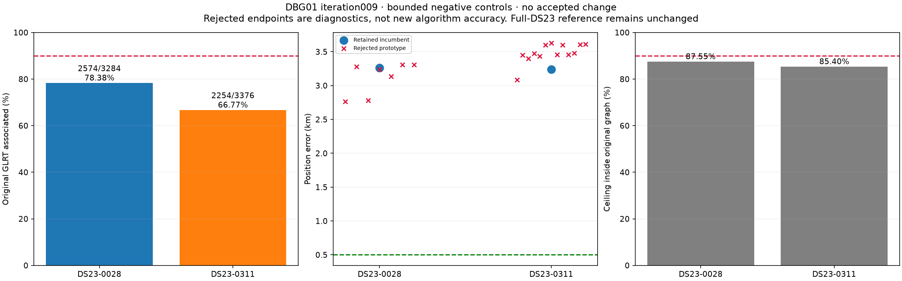

## Inputs, controls and accounting

New position fits start at east/north **[0,0]** within the original
**25×25 km box centered37.906,-122.545**. Evaluation GPS
**37.849061591561885,-122.48574968092912** ranks debug priorities and scores
frozen endpoints only. It never selects satellites, aliases, covariance
parameters, priors, masks or optimization starts. Inference uses causal
Space-Track elements whose epoch and collection precede the scan cutoff.
The available catalogue is Starlink-only; it is not a catalogue of all
possible orbital transmitters. Following elements are diagnostic-only.

Every controlled trial has matched **c=0 versus fitted-c** observations,
candidate identities, aliases, other priors and compute budgets. Existing
receiver/band offsets, linear drifts, smooth terms and orbital priors remain.
Ordinary recovery uses the existing five phase-refresh rounds of48 descent
iterations and its original bounded feasibility refinement. Covariance
trials use five rounds of48 iterations, identically in both c arms, with no
new nuisance coordinates. No RF collection, IQ reprocessing, stationary
history pooling or motion prototype is introduced.

Counts refer to unique original winning GLRT IDs. Polynomial drawing samples
are not observations. All trial data remain in the original denominator;
unaccepted points are not silently removed. Likelihood membership and
post-fit-only association are distinct.

| Scan | GLRT | Associated | % | Fragments | Points/fragment | Curved position points | Predictive position points | c=0 error km | Fitted-c error km |
| --- | ---: | ---: | ---: | ---: | ---: | ---: | ---: | ---: | ---: |
|0028 retained|3,284|2,574|78.38|83|31.01|2,115|459|3.264|3.264|
|0311 retained|3,376|2,254|66.77|69|32.67|1,937|293|3.344|3.240|

0028's2,574 associated observations all enter the position likelihood.
0311 uses2,230 observations in the likelihood; another24 are post-fit-only.
All rejected proposals fall back exactly to these incumbents. Their endpoint
errors in the prototype table are diagnostic results, not accepted accuracy.

| Scan | Unused in graph | Outside graph | Original graph points | Graph-only ceiling | Outside-graph points needed for90%, even with perfect graph recovery |
| --- | ---: | ---: | ---: | ---: | ---: |
|0028|301|409|2,875|87.55%|81|
|0311|629|493|2,883|85.40%|156|

Thus90% cannot come solely from relabeling the current graph. These ceilings
do not imply that all graph or outside-graph measurements are valid signal.

## Standard DBG01 figures:0028

Gray denotes **all original GLRT**, not unused points. Colored points in the
associated view denote satellite hypotheses. Red in the unused view denotes
unassociated GLRT; colored lines are graph polynomial fragments. Curves are
drawn in native CFO coordinates and break across native alias changes.

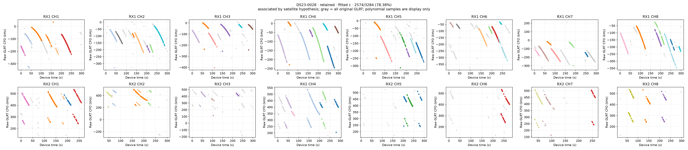
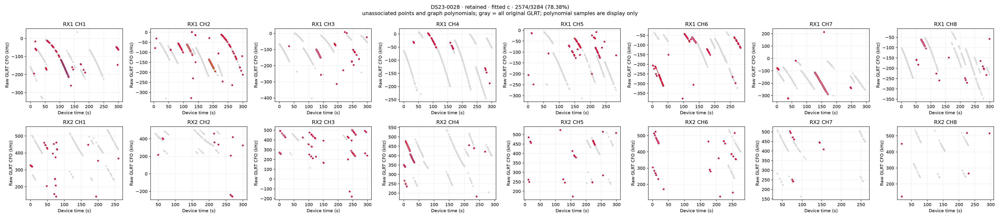
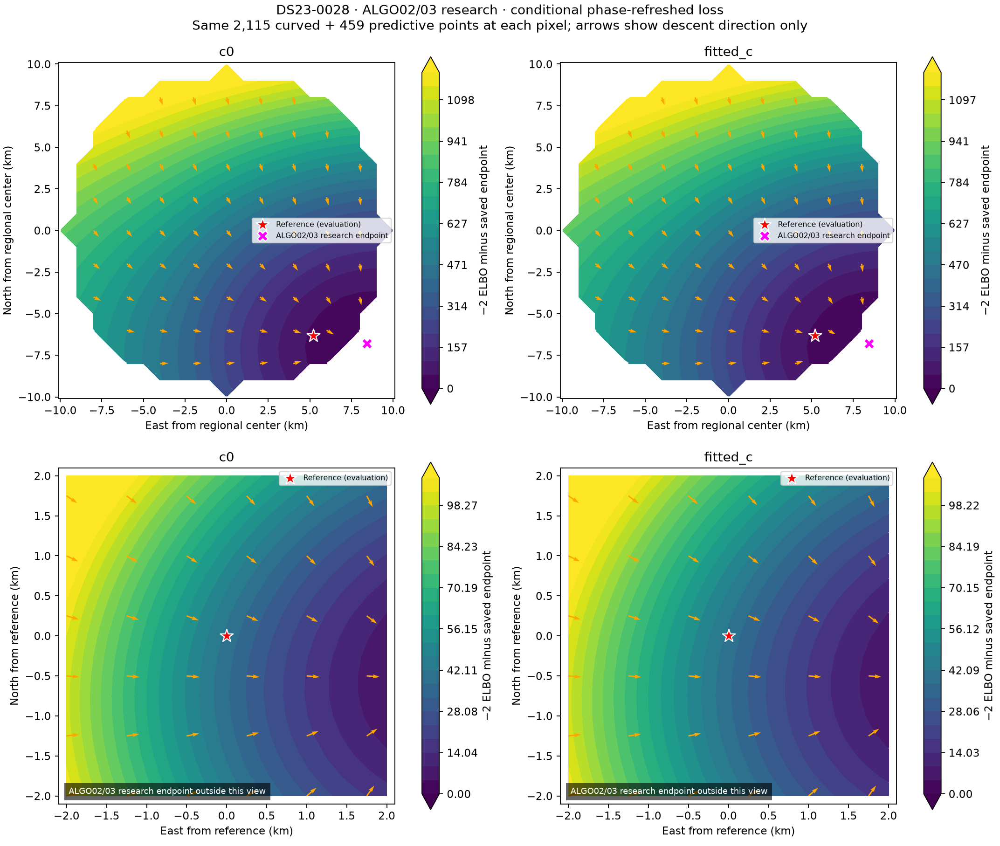
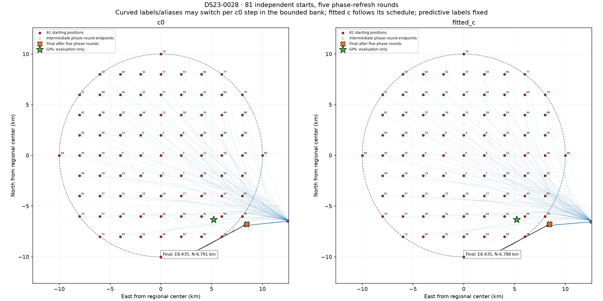
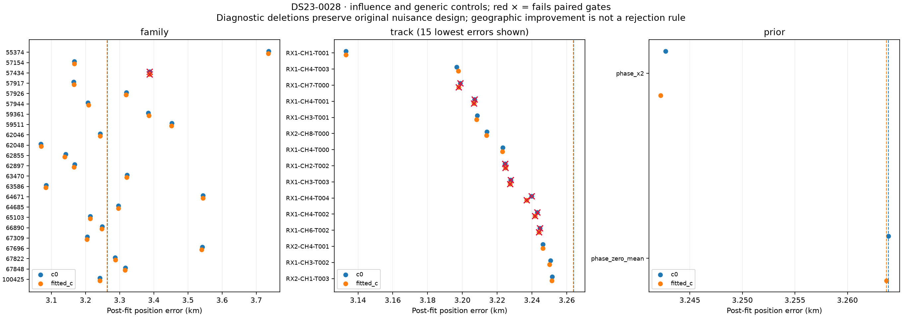
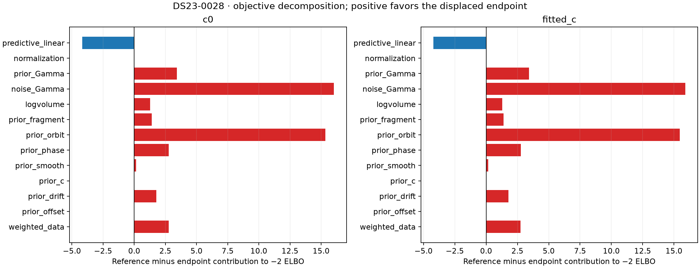
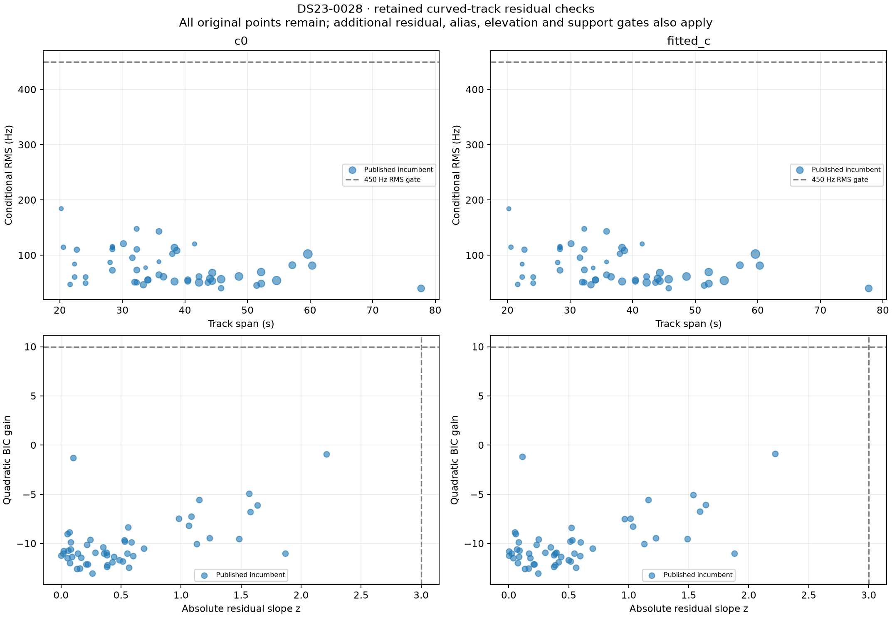

The surface evaluates the current likelihood with frozen labels, aliases
and observations, refitting nuisance terms and refreshing absolute phase
five times at each sampled position; it is not an acquisition-to-position
rerun at every pixel. The convergence figure instead starts the
phase-refreshed assignment search at81 positions. Its two panels are the
c arms. Curved labels/aliases may switch at accepted c=0 steps among the
bounded discovery bank; fitted c follows that branch schedule. Predictive
identities remain fixed. Thin lines connect recorded descent states.
Hollow purple diamonds are **intermediate phase-round endpoints**, which
can reach the regional boundary; orange X markers are final after all
five rounds. Those boundary excursions are not final converged positions.
The [per-round coordinates](tables/restart_phase_rounds.csv) preserve this
distinction. GPS is a display reference only.

An RF-only restart selector considers the saved assignment pool, requires
paired gates and phase convergence, and applies a **2 log(pool size)**
penalty before replacing the incumbent. Its best0028 gain is only
**0.00000490**, below the **2.77259** penalty. The0311 gain is also numerical
noise, about1e-8. Neither changes the result. More starts do not establish
a materially better RF minimum under the current search and model.

##0028: a plausible suffix is not automatically an admissible full track

The source is **RX1 CH1 T000**, RF10.9403125GHz,77 observations over
**52.54–130.27s**. Its persisted polynomial representation contains a cubic
piece through78.10s and a quartic from78.456s onward. The incumbent uses
the first51 observations. The unused26-point block runs from
**103.6584 to130.2734s**, inside the quartic piece; this mask boundary is
not a persisted polynomial break.

The usual extension skips already accepted source keys. Whole-track
nomination also correctly refuses a source containing active calibration
observations. This leaves a genuine partial-mask recovery gap. The explicit
suffix diagnostic uses only the unused26 original IDs, confirms they are
disjoint from active calibration, and searches the causal catalogue at the
fixed incumbent endpoint. Curved-calibration uncertainty is retained.
The best hypothesis is the existing **57434**, conditional RMS **65.90Hz**.
The next is53394 at157.39Hz; its fixed-radio residual has substantial
quadratic structure and autocorrelation. These are conditional hypotheses,
not externally verified satellite identities.

At the **frozen fitted-c incumbent mean**, prefix and suffix separately
pass the original residual checks. The complete77 observations do not:
their lag-one correlation is about**0.621**, above**4/sqrt(77)=0.456**.
The different outcomes follow partly from the sample-count-dependent gate;
they are not evidence that splitting an otherwise continuous component
creates independent noise. The complete checks are in
[the frozen-mask table](tables/partial_mask_frozen_checks.csv).

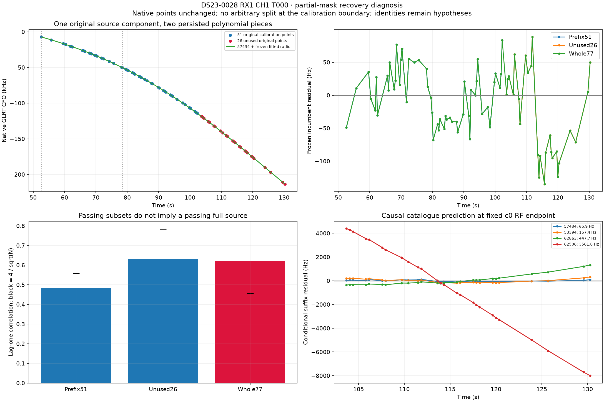

The restoration prototype changes only the calibration mask: use the full
77 observations with the original satellite, aliases, powers, means, noise
model and parameter definitions. The unused subset independently satisfies
the existing raw-curvature rule. Every old likelihood observation survives.
After refitting, target RMS is about**50.89Hz**, with acceptable mean,
slope, quadratic and step statistics. Its **ACF0.53668 still exceeds0.45584**.
Both c arms reject. The roughly3.13km endpoint cannot be counted as an
improvement because the scientific gates fail. No new fragment is invented
at103.658s merely to relax the effective correlation threshold.

## A noise-model explanation was testable, but did not rescue the location

An RF-only covariance prototype pools polynomial residual contrasts from
**other graph components on the same receiver**, excluding all77 target IDs
from the new shape and amplitude estimation. Native heteroscedastic sigma
and weighted polynomial contrasts are retained. The model is
`K=(1-alpha)I+alpha exp(-abs(t_i-t_j)/tau)`.

The fixed grid has alpha in0.1,0.3,0.6,0.9 and tau in1,3,10,30,100s.
At least10 training pieces and a gain over2log(contrast dimensions) are
required. Sixty pieces with1,738 contrasts choose **alpha0.9,tau30s**:
REML gain**242.35** versus penalty**14.92**. Target polynomial contrasts
have positive gain**5.97**, meeting the predeclared shape-validation rule.
The primary variance multiplier is learned only from other components:
**sigma scale2.42323**. A shape-only control keeps scale1.

This target exclusion applies to the **new** covariance estimation. The
inherited native-sigma estimator may already use RF from the target, so
this is not a fully independent noise validation. The REML score is a
contrast-model diagnostic, not a calibrated identity probability. The
positive target gain is a weak qualification, not new-location validation.

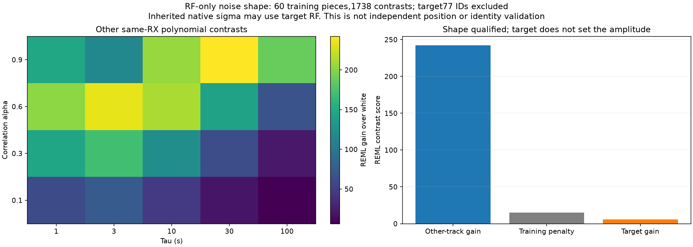

Only the target's curved-noise block changes. Other curved blocks, old
predictive observations, Student/Gamma priors, powers and parameter
dimensions retain their definitions. Predictive density uses the exact
changed curved posterior precision and joint covariance. Its direct SVD
replay passes; predictive evidence does not recalibrate curved coefficients
at fixed position. The alpha0/scale1 implementation reproduces the original
white model in both c arms and both masks: objective differences below
7e-10 and coefficient differences below1.13e-10.

The covariance-aware criterion explicitly changes stochastic checks for
the target to whitened innovations. It retains raw RMS, bias, aliases,
visibility, mean, slope, quadratic and step guards, as well as all original
checks for other tracks. Thresholds are not tuned to admit this example.

| Restored77 trial | c=0 error km | Fitted-c error km | Overall fitted-c RMS Hz | Target fitted-c raw slope z | Raw step z | White ACF | Decision |
| --- | ---: | ---: | ---: | ---: | ---: | ---: | --- |
|Shape only|3.306271|3.306314|79.6833|4.7915|5.5447|0.03183|Reject|
|Other-track scale, primary|3.306481|3.306560|79.7038|4.8642|5.6185|0.03222|Reject|

Whitening removes the ACF signal, but raw slope must be≤3 and raw step≤4.
Both fail. The slightly lower RMS than the *white restored-mask trial*
does not yield better location; comparison to the51-point-prefix baseline
would additionally change the observations. At these rejected endpoints,
the incompatible source is not an associated77-point gain. There is no
accepted coverage increase or full-population run of this covariance model.

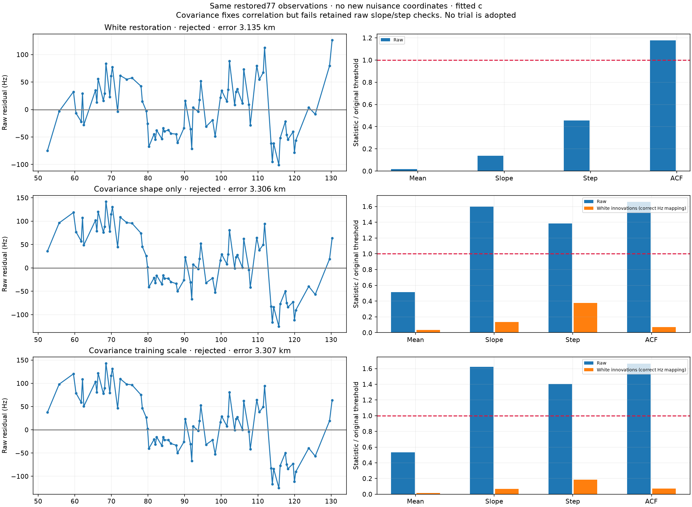

A diagnostic implementation error was caught before acceptance or
publication: `batch_noise_screen` has a75Hz noise floor, while whitened
innovations are dimensionless. Feeding them directly to that function
understates standardized mean/slope statistics. The corrected screen maps
innovations to75Hz, equivalent to a unit normalized floor. V2 replays each
saved objective within1e-5 and does **not** rerun or alter positions. The
positions and objectives in V1 remain valid; its innovation statistics are
invalid. Both trials reject under the corrected V2 gates. V1 sources/results
are preserved in the evidence archives; only corrected V2 checks appear
in published tables and figures. A dedicated mean-offset unit test detects
this dimensional error.

##0311: additional point-rich curve searches still fail residual structure

The three default wholly unused curved nominees are:

| Source | Points | Span s | Causal hypothesis | Default fitted-c conditional RMS Hz | Quadratic BIC gain | Lag-one ACF |
| --- | ---: | ---: | ---: | ---: | ---: | ---: |
|RX1 CH7 T001|36|44.03|66506|129.5|10.190|See complete gate table|
|RX1 CH3 T001|29|44.01|66865|287.4|11.522|0.879|
|RX1 CH2 T000|18|36.20|64207|281.1|25.454|0.833|

All seven nonempty unions fail. These curves mostly fail structure checks,
not the450Hz RMS ceiling. The first's quadratic statistic is close to the
10 threshold; that does not justify tuning the threshold around one case.

The existing support-only control fits two eligible proposals: the29-point
66865 curve and its47-point union with64207. Both reject. A same-budget
ordering change sorts eligible proposals by number of additions, descending
original point count, then component key; it reuses identical old fits and
tests a65-point union. Both trials reject. The36-point66506 source is
already part of an active protected family, so it is **not** eligible for
the one-owner orbital-simplification mechanism. The ordering experiment
does not claim to simplify that protected family.

A separate bounded search examines the most point-rich unused actively
curved source outside the three longest-span targets. In0311 this is
**RX1 CH1 T002:47 points over34.43s**, nominating66865. Both its single fit
and76-point union with the29-point same-family nominee reject. In0028
there is no additional eligible whole curve and no eligible point-priority
support proposal. An empty search is reported as empty, not as a successful
recovery. There is no qualifying partially used curved block in0311.

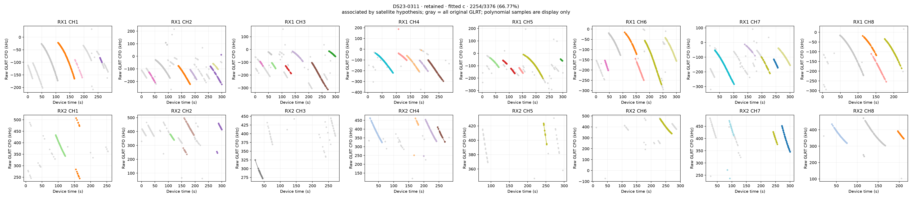
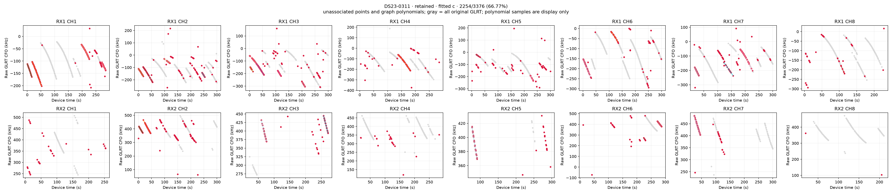
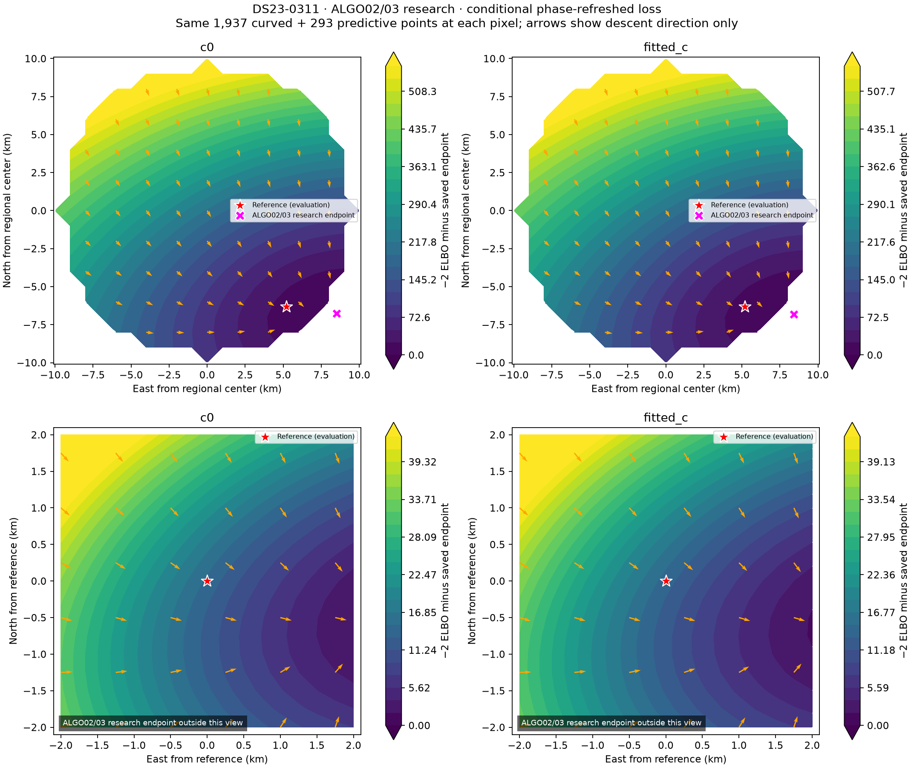
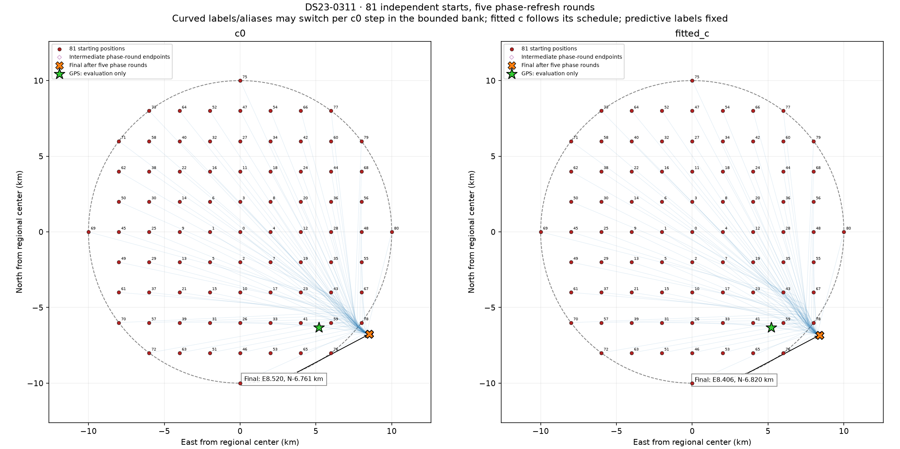
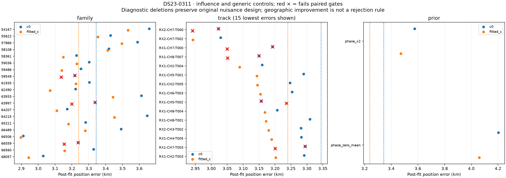
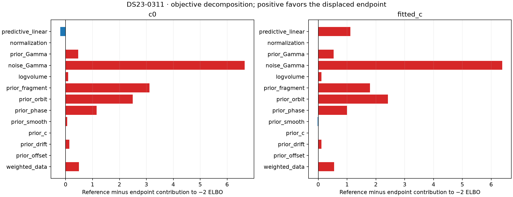
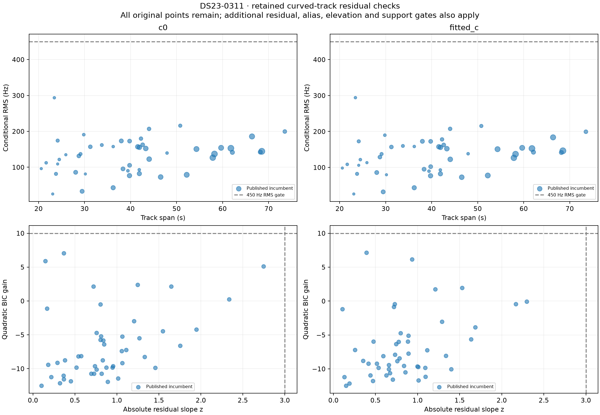

## TLE diagnostics: later elements do not solve these examples

Matched phase-only following-element diagnostics use the same frozen c=0
endpoint and causal receiver posterior. Both element epoch and collection
must be after the scan, within48h. They never nominate inference identities,
update a position, set priors or admit a point.

For0028's partial suffix,57434 changes only **62.22→62.69Hz** causal to
following phase-only RMS. This is a different restricted model from the
65.90Hz physical-mode predictive nomination above; those two RMS values
must not be interpreted as a TLE comparison. The alternate53394 gives
about3.52→3.56kHz under the restricted phase-only model, inconsistent with
the better nomination that allowed physical modes. More orbit freedom can
make an alternate identity look plausible; phase-only diagnostics alone
also do not prove identity.

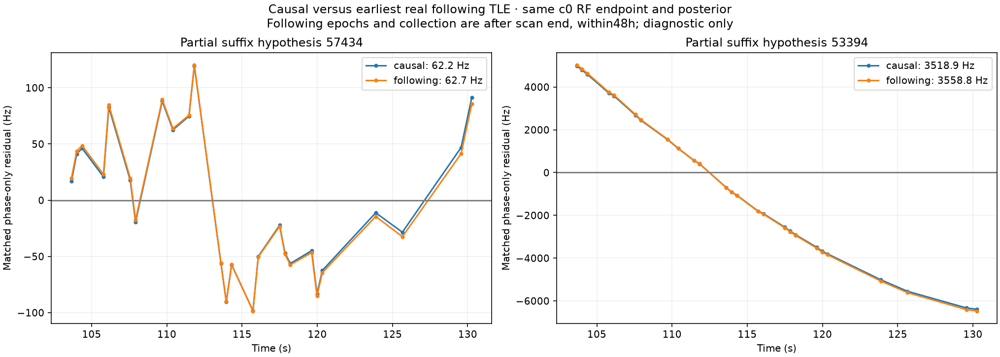

The three longest wholly unused graph components, including linear tracks,
are checked separately. Best-hypothesis causal/following conditional RMS:

| Scan/source | Hypothesis | Causal Hz | Following Hz |
| --- | ---: | ---: | ---: |
|0028 RX1 CH7 T002|62863|78.80|87.23|
|0028 RX1 CH6 T004|55284|1433.70|1431.11|
|0028 RX1 CH2 T005|57909|45.85|42.72|
|0311 RX1 CH7 T001|66506|125.19|133.06|
|0311 RX1 CH3 T001|66865|262.58|262.12|
|0311 RX1 CH2 T000|64207|185.30|185.66|

A small RMS on an isolated linear fragment does not independently constrain
offset or identity. These following elements make only small changes and
do not establish that causal TLE age explains the missing associations.
Alternative top-three hypotheses, raw CFO, graph fits and residual arrays
are preserved. Neither following-element nor evaluation-GPS results choose
an algorithm policy.

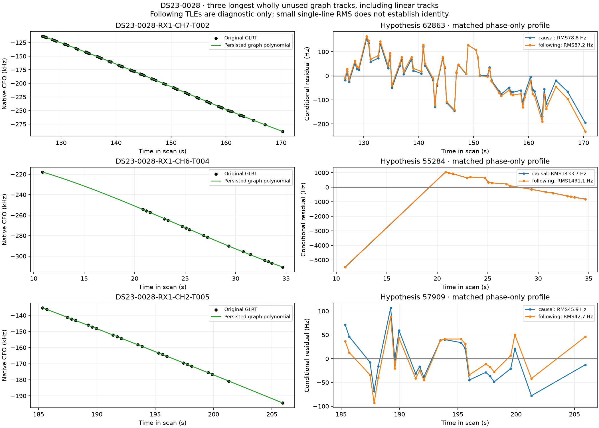
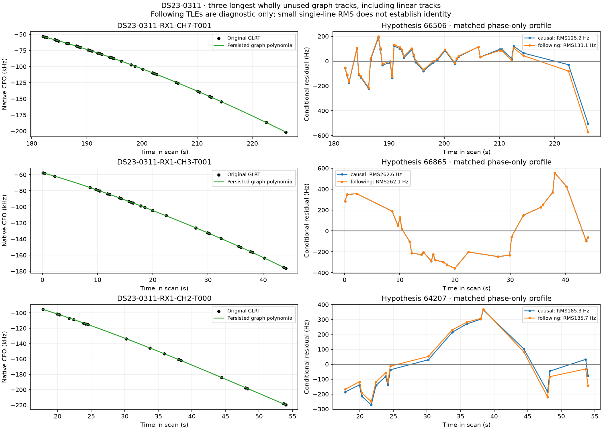

## Family ablations, uncertainty and limits

All active families and retained curved tracks receive the standard DBG01
deletion diagnostics, with both c arms and the same regional budget.
[Family ablations](tables/family_ablations.csv) include numerical objective
replays, removed points, paired qualification, RMS, error and the remaining
GLRT membership. [All interventions](tables/all_interventions.csv) additionally
record individual-track and phase-prior sensitivity controls. The influence
figures above compare these with the incumbent. GPS-ranked deletion gains
are diagnostic only: a better error after deleting a family is not proof of
misassociation, and no family is dropped because it improves GPS error.

For0028, even the GPS-best single-family deletion,62048, leaves **3.070km**
error while discarding151 curved observations and reducing association to
73.78%. For0311, deleting66506 leaves **2.897km**, removes286 curved plus39
predictive observations, and reduces associated coverage to58.23%. Neither
single deletion approaches0.5km. This bounded evidence does not support
one catastrophic family as a sufficient explanation for either scan;
multiple coupled errors or model uncertainty remain possible.

The surfaces, common restart endpoints and structured rejected curves show
that merely using more points or starts is insufficient under the current
model. They do **not** establish the unique cause of the remaining bias.
Unmodeled receiver behavior, orbital uncertainty, correlated RF noise and
identity ambiguity remain possible. This batch has no independently
qualified physical correction that distinguishes them. A covariance model
that improves RF contrast score still can move position poorly or fail raw
deterministic checks. The wider model should be tested on new queue cases
before returning to0028/0311 with another variant.

## Execution repair and reproducibility

The first0028 whole-track nomination accidentally received a partially
used source from the general unused-point inventory. The nomination helper
correctly refused it. Its worker receipt indicated failure, while the outer
command returned zero; a dependent stage then failed. The original process
**98695 terminated unsuccessfully**. Its artifacts remain intact, including
the nonterminal-looking original batch JSON. They are not final results.

The repair filters only the whole-track nomination input to wholly unused,
inactive source components. It retains partial data in the inventory and
adds an explicit partial-mask diagnostic instead. It proves0311's target
list is unchanged and reuses its original nomination/position files
byte-for-byte. Only0028's failed stages are recomputed. Subsequent stages
check scientific pass receipts, not just shell exit codes. The repaired
process**18168** completed; [the resume record](evidence/batch_resume_execution.json)
is authoritative. Independent checks pass for **626 endpoint arms and36
nominee-density checks**. New component-owned tests: **18 passed**.

Reproduction uses the existing research environment and corpus, not a
standalone deployment bundle. The runner and repair source explain the
stage sequence. Additional bounded scripts have frozen protocols, native
ID masks and hashes; source snapshots are in[source/tools](source/tools)
and[source/tests](source/tests). To regenerate assets in that environment:

```bash
env PYTHONDONTWRITEBYTECODE=1 \
 PYTHONPATH=/tmp/algo03-feasible-deps:src:tools \
 OPENBLAS_NUM_THREADS=1 OMP_NUM_THREADS=1 \
 .venv/bin/python -B tools/report_ds23_dbg01_iteration_009.py
```

The report includes21 scientific figures and10 CSV tables. Raw JSON/CSV/Python
records are split into five compressed archives under[evidence](evidence),
including original failures, repaired results, every trial, full DBG01
surfaces/restarts/ablations, causal/following profiles, noise selection,
implementation nulls and V1/V2 unit correction. Large radio inputs remain
outside Git. The[source hash manifest](evidence/source_hashes.json) records
the published analysis source snapshots.

Useful machine-readable tables:

- [Retained position and GLRT accounting](tables/position_and_association.csv)
- [All prototype endpoints, including rejected trials](tables/prototype_trials.csv)
- [Every trial's per-source gates](tables/prototype_track_gates.csv)
- [Retained-track residual distributions](tables/residual_diagnostics.csv)
- [Whole-track following-element diagnostics](tables/following_TLE_profiles.csv)
- [Partial-tail following-element diagnostics](tables/partial_tail_following_TLE.csv)

**Decision:** retain the full-DS23 incumbent, publish this negative iteration,
and continue with0080/0257. No new ALGO number, forced90% membership or
location-specific correction is introduced.
