# Iteration011 figure inventory

All figures describe frozen results; GPS appears only for evaluation.

## DS23-0163 convergence 10km

## DS23-0163 default graph associated GLRT

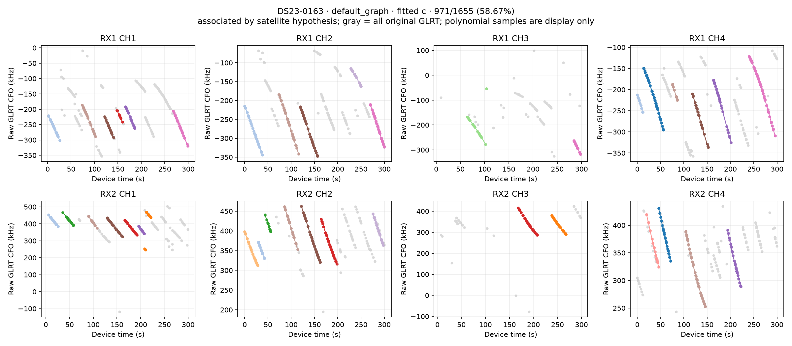

## DS23-0163 default graph unassociated GLRT

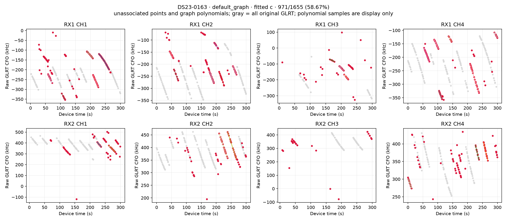

## DS23-0163 default temporal policy associated GLRT

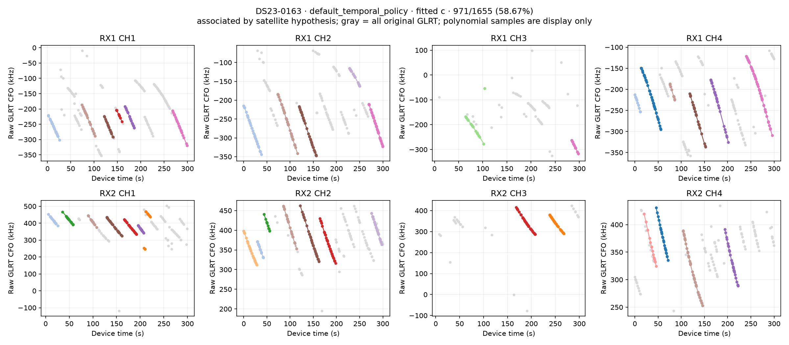

## DS23-0163 default temporal policy unassociated GLRT

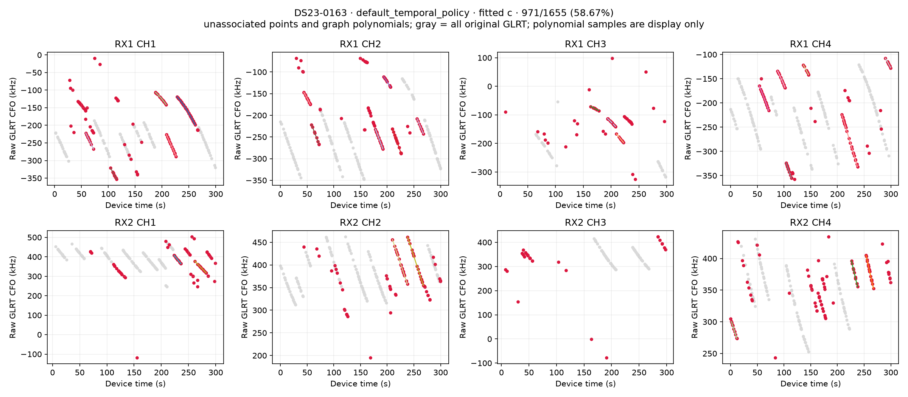

## DS23-0163 incumbent associated GLRT

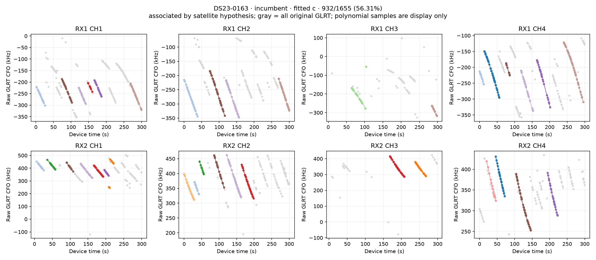

## DS23-0163 incumbent unassociated GLRT

## DS23-0163 independent paths 1

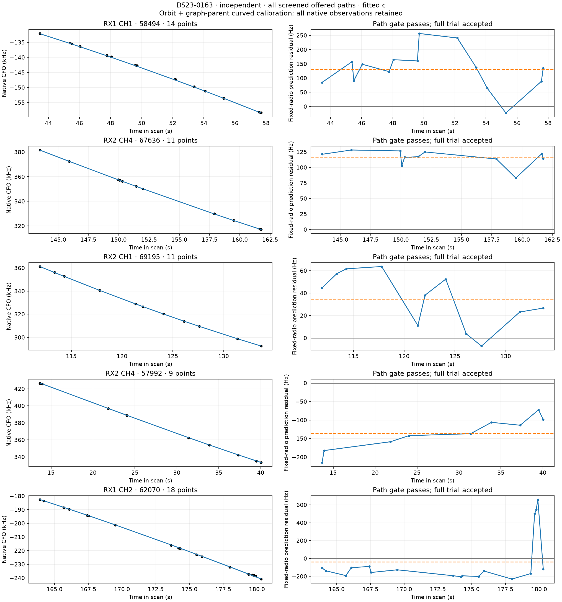

## DS23-0163 influence and controls

## DS23-0163 loss decomposition

## DS23-0163 loss gradient 10km

## DS23-0163 persistent5s paths 1

## DS23-0163 rf-parent temporal policy associated GLRT

## DS23-0163 rf-parent temporal policy unassociated GLRT

## DS23-0163 rf graph parent associated GLRT

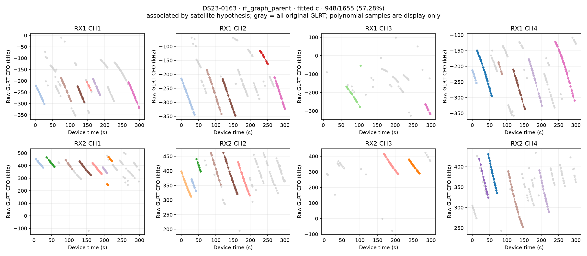

## DS23-0163 rf graph parent unassociated GLRT

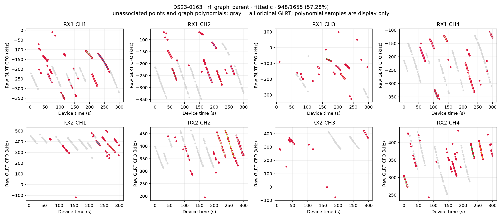

## DS23-0163 shared curvature

## DS23-0163 temporal policy associated GLRT

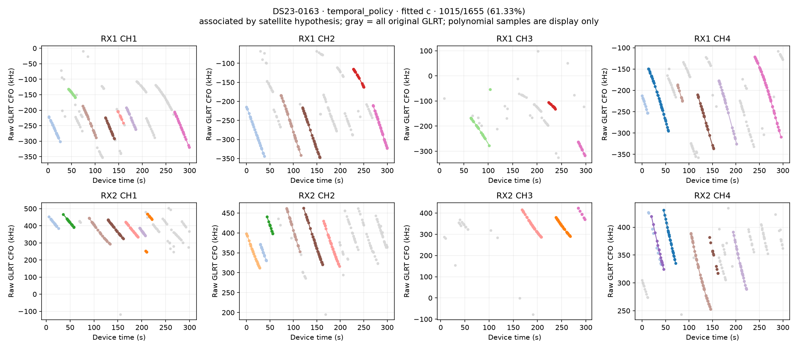

## DS23-0163 temporal policy unassociated GLRT

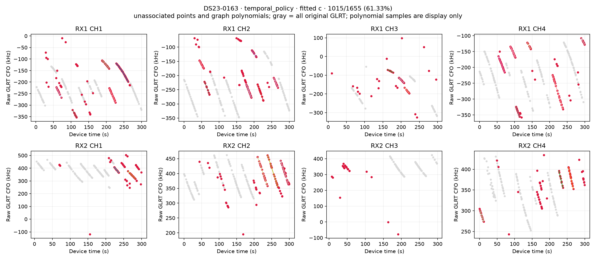

## DS23-0163 track residuals

## DS23-0163 unused track TLE diagnostics

## DS23-0209 convergence 10km

## DS23-0209 default graph associated GLRT

## DS23-0209 default graph unassociated GLRT

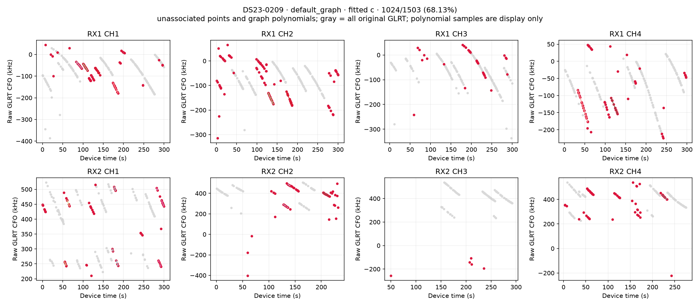

## DS23-0209 default temporal policy associated GLRT

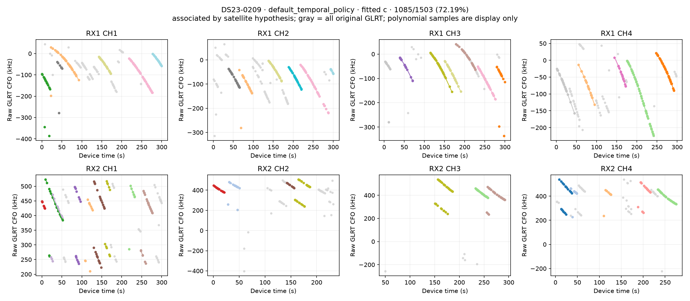

## DS23-0209 default temporal policy unassociated GLRT

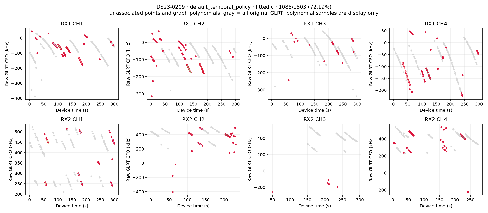

## DS23-0209 incumbent associated GLRT

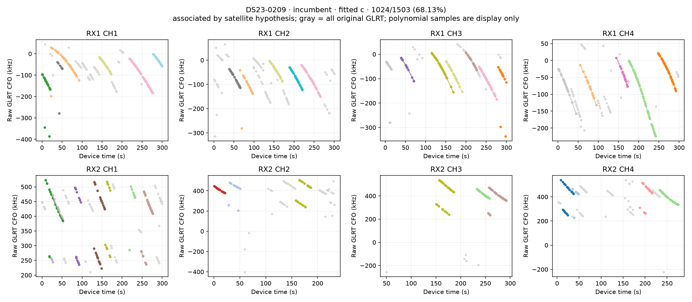

## DS23-0209 incumbent unassociated GLRT

## DS23-0209 independent paths 1

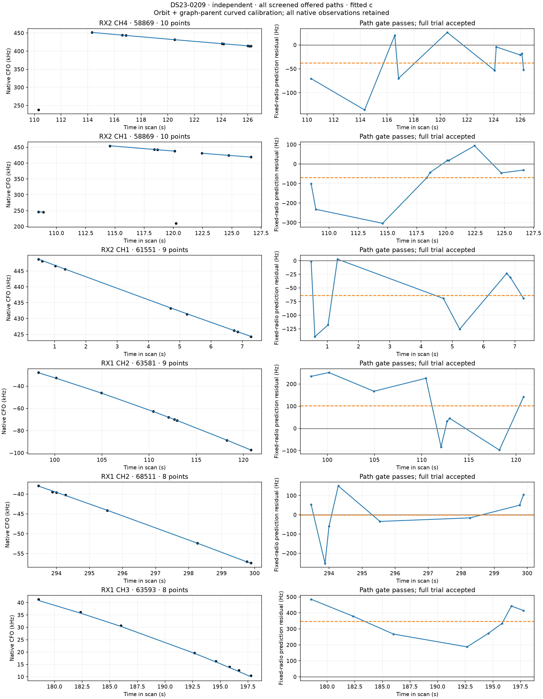

## DS23-0209 independent paths 2

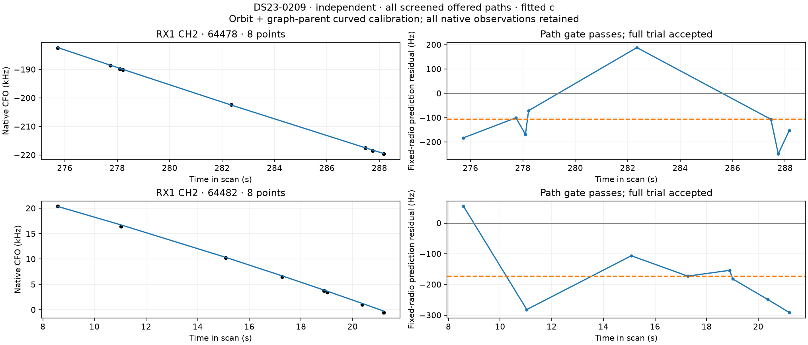

## DS23-0209 influence and controls

## DS23-0209 loss decomposition

## DS23-0209 loss gradient 10km

## DS23-0209 persistent5s paths 1

## DS23-0209 persistent5s paths 2

## DS23-0209 rf-parent temporal policy associated GLRT

## DS23-0209 rf-parent temporal policy unassociated GLRT

## DS23-0209 rf graph parent associated GLRT

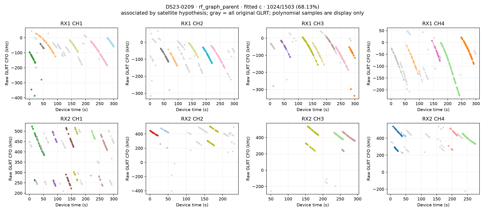

## DS23-0209 rf graph parent unassociated GLRT

## DS23-0209 temporal policy associated GLRT

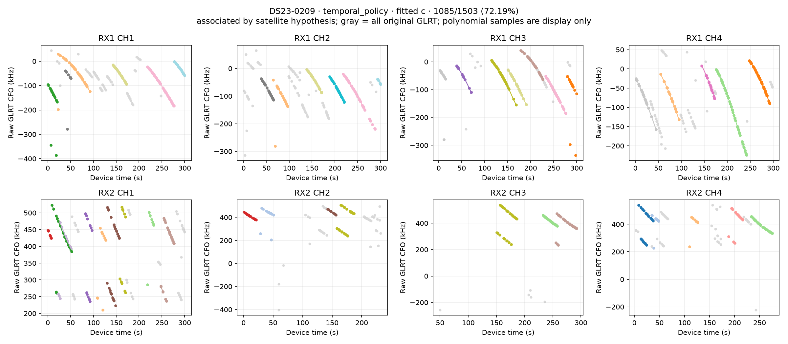

## DS23-0209 temporal policy unassociated GLRT

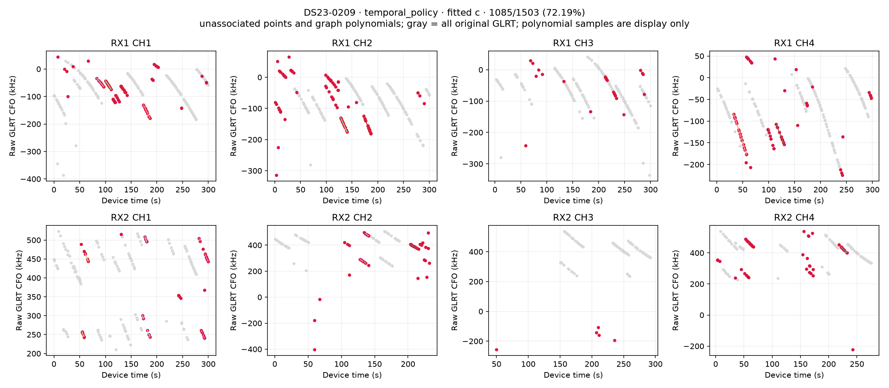

## DS23-0209 track residuals

## DS23-0209 unused track TLE diagnostics

## full DS23 RF gain comparison

## full DS23 by scan

## full DS23 paired guard summary

## full DS23 temporal uncertainty

## iteration summary

