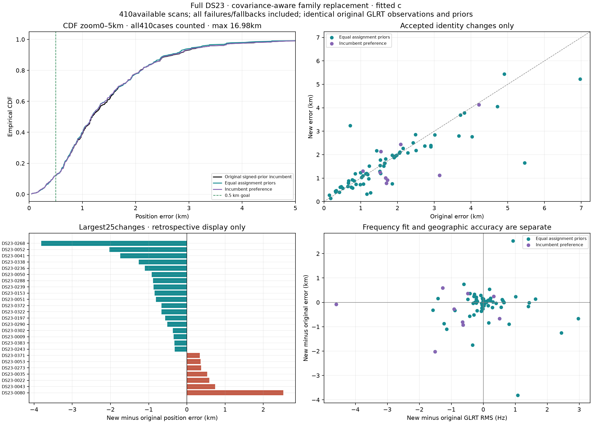
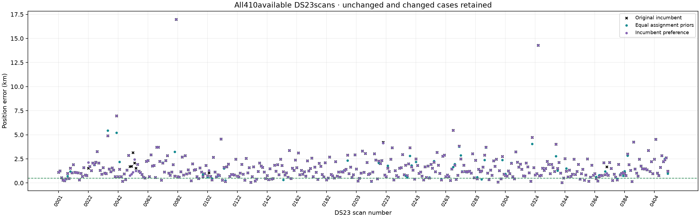
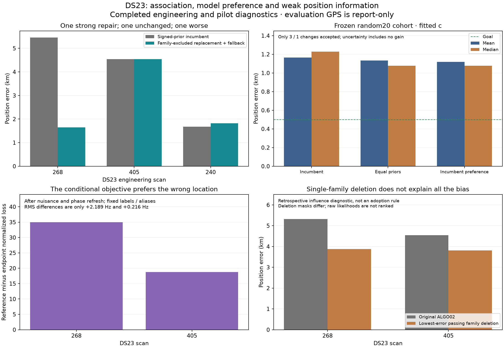

# DS23: modest progress from family-excluded satellite replacement

Family replacement reduces full-DS23 fitted-c mean error **1.498→1.469 km**
and median **1.185→1.178 km**, with gains in both recording formats. The gain
is small and some cases become worse. This is a research result, with production
defaults unchanged. The **0.5 km mean-and-median goal remains unmet**.



## Matched results and coverage

All **410 available scans** are included, out of 413 dataset members. Scans
0012, 0184 and 0286 remain unavailable, as in the original benchmark. No original
curved or predictive point is dropped. Each replacement starts at [0,0] in the
same 25 × 25 km box centered at **37.906, -122.545**. Evaluation GPS
37.849061591561885, -122.48574968092912 is accessed only after inference and audit.
TLEs are causal; no new RF collection is used.

| Method | c arm | Mean km | Median km | Changed scans |
| --- | --- | ---: | ---: | ---: |
| Signed-prior incumbent | 0 | 1.508507 | 1.249985 | 0 |
| Replacement, equal identity priors | 0 | **1.479378** | **1.190706** | 74 |
| Replacement, incumbent preference | 0 | 1.498232 | 1.208241 | 9 |
| Signed-prior incumbent | fitted | 1.498002 | 1.185452 | 0 |
| Replacement, equal identity priors | fitted | **1.469461** | **1.178102** | 74 |
| Replacement, incumbent preference | fitted | 1.489249 | 1.169162 | 9 |

Equal-prior fitted-c results improve **40** scans, worsen **34**, and leave
336 unchanged. The count within 0.5 km stays **48/410**. Worst error remains
16.980 km; the 90th percentile improves 2.705→2.620 km. Mean GLRT RMS changes
only -0.0038 Hz across the population. Association percentage is unchanged:
this experiment replaces identities while preserving the observation masks.

| Format, fitted c, equal priors | Scans | Original mean/median km | New mean/median km |
| --- | ---: | --- | --- |
| Fast | 204 | 1.260397 / 1.045913 | 1.240377 / 1.031316 |
| Adaptive | 206 | 1.733301 / 1.390638 | 1.696320 / 1.333925 |

On the **387 scans outside the current engineering three and random20 pilot**,
fitted-c mean/median change 1.496581/1.184553→1.477521/1.171652 km, with 38
improved and 31 worsened. Older methods inspected these scans and they all
belong to the same site. This is not an untouched or new-location validation.



## Algorithm

1. Start from the frozen signed-prior curved/predictive assignments. Hold every
   curved observation of one active family out of calibration. Refresh the
   other families' phases five times at the saved blind RF position. Linear
   observations remain predictive evidence and never calibrate nuisance terms.
2. Jointly predict the held family's curved and linear observations using the
   correlated calibration covariance, one candidate phase, supported physical
   orbit modes and 300 Hz fragment constants. Proposal-only unseen Student
   phases are moment-matched Gaussian; held curved noise is
   `point_noise × sqrt(2/power)`. Final fitting restores the original model.
3. Screen the entire causal catalogue, with per-fragment integer aliases of
   period `1 / 4.4e-6 Hz`. Refine the original identity and seven alternatives,
   through five phase refreshes within ±15 seconds, requiring nonnegative
   elevation. Previously unsupported candidate orbit modes require at least
   two held curved receiver/channel owners; existing modes keep their definition.
4. Test up to four positive predictive-gain whole-family replacements, plus the
   leading independent two-family combination. Relabel all members and linear
   entries of an explicit replacement. Other labels, aliases, masks and powers
   stay fixed. Every original point returns to the final likelihood.
5. Restore the original Gamma, Student, hardware, fragment and physical orbit
   priors. Fit both c arms from the regional center, using five phase rounds and
   48 position steps per round. The existing constrained rescue requires
   normalized slack ≥-0.25, and uses five rounds, 40 steps and 0.01 interior.
6. Require both arms to pass all original curved/predictive gates and final
   phase change ≤0.01 s. Rank by normalized c=0 RF evidence. Equal-prior adoption
   requires positive gain; the control adds `2 log(catalogue size × active family
   count)` as incumbent preference. Remove an unused Student coordinate's
   variational gap only when no curved or predictive point depends on it.

**Limitation:** nomination conditions on an existing position that was itself
estimated using the disputed family. Calibration is held out conditional on
that position, but position uncertainty is not integrated. This is not a fully
independent held-family validation. Final hypotheses do receive regional cold fits.

The adoption controls were recorded before their new geographic outcomes.
Engineering/pilot numerical results were reused identically in the full run.
Execution used 30 processes, one BLAS thread each, with 360 s nomination and
540 s paired-position caps. All 410 case jobs completed after recorded repairs.

## What the difficult scans reveal



- **268:** all 81 earlier starts reached the same displaced, gate-passing basin.
  The new 53923→67953 hypothesis passes both c arms and reduces error
  **5.461→1.649 km**, while RMS rises 138.454→139.533 Hz. It supports further
  identity/calibration investigation, without independently proving the ID.
  Earlier targeted 0.943 km repairs also recovered more observations, so their
  advantage cannot be attributed to splitting alone.
- **405:** the tested replacements still fail original gates; the 4.544 km
  incumbent remains. Two unresolved RX1 curves separately nominate 66465.
  Their independent phases do not yet establish one shared family. Its old
  -0.373 s value is a forecast prior, with no retained curved or predictive support.
- **80:** error worsens **0.712→3.236 km** despite passing gates. This is a
  necessary negative control for the next prototype, not a GPS-selected exclusion.

Earlier single-family deletions left at least 3.880/3.809 km error on 268/405
among passing deletions. The longest unresolved curves each contain one persisted
polynomial piece; a multi-piece join has not been demonstrated as their cause.
At the reference position, refreshed conditional losses are worse by about
35.0/18.8 while RMS differs only 2.189/0.216 Hz. This reveals model preference
and weak separation of position from nuisance terms, without isolating one
receiver, satellite or defective prior.

## Uncertainty

Scan-resampling gives fitted-c mean-change interval [-0.0600, -0.0013] km;
the median-change interval includes zero. A post-evaluation sensitivity analysis
resamples whole occupied UTC blocks, without changing any fit or selection:

| Block duration | Occupied blocks | Fitted-c mean-change 95% interval km |
| --- | ---: | --- |
| 1 hour | 107 | [-0.0629, +0.0024] |
| 3 hours | 37 | [-0.0605, +0.0012] |
| 6 hours | 19 | [-0.0611, +0.0026] |

All three corresponding c=0 mean intervals exclude zero. The fitted-c gain
remains provisional under temporal dependence. These intervals do not account
for the full history of development on DS23. The random20 pilot had the same
direction, 1.166/1.229→1.133/1.076 km, but only three accepted changes and two
harms. No claim of robust new-location generalization follows.

## Recommended next experiments

1. **Joint position/calibration family cavities.** Infer a region-wide position
   distribution from the other families, and carry position/calibration
   cross-covariance or several regional modes into held-family nomination.
2. **Automatic family partitioning.** Compare whole-family replacement with
   coherent receiver/channel/time partitions, keeping the exact same points
   and explicit complexity priors. Share phase/orbit terms per satellite.
3. **Refresh competing identities during descent.** Keep unresolved and competing
   hypotheses, updating their support as position moves. An EM-like proposal
   loop is worth testing; every final mode still needs exact gate checks.
4. **Recover independent curved information.** Test coherent 66465 reentry on
   405 and cross-receiver prediction. Compare whether discrepancies follow a
   receiver/band or satellite/channel. Use nuisance-eliminated position
   information alongside counts and RMS.

The publisher abstract of [Mind the Beam](https://www.ion.org/publications/abstract.cfm?articleID=20898)
reports channel-dependent CFO behavior and synchronized channel clusters within
a satellite. This motivates structured tests, without establishing that cause
in DS23. Earlier receiver-clock/carrier-flexibility controls have not supplied
a general fix. A recent [multi-position nomination preprint](https://arxiv.org/abs/2610.01021)
also motivates regional nomination; its results do not validate this pipeline.

## Reproduction and numerical audit

The [source capsule](source/) contains the new tools, repair helper and tests.
It requires the existing frozen ALGO02 research environment and local inputs;
it is not a standalone replacement pipeline. Restore `source/tools/` and
`source/tests/` to their corresponding workspace paths before running commands.
The figure helpers retain their original report-directory layout. Use the workspace venv,
`PYTHONPATH=/tmp/algo03-feasible-deps:src:tools` and one BLAS/OMP thread:

```sh
.venv/bin/python tools/run_ds23_family_cavity_full.py --stage nominations
.venv/bin/python tools/run_ds23_family_cavity_full.py --stage positions
.venv/bin/python tools/report_ds23_family_cavity.py --directory reports/2026_10_22_ds23_family_cavity/phase_refreshed/full_DS23 --workers 30
.venv/bin/python tools/plot_ds23_family_cavity_full.py
```

Repairs addressed missing earlier TLEs on 0130/0260, preserving the existing
unavailable-history prior, and actual final linearization references on legacy
0074/0365 fallbacks, preserving their objectives and endpoints. Original failed
files remain archived. Raw multi-gigabyte results stay local; hashes are recorded.

All **410 nomination and 410 position audits pass**: current catalogue causal
epoch/collection, held calibration separation, normalized density, dense/SVD
predictive covariance, exact phase geometry, independent finite orbit derivatives
and original residual gates. A too-large finite-difference audit step was
replaced by a converged Richardson reference, with unchanged inference and
residual tolerance. The large-basis candidate exposing it was not selected.
**19 focused tests pass**; golden fixtures remain unchanged.

[Per-scan results](tables/positions.csv) · [Matched summary](tables/compact_summary.csv) ·
[Temporal sensitivity](evidence/temporal_block_sensitivity.json) ·
[Compact audit and source hashes](evidence/publication_receipt.json).
