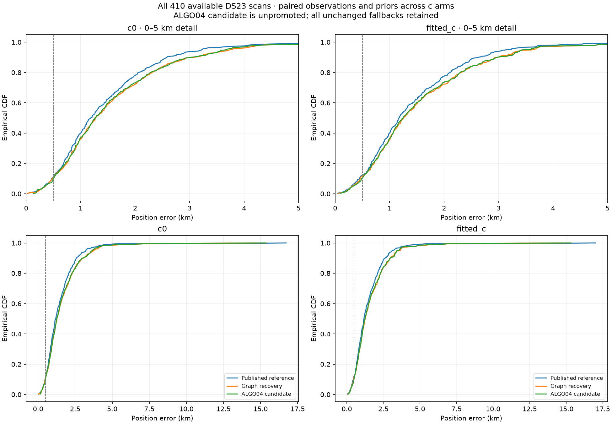
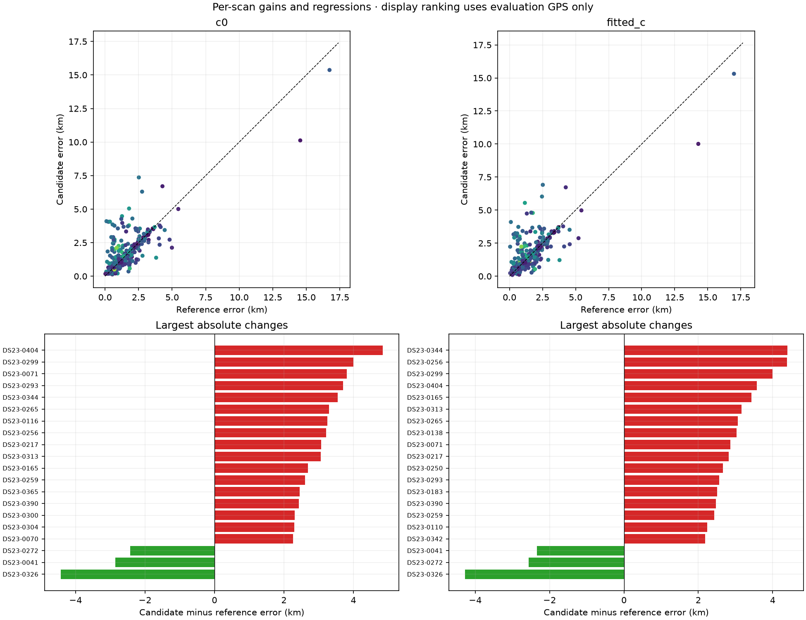
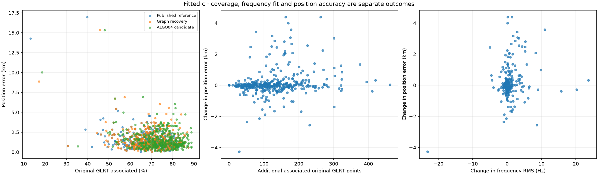
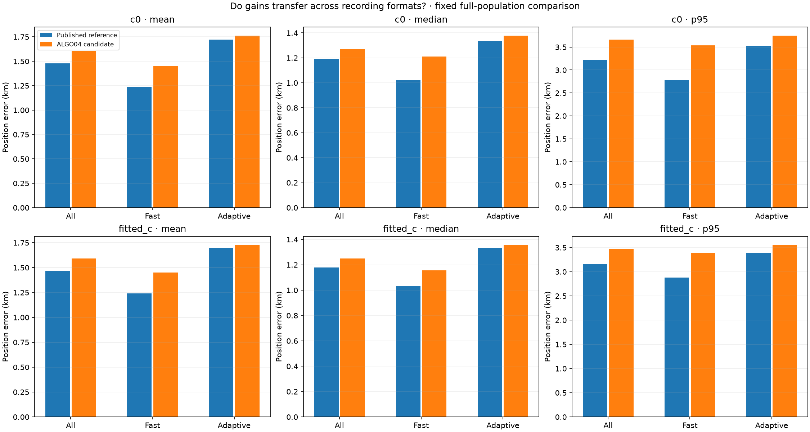
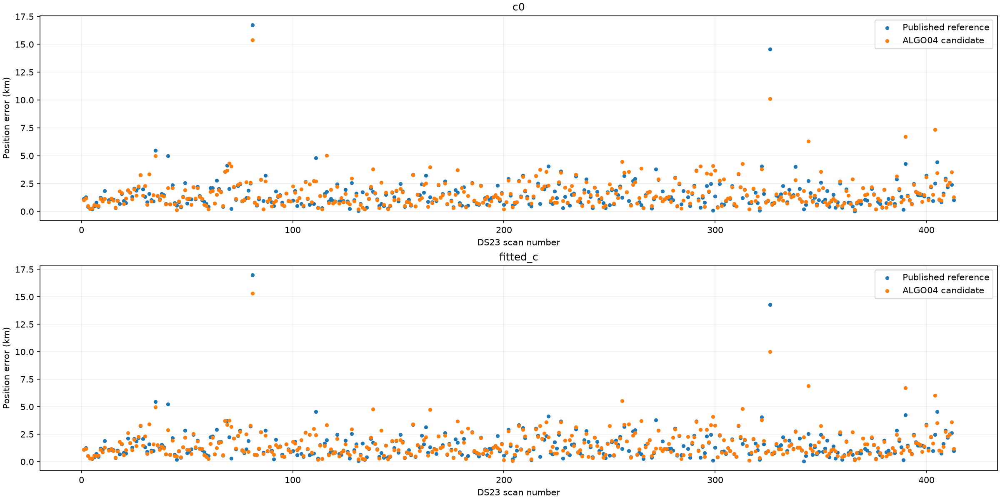

# ALGO04 candidate: full DS23 promotion assessment

**This is a frozen candidate evaluation, not an ALGO04 release.** The reference remains the published ALGO02/03-derived equal-assignment-prior family-cavity policy. All 410 available DS23 scans are compared; the three unavailable manifest members are 0012, 0184 and 0286.

The candidate combines whole-curve graph recovery, the existing support-aware control, and persistent native-point recovery. It excludes the rejected identity replacements and prior changes from iteration 018. The same RF-only policy applies to every scan; GPS is used only in this report.

| Method | c arm | Mean, km | Median, km | p95, km | Worst, km | GLRT associated |
| --- | --- | ---: | ---: | ---: | ---: | ---: |
| Published reference | c0 | 1.4794 | 1.1907 | 3.2241 | 16.7317 | 70.10% (726,622/1,036,559) |
| Published reference | fitted_c | 1.4695 | 1.1781 | 3.1567 | 16.9798 | 70.08% (726,425/1,036,559) |
| Graph recovery | c0 | 1.6184 | 1.2739 | 3.7496 | 15.4177 | 71.43% (740,381/1,036,559) |
| Graph recovery | fitted_c | 1.5973 | 1.2590 | 3.6307 | 15.3434 | 71.41% (740,169/1,036,559) |
| ALGO04 candidate | c0 | 1.6072 | 1.2686 | 3.6652 | 15.3719 | 75.10% (778,426/1,036,559) |
| ALGO04 candidate | fitted_c | 1.5907 | 1.2491 | 3.4725 | 15.3140 | 75.08% (778,246/1,036,559) |

Numeric promotion criteria: **FAIL — do not promote this candidate**.

The fitted-c candidate adds **51,821 associations**, but mean error increases by **121 m**, median by **71 m**, and p95 by **316 m**. Both mean-error moving-block intervals are positive, supporting degradation under these dependence checks. Median-change intervals include zero for fitted c. The worst error improves from 16.980 to 15.314 km, but 53 scans regress by more than 500 m; tail improvement in one extreme does not compensate for the broader losses.

Graph recovery accounts for most of the damage: fitted-c mean rises 1.469→1.597 km before native recovery slightly reduces it to 1.591 km. Fast-scan mean worsens 1.240→1.452 km; adaptive mean worsens 1.696→1.728 km. Keep the reference and do not promote this candidate.

## Accuracy criteria and execution completeness

| Criterion | c=0 | Fitted c |
| --- | --- | --- |
| mean improves | FAIL | FAIL |
| median improves | FAIL | FAIL |
| p95 does not increase | FAIL | FAIL |
| worst does not increase | PASS | PASS |
| no regression above half km | FAIL | FAIL |
| no unresolved execution deadline | FAIL | FAIL |

A gain in association cannot override a failed position criterion. Reference, graph-only and final outputs use identical scan denominators; within each hypothesis c arms have matched points, identities, aliases, other priors and search budgets. Frequencies and positions are reported separately because the recovered observation set changes. Raw objective differences across different masks are not used to select the policy.

## Individual gains and regressions

| c arm | Improved >1 m | Worsened >1 m | Regressions >500 m |
| --- | ---: | ---: | ---: |
| c0 | 200 | 198 | 58 |
| fitted_c | 195 | 202 | 53 |

Largest fitted-c regressions are shown below. Ranking is retrospective display only; it did not alter any fit or acceptance decision.

| Scan | Reference, km | Candidate, km | Change, km | Additional associated GLRT |
| --- | ---: | ---: | ---: | ---: |
| DS23-0344 | 2.520 | 6.914 | +4.394 | +162 |
| DS23-0256 | 1.163 | 5.548 | +4.385 | +263 |
| DS23-0299 | 0.101 | 4.100 | +3.998 | +170 |
| DS23-0404 | 2.457 | 6.028 | +3.571 | +178 |
| DS23-0165 | 1.310 | 4.742 | +3.432 | +77 |
| DS23-0313 | 1.644 | 4.811 | +3.167 | +123 |
| DS23-0265 | 0.668 | 3.731 | +3.063 | +176 |
| DS23-0138 | 1.760 | 4.787 | +3.028 | +301 |

Scan 0071 is a concrete counterexample to promotion based on the initial two scans. It gains 59 graph associations from RX1 CH1 T002 assigned to 65020, but fitted-c error increases 0.302→3.166 km at the graph stage; c=0 increases 0.250→4.056 km. Native recovery adds 72 more associations with negligible further position change. Fitted-c frequency RMS changes only 80.63→83.00 Hz. All required final gates pass and original accepted IDs survive. This demonstrates insufficient protection against localization bias; it does not, by itself, prove 65020 is the wrong identity. No gate was loosened to admit this result.

## Association and recording-format effects

The figure separates fast and adaptive recordings. Exact subgroup mean, median, p90, p95, maximum, association counts and numbers below 0.5 km are in [summary.csv](tables/summary.csv). The pooled association percentage is total unique original winners associated divided by total original winners, not the average scan percentage. No alternative GLRT peaks are added to that denominator.

## Paired uncertainty

Chronological circular moving-block bootstraps use 2000 draws and 10/20-scan blocks. Intervals describe sensitivity to dependence within this dataset; DS23 is a development dataset at one location, so these are not new-location confidence guarantees. Negative change means improvement.

| c arm | Block scans | Metric | 95% interval for candidate minus reference, km |
| --- | ---: | --- | --- |
| c0 | 10 | mean | [0.0338, 0.2238] |
| c0 | 10 | median | [0.0006, 0.1953] |
| c0 | 20 | mean | [0.0387, 0.2150] |
| c0 | 20 | median | [0.0041, 0.1808] |
| fitted_c | 10 | mean | [0.0349, 0.2106] |
| fitted_c | 10 | median | [-0.0124, 0.1685] |
| fitted_c | 20 | mean | [0.0399, 0.1980] |
| fitted_c | 20 | median | [-0.0067, 0.1637] |

## Frozen algorithm and controls

The [complete specification](METHOD.md) records target selection, full causal nomination, support-aware recovery, matched cold refits, persistent HMM discovery, permutation and identity gates, whole-path validation, predictive-only native evidence, fallback and promotion rules. The machine-readable [protocol](evidence/protocol.json) was written before full-population evaluation.

The original 25×25km region is centered at 37.906,−122.545. New fits start at its center. Evaluation GPS 37.849061591561885,−122.48574968092912 never selects a hypothesis, prior, mask or endpoint. Catalogue elements satisfy both epoch and collection-time causality. No following TLEs, new RF, IQ reprocessing, stationary-history pooling, point pruning or scan-specific retuning enter this candidate.

Recovery always preserves original accepted IDs in both c arms. Linear and native predictive sources do not calibrate hardware or orbital nuisance coefficients. The independent temporal method remains a control, never a truth-selected alternative. The candidate itself is evaluated unchanged even after regressions become visible.

## Execution, audit repairs and reproducibility

Final statuses: {'complete': 408, 'deadline_fallback': 1, 'reference_unqualified': 1}. Graph recovery selected on 207 scans; persistent recovery selected on 393 scans, including 128 passing near-feasible refinements.

The inherited unqualified reference remains in every population metric and is not claimed as a newly validated candidate. Any `deadline_fallback` row is an explicit operational failure that retains the reference; it is not a completed scientific candidate search. Thus the full-population table evaluates a deadline-safe policy where necessary, and does not imply that every proposed search completed. All accepted outputs and reference fallbacks replay their objectives, expected density, gates and measurement IDs. The reporter independently matches every reference position error to the published benchmark. The 0239/0261 canaries reproduce iteration 018 endpoints and accepted IDs exactly.

Some historical zero-predictive records omit empty gate/slice arrays. The audit adapter supplies empty arrays only when there are no predictive entries. A legacy phase-reference audit reconstructs archived numeric diagnostics from saved phase-round positions, while separately replaying the current objective and density and requiring identical decisions and IDs. It retains the original numeric tolerance and changes no fit or scientific gate. All failed attempts are archived.

Deadline-limited graph searches, where present, resume only the originally enumerated hypotheses. Already completed hypotheses are checked against exact nodes, masks, entries and prior means before reuse. Total elapsed execution can exceed the first-attempt deadline; completed-search results are not a claim of meeting that deadline on an embedded device. The deadline outcomes, resumed search receipts and original failures remain in evidence. No extra satellite identities, solver starts or per-hypothesis iteration budgets are introduced.

This is a 24-worker desktop analysis with one numerical thread per process, not an embedded runtime benchmark. [Execution status](tables/execution_status.csv) records final-attempt timings; retries are separately archived. [Tests](evidence/tests.txt), [numerical audits](evidence/numerical_audits.json), [result hashes](evidence/result_receipts.json), and [archive manifest](evidence/archive_manifest.json) support the result. Source snapshots are under [source/tools](source/tools); begin with `run_algo04_candidate.py`, the separately recorded audit/resume adapters, and `report_algo04_candidate.py`. Frozen upstream DS23/ALGO02 inputs and the repository scientific environment remain prerequisites.

The phase-metadata adapter additionally copies a missing `final_phase_change_s` from the already saved final history entry. No convergence value is assumed or newly estimated. The targeted suite passes **23 tests**.

For reproduction, `source/upstream_tools` snapshots belong in an isolated checkout's `tools` directory; keep this report's driver scripts under `source/tools` so their report-relative output paths remain valid.

Publication scope: Git contains the report, figures, complete numerical tables, source snapshots, numerical audit summaries and hash manifests. The 41 large result archives remain at `/srv/bulk/leo/research/algo04-candidate-20261023/evidence`; `archive_manifest.json` records their local report-relative paths, sizes and hashes. These archives contain each scan's final paired results and saved failed-attempt result receipts, and are not included in Git. Intermediate proposal, covariance and checkpoint dumps remain at `/srv/bulk/leo/research/algo04-candidate-20261023/raw`. Re-running discovery also requires the frozen upstream inputs described above.

The candidate has not been installed as a runtime default. The original reference and all failed hypotheses are preserved. Further scientific changes require a new frozen evaluation; this report does not select a patch using the worst regression or discard hard scans to improve the summary.

Complete numerical tables: [positions](tables/positions.csv), [paired changes](tables/paired_changes.csv), [largest regressions](tables/largest_regressions.csv), [block intervals](tables/block_intervals.csv). All figures are indexed in [FIGURES.md](FIGURES.md).

Deadline-specific operational control: [first-deadline reference fallback versus completed search](tables/deadline_vs_completed_search.csv). This separate table includes aggregate retry time and explicitly distinguishes completed retries from DS23-0004's unresolved search and reference fallback. DS23-0068 retains its inherited unqualified reference.
