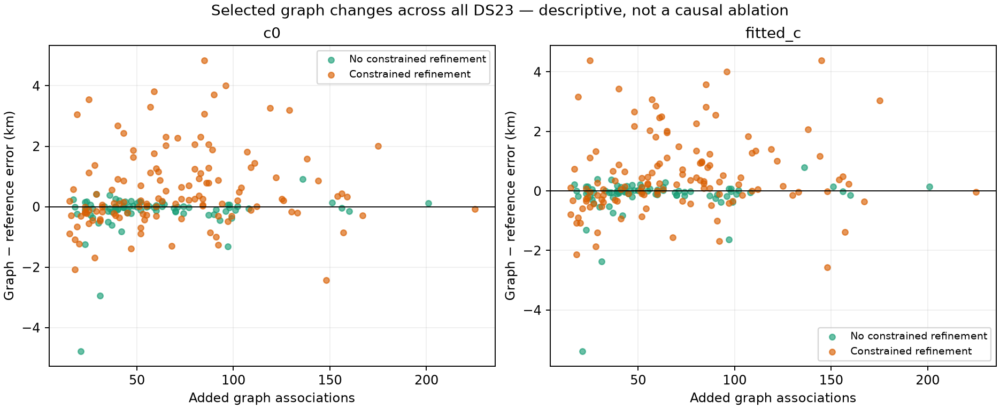
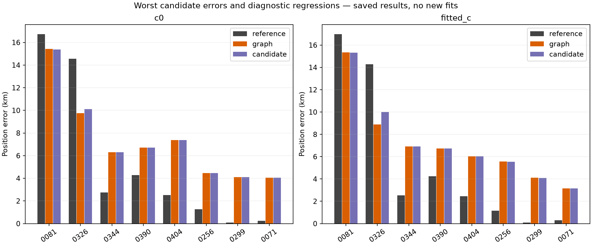
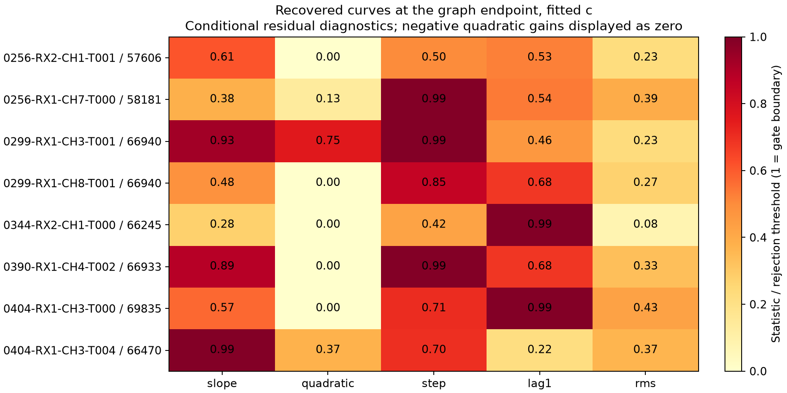
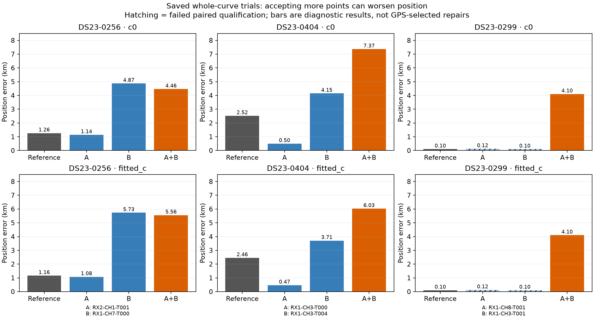

# ALGO04 candidate: exploratory outlier review

**Exploratory diagnostic review, not an ALGO release.** The [full DS23 evaluation](../2026_10_23_algo04_candidate_full_ds23/README.md) failed promotion. The published reference remains the default. This review reads saved results only: no new fits, RF collection, gate changes, or fixes were tested or adopted. GPS errors select retrospective examples for display; GPS does not enter inference.

Across 410 scans, the fitted-c candidate increases association from 70.08% to 75.08%, while mean position error increases from 1.4695 to 1.5907 km. The c=0 arm also worsens. Association and frequency-fit diagnostics must therefore be assessed separately from position accuracy.

## Where graph-stage changes concentrate

Graph recovery is selected on 207 scans. The table compares each selected graph result with its own reference, before the native recovery stage. Positive position-error change means degradation.

| c arm | Selected graph group | Scans | Mean error change, km | Regressions >0.5 km | Improvements >0.5 km |
| --- | --- | ---: | ---: | ---: | ---: |
| c=0 | Without constrained refinement | 80 | -0.168572 | 1 | 7 |
| c=0 | With constrained refinement | 127 | +0.554891 | 51 | 16 |
| Fitted c | Without constrained refinement | 80 | -0.171974 | 1 | 8 |
| Fitted c | With constrained refinement | 127 | +0.521042 | 48 | 18 |

This is an association between refinement and failure, **not a controlled causal ablation**. The existing fit configuration attempts refinement only after at least one c arm fails and the minimum gate slacks are at least -0.25. The groups therefore differ in difficulty before refinement. Rescue optimizes gate feasibility alongside position; the concentration of regressions motivates a controlled test but cannot establish what would happen if rescue were removed.

The two c arms retain their original matched controls within each hypothesis. This retrospective grouping does not create a new matched comparison between refined and unrefined scans. [All group statistics](tables/refinement_groups.csv) also include the unchanged scans and a descriptive near-margin subgroup; that label uses saved minimum slack <=0.010101 and is not a proposed acceptance threshold.

## Recovered evidence and near-boundary diagnostics

DS23-0344 is a compact example: graph recovery adds 25 points from RX2 CH1 T000 assigned to NORAD 66245, spanning 103.4–155.9 seconds as one persisted piece. Fitted-c position error changes from 2.520 to 6.914 km while frequency RMS changes from 120.80 to 120.99 Hz. Its recovered track's conditional lag-one autocorrelation is approximately 0.7919992 against the gate threshold 4/sqrt(25)=0.8. Passing with a small numerical margin does not establish independent localization information.

Other large regressions involve these graph additions:

| Scan | Recovered graph evidence |
| --- | --- |
| DS23-0256 | 65 points assigned to 57606 on RX2 CH1; 50 assigned to 58181 on RX1 CH7 |
| DS23-0404 | 64 points assigned to 69835 and 21 assigned to 66470, both on RX1 CH3 |
| DS23-0299 | 40 points on RX1 CH3 and 56 on RX1 CH8, both assigned to 66940 |

Some conditional step statistics are near 3.96 against a threshold of 4. The [conditional gate table](tables/focus_conditional_gates.csv) contains values for each displayed track and both c arms; [recovered sources](tables/recovered_sources.csv) records time spans, persisted pieces, nomination alternatives and score margins. A curved source saved as one piece is not proof that it is clean, and these diagnostics do not prove an identity label is wrong. Repeated observations of one satellite across channels also require care when judging independence.

The largest final fitted-c errors remain DS23-0081 at 15.314 km and DS23-0326 at 10.010 km. The earlier [worst-outlier review](../2026_10_23_ds23_worst_outlier_review/README.md) and [bounded mechanism tests](../2026_10_23_ds23_worst_mechanism_tests/README.md) indicate ambiguity or weak information; this review supplies no new diagnosis or successful repair for them. [Stage changes](tables/stage_changes.csv) keeps the reference, graph and final errors, frequency RMS and association changes separate for both c arms.

## Saved single-source versus joint trials

The saved discovery trials expose a second selection issue: maximizing associated point count can prefer a much worse position among hypotheses that pass the paired gates. These are archived trial comparisons, not newly fitted fixes or GPS-selected policy outputs. The errors below are fitted-c graph-stage values; final native recovery may change them slightly.

| Scan | Trial | Added graph points | Constrained rescue | Paired gates | Error, km |
| --- | --- | ---: | --- | --- | ---: |
| DS23-0256 | 57606 alone | 65 | No | PASS | 1.078172 |
| DS23-0256 | 58181 alone | 50 | Yes | PASS | 5.734123 |
| DS23-0256 | Joint | 115 | Yes | PASS | 5.556912 |
| DS23-0404 | 69835 alone | 64 | Yes | PASS | 0.471049 |
| DS23-0404 | 66470 alone | 21 | Yes | PASS | 3.707898 |
| DS23-0404 | Joint | 85 | Yes | PASS | 6.027708 |
| DS23-0299 | 66940 on CH8 alone | 56 | No | FAIL | 0.122223 |
| DS23-0299 | 66940 on CH3 alone | 40 | No | FAIL | 0.098574 |
| DS23-0299 | Joint | 96 | Yes | PASS | 4.101899 |

The [complete saved-trial table](tables/saved_graph_trials.csv) includes both c arms and failed trials. The two DS23-0299 single-source trials fail the paired scientific gates and must not be adopted because their GPS errors look favorable. DS23-0404 also shows why simply disabling rescue is insufficient: its favorable single-source trial itself uses rescue. The selected joint hypotheses maximize point count, rather than demonstrating superior compatibility on a common observation set.

These examples motivate testing both gate-driven rescue and hypothesis ranking. They do not identify a deployable replacement. The original unconstrained pair is overwritten during the saved fit configuration, so a full-population no-rescue result cannot be inferred by switching selected rows. Positive controls DS23-0041 and DS23-0272 remain in the review tables alongside regressions.

## Proposed controlled tests

These are proposed follow-up experiments, not changes selected or validated by this review.

First bound mechanism debugging to DS23-0344's single 25-point source, DS23-0256's passing versus rescued sources, and DS23-0404's favorable rescued single versus inaccurate joint result, retaining DS23-0041/0272 as positive controls. Freeze any resulting rule before a full-population ablation. No new campaign is launched in this review.

1. Run a frozen full-population ablation disabling gate-driven constrained rescue while retaining the unconstrained graph hypotheses. Preserve observations, candidate identities, priors, full search budgets and all evidence; recompute the native stage from the chosen parent in both c arms. Compare c=0 and fitted c with matched controls and report frequency fit separately from position accuracy. Separately test replacing maximal-point-count ranking with model-compatibility comparisons across common original observations and a background/null model; the favorable rescued single-source result in DS23-0404 precludes treating rescue removal alone as a demonstrated solution.
2. Test conditional prediction across independent families/owners and time blocks before promoting recovered evidence into calibration corrections; require independent witnesses. Carry correlated nuisance and phase uncertainty. Count predictive-only evidence separately, while recognizing that predictive-only evidence can still move position.
3. Test receiver-versus-satellite corrections only when physically justified and supported by independent witnesses, or split a native track only where its data support the split. Do not introduce arbitrary polynomials or tune thresholds against GPS.

## Reproducibility and scope

The [review script](source/review.py) reads the frozen candidate's saved `raw/<case>/result.json`, archived trial/nomination records and position table from `/srv/bulk/leo/research/algo04-candidate-20261023`. Its output directory is the parent of `source`; re-running it requires those bulk artifacts and the numerical plotting environment. It performs no fitting or inference selection. The [review receipt](evidence/review_receipt.json) records 410 per-result hashes, 20 trial/nomination hashes, the source hash, gate-threshold provenance and retrospective-ranking disclosure. The script independently recomputes all 2460 position errors to a tolerance of 1e-8 km and asserts that all six selected joint-trial c-arm endpoints match the published graph endpoints.

Any replacement ranking must compare models on the same original observations, including an explicit background/unexplained alternative. Comparing raw losses across different selected masks does not provide that comparison.

This companion publishes only Markdown, four figures, five complete tables, the source snapshot and receipt. Large result archives remain on bulk storage as documented in the full evaluation. The original candidate evaluation, failed hypotheses and runtime defaults are unchanged.
