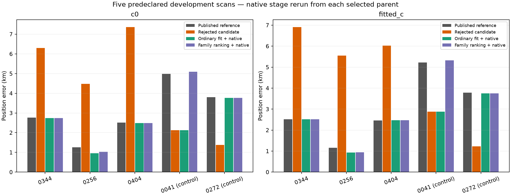
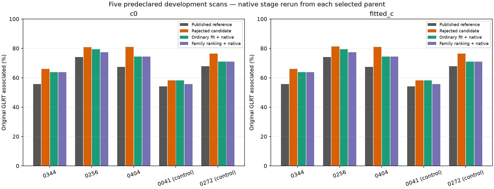
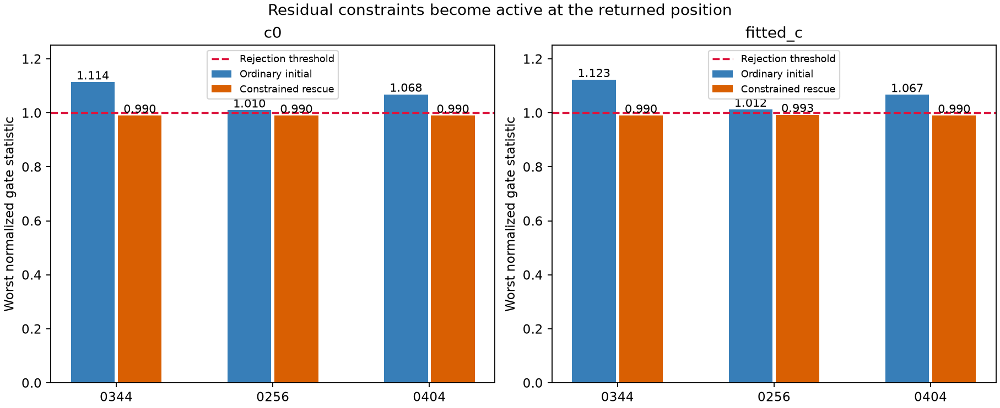
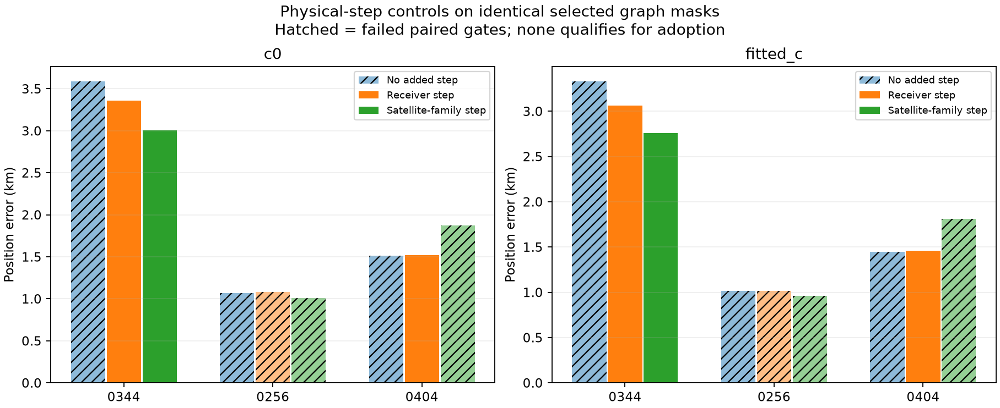
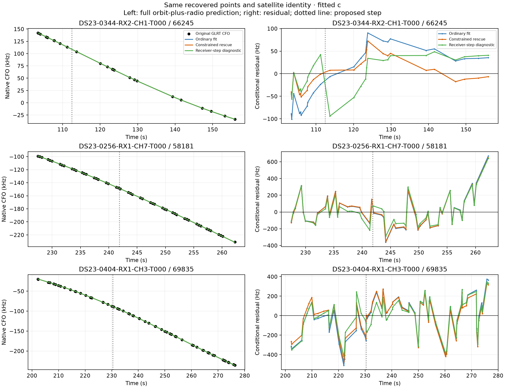
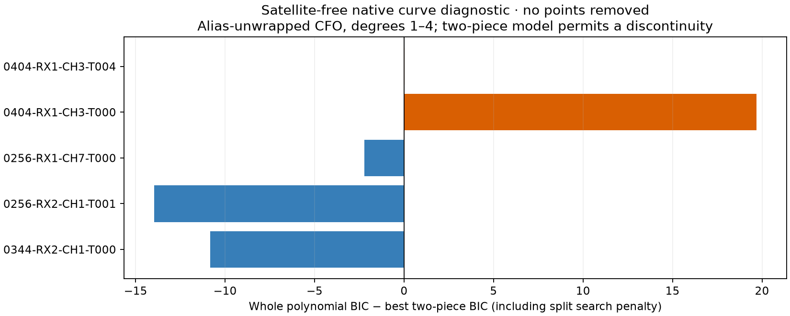

# Bounded ALGO04 recovery controls: rescue, ranking and physical discrepancies

**The ordinary-fit variant avoids the three selected large regressions and improves the five-case mean, but loses the beneficial recovery on positive control 0272. No new ALGO version is promoted.** The common-family ranking is too conservative in this test. No tested frequency-step correction meets all the predeclared requirements.

This executes the bounded plan from the [outlier review](../2026_10_23_algo04_candidate_outlier_review/README.md), following the [failed full-DS23 candidate evaluation](../2026_10_23_algo04_candidate_full_ds23/README.md). Development cases are 0344, 0256 and 0404; positive controls are 0041 and 0272. They were declared before the new fits. They are deliberately selected same-site examples, not a random sample or new-location validation. Full DS23 was not rerun in this iteration; its published reference remains unchanged.

## Position and association results after native recovery

The ordinary-fit method changes graph fitting only. The existing persistent native recovery and its existing bounded constrained rescue are then rerun from the selected graph parent. “No rescue” in filenames therefore means **no graph gate-constrained rescue**, not removal of the downstream native solver.

| Scan | Reference error, km | Rejected candidate, km | Ordinary graph + native, km | Family ranking + native, km | Ordinary method GLRT associated |
| --- | ---: | ---: | ---: | ---: | ---: |
| 0344 | 2.520 | 6.914 | 2.513 | 2.513 | 63.81% |
| 0256 | 1.163 | 5.548 | 0.927 | 0.939 | 79.48% |
| 0404 | 2.457 | 6.028 | 2.469 | 2.469 | 74.46% |
| 0041, positive control | 5.220 | 2.877 | 2.877 | 5.328 | 58.21% |
| 0272, positive control | 3.783 | 1.221 | 3.746 | 3.746 | 70.95% |

The table uses fitted c. The plots and [complete position table](tables/positions.csv) contain both c arms. Original accepted physical observation IDs are protected; rejected recovery proposals remain in the evidence rather than being silently discarded from evaluation.

| Method | Mean c=0 / fitted-c error, km | Median c=0 / fitted-c, km | Associated c=0 / fitted-c |
| --- | ---: | ---: | ---: |
| Published reference | 3.067 / 3.029 | 2.761 / 2.520 | 66.50% / 66.50% |
| Rejected candidate | 4.330 / 4.517 | 4.475 / 5.548 | 74.77% / 74.92% |
| Ordinary graph + native | 2.414 / 2.507 | 2.486 / 2.513 | 71.75% / 71.75% |
| Common-family ranking + native | 3.022 / 2.999 | 2.741 / 2.513 | 70.71% / 70.71% |

These summaries cover only the five declared cases. Ordinary fitting adds 551 associations over the reference across 10,508 original GLRT points. The mean gain is not evidence of dataset-wide improvement. Frequency RMS is reported separately in the tables; different observation masks make raw fit scores unsuitable for direct model selection.

## Test 1: optimize the RF objective, then validate the gates

All archived whole-curve default and support-model proposals are retained, including failed alternatives. Both c arms use the same observations, satellite labels, aliases, causal catalogue and priors. Cold starts are at the center of the existing 25×25 km region, centered at 37.906, −122.545. Evaluation GPS is read only by the reporting code.

Each hypothesis receives the original five phase refreshes with up to 48 position iterations each. When a paired fit fails but its minimum normalized gate slack is at least −0.25, it receives five further refreshes with up to 40 ordinary SLSQP iterations each. This matches the original rescue allowance and scalar RF objective, while removing residual-test inequalities from that optimizer. Actual iterations can differ because of convergence. Gates and phase convergence are checked afterward, with no thresholds relaxed and no observations trimmed. Failed hypotheses cannot be selected because their GPS errors look favorable.

The original maximum-added-points ranking among qualifying hypotheses remains in this first test. It selects the 65-point 57606 source on 0256 and the previously beneficial 100474 source on 0041. No new graph hypothesis qualifies on 0344, 0404 or 0272, so those retain the reference graph before native recovery. See [all ordinary trials](tables/ordinary_trials.csv) and [graph-stage results](tables/graph_stage.csv).

The controlled comparison narrows the failure mechanism:

* On 0256, the selected joint mask's initial ordinary fitted-c position has 1.014 km error but fails a step statistic at about 4.049 against a limit of 4. Constrained rescue moves the graph result to 5.557 km error to satisfy the gates. The ordinary-only policy instead accepts the other, independently qualifying 65-point addition, then reaches 0.927 km after native recovery. It does not accept the failed joint fit.
* On 0344, the recovered source's ordinary residual lag-one correlation is about 0.898 against a limit of 0.8; rescue returns it near 0.792. The geometric error grows from the ordinary diagnostic's 3.326 km to 6.914 km. Neither is a proven satellite-identity correction.
* On 0404, the corresponding correlation is about 0.534 against a limit of 0.5; rescue brings it near 0.495 while graph error rises from 1.447 to 6.028 km. The 1.447 km ordinary diagnostic still fails the original gates and is not adopted.

This is now a direct intervention on the graph solver, rather than only the descriptive refined-versus-unrefined grouping from the prior review. It still does not prove that every rescued track is harmful: the positive-control 0272 recovery is lost, and the earlier favorable single-source 0404 trial also required rescue.

## Test 2: compare predictions on common satellite-family evidence

The ranking prototype compares the reference and qualifying archived/new graph hypotheses. It selects the three largest original curved families by point count, without using GPS. At each hypothesis's saved position, it excludes an entire held family—including any newly recovered source assigned to that family—from nuisance calibration. Five fixed-position phase refreshes start from zero. Exactly the same original held observation IDs are scored for every branch.

The predictive covariance carries receiver, phase, supported orbit-mode and fragment uncertainty. It uses the existing Gaussian approximation at fitted Gamma precisions and the existing unseen-noise inflation. A dense covariance calculation independently verifies the predictive density. Each whole-family score mixes a 0.95 signal component with 0.05 uniform alias-period clutter; there is no per-point deletion. The three family scores form a **composite diagnostic**, not a full joint likelihood or calibrated satellite probability.

A replacement must improve both c-arm scores over the reference by more than `2 log(number of branches)`; c0 score breaks ties. Prediction must be visible, phase-converged, and have marginal SD below one twentieth of the alias period. The full-fit position and catalogue nominations are reused, so this is **not full cross-validation**: exclusion applies to the nuisance update, not the position estimate. These limits are recorded in each ranking receipt.

No replacement is selected. The 65-point 0256 addition improves the score by only about 2.20/1.65 units, below the 3.22 penalty. On 0404, holding out family 63644 leaves roughly 15.5 kHz marginal uncertainty and fails the width qualification; the ranking falls back. The rankings reject helpful 0041 and 0272 additions as well. Their final changes relative to the reference come solely from rerunning native recovery. See [all scores and qualification flags](tables/common_family_scores.csv).

This prototype is rejected as a replacement selection rule. It protects against the displayed bad graph updates but does not distinguish them reliably from useful recovery. No threshold was adjusted after viewing GPS errors. It is also not the proposed full joint all-GLRT generative mixture; that broader model has not been implemented or validated here.

## Test 3: receiver versus satellite-family frequency steps

For each of the three development scans, use the same selected graph mask and its initial ordinary c0 residuals. Among recovered curves, scan splits with at least eight points on each side. Remove an affine trend and select the largest standardized step improvement. This chooses the source and time from RF data. Fit three models with identical points and cold-start budgets: no step, one receiver-shared step, and one satellite-family step scaled by RF. Both added steps use the existing 300 Hz Gaussian prior. These are frequency-discrepancy hypotheses, not fitted changes to TLE epochs or proof of a hardware event.

The extra step must improve both same-mask objectives by more than the predeclared split/model-search penalty, pass all original paired gates, retain parent IDs, and have supporting witnesses. A receiver proposal needs same-sign evidence above two nominal standard errors from at least two distinct other families within ±20 seconds. A family proposal needs existing observations spanning the event on both receivers. Witness amplitudes are descriptive conditional-residual fits; their covariance does not make them an independent causal validation. Therefore even passing this screen would only justify further validation, not automatic adoption.

| Scan | Proposed time | Receiver-step error c=0 / fitted-c, km | Paired gates | Why not adopted |
| --- | ---: | ---: | --- | --- |
| 0344 | 112.46 s | 3.360 / 3.064 | PASS | No other-family witness; same-mask objective does not improve |
| 0256 | 241.86 s | 1.079 / 1.013 | FAIL | Step residual test still fails; potential witnesses are two channels of one family, 62134 |
| 0404 | 230.39 s | 1.518 / 1.456 | PASS | Fitted-c gain 9.53 is below penalty 10.21; witnesses are two channels of only one other family, 62496 |

The satellite-family step also does not qualify on any case. It passes residual gates on 0344 but offers only about 0.4 objective units against a 6.80 penalty, without cross-receiver support. It fails residual gates on 0256 and 0404. [All physical trials](tables/physical_trials.csv) retain errors, frequency RMS, amplitudes, penalties and qualification flags—including attractive but disqualified positions.

The CFO panels show original measurements in their native alias gauge and the complete orbit-plus-radio prediction, not an orbit-only curve. Residuals correspond to those same physical points. Small changes on the CFO scale can have large position effects. The dotted lines mark hypotheses, not established discontinuities.

## Is a track join the explanation?

A separate satellite-free diagnostic fits degrees 1–4 to the original graph-unwrapped CFO using the nominal observation noise and BIC. It compares the best whole polynomial with two polynomial pieces, each having at least eight points, including a split-search penalty. The two-piece diagnostic permits discontinuity; it is not a production track splitter or an adopted correction. Original points are never removed.

All five examined recovered sources are stored as one piece. The penalized split gain is −10.84 for 0344, −13.97 and −2.23 for the two 0256 sources, and +19.70/+0.02 for the two 0404 sources. Thus there is no support from this test for a blanket split fix. The 64-point 0404 source merits a bounded segmentation follow-up. The 0256 CH7 final point is only about 1.44 nominal sigma from its best native polynomial, despite its large orbit-model residual; that does not support simply deleting it. These diagnostics depend on the assumed noise scales and do not prove a physically real discontinuity. See [native shape table](tables/native_shape.csv).

Raw CFO wraps must not be interpreted as track breaks. The final diagnostic verifies that graph-unwrapped values match the original GLRT modulo the alias period. An initial draft used wrapped CFO and was corrected before any result was adopted.

## Decision and next step

Retain the published full-DS23 reference. The ordinary graph-fit rule is the strongest candidate from this bounded iteration: both c-arm five-case means improve over the reference while retaining higher association. Its lost 0272 recovery prevents claiming that it solves the recovery problem generally. Freeze it before a matched full-DS23 evaluation, and report gains, lost useful tracks and tails separately.

Do not promote the common-family ranking or any frequency-step model. Do not rescue disqualified hypotheses by selecting their favorable GPS outcomes. For further mechanism work, investigate native segmentation of the 0404 source and seek genuinely independent receiver/family evidence. Avoid another unconstrained nuisance-parameter sweep on these cases. No new ALGO-series release or new-location claim follows from this iteration.

## Validation, artifacts and reproduction

All four stages complete on their declared cases. **Eight focused tests pass.** They cover whole-family exclusion, shared predictive covariance, paired ID preservation, geography-free ranking, affine-resistant step detection, minimum segment size, unique predictive ownership and polynomial alias-gauge invariance. **38 fixed endpoints replay exactly**, including ordinary, constrained and physical-model controls. The 12 frozen core source hashes from the candidate study still match. All common-family score comparisons use identical held IDs.

The first physical coverage adapter counted explicit predictive entries twice when post-fit extension rediscovered them. It stopped with a duplicate-ID error. The repaired adapter gives explicit predictive ownership precedence, matching the existing native coverage rule. It changes no fit, gate, candidate, observation or prior. The failed receipts and original adapter source are retained in [failed_physical_v1](evidence/failed_physical_v1/); [protocol v2](evidence/followup_protocol_v2.json) records the repair. A separate draft polynomial report also had a source-hash path-type error; the final version verifies its inputs and alias gauge before publication.

[Protocol](evidence/protocol.json), [endpoint audit](evidence/endpoint_audit.json), [report hashes](evidence/report_receipt.json), [tests](evidence/tests.txt) and [source](source/) identify the work. The published capsule includes Markdown, six figures, eight tables, source and compact diagnostics. Full per-hypothesis fits, discovery covariance and native-path outputs remain under `/srv/bulk/leo/research/algo04-controlled-tests-20261023/raw`; the report receipt hashes the top-level raw result files. Frozen inputs remain under `/srv/bulk/leo/research/algo04-candidate-20261023`.

Use the existing repository virtual environment with `PYTHONDONTWRITEBYTECODE=1`, one BLAS/OMP thread, and `PYTHONPATH=<report>/source:/tmp/algo03-feasible-deps:src:tools`. The order is `experiment.py norescue`, `experiment.py rank`, `followup.py physical`, `followup.py native`, `audit.py`, `native_shape.py`, then `report.py`. Reproduce in a new output directory and preserve the original protocol/evidence. Before running the repaired follow-up adapter, copy the archived `evidence/followup_protocol.json` into that new output root: v2 hashes this v1 provenance record without rerunning the failed v1 adapter. The scripts depend on the existing local corpus and upstream research helpers; they perform no RF collection or QNAP writes.
