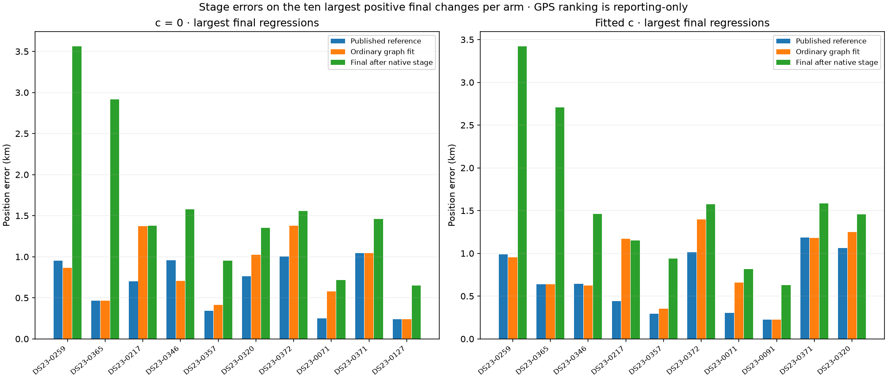
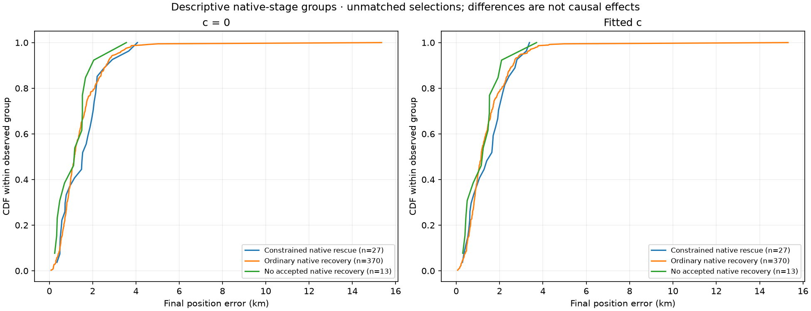

# Full DS23 ordinary graph-fit assessment

**The ordinary graph rule improves average error and association over the published reference, but does not qualify for promotion.** It avoids much of the preceding candidate's degradation. Seven recordings in each c arm still regress by more than 0.5 km, and fitted-c p95 increases by 45 m. Retain the published reference; this is not an ALGO04 release.

This scales the [five-case controlled study](../2026_10_23_algo04_controlled_recovery_tests/README.md) to the same cohort as the [preceding full candidate](../2026_10_23_algo04_candidate_full_ds23/README.md). The comparator is the published ALGO02/ALGO03-derived family-cavity reference, not the original unmodified ALGO02. No algorithm settings were adjusted after viewing these full-cohort errors.

## Population, execution and controls

All **410 available recordings** have terminal outcomes: **408 successful searches**, one inherited unqualified reference (0068), and one incomplete earlier support-hypothesis bank (0004). The two exceptions retain their reference results. There are **zero new execution fallbacks**. The original 413-recording manifest also contains unavailable 0012, 0184 and 0286. All tables distinguish the 413 manifest denominator, 410 available positions, and 408 completed-search comparison. Main numerical results below use all 410 available positions, including the two unchanged carries.

The available population contains **204 fast and 206 adaptive recordings**. Jobs used 16 lower-priority processes with one numerical thread each on the existing corpus. No RF was collected. SOL agents prepared reporting and independent integrity checks; the numerical intervention remained the frozen ordinary-fit rule.

Both c arms use the same hypotheses, observations, aliases, other priors and solver budgets. Only graph fitting changes: optimize the original RF objective without residual-gate inequalities, then apply the original gates. The existing native recovery, including its constrained rescue, remains unchanged. Linear predictive evidence may constrain position but does not learn shared RF calibration coefficients. GPS is reporting-only; the existing 25×25 km region is centered at 37.906°, −122.545°. No post-observation TLE or stationary cross-scan pooling is introduced.

The test reuses the frozen upstream graph and causal hypothesis banks; it does not recompute acquisition, GLRT or catalogue nomination. The usable bank contains 2,155 graph trials, excluding the incomplete-bank case. See [METHOD.md](METHOD.md) for the exact procedure, caveats and reproduction commands.

## Full-cohort position and association results

All errors are kilometres. Association is summed unique original GLRT IDs divided by 1,036,559 original GLRT points, rather than an unweighted average of scan percentages.

| Arm | Method | Mean | Median | p95 | Worst | GLRT associated |
| --- | --- | ---: | ---: | ---: | ---: | ---: |
| c=0 | Published reference | 1.4794 | 1.1907 | 3.2241 | 16.7317 | 70.099% |
| c=0 | Prior rejected candidate | 1.6072 | 1.2686 | 3.6652 | 15.3719 | 75.097% |
| c=0 | Ordinary graph + native | **1.4336** | **1.1700** | **3.1601** | **15.3498** | **74.447%** |
| Fitted c | Published reference | 1.4695 | 1.1781 | **3.1567** | 16.9798 | 70.080% |
| Fitted c | Prior rejected candidate | 1.5907 | 1.2491 | 3.4725 | 15.3140 | 75.080% |
| Fitted c | Ordinary graph + native | **1.4260** | **1.1568** | 3.2018 | **15.3116** | **74.414%** |

Ordinary recovery adds **45,061 c=0 associations** and **44,925 fitted-c associations** over the reference. Fitted-c coverage rises from 726,425 to 771,350 points. The 90% aspiration is not reached, and acceptance gates were not relaxed to approach it.

Mean error improves by 45.8 m with c=0 and 43.5 m with fitted c. This is substantially smaller than the 522 m fitted-c mean gain on the five selected development cases. The full-cohort result must replace that small-sample impression when deciding whether to release the method.

Chronological moving-block sensitivity intervals for fitted-c mean change are −83.5 to −9.0 m with 10-scan blocks, and −82.1 to −10.1 m with 20-scan blocks. Median-change intervals include zero in both arms. These are within-corpus resampling diagnostics, not new-location validation. As a post-hoc sensitivity check only, excluding previously closed 0081/0326 leaves mean improvements of 31.8 m c=0 and 29.1 m fitted c; no deployed selection excludes those scans.

## Fast versus adaptive recordings

Values are reference → ordinary graph + native. Both subgroup means improve, but **both subgroup medians worsen slightly**, despite the pooled median improvement. Do not describe the gain as uniform across the distribution.

| Format | Arm | Mean error | Median error | p95 error | GLRT associated |
| --- | --- | ---: | ---: | ---: | ---: |
| Fast, n=204 | c=0 | 1.2339 → 1.2246 | 1.0212 → 1.0400 | 2.7810 → 2.7449 | 72.184% → 76.141% |
| Fast, n=204 | Fitted c | 1.2404 → 1.2314 | 1.0313 → 1.0541 | 2.8801 → 2.7061 | 72.157% → 76.097% |
| Adaptive, n=206 | c=0 | 1.7224 → 1.6406 | 1.3373 → 1.3529 | 3.5293 → 3.5060 | 65.205% → 70.468% |
| Adaptive, n=206 | Fitted c | 1.6963 → 1.6187 | 1.3339 → 1.3352 | 3.3874 → 3.3865 | 65.206% → 70.465% |

The fitted-c fast worst error improves from 4.544 to 3.746 km; adaptive worst improves from 16.980 to 15.312 km. Adaptive recordings still have worse mean, median and worst error than fast recordings under this method. The largest absolute final errors remain previously investigated adaptive 0081 (15.312 km) and 0326 (10.010 km). Their existing limitations remain visible; this iteration does not reopen them without new evidence.

## Why promotion fails, and where errors enter

There are seven regressions above 0.5 km and two above 1 km in each arm. The union of scans exceeding 0.5 km in either arm is 0071, 0217, 0259, 0320, 0346, 0357, 0365 and 0372. There are also 15 c=0 and 14 fitted-c improvements greater than 0.5 km. The release rule protects individual recordings as well as averages.

| Frozen requirement | c=0 | Fitted c |
| --- | --- | --- |
| Mean and median improve | Pass | Pass |
| p95 does not increase | Pass | **Fail: +45.1 m** |
| Worst error does not increase | Pass | Pass |
| No individual regression above 0.5 km | **Fail: 7 scans** | **Fail: 7 scans** |

All planned cases are terminal and numerical QA passes. The two declared inherited exceptions are disclosed separately from scientific search completion; they are not the reason the performance requirements fail. No new algorithm version or default is promoted.

The largest two new regressions enter at the **native stage**. They demonstrate two distinct situations:

| Scan | Arm | Reference error | After ordinary graph | After native | Native mechanism |
| --- | --- | ---: | ---: | ---: | --- |
| 0259 | c=0 | 0.9535 | 0.8634 | 3.5621 | Ordinary native fit |
| 0259 | Fitted c | 0.9907 | 0.9515 | 3.4213 | Ordinary native fit |
| 0365 | c=0 | 0.4657 | 0.4657 | 2.9147 | Constrained native rescue |
| 0365 | Fitted c | 0.6382 | 0.6382 | 2.7075 | Constrained native rescue |

On 0259, graph recovery adds 40 points and slightly improves position. Seven native paths then add 97 points across four satellite families: 65340 (54), 67618 (23), 61627 (12), and 62739 (8). Total association rises 49.82% → 53.50% → 62.43%, while final fitted-c error reaches 3.421 km. Its saved RMS falls 160.77 → 157.43 → 155.77 Hz, showing that a lower frequency residual does not guarantee a better position. This fit did **not** use constrained native rescue.

On 0365, the graph parent stays unchanged. Constrained native recovery adds 161 points, raising association 68.80% → 74.15%, while fitted-c error grows 0.638 → 2.707 km. The added paths span multiple families, including 68553 (48 points) and 68555 (44). These summaries locate the stage of regression; they do not establish that a particular satellite identity is wrong.

Graph fitting also remains imperfect: on 0217 the fitted-c error increases 0.440 → 1.168 km at the graph stage, then ends at 1.152 km after native recovery. We should not attribute every remaining regression to constrained rescue, or to native recovery generally.

The selected graph changed on 117 scans. Native recovery was accepted on 397; 27 used constrained rescue, from 29 eligible attempts. The subgroup plot below is descriptive: scans reaching rescue are selected for difficulty, so their distribution is not a causal comparison of solvers.

## Frequency fit and the controlled c ablation

| Method | Mean saved RMS, c=0 / fitted c (Hz) | Mean position error, c=0 / fitted c (km) |
| --- | ---: | ---: |
| Reference | 110.679 / 110.625 | 1.4794 / 1.4695 |
| Prior rejected candidate | 111.230 / 111.169 | 1.6072 / 1.5907 |
| Ordinary graph + native | 110.847 / 110.789 | 1.4336 / 1.4260 |

These are arithmetic means of saved per-scan RMS diagnostics, not pooled residual RMS. Observation membership differs between methods, so these values are descriptive rather than model-selection scores. Within each paired c comparison, masks, candidates, aliases, other priors and numerical budgets are matched. Fitted c lowers the ordinary variant's mean error by 7.6 m relative to c=0, while coverage and tail effects remain separate outcomes. Cross-mask raw likelihood totals are not used to claim a better model.

## Validation, artifacts and next bounded investigation

All **23 tests pass**. Independent output QA validates 2,448 new reference/graph/final arm audit records across 408 completed searches and four reused inherited-reference audit records. Maximum objective replay difference is 5.38×10⁻⁶, below 10⁻⁵; independent density difference is 7.28×10⁻⁷, coefficient-equation error 1.57×10⁻⁷, and predictive covariance-density difference 1.66×10⁻⁷. All five controlled-study cases reproduce their selected graph and final positions, objectives and accepted-ID sets exactly. The 786-file dependency seal passes after execution.

The report contains [all per-scan results](tables/positions.csv), [distribution summaries](tables/summary.csv), [paired changes](tables/paired_changes.csv), [stage changes](tables/stage_changes.csv), [c ablations](tables/c_ablation.csv), [regression counts](tables/regressions.csv), [execution status](tables/execution_status.csv), and [block intervals](tables/block_intervals.csv). [Output QA](evidence/output_audit.json), [report receipts](evidence/report_receipt.json), [stage summaries](evidence/stage_diagnostics.json), [tests](evidence/tests.txt), [protocol](evidence/protocol.json), [dependency seal](evidence/dependency_seal.json), and [artifact hashes](manifest.json) preserve provenance. Raw scan/fit banks stay in the bulk research workspace; they are not duplicated into Git.

The next bounded debug pair should be **0259 and 0365**, with positive controls retained. First ablate the added native paths by satellite family on identical observations and both c arms; inspect each family's position gradient and separate residual-mean from covariance/determinant contributions. For 0365, also compare the existing ordinary and constrained native endpoints on their fixed shared mask. For 0259, investigate path identity, correlated information and model discrepancy: removing constrained rescue alone cannot address its ordinary-fit regression. Any proposed general guard must be tested against useful native recoveries before another frozen full-DS23 evaluation. No such guard is adopted in this report, and no GPS-selected per-scan ensemble is constructed.
