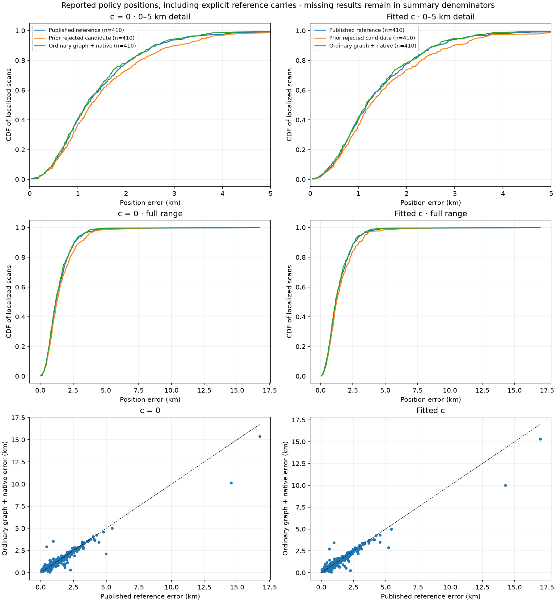
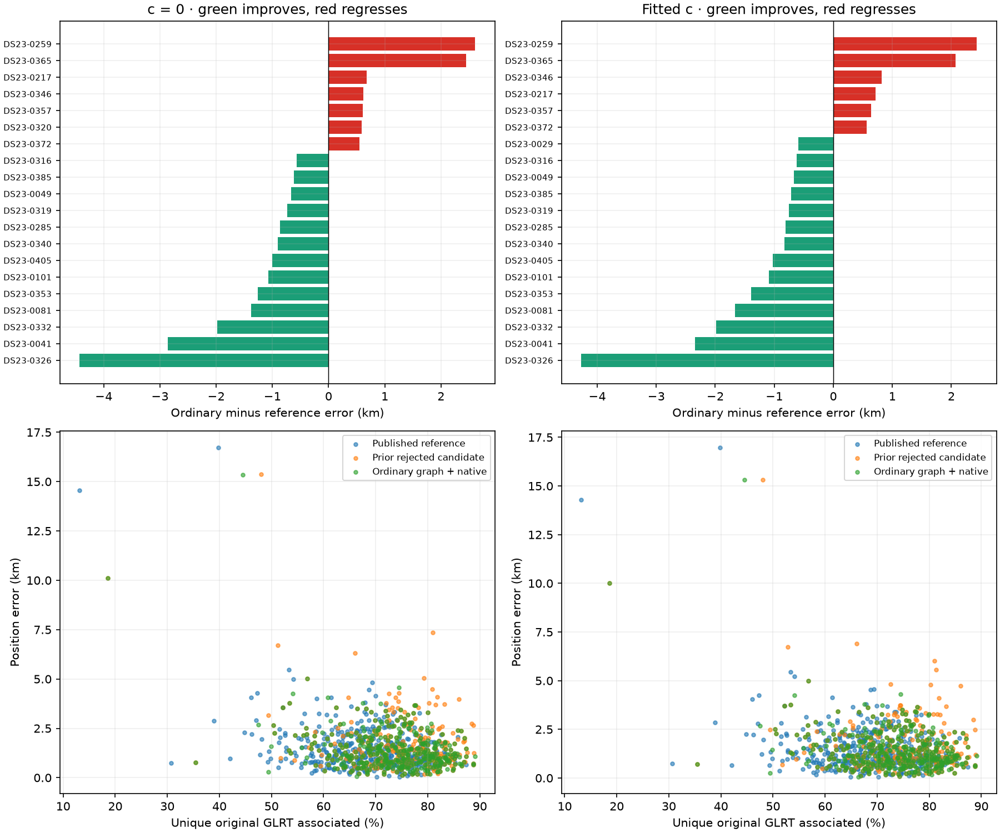
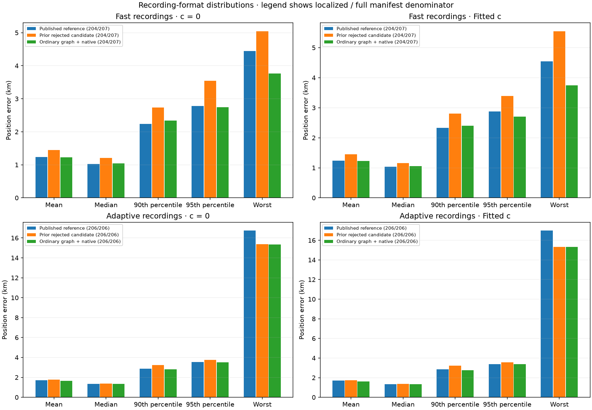

# Full DS23 ordinary graph-fit evaluation

Frozen result evaluation over 413 manifest recordings. Missing and failed results remain in the full denominator. Common completed cohorts require all three methods and both c arms.

Coverage counts unique accepted original observation IDs per recording. Frequency RMS and position accuracy are separate outcomes; lower in-sample RMS does not establish better localization.

The paired c=0 versus fitted-c table reports frequency RMS and position-error changes independently. Matched observation, candidate, prior and budget controls must be verified from runner provenance.

[Summary distributions](tables/summary.csv) · [Regressions](tables/regressions.csv) · [Status and fallbacks](tables/execution_status.csv) · [Paired c ablation](tables/c_ablation.csv)

Planned available population: 410. Full-manifest and planned-available denominators are reported separately. Reference-unqualified, incomplete-bank and execution-fallback positions are retained as explicit reference carries, and excluded from the common scientific-completion cohort.

Scientific-search completion is descriptive, separate from the frozen computational promotion condition: all planned cases terminal, no new execution fallback, only the two declared inherited exceptions, and valid numerical QA. An omitted independent QA receipt leaves this condition provisional. The five performance checks retain their frozen thresholds.

Promotion checks: `{"all_planned_cases_terminal": true, "all_scientific_completed": false, "c0": {"mean_improves": true, "median_improves": true, "no_regression_above_half_km": false, "p95_does_not_increase": true, "worst_does_not_increase": true}, "computational_eligibility": true, "decision_status": "not_eligible", "eligible": false, "fitted_c": {"mean_improves": true, "median_improves": true, "no_regression_above_half_km": false, "p95_does_not_increase": false, "worst_does_not_increase": true}, "no_new_execution_fallback": true, "numerical_QA_audit_passed": true, "only_expected_inherited_exceptions": true, "performance_requirements_passed": false}`.

Chronological circular moving-block intervals (10 and 20 scans) measure sensitivity to within-corpus dependence; they do not establish generalization to new locations.

