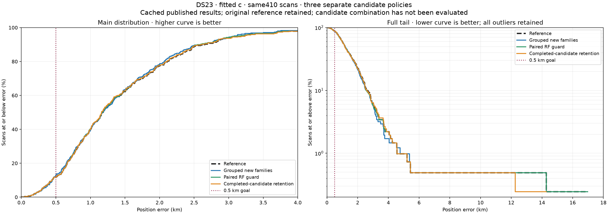
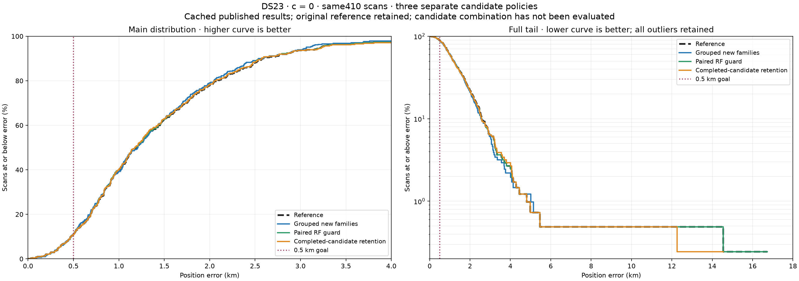
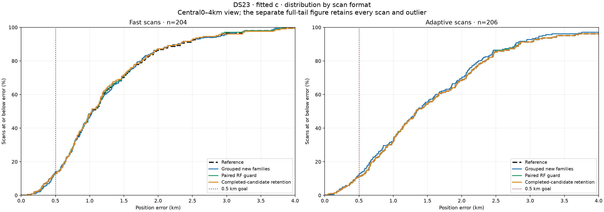

# DS23 position-error distributions for full-population candidates

The three separately evaluated candidates remain close to the published
ALGO02/ALGO03 research reference. None has demonstrated the0.5km mean-and-median
target or qualified for a new ALGO release. These plots compare frozen saved
results; they do not combine the different favorable local DBG01 outcomes.

All methods contain the **same410 scans** in both c arms. The413-entry manifest
has three unavailable entries:0012,0184,0286. No large error, failed proposal or
inherited phase-limit exception is removed;0068 remains included. The source
references agree across all three publications and the canonical benchmark to
1e−8km before plotting. No new inference or policy selection is performed.

## Fitted-c distributions

The left panel is an empirical cumulative distribution: at a given error,
the y value is the percentage of scans at or below that error. Higher is better.
The0–4km window exposes the central distribution. The right panel shows the
entire tail to18km with a logarithmic percentage axis: lower is better.
It includes the final outlier rather than truncating the upper tail. The
vertical dotted line marks0.5km. Nearly overlapping curves reflect modest
full-population differences rather than a plotting omission.

| Separate method | Mean km | Median km | P90 km | P95 km | Maximum km | Within0.5km |
|---|---:|---:|---:|---:|---:|---:|
|Reference|1.469|1.178|2.620|3.157|16.980|48/410|
|Grouped new families|1.449|1.179|2.598|3.064|16.980|53/410|
|Paired RF guard|1.462|1.167|2.551|3.094|16.980|48/410|
|Completed-candidate retention|1.453|1.161|2.597|3.211|14.282|48/410|

Grouped prediction improves122 scans and worsens92 by more than1m;196 remain
within1m of the reference. It improves the mean and P95 but slightly worsens
the median and leaves the largest error unchanged. Its full-population
association is71.2161% versus70.0804% for the reference.

The paired guard changes only two scans, improving both;408 returned positions
are unchanged. Completed-candidate retention changes six, improving four and
worsening two. Its lower mean, median and maximum coexist with a **worse P95**.
Improved averages therefore must not be described as improvement everywhere
in the distribution. Temporal-block uncertainty in the source assessments
remains applicable; these new plots provide no independent confirmation.

## Matched c=0 distributions

| Separate method | Mean km | Median km | P90 km | P95 km | Maximum km | Within0.5km |
|---|---:|---:|---:|---:|---:|---:|
|Reference|1.479|1.191|2.576|3.224|16.732|45/410|
|Grouped new families|1.458|1.208|2.544|3.064|16.732|46/410|
|Paired RF guard|1.474|1.181|2.569|3.224|16.732|45/410|
|Completed-candidate retention|1.465|1.176|2.569|3.232|14.550|45/410|

Each source comparison retains its matched c=0/fitted-c observations,
candidate hypotheses, aliases, other priors and budgets. These are position
accuracy distributions. Frequency-fit effects are documented separately in
the underlying reports; no localization improvement is inferred from RF RMS.

## Fast and adaptive scans

The same410 scans divide into204 fast and206 adaptive scans. These panels show
the central0–4km fitted-c distribution; the preceding full-tail plot includes
all observations. The complete quantile and coverage breakdown by arm, method
and format is in [summary.csv](tables/summary.csv). Format labels come from
the original recording metadata and do not select a model or an outcome.

## Provenance and reproduction

- [Grouped-family full-population experiment](../2026_10_22_ds23_dbg01_iteration_007/README.md): new predictive evidence from unused graph fragments; full matched position fits.
- [Paired RF-evidence guard](../2026_10_22_ds23_dbg01_iteration_011/README.md): saved410-case decision replay with fresh changed-case validation; unchanged coverage.
- [Completed-candidate retention](../2026_10_23_ds23_completed_deadline_assessment/README.md): saved410-case decision replay with six independently audited rescues; no new410-scan fitting campaign.
- [Canonical full-population reference](../2026_10_22_ds23_family_cavity_full_assessment/README.md).

[positions.csv](tables/positions.csv) contains every error, paired reference
difference, method, c arm, recording format and GLRT count. The
[reproduction receipt](evidence/reproduction.json) hashes all inputs and code
and records alignment, availability and population summaries. The source
snapshot and its tests are in [source](source/plot_ds23_algo_candidate_distributions.py).
Restore the snapshot to `tools/plot_ds23_algo_candidate_distributions.py` in
the existing repository/research environment, with its test in
`tests/analysis/test_ds23_candidate_distributions.py`, then run that script.
It requires NumPy, Matplotlib and the original hashed reporting inputs,
including `reports/2026_10_19_algo02_ds23_full/sample.json` for format labels.
It does not access RF, IQ or TLE services.

Tests reject duplicate or unmatched scan populations and verify the empirical
CDF/tail treatment of ties and the last outlier. All plots retain the original
causal-inference results. GPS is used only through their already reported
evaluation errors. These are extensively studied same-site data, not
validation at a new location. No combined candidate or new ALGO series is
claimed.
