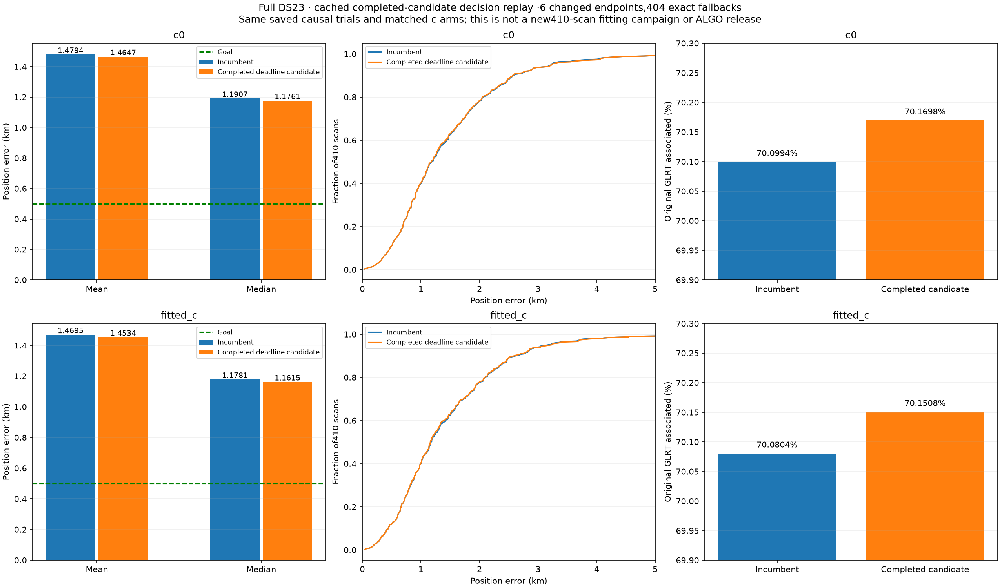
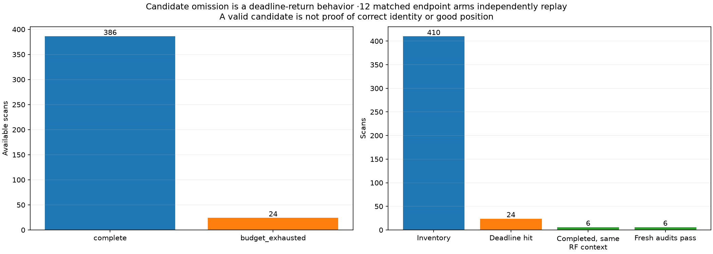
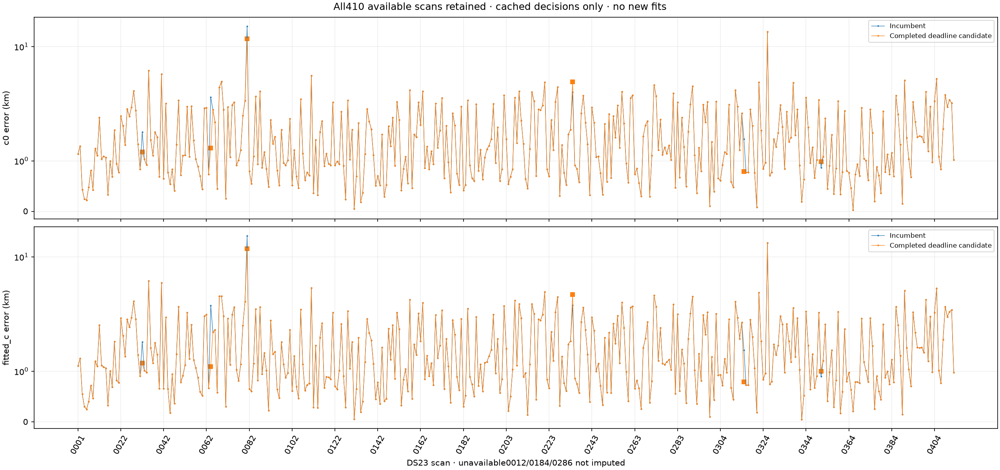
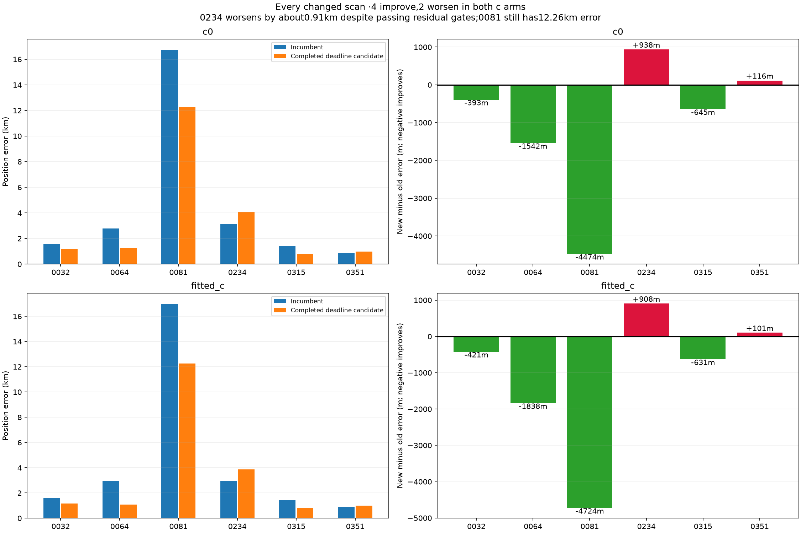
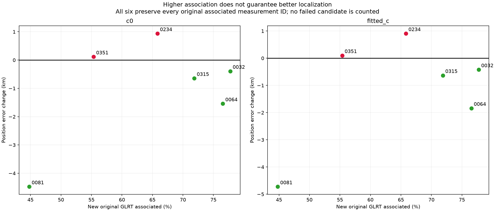
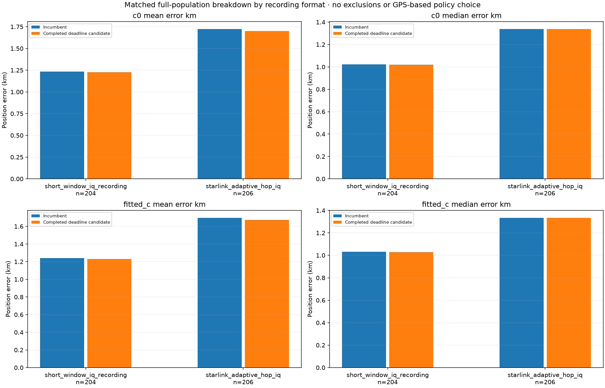
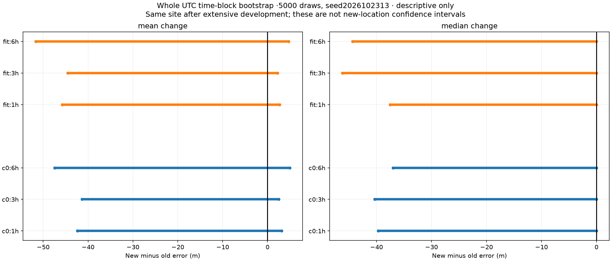

# DS23: preserve completed candidates when a later search times out

A review of the existing ALGO02/ALGO03 graph-recovery searches found a concrete
return-path problem: a search can finish a candidate that passes both c arms,
then hit its 400-second deadline while testing another alternative and return
the incumbent. Of 410 available scans, 24 searches timed out. Six contain a
completed qualifying candidate in exactly the current incumbent RF context.
All six pass fresh independent numerical replay and preserve every originally
associated GLRT measurement ID.

Replaying a frozen completed-candidate policy across **all 410 scans** improves
fitted-c mean/median error **1.469461/1.178102 → 1.453353/1.161472 km**. It adds
**729 original GLRT associations**, including **606 curved likelihood points**.
However, four scans improve and two worsen; scan0234 worsens by **0.908 km**.
Time-block uncertainty intervals include zero. This is a provisional research
result, **not a new ALGO release or a replacement of the published reference**.
The mean-and-median **0.5 km goal remains unmet**.

## Relationship to the existing algorithms

This extends the [ALGO02](../ALGO02/README.md) and
[ALGO03 family-replacement](../2026_10_22_ds23_family_cavity_full_assessment/README.md)
work. The hypothesis arose during
[DBG01 iteration013](../2026_10_23_ds23_dbg01_iteration_013/README.md), which
separately tested shared RF events and constrained temporal prediction.

The present result reuses already completed **owner-reentry** trials: whole
curved graph sources, at least two receiver/channel owners, the original
causal catalogue and aliases, and the previously defined fine receiver
covariance basis. The latter has 10-second spacing, 15-second width and matched
average pointwise variance. This is not a new nuisance-model search. The
recovered trial's receiver basis differs from the incumbent's, so the accuracy
comparison is the existing recovery policy versus its old fallback behavior;
it does **not** isolate receiver-basis changes as a separate ablation.

There are **no new position fits**, candidates, TLEs or RF measurements here.
This is an assessment of cached completed decisions, not a fresh 410-scan
acquisition-to-position campaign. The original 400-second per-case fitting
budget is unchanged. Additional work consists of archive inspection and
independent endpoint validation.

## What failed in the return path

The original worker appends each completed trial to a checkpoint. It retains a
local list of passing trials, but assigns `selected` and updates `policy_arms`
only after finishing all offers in the group. The timeout handler records
`budget_exhausted` without committing an earlier completed passing trial.

The six affected records each contain two completed trials. The deadline was
reached while searching later alternatives. A saved candidate is therefore a
real completed fit, not an interrupted numerical state. Conversely, the search
is incomplete: the archive cannot show which unfinished alternative would have
won with unlimited time.

The full inventory contains **386 complete** and **24 budget-exhausted** cases.
The policy changes only **0032,0064,0081,0234,0315,0351**, with 404 exact
incumbent fallbacks. No scan is removed because of a timeout, poor position or
failed candidate. The unavailable dataset entries remain **0012,0184,0286**;
413 manifest entries and 410 available results are reported consistently.

## Frozen decision rule and validation

The RF-only inventory was sealed before the new geographic evaluation. A
candidate is eligible only if the archived search hit its deadline and its
incumbent matches the current published reference in both arms: objective,
active and predictive counts, and the exact saved `beta`, `smooth` and phase
vectors. Its calibration mask must preserve the original mask.

Among completed candidates, retain only paired passing residual, regional-box,
strict phase and phase-refresh checks. Use the **first passing group**, then
the lowest c=0 RF objective among its completed qualifying alternatives. Raw
objectives are never compared across different observation groups. This
matches the intended first-group search order; it does not rank by GPS,
position error or number of successful scans.

Before any geographic scoring, fresh replay reconstructs each of the six
candidate models from the current causal context and verifies:

- Every original calibration label and alias, and the current causal prior means.
- The saved objective, independent expected density, coefficient equations and
  dense predictive covariance.
- Every original curved and predictive residual gate.
- Coverage from unique original GLRT IDs, with no original association lost.

All **12 endpoint arms** pass. Saved-objective differences are exactly zero;
the largest independent density difference is below **9.2×10⁻⁷**, coefficient
equation error below **1.4×10⁻⁷**, and predictive covariance difference below
**7.0×10⁻⁸**. The RF decision is then finalized in a separate process before
GPS evaluation. Four component-owned tests check context matching, search
ordering, strict qualification, deadline eligibility and mask preservation.

Inference retains the original **25×25 km** box centered at
**37.906,-122.545**, with a cold start at its center. Evaluation GPS
**37.849061591561885,-122.48574968092912** is used only to measure errors.
No following TLE, manually selected satellite, stationary-history pooling or
motion model enters inference. Within each comparison, c=0 and fitted-c use
the same observations, candidate identities, aliases, other priors and budgets.
Linear sources remain predictive evidence rather than calibrators of receiver
offsets and drifts.

The inherited qualification count remains **409/410 in each arm**. Scan0068
still exceeds the strict phase limit and is retained explicitly in every
accuracy table, as in the published reference. The six changed cases have
fresh numerical replay; the other 404 retain the existing saved qualification
audit. This is not a claim of 820 fresh endpoint replays.

## Full-DS23 results

|Arm|Policy|Mean km|Median km|90th percentile km|Maximum km|Within0.5 km|GLRT associated|
|---|---|---:|---:|---:|---:|---:|---:|
|c=0|Published incumbent|1.479378|1.190706|2.575508|16.731744|45/410|726,622 /1,036,559 (70.0994%)|
|c=0|Completed candidate|**1.464746**|**1.176097**|2.568884|14.550145|45/410|727,351 /1,036,559 (70.1698%)|
|Fitted c|Published incumbent|1.469461|1.178102|2.619963|16.979794|48/410|726,425 /1,036,559 (70.0804%)|
|Fitted c|Completed candidate|**1.453353**|**1.161472**|2.597355|14.281696|48/410|727,154 /1,036,559 (70.1508%)|

Fitted-c mean improves by **16.11 m** and median by **16.63 m**. The c=0
changes are **14.63 m** and **14.61 m**. The number within0.5 km is unchanged.
Both arms add729 associated original points; predictive likelihood membership
is unchanged, while606 new points enter curved calibration. The remaining123
are post-fit association extensions, not additional likelihood measurements.

Frequency fit is a separate outcome: mean per-scan fitted-c RMS changes from
110.6246 to110.5899 Hz, and c=0 from110.6787 to110.6437 Hz. All six changed
scans have lower RMS, including the two that worsen geographically. No
geographic inference is drawn from these in-sample RMS improvements.

|Scan|New curved points|New candidate NORAD|c=0 error, old→new km|Fitted-c error, old→new km|New associated /all GLRT|
|---|---:|---:|---:|---:|---:|
|0032|114|57972|1.570290→1.177727|1.580918→1.160197|2580/3318 (77.76%)|
|0064|89|69839|2.791535→1.249820|2.929738→1.091624|2617/3419 (76.54%)|
|0081|79|65419|16.731744→12.257619|16.979794→12.255824|709/1583 (44.79%)|
|0234|86|67992|3.157629→4.095843|2.964567→3.872852|2192/3330 (65.83%)|
|0315|125|66456|1.429498→0.784757|1.419854→0.788899|1903/2648 (71.87%)|
|0351|113|58176|0.867259→0.982976|0.894956→0.996426|1740/3143 (55.36%)|

Candidate identities in this table describe frozen RF choices, not GPS-selected
ground-truth labels. Passing the residual gates does not establish that every
identity is correct or that the nuisance model has removed all position bias.
Scan0081 improves substantially but remains a severe12.26 km failure.

## Recording formats and uncertainty

|Format|Available scans|Fitted-c mean, old→new km|Fitted-c median, old→new km|Changed scans|
|---|---:|---:|---:|---:|
|Fast /short-window|204|1.240377→1.231161|1.031316→1.029732|5 (3 improve,2 worsen)|
|Adaptive|206|1.696320→1.673388|1.333925→1.333925|1 (0081 improves)|

The small adaptive mean gain comes entirely from0081, with no adaptive median
change. The fast mean gain is about9.22 m. Full c=0 and fitted-c breakdowns
are in the downloadable tables.

Report-only bootstrap resamples whole occupied UTC blocks of1,3 and6 hours,
with5,000 draws and seed2026102313. The mean-change95% intervals include zero
for every block size and arm. For fitted c they range from approximately
**[−45.7,+2.7] m** at1 h to **[−51.7,+4.7] m** at6 h. Median intervals reach
zero as well. They are descriptive sensitivity checks after extensive same-site
development, not calibrated evidence of new-location generalization.

## Decision and next work

Keep completed candidates in a validated checkpoint so a later timeout cannot
erase useful work. Keep this particular adoption policy provisional: its
accuracy evidence is concentrated in six already studied same-site cases and
includes a large regression. Do not suppress0234 using evaluation GPS.

Iteration013's shared-event result on0234 is a different model and observation
mask; its2.363 km error cannot replace the3.873 km candidate here without a
new RF-only model-selection protocol and a matched full-population assessment.
The earlier iteration011 paired-positive replacement guard is also separate;
its gains have **not** been added to this experiment.

Continue bounded DBG01 analysis on the next unchanged-benchmark cases,
**0202 and0262**. Require a transferable RF explanation, original residual
checks, causal inference and matched full-DS23 accuracy before another
ALGO-series publication. More associations alone do not satisfy that bar.

## Reproduction and evidence

The source snapshot contains the inventory, independent replay, RF selection
and evaluation scripts, the original reentry worker, qualification logic,
bootstrap code, reporter and component-owned tests. Run from the repository
with `PYTHONPATH=/tmp/algo03-feasible-deps:src:tools`, BLAS threads set to1 and
the existing virtual environment. The scripts preserve frozen outputs rather
than overwrite previous decisions.

1. Run `inventory_ds23_completed_deadline_candidates.py` to bind every canonical
   source hash, inspect deadline records and freeze tentative RF eligibility.
2. Run `audit_ds23_completed_deadline_candidates.py` for the six independent
   native replays (two workers,120-second cap per case, no refitting).
3. Run `evaluate_ds23_completed_deadline_candidates.py --stage select` to seal
   passing RF choices, then `--stage evaluate` in a separate process to evaluate
   all410 outcomes against the reproduced canonical baseline.
4. Run `report_ds23_completed_deadline_candidates.py` for figures, exact tables,
   qualification accounting, uncertainty and provenance archives.

Exact [positions](tables/positions.csv), [summary](tables/summary.csv),
[changed cases](tables/changed_cases.csv), [format breakdown](tables/format_summary.csv),
[bootstrap](tables/bootstrap.csv), [native replay](tables/native_replay.csv),
[completed offers](tables/completed_offers.csv), [full inventory](tables/status_inventory.csv)
and [qualification](tables/qualification.csv) are included.

The [report checks](evidence/report_checks.json) bind source hashes. The
[archive manifest](evidence/archive_manifest.json) hashes all raw inventory,
RF decisions, endpoint audits and evaluation records, the six saved reentry
records, prior qualification audit, manifest metadata and canonical publication
receipt. The [compressed archive](evidence/raw_and_completed_candidates.tar.gz)
preserves those inputs. Large earlier engine and contract inputs remain in the
linked ALGO02/ALGO03 reports; no reference repository is a runtime dependency.
