# Iteration011 figure inventory

All figures describe frozen results; GPS appears only for evaluation.

## DS23-0064 convergence 10km

## DS23-0064 graph recovery associated GLRT

## DS23-0064 graph recovery unassociated GLRT

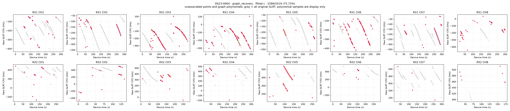

## DS23-0064 incumbent associated GLRT

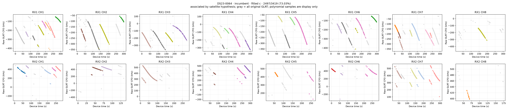

## DS23-0064 incumbent unassociated GLRT

## DS23-0064 independent paths 1

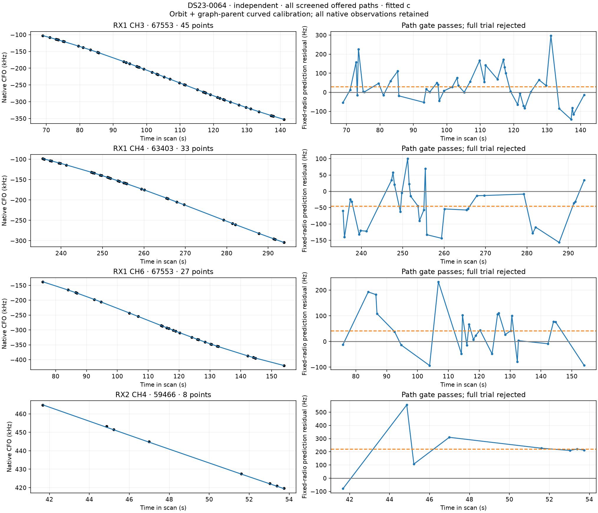

## DS23-0064 influence and controls

## DS23-0064 loss decomposition

## DS23-0064 loss gradient 10km

## DS23-0064 persistent5s paths 1

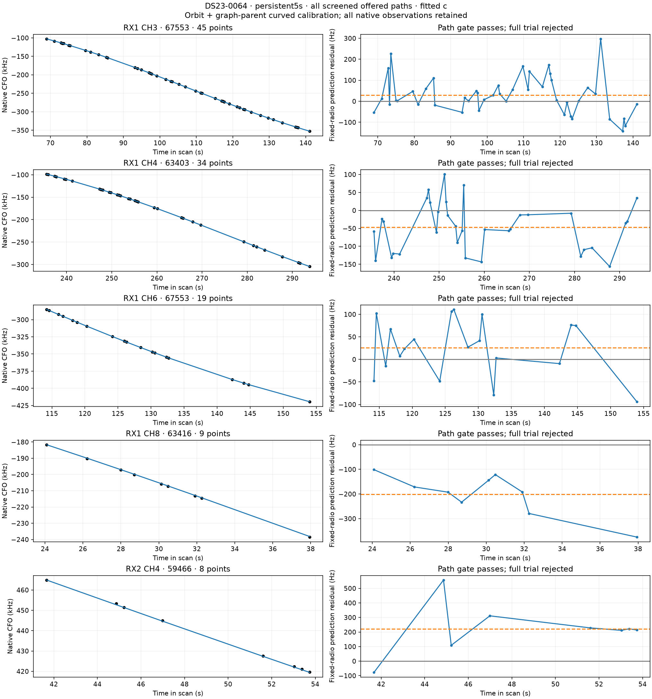

## DS23-0064 supported shared step associated GLRT

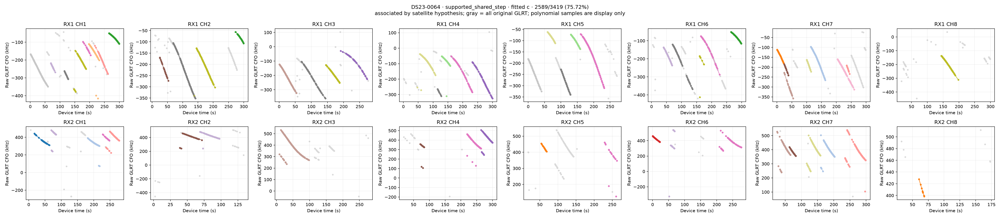

## DS23-0064 supported shared step unassociated GLRT

## DS23-0064 temporal policy associated GLRT

## DS23-0064 temporal policy unassociated GLRT

## DS23-0064 track residuals

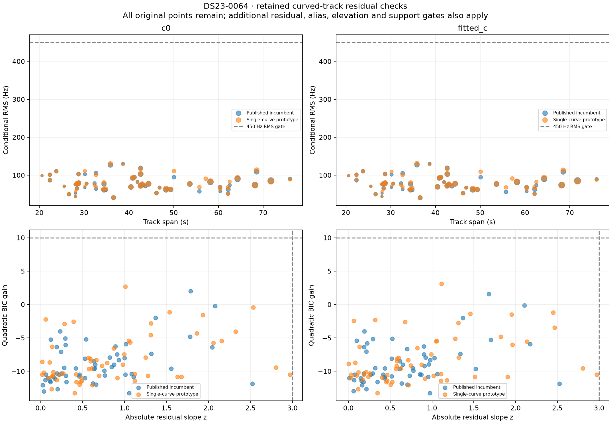

## DS23-0064 unused track TLE diagnostics

## DS23-0234 convergence 10km

## DS23-0234 event CFO and residuals

## DS23-0234 graph recovery associated GLRT

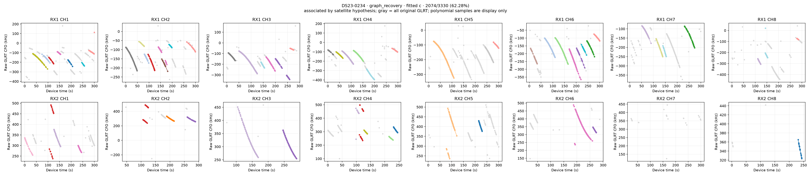

## DS23-0234 graph recovery unassociated GLRT

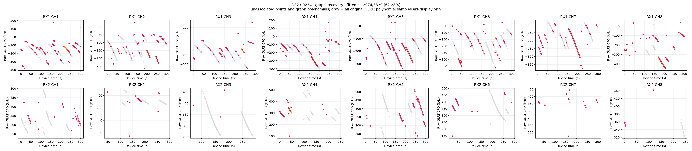

## DS23-0234 incumbent associated GLRT

## DS23-0234 incumbent unassociated GLRT

## DS23-0234 independent paths 1

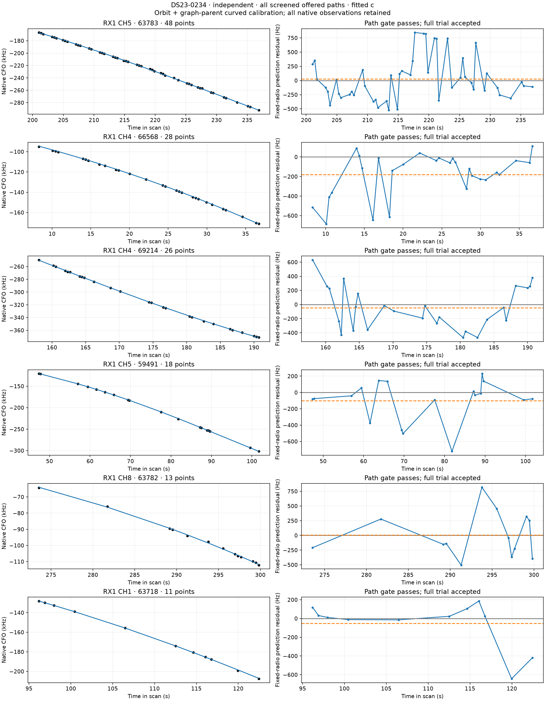

## DS23-0234 independent paths 2

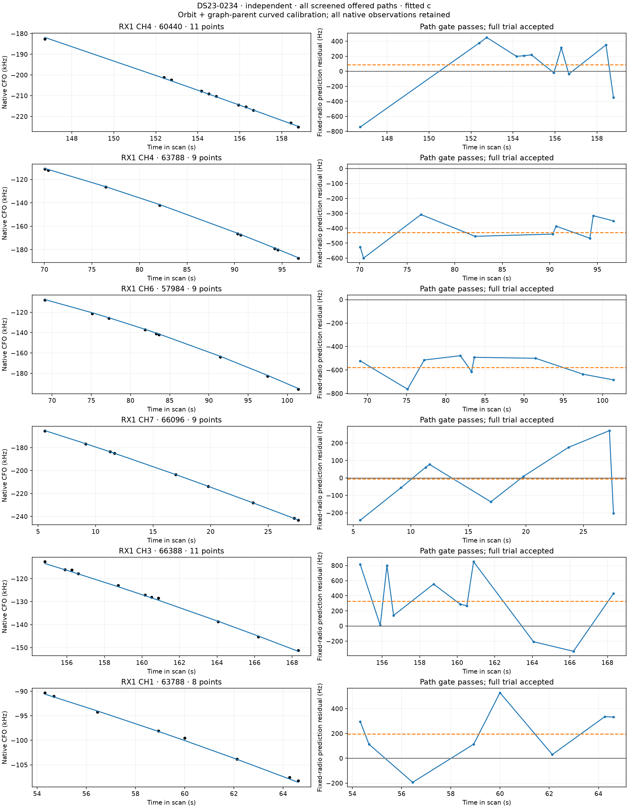

## DS23-0234 independent paths 3

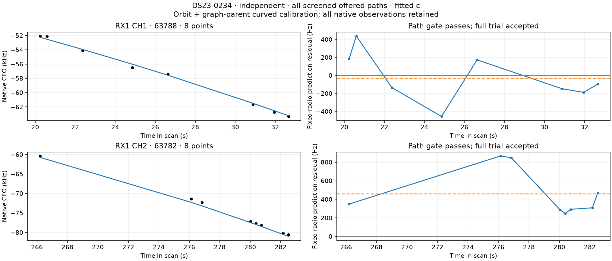

## DS23-0234 influence and controls

## DS23-0234 loss decomposition

## DS23-0234 loss gradient 10km

## DS23-0234 persistent5s paths 1

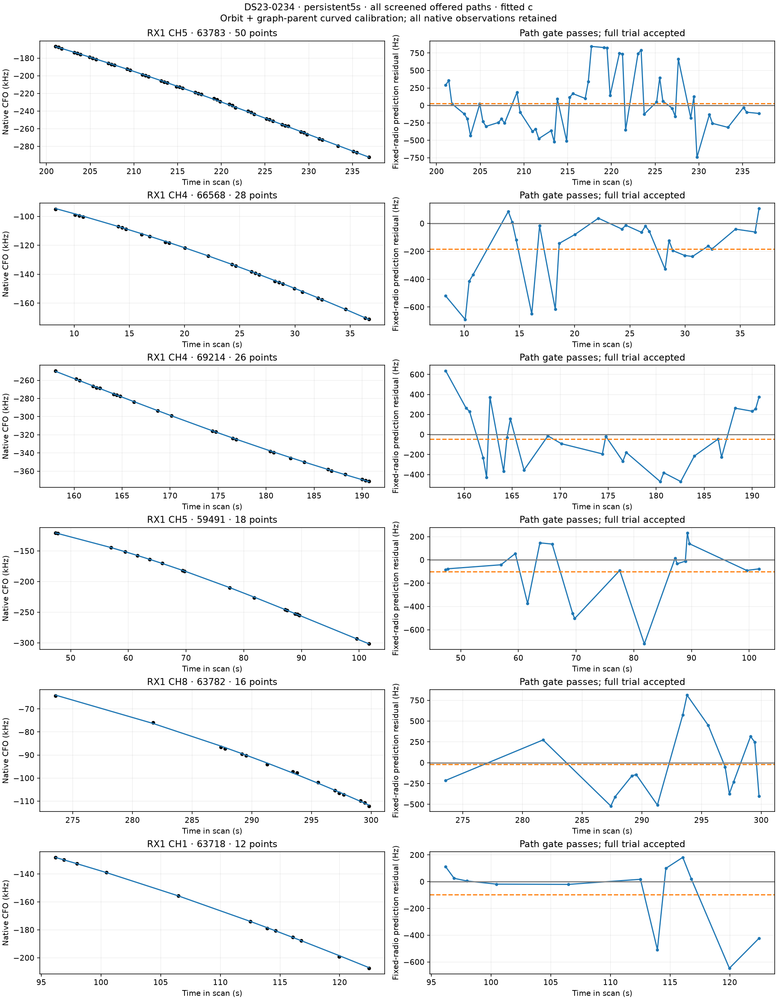

## DS23-0234 persistent5s paths 2

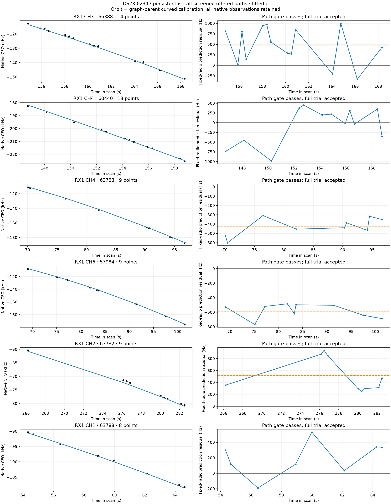

## DS23-0234 persistent5s paths 3

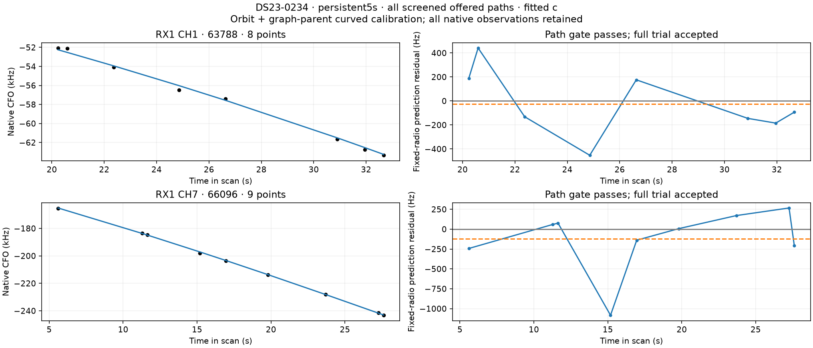

## DS23-0234 step model comparison

## DS23-0234 step transfer

## DS23-0234 supported shared step associated GLRT

## DS23-0234 supported shared step unassociated GLRT

## DS23-0234 temporal policy associated GLRT

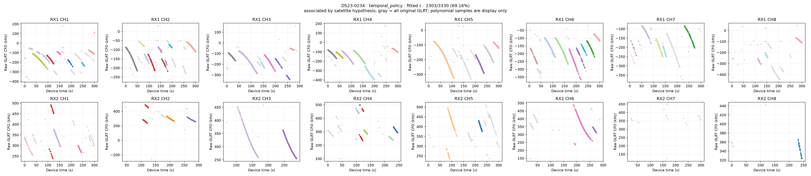

## DS23-0234 temporal policy unassociated GLRT

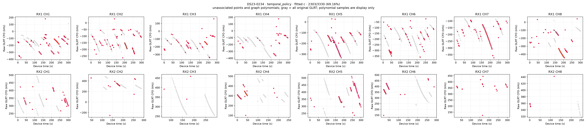

## DS23-0234 track residuals

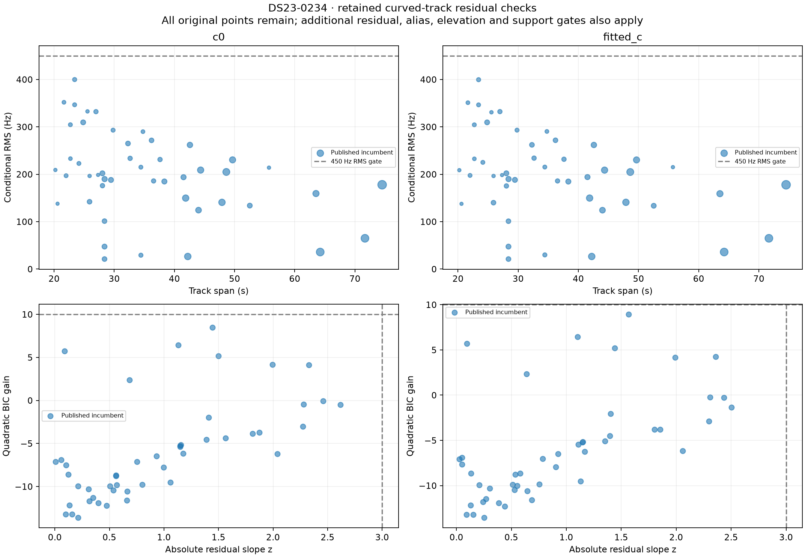

## DS23-0234 unused track TLE diagnostics

## historical timeout completed candidates

## iteration summary

