# DS23 DBG01 iteration013: shared RF steps, active mode support and deadline fallbacks

This bounded iteration builds on [ALGO02](../ALGO02/README.md) and the existing
[ALGO03 family-replacement research](../2026_10_22_ds23_family_cavity_full_assessment/README.md).
On **0234**, a penalized shared frequency step composed with the existing
active-owner support rule admits111 curved observations and improves fitted-c
position error **2.965→2.363km**. On **0064**, recovering one35-point curved
source improves **2.930→1.235km**. The original constrained temporal solver then
adds115 predictive points with essentially unchanged1.235km error and reaches
**79.09% associated GLRT**. Both improvements also appear with c=0.

These are local development results. Neither approach has demonstrated a new
full-DS23 improvement, and no new ALGO-series version is released. The canonical
410-scan fitted-c mean/median remain **1.469461/1.178102km**. Iteration011's
paired-positive guard remains a provisional1.462402/1.167197km candidate. The
**0.5km mean-and-median goal remains unmet**.

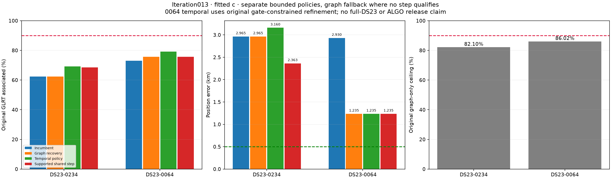

## Scope, data and controls

0234/0064 are the next two unclosed cases in the unchanged error-ranked debug
queue. GPS **37.849061591561885,-122.48574968092912** determines reporting and
debug priority only. Inference cold-starts at[0,0] in the original **25×25km box
centered37.906,-122.545**. No evaluation coordinate selects a satellite, event
time, nuisance parameter or accepted prototype.

The original GLRT detections, graph polynomials, causal catalogue, candidate
aliases, other priors, noise powers and c=0/fitted-c fitting budgets remain
matched. No new RF collection, IQ processing, stationary-position pooling or
trajectory model is used. Following TLEs are diagnostic only. Linear tracks
remain predictive evidence and never calibrate receiver corrections. New shared
frequency events are inferred from actively curved sources with a proper prior;
they are not free offsets fitted independently to linear tracks.

All original likelihood observations and associated IDs are retained in accepted
policies. Graph, temporal and shared-step variants are **separate experiments**;
their gains are not summed into an untested pipeline. The frozen [protocol](evidence/protocol.json)
and raw archives document every fit and failure.

|Scan|Method|Associated / all GLRT|Associated %|Curved / predictive likelihood points|c=0 error km|Fitted-c error km|
|---|---|---:|---:|---|---:|---:|
|0234|Incumbent / graph fallback|2074/3330|62.28|1646 /428|3.157629|2.964567|
|0234|Persistent temporal|2303/3330|69.16|1646 /657|3.326672|3.159593|
|0234|Supported shared receiver step|2284/3330|68.59|1757 /428|**2.493670**|**2.362716**|
|0064|Incumbent|2497/3419|73.03|2200 /297|2.791535|2.929738|
|0064|Whole-curve graph recovery|2589/3419|75.72|2235 /297|**1.525642**|**1.235169**|
|0064|Gate-constrained temporal|2704/3419|**79.09**|2235 /412|1.525692|1.235254|

The0234 shared-step row reports fitted-c coverage. Its c=0 coverage is
2240/3330=67.27%; both arms use the **same2185 likelihood observations**.
The difference is in post-fit association extensions, not a different inference
mask. The111 added curved points yield210 more fitted-c associations, including
99 additional post-fit extensions. In0064,35 new calibration points yield92
more associations, including57 post-fit extensions. Do not call all of these
additional calibration measurements.

Exact counts, fragment counts, points/fragment, RMS and gate qualification are
in [position/association](tables/position_and_association.csv),
[all trials](tables/prototype_trials.csv) and [all curved gates](tables/all_curved_gates.csv).
Frequency fit is not used as a substitute for geographic accuracy.

## 0234: why plausible long curved sources were rejected

The three original whole-source nominees are RX1 CH7 T000(67 points/56.057s,
67992), RX1 CH5 T007(44 points/55.715s,60440), and RX1 CH5 T004(43 points/35.836s,
63783). Each has one persisted polynomial piece. Default and support-aware
whole-curve trials all fail; no failed low-error trial is adopted.

The67-point67992 trial has fitted-c RMS217.0Hz but fails its step statistic:
**4.243>4**. Its conditional mean, slope, quadratic and lag-one correlation
screens otherwise pass. The44-point60440 trial instead has slope z3.699,
quadratic BIC gain19.88, step z5.110 and ACF0.708. The43-point63783 trial has
ACF≈0.739, above4/√43≈0.610, and can destabilize other retained families. These
are structured model discrepancies, not simply a450Hz RMS threshold problem.

Following elements do not remove the leading-source discrepancies. The matched
phase-only diagnostics are213.49→217.28Hz for67992,272.18→274.33Hz for60440,
and367.33→368.12Hz for63783(causal→following). These profiles are diagnostic
nuisance-conditioned fits, not satellite identity probabilities or accepted
regional solutions.

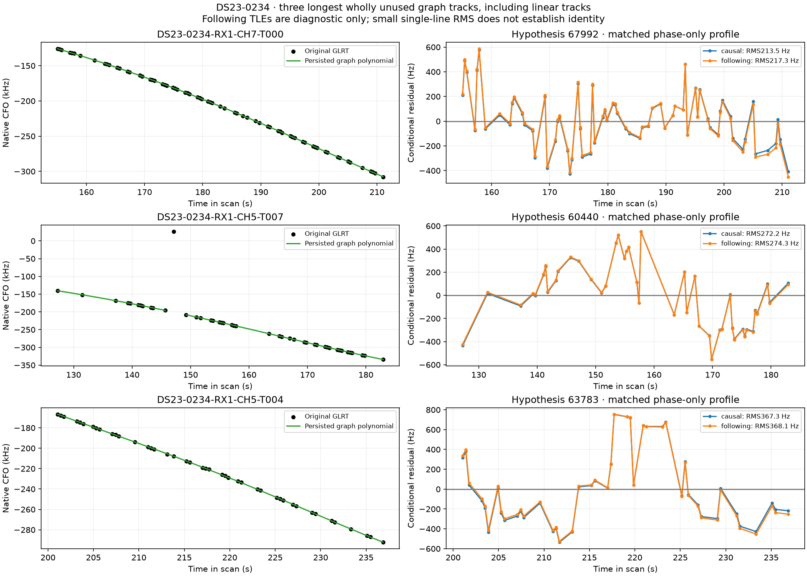
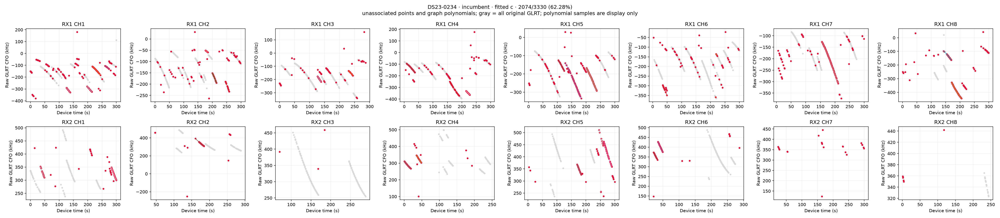

### One common RF event has support from another family

The maximum original CUSUM split of the67-point source falls at
**158.3847534s**, between its fourth and fifth observations. Its before-minus-
after mean difference is394.61Hz(step z4.225 in c=0). We then examine original
parent calibration sources from **other satellite families**, never the new
source itself. One60440 curve on RX1 CH6 spans the split with at least four
points on each side and independently suggests an after-minus-before step of
approximately **−521Hz**. Its affine-eliminated Gaussian proposal gain is about10.

Free affine removal here is a diagnostic to prevent a constant or linear error
from voting for a jump. It is not receiver calibration from linear evidence.
The other curve's residuals share the parent posterior and do not constitute
independent identity probabilities. The evidence warrants a bounded shared
event test, not a claim that a particular oscillator physically jumped.

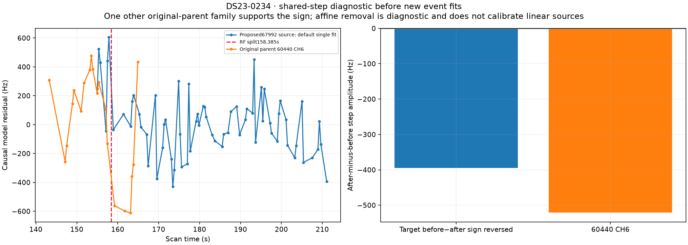

The experiment reuses the existing frequency-event model and **300Hz Gaussian
amplitude prior**. Time, receiver and band are fixed by the RF diagnostic before
new fits. We test two existing scopes: a high-band-only RX1 step and an RX1
step shared across bands. Each is fitted on the existing67-point single and
111-point two-source additions; the pair includes the60440 CH5 source spanning
the same time. No original point is trimmed.

Every event is compared with its **identical-mask, identical-base no-event null**.
Gaussian marginalization includes the event's complexity; a further fixed
time/model search penalty is **2log((67−7)×2)=9.57498**. Both calibration arms
must beat that penalty and pass all original gates. Raw scores from different
observation masks are not ranked against one another. Only after qualification
does the policy prefer more added points, then the lowest c=0 bound within that
scope. This selection is sealed before geographic evaluation.

### The step alone reveals a second gate: unsupported orbital modes

The ordinary-base event fits clear the conditional residual screens but still
fail overall qualification. The67992 family has only one active receiver/channel
owner, while its orbital design retains three shape coordinates because of
inactive nominated owners. The unchanged final support gate requires at least
two active owners when those modes are enabled.

The correction is to compose the event with the **already implemented support-aware
base**: preserve all incumbent curved/predictive modes, keep the new family's
phase, and remove its unsupported three shape modes. This adds no orbital
freedom and does not relax the two-owner gate. The one-owner simplification
without the shared event still fails the step screen; both existing pieces
are needed here.

The event constructor now accepts an optional base-problem factory. The default
factory is unchanged, and all eight pre-hook event endpoint arms replay
numerically. Old sources are preserved in the raw evidence. Zero-event support
nulls replay exactly, including reuse of the previously completed67-point null;
the111-point support null is newly fitted under the same declared budget.

|Supported event|Added curved points|c=0 error km|Fitted-c error km|Paired final gates|
|---|---:|---:|---:|---|
|RX1 high band|111|2.689146|2.527965|Pass|
|RX1 shared across bands|111|**2.493670**|**2.362716**|Pass|
|RX1 high band|67|3.041359|2.883504|Pass|
|RX1 shared across bands|67|2.884588|2.760073|Pass|

The selected111-point receiver-wide event has amplitudes−620.86Hz(c=0) and
−618.91Hz(fitted c), about2.1 prior standard deviations. Its matched-null RF
gains are53.3169/52.5466, above9.57498. The target's residual step statistics
fall below4 and all conditional/profile/support, elevation, alias and phase
checks pass. Original associated IDs are preserved in both arms. The exact
hardware versus processing cause remains unresolved; the parsimonious supported
object is a shared frequency event.

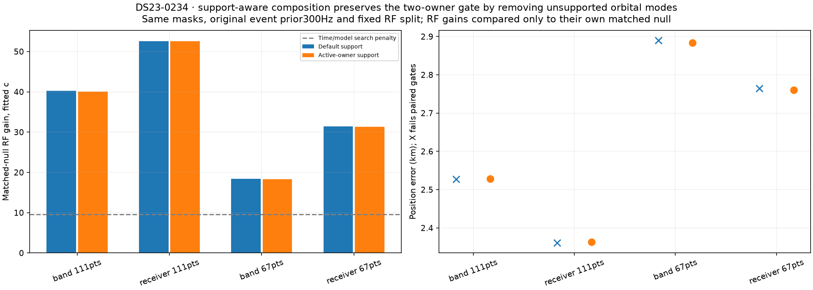
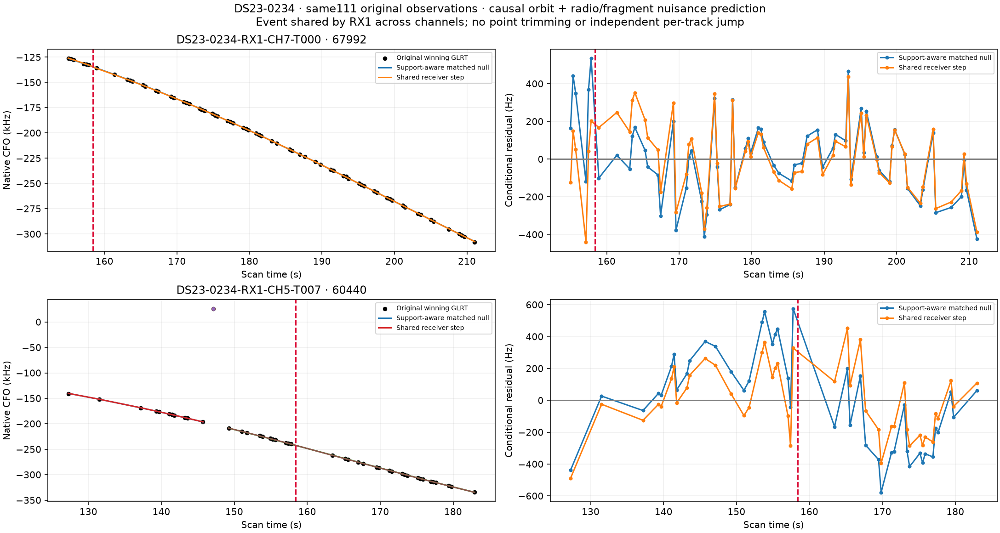
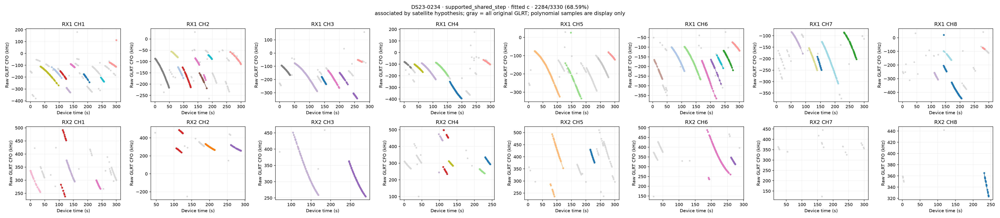
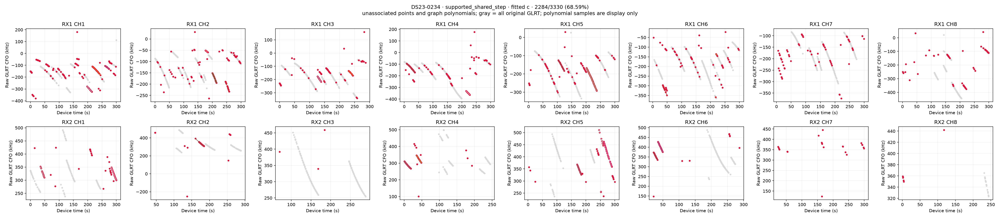

Native CFO uses the GLRT's actual alias gauge; plotted curves break at alias
changes. Predictions include causal orbit, radio and declared fragment nuisance
terms. The event is shared by the receiver, not fitted independently per source.
Gray is all original GLRT, red is unused, and graph polynomial samples are for
display only.

### Other bounded controls remain negative

The unchanged persistent native search adds229 predictive points and reaches
69.16%, yet worsens fitted-c error to3.160km. The independent-state control
adds217 points and gives3.020km, also worse than the incumbent. Both pass their
final gates; higher coverage alone does not establish improvement.

One additional point-rich source outside the initial three-longest budget,
RX1 CH8 T000(44 points), nominates69214. Its support-aware fit fails. No broader
catalogue/threshold sweep or forced assignment is performed.

## 0064: useful curved evidence and a constrained temporal solution

RX1 CH4 T004 has35 original points over232.030–289.197s, one polynomial piece,
and a strong causal63403 nomination. Its complete regional refit passes both
arms and improves fitted-c error2.930→1.235km. The following-element profile
does not improve the nomination(74.12→82.03Hz). Other leading additions remain
structured:69953 on RX1 CH4 T006 has quadratic residual BIC≈13.0(limit10), and
58437 on RX2 CH5 T000 has residual slope z≈4.01(limit3) and step z≈4.72(limit4).
Their low RMS values around125/131Hz are insufficient for acceptance.

The native search initially offers115 persistent predictive points. Its cold
solution fails the retained63403 source's ACF gate: fitted-c0.68122 versus
4/√35≈0.67612. The minimum normalized slacks are−0.00279/−0.00753, inside the
unchanged near-feasible trigger≥−0.25. The existing constrained solver retains
all frozen paths, masks, priors and original gate thresholds and converges to
a paired-valid result with all parent IDs preserved.

Its fitted-c error is **1.235254km**, only0.085m different from the graph parent,
while association rises2589→2704 points, **75.72→79.09%**. Curved calibration
remains2235 points; predictive likelihood points rise297→412. This is a coverage
gain with essentially unchanged position, not another1.7km accuracy gain.
The unconstrained independent113-point result is rejected, not reported as an
accepted alternative. No shared-step target qualifies on0064.

A separate49-point extra-source trial(RX1 CH7 T003,69839) also fails. Its
lower-error-looking fit is not selected from GPS or used to bypass the gates.

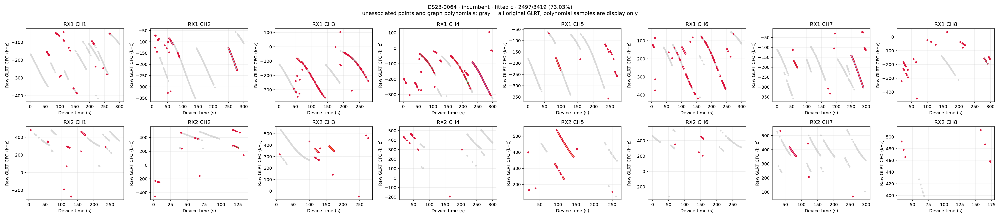
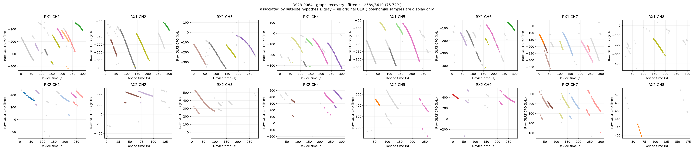
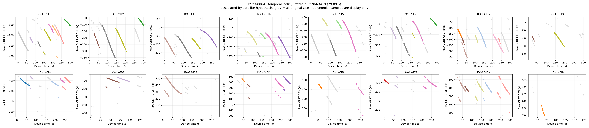
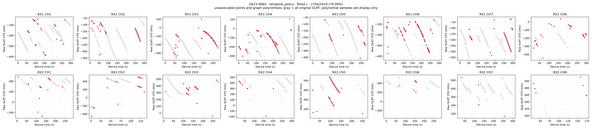
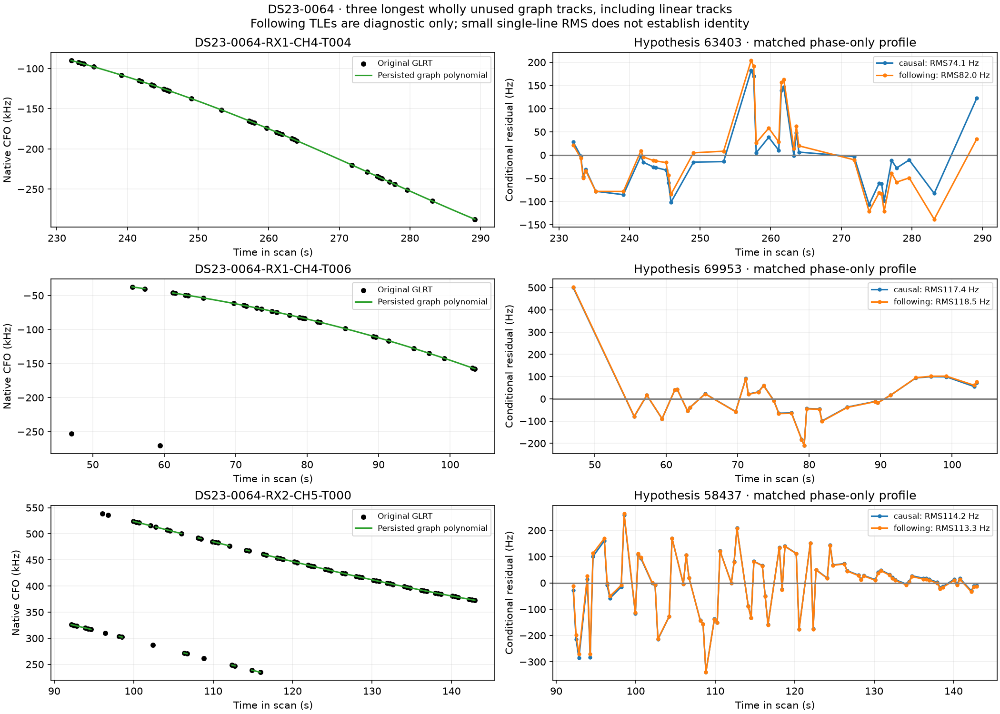

The detailed offered-path pages in the [figure gallery](FIGURES.md) retain their
unconstrained trial labels, including rejected paths. The accepted constrained
result uses the same native IDs and is identified separately in the summary
and [trial CSV](tables/prototype_trials.csv).

## DBG01 surfaces, starts and family ablations

Loss surfaces use the same incumbent likelihood observations at each spatial
pixel, refreshing phases. They do not rerun acquisition or a full catalogue
search per pixel. Arrows indicate descent direction. The independent81-start
plots use the existing bounded curved-association bank: labels/aliases can change
under the c=0 rule, fitted c follows its schedule and predictive labels remain
fixed. Purple open diamonds are intermediate phase-round endpoints; final
orange X marks follow five rounds. GPS is report-only. These figures describe
the incumbent rather than the new event model.

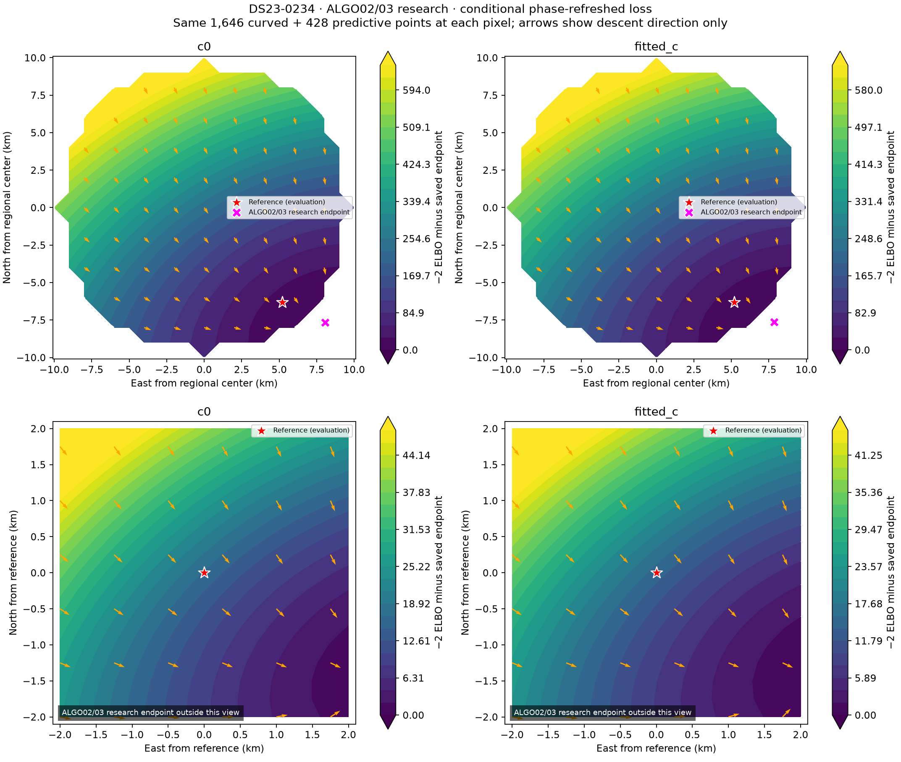
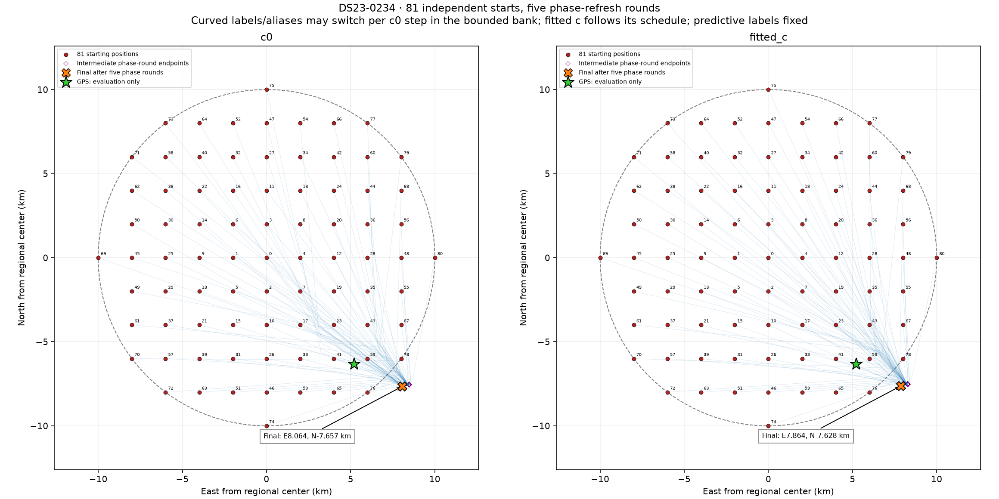
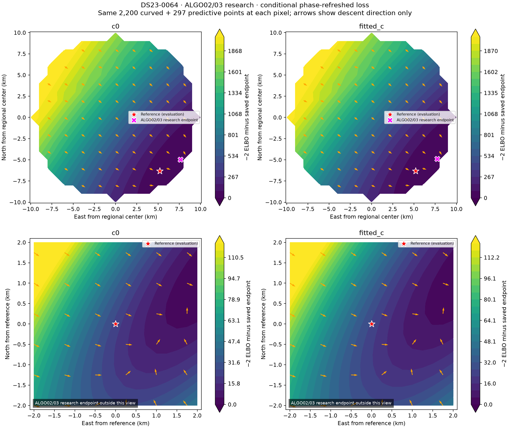
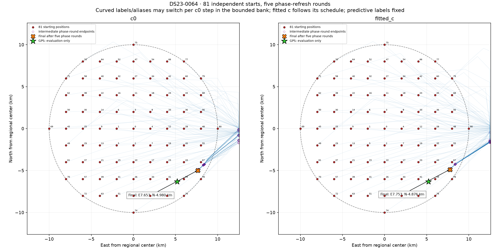

Best paired-valid fitted-c family-deletion diagnostics reach2.463km in0234
(drop63783) and2.776km in0064(drop63030). No single removed family cures the
bias. These deletions are ranked by GPS for explanation only; no deletion is
adopted. Generic prior controls and all source ablations remain in the evidence.

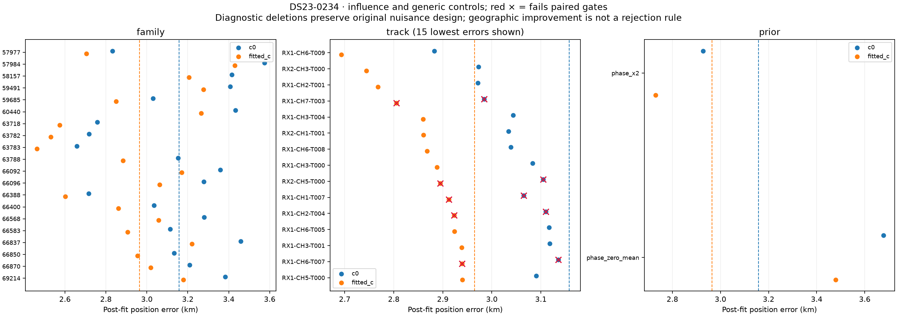
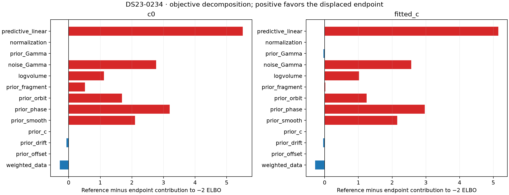
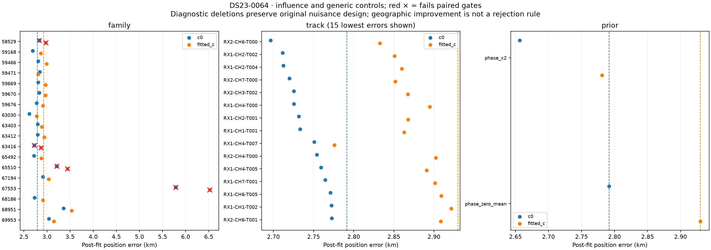
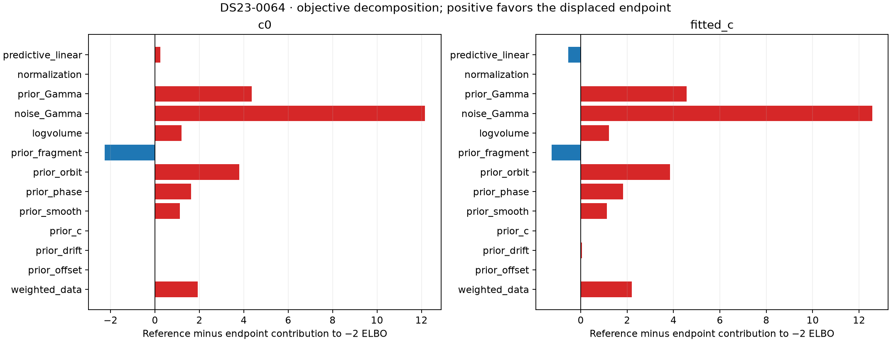

The original graph-only ceilings are2734/3330=82.10% and2941/3419=86.02%.
Even perfect graph association requires at least263/137 additional outside-graph
points respectively to reach90%. Native recovery can use supported original
detections outside the graph, but no observation is assigned to force90%.

## A separate execution bottleneck in the archived full run

Reviewing existing approaches also found that both historical owner-reentry
searches had a **completed candidate with saved passing paired gates**, then
timed out while evaluating later candidates. Each400s timeout returned the
incumbent and omitted final selection. These archived candidates use a different
fine receiver basis and different additions; this is context, not a matched
ablation against the new event model.

|Archived case|Completed partial addition|Saved passing candidate, fitted-c km|Returned policy, fitted-c km|Search status|
|---|---:|---:|---:|---|
|0234|86 points|3.872852|2.964567|400s budget exhausted|
|0064|89 points|1.091624|2.929738|400s budget exhausted|

There is exactly one completed passing candidate in each record, so this table
does not choose among candidates using geography. Its saved phase changes are
below0.01s. Fresh independent qualification of partial candidates and a
full-population deadline-rescue replay are **still required** before adoption.
The0234 example also shows why retaining a passing candidate is not automatically
a localization improvement. A sensible follow-up is an RF-only policy that
returns the best fully completed, qualified candidate available at a deadline,
with provenance and incomplete-search status, rather than silently discarding
all progress. It must be evaluated across the full available population and
against the correct unchanged incumbent context.

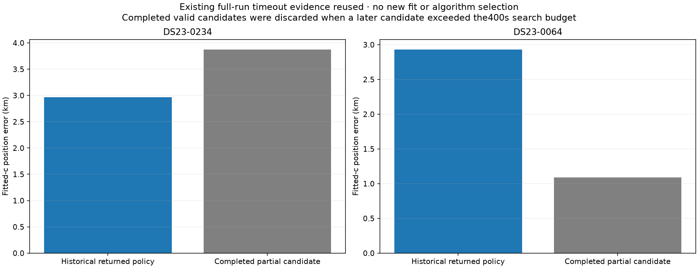

## Validation, artifacts and next work

All standard numerical stages terminate and pass. The standard DBG01 audit
checks **622 endpoint arms and42 nomination densities**. An additional
**30 recovery/event endpoint arms** and **eight matched no-event null arms**
replay expected RF log densities, coefficient equations, dense predictive
covariance, every original curved/predictive gate and physical-ID membership.
This includes independent event design construction and the correct placement
of fragment priors before the appended event coordinate. **15 component tests
pass**, including event units/scope, affine-resistant transfer diagnostics,
unchanged near-feasible eligibility, point-rich selection and explicit base-factory
injection. No public persisted contract or golden fixture changes.

The report includes **41 figures,11 CSV tables and five raw-evidence archives**,
all below45MiB. See [all figures](FIGURES.md), [tables](tables/),
[evaluation](evidence/evaluation.json), [standard audit](evidence/independent_iteration_audit.json),
[new endpoint audit](evidence/recovery_endpoint_audit.json),
[matched-null audit](evidence/step_null_audit.json),
[archive hashes](evidence/archive_manifest.json), and [source snapshots](source/).
Radio inputs remain referenced rather than copied into Git. Source snapshots
require the existing research environment and prior source freezes.

For reconstruction in a fresh output root: run the iteration013 batch, existing
track diagnostics/native paths, near-feasible refinement, extra-curve control,
step-transfer diagnostic, ordinary-base step experiment, support-aware step
composition, independent endpoint/null audits and report builder. Frozen
protocols specify every candidate, time, prior, budget and unchanged gate.
Do not overwrite original experiment outputs or reclassify failed models.

The next unclosed debug cases are determined from the unchanged benchmark.
Before further nuisance expansion, audit the completed-candidate deadline
behavior across archived DS23 outputs. The shared-step composition is an
RF-supported local candidate; prior negative frequency-event cohort results
still apply. New ALGO-series releases require credible matched full-DS23
accuracy, coverage, regression and qualification evidence. These cases remain
above0.5km, and no new-location performance is established.
