# DS23 DBG01 iteration014: missing owners, shared receiver steps and false curvature

This bounded iteration continues the existing [ALGO02](../ALGO02/README.md) and
[ALGO03](../2026_10_22_ds23_family_cavity_full_assessment/README.md) approaches
on the next two unclosed worst-error scans, **0202 and0262**. In0202, recovering
two curves as67335 adds71 calibration points but barely changes position.
Existing persistent temporal prediction adds56 more points and improves
fitted-c error **2.913→2.765 km**, reaching **76.96%** association.

In0262, a receiver-wide frequency step supported by a different original curved
family on the other band recovers the entire81-point longest unused curve.
It passes every original gate and improves **2.886→2.760 km**, reaching
**70.98%** association. A separate persistent temporal experiment reaches
**72.43%** and **2.621 km**. These are separate experiments; their improvements
are not added into an untested combined pipeline.

The changes are local development results. **No new ALGO version is released.**
The canonical410-scan fitted-c mean/median remain **1.469461/1.178102 km**.
The separate [completed-deadline assessment](../2026_10_23_ds23_completed_deadline_assessment/README.md)
remains a provisional1.453353/1.161472 km candidate, with two regressions and
inconclusive temporal uncertainty. The **0.5 km mean-and-median goal remains
unmet**. Both cases are closed after these bounded tests; the next batch is
selected from the unchanged benchmark.

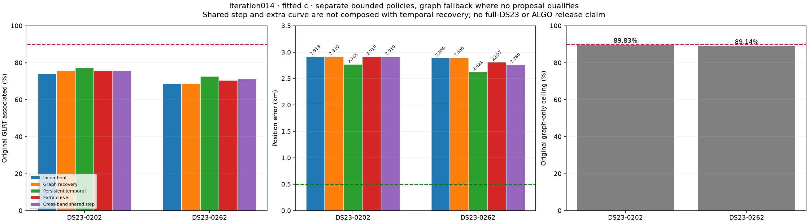

## Controls and scope

Inference uses the original **25×25 km box centered37.906,-122.545**, cold
starts at its center, the causal catalogue, original GLRT measurements and
aliases, and existing phase, orbital, receiver and noise priors. Evaluation GPS
**37.849061591561885,-122.48574968092912** ranks debug cases and measures frozen
outcomes only. It does not select a satellite, event time, model or accepted
point. Following TLEs are diagnostic only.

Every comparison includes matched c=0 and fitted-c arms, with the same
observations, candidate sets, aliases, other priors and budgets. No RF was
collected or IQ reprocessed. There is no trajectory model or stationary-history
pooling. Original contracts and polynomial fixtures are unchanged. Every
accepted policy preserves all original associated measurement IDs.

The graph nomination budget remains the three longest wholly unused actively
curved sources. Its default and support-aware fitters, native-time union,
physical gates and near-feasible controls are reused. An additional fixed
point-priority budget tests one dense source omitted by span ordering. Temporal
recovery uses the existing independent and5-second persistent methods,19
permutation controls, fixed-parent residual checks and paired identity/alias
requirements. New temporal measurements remain predictive-only.

|Scan|Method|Associated /all GLRT|Associated %|Curved /predictive likelihood points|c=0 error km|Fitted-c error km|
|---|---|---:|---:|---:|---:|---:|
|0202|Incumbent|3186/4305|74.01|2575 /611|2.923424|2.912873|
|0202|Whole-curve graph recovery|3257/4305|75.66|2646 /611|2.920649|2.910381|
|0202|Persistent temporal, on graph parent|3313/4305|**76.96**|2646 /667|**2.786271**|**2.764694**|
|0262|Incumbent /graph fallback|2429/3536|68.69|1953 /476|2.916879|2.886298|
|0262|Extra whole curve|2485/3536|70.28|2009 /476|2.839894|2.807415|
|0262|Shared receiver step|2510/3536|70.98|2034 /476|2.799395|2.759983|
|0262|Persistent temporal, on incumbent|2561/3536|**72.43**|1953 /608|**2.632574**|**2.620914**|

The independent temporal control adds63 points in0202 and196 in0262. It gives
fitted-c errors2.746964 and2.907453 km respectively. It therefore explains
**more points while worsening0262's position**. The persistent method is the
predeclared primary, not a choice made by looking at these geographic errors.
Neither temporal result requires near-feasible refinement in this batch.

The [full table](tables/position_and_association.csv) includes fragment counts,
points/fragment, associated points outside the likelihood, RMS, phase checks
and original IDs lost. Separate controls retain the graph fallback when they
have no proposal; repeated fallback rows are not extra discoveries.

## 0202: additional evidence does not move the biased minimum very far

RX2 CH3 T001 has34 points over40.128 s, and RX2 CH2 T001 has37 over25.918 s.
Both support67335 in the full causal nomination. Each standalone fit passes;
their71-point union also passes and is selected by the existing added-point
rule. The original64442 alternative fails residual structure checks.

Matched diagnostic phase-only RMS values are **55.89→53.81 Hz** and
**43.87→43.41 Hz** using causal→following elements for67335. Following
elements do not uncover a large missing orbital correction. These are
fixed-radio profiles, not calibrated identity probabilities.

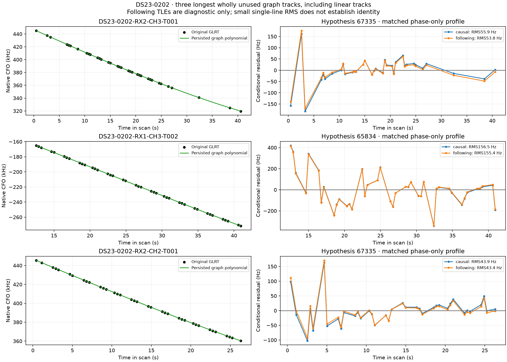

Despite71 added calibration observations and lower RMS, graph recovery changes
fitted-c error by only **2.5 m**. Persistent prediction adds another56 points
and improves the graph parent by about146 m. The result still has2.765 km
error. Missing associations explain some coverage loss, but they are not the
whole localization bottleneck.

### An isolated point creates unsupported high-order curvature

RX1 CH1 T005 contains21 points in one persisted degree4 polynomial. Its first
point is at128.553 s; the next is at138.149 s, a **9.596 s gap**. The first
point's polynomial leverage is **0.999790**. A fourth-order curve can interpolate
that isolated point and then follow the20-point cluster while introducing
curvature across a region with no measurements.

The original whole-source satellite trials have profile RMS about4.65 kHz.
The existing single-deletion diagnostic shows why apparent curvature is
misleading: omitting the isolated first point diagnostically reduces linear
RMS from4785 to **143.70 Hz**, with quadratic BIC gain **8.326**. The whole
source fails the existing requirement that nonlinear support survive every
single-point deletion. Its20-point core also lacks sufficiently strong,
distributed active curvature.

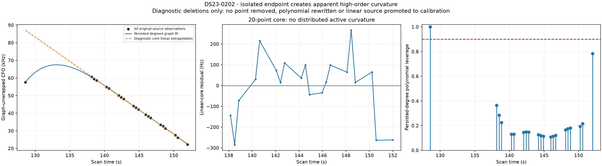

This does not prove which satellite produced the isolated measurement. It
shows that this polynomial is unsuitable as a single actively curved calibration
source. The original point and polynomial remain intact, no point is removed,
and the20-point cluster is not promoted to receiver calibration. The frozen
active-family temporal search does not accept those source IDs either.

## 0262: the longest unused curve needs a shared RF correction

RX1 CH5 T003 has **81 points from61.929 to120.839 s** and one polynomial piece.
The leading causal hypothesis is58840. Its default fitted-c conditional RMS is
only189.39 Hz, but the step statistic is **4.225>4**. Its mean, slope,
quadratic and lag-one screens pass. The same addition also pushes the original
RX2 CH5 /68311 source just beyond the slope screen, approximately3.030>3.
Simply admitting a low-RMS track would violate two original source checks.

The phase-only following-element diagnostic is **187.95→189.46 Hz**, so the
nearest available following TLE does not remove the discrepancy. The source is
independently curved: linear RMS remains above **6031.85 Hz** and quadratic BIC
gain above **494.64** under every single-point deletion.

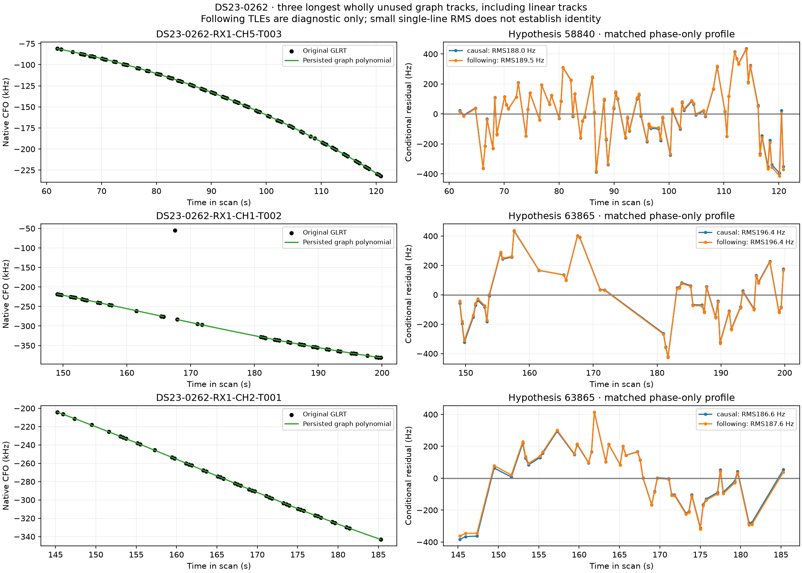

### Receiver-wide support can cross the band boundary

The original maximum CUSUM split nominates **116.4028998 s**. The target's
before-minus-after residual difference is297.77 Hz. The unchanged iteration013
rule requires another original curved family on another **same-band** channel;
neither scan qualifies, so it launches no event fits.

However, an original RX1 CH1 /62151 calibration source spans the split on the
other band. Its18 retained original calibration points independently pass the
curvature jackknife: minimum linear RMS **287.96 Hz**, minimum quadratic BIC
gain **19.82**. After diagnostic affine elimination, this source suggests an
after-minus-before step of **−639.12 Hz**, with a300 Hz prior and RF proposal
gain26.64. It supports the target's sign without reusing its family.

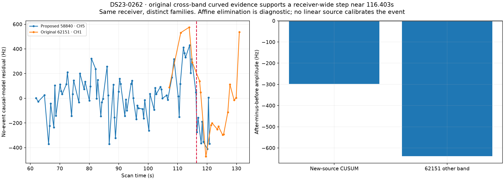

The bounded extension permits **other-band evidence for a receiver-wide event**.
It does not permit other-band evidence to justify a band-only correction. There
is one time, one receiver and one shared coefficient; no independent per-source
jumps are fitted. Both the default and existing support-aware bases are tested,
with default-first acceptance fixed before geographic evaluation.

The event keeps the original **N(0,300² Hz²)** prior and the fixed search
penalty **2log((81−7)×2)=9.9944**. Both arms must beat their identical-mask
no-event control by that amount, pass every original gate and retain every
original associated ID. Each new fit uses the existing five phase rounds and
48 position steps from the regional center. No threshold is relaxed.

Both bases reach the same event endpoint. The learned shared amplitude is
**−365.59 Hz with c=0** and **−364.83 Hz with fitted c**. RF gains against the
archived default null are63.12/61.59; the unconstrained support-base null gives
**39.33/39.08**, still above the penalty. The archived default null includes
an attempted gate-constrained refinement, so its larger gain should not be
attributed entirely to the event. Both nulls and event states replay exactly.

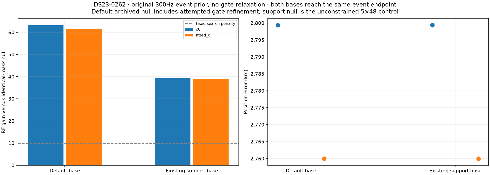
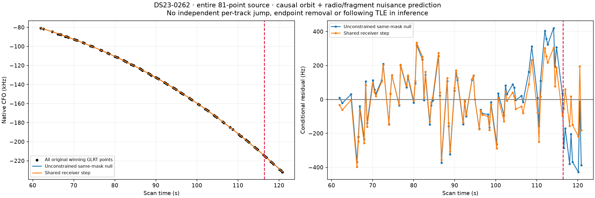

With fitted c, target RMS becomes **158.24 Hz**, step statistic **2.678**,
lag-one correlation **0.206**, slope z **0.432**, and quadratic BIC gain
**−12.21**. All original sources, including68311, now pass. Position improves
by126 m and association rises by81 points. The modest geographic improvement
shows that repairing this genuine residual discrepancy does not eliminate
the scan's larger position bias. The evidence supports a shared RF event; it
does not establish a particular hardware cause.

### Family tension persists, but the obvious alternative fails

Default attempts to add RX1 CH1 T002(45 points) and CH2 T001(44 points) as63865
fail correlated-residual checks. Their89-point union has fitted-c lag-one
correlations about0.675/0.692, and an original CH8 /63865 source has a4.372
step statistic. Following-element profiles for63865 barely change:
196.419→196.414 Hz and186.612→187.608 Hz.

DBG01 family deletion shows that removing63865 diagnostically reduces fitted-c
error to **1.172 km**, with lower coverage. This is evidence of tension, not
proof of a wrong identity or permission to delete the family using GPS.

We test a bounded hypothesis selected from RF failures: the largest failed
multi-source addition to an already active family. Exclude that complete family
before estimating radio calibration, add the two unused owners to its predictive
nomination, and search the complete causal catalogue coarsely with the best
seven candidates refined. The strongest phase-qualified alternative is67119.
Then jointly relabel the entire original family and its two new sources, keeping
the identical augmented likelihood mask and original priors and fit budgets.

The existing63865 augmented fit is reused. The67119 alternative has **worse
corrected RF evidence by339.45/337.08** in c=0/fitted-c and fails five curved
source gates. Its lower2.256 km fitted-c error is therefore rejected. The
alternative merges with an already present67119 family, so the normalization
removes the existing unused-phase variational gap consistently. No original
likelihood point is deleted and no invalid low-error fit is adopted.

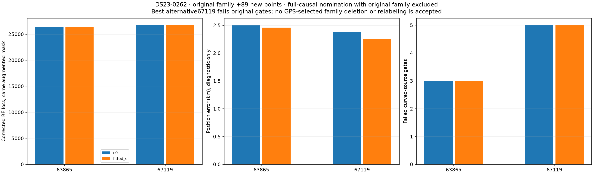

This bounded test does not resolve63865's discrepancy. It rules out the
strongest tested causal replacement under the same physical model. Further
case-specific parameter tuning is deferred; the batch moves on.

## Loss surfaces, descent and family ablations

Each scan retains DBG01's 10 km loss/gradient maps, decomposition, family and
track ablations, nuisance-prior controls and **81 independent starting points**.
All81 recorded final endpoints per scan pass the restart compatibility checks.
The best RF gains are only4.67×10⁻⁸ in0202 and−3.20×10⁻⁹ in0262, below
the2log4 restart penalty. No restart is adopted. These experiments do not show
a better reachable minimum under the incumbent likelihood.

Purple diamonds are intermediate phase-round endpoints. Orange X marks the
final endpoint after five phase-refresh rounds; the red points are independent
starts. Curved labels and aliases may change within the bounded causal bank
under the c=0 step schedule; fitted c follows that schedule, while original
predictive labels remain fixed. This is not an exhaustive assignment search.
Loss-map pixels evaluate the recorded conditional model, not a complete GLRT
and satellite-discovery rerun at each pixel.

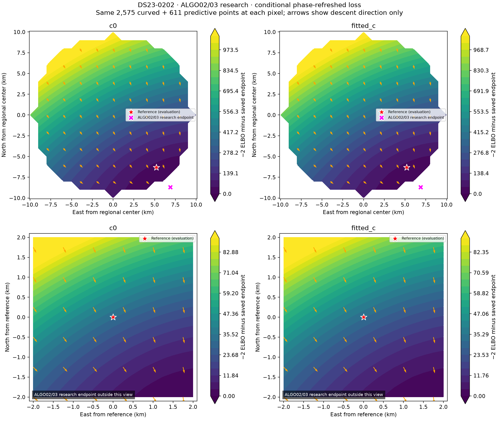
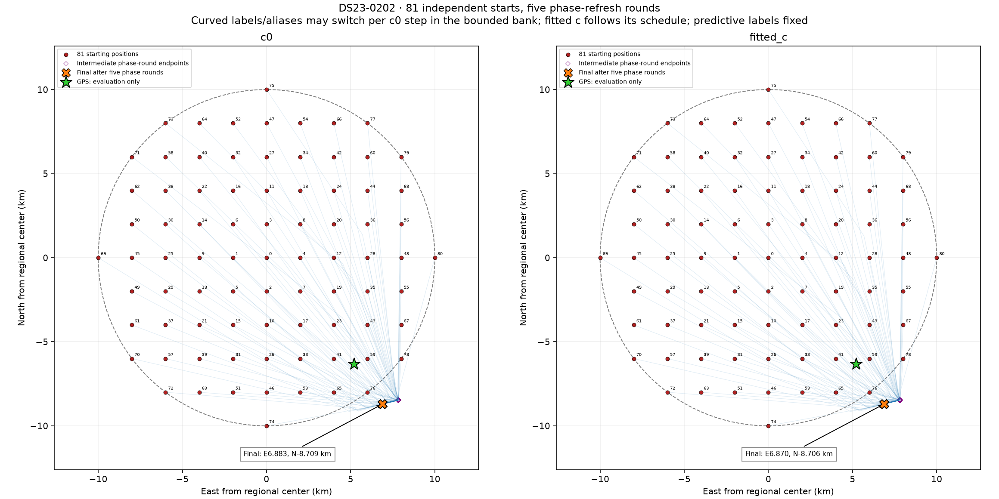
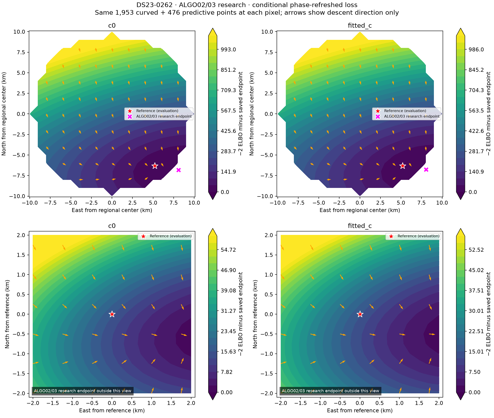
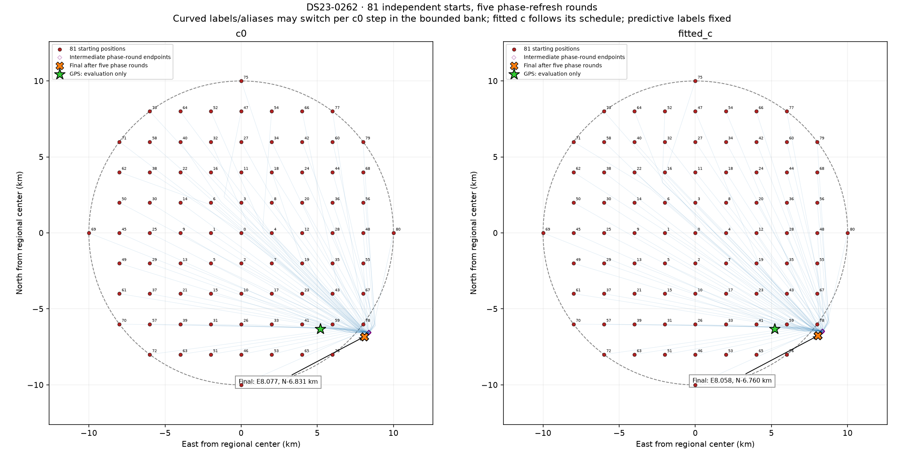

Deleting62503 gives0202's lowest paired-valid family-deletion error,
**2.200 km**. Deleting63865 gives0262's1.172 km. These outcomes are reported
as GPS-evaluated diagnostics only. They are not inference policies or proof
that one bad satellite explains either scan.

## Coverage limits and figures

Even associating every existing graph point could cover only **3867/4305
(89.83%)** in0202 and **3152/3536 (89.14%)** in0262. Reaching90% therefore
requires at least8 and31 original measurements outside the current graph,
respectively. Neither recovering graph fragments nor relaxing satellite gates
alone can meet that target honestly. Existing native temporal search can reach
outside-graph measurements while keeping identity, alias, visibility and
residual checks; its higher coverage is still not a guarantee of better position.

Gray always means **all original GLRT as context**. Red highlights unused
original points in the unused-evidence figures. Colored curves show the
corresponding graph polynomials; polynomial samples are never counted as
measurements. Associated plots color points by satellite hypothesis.

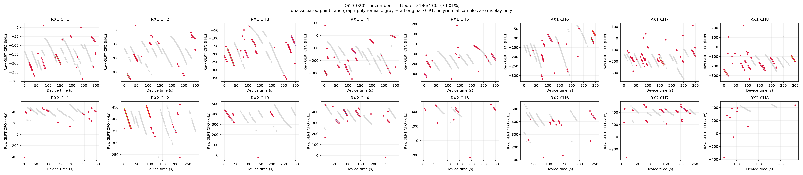
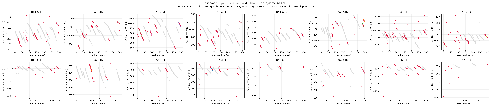
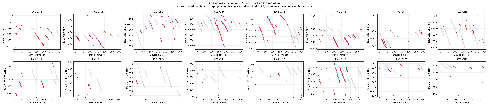

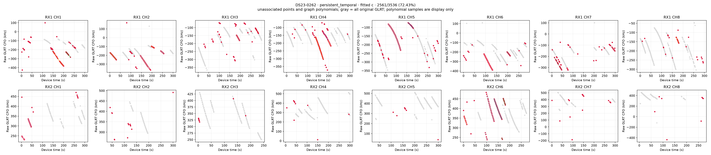

All associated/unused plots, native predictive-path CFO/residual pages,
per-track residuals, ablations and controls are in the [48-figure gallery](FIGURES.md).

## Validation, reproduction and decision

All13 standard stages complete with scientific receipts. The independent
standard audit checks **666 endpoint arms and43 nomination densities**.
Additional independent replay checks **18 temporal, extra-curve, event and
matched-null arms**, plus **four augmented-family arms**, including rejected
controls. Expected densities, coefficient equations, predictive covariance,
original residual gates and accepted IDs replay. Ten component-owned tests
cover runner ordering, safe resume, unchanged driver bindings, cross-band
support and atomic complete-family relabeling.

The initial orchestration process exited with143 while a position worker
continued. Its completed scientific receipt was verified and preserved; no
position fit was restarted. An explicit detached resume completed the remaining
stages within the original total1800-second standard-batch budget. The
[resume receipt](evidence/orchestration_resume.json) preserves this distinction
instead of inventing a successful process exit code. Separate bounded recovery
and hypothesis budgets are recorded in their raw protocols.

Reproduce with the source snapshots and original ALGO02/ALGO03 inputs, using
the existing virtual environment, `PYTHONDONTWRITEBYTECODE=1`,
`PYTHONPATH=/tmp/algo03-feasible-deps:src:tools`, and BLAS threads set to1:

1. `run_ds23_dbg01_iteration_014.py --batch` produces standard DBG01 and graph
   recovery receipts. Its explicit resume script is only for the recorded
   interrupted orchestration, not a second fit campaign.
2. `probe_ds23_iteration014_recovery.py --stage diagnostics`, `paths`,
   `feasibility` and `extra` bind the existing recovery drivers to this batch.
3. `probe_ds23_iteration014_step_transfer.py --stage diagnostic` and `default`
   apply the unchanged013 rule, which nominates no same-band event fits here.
   `probe_ds23_iteration014_cross_band_step.py` tests the receiver-wide extension.
4. `diagnose_ds23_iteration014_false_curvature.py` records source integrity
   without modifying observations or contracts.
   `probe_ds23_iteration014_augmented_family.py` tests the bounded whole-family
   replacement; its nomination and selection use no geographic errors.
5. Run the two014 independent audit scripts, then
   `report_ds23_dbg01_iteration_014.py`. `--supplement` adds the late family and
   curvature controls to an existing atlas without refitting or rerendering it.

Exact [positions/coverage](tables/position_and_association.csv),
[all prototype trials](tables/prototype_trials.csv), [curved gates](tables/all_curved_gates.csv),
[family ablations](tables/family_ablations.csv), [interventions](tables/all_interventions.csv),
[TLE diagnostics](tables/following_TLE_profiles.csv), [source integrity](tables/source_integrity.csv),
[curvature witnesses](tables/curvature_witnesses.csv), [event controls](tables/shared_step_models.csv)
and [augmented-family trials](tables/augmented_family_trials.csv) are included.

The [source hashes](evidence/source_hashes.json),
[independent standard audit](evidence/independent_iteration_audit.json),
[additional recovery audit](evidence/recovery_endpoint_audit.json),
[family replay](evidence/augmented_family_independent_replay.json) and
[archive manifest](evidence/archive_manifest.json) bind the evidence. Five raw
archives preserve the full scientific outputs, including failures, nominations,
both c arms, restart trajectories and selected original observation IDs.

Keep these local findings separate from a new ALGO release. The cross-band
nomination extension has one development success and needs independent
confirmation before any full-DS23 rollout. The augmented identity change is
rejected, false endpoint curvature is diagnosed without forced calibration,
and neither scan yet approaches0.5 km error. Continue to the next two unclosed
cases rather than tuning these scans until they fit evaluation GPS.
