# Iteration016 figure inventory

All figures describe frozen results; GPS appears only for evaluation.

## DS23-0386 convergence 10km

## DS23-0386 curvature degree control

## DS23-0386 extra curve associated GLRT

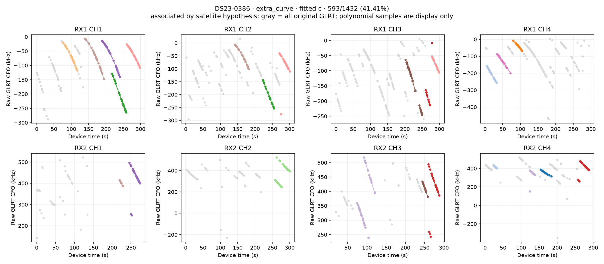

## DS23-0386 extra curve unassociated GLRT

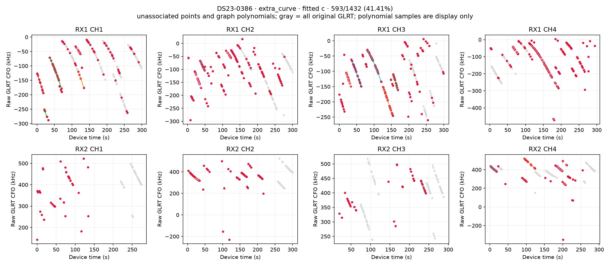

## DS23-0386 graph recovery associated GLRT

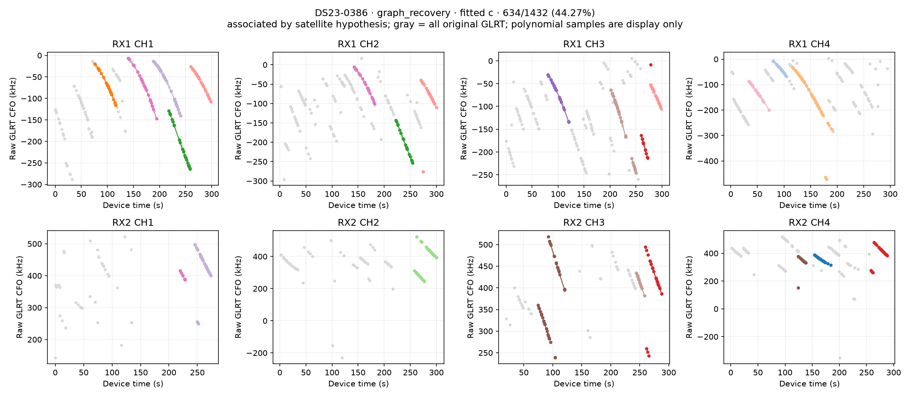

## DS23-0386 graph recovery unassociated GLRT

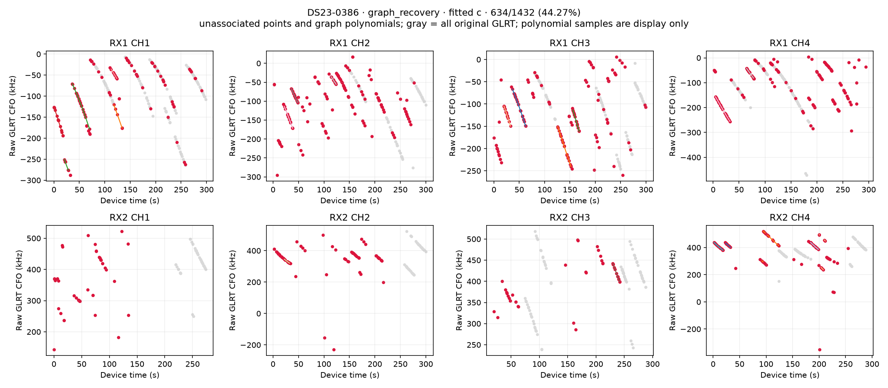

## DS23-0386 incumbent associated GLRT

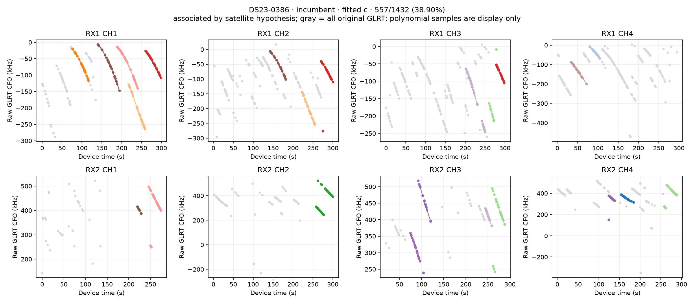

## DS23-0386 incumbent unassociated GLRT

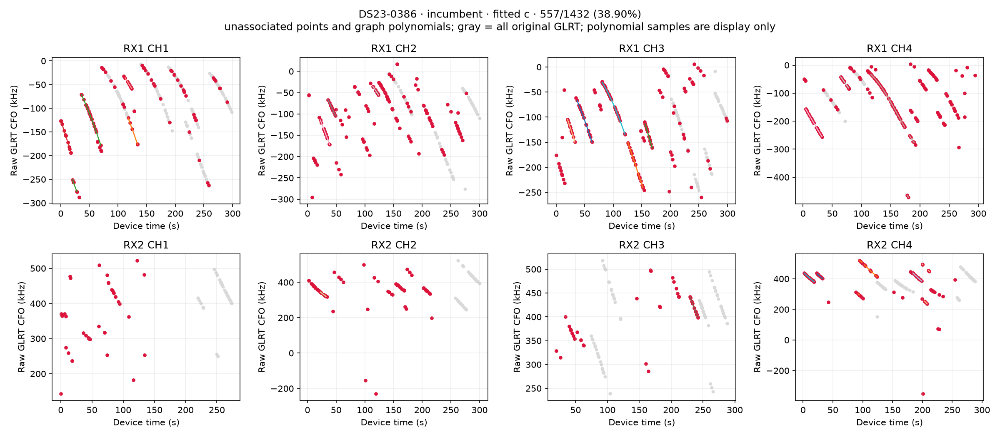

## DS23-0386 independent paths 1

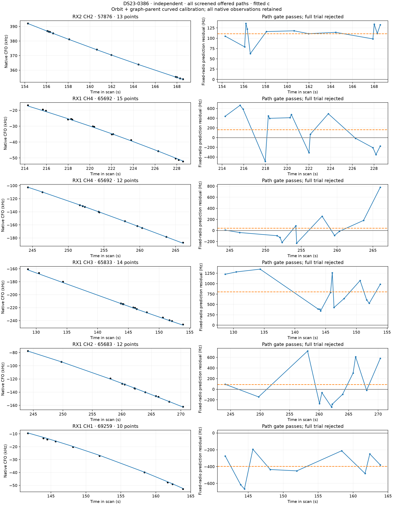

## DS23-0386 independent paths 2

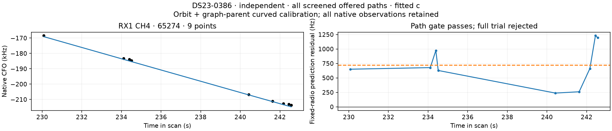

## DS23-0386 influence and controls

## DS23-0386 loss decomposition

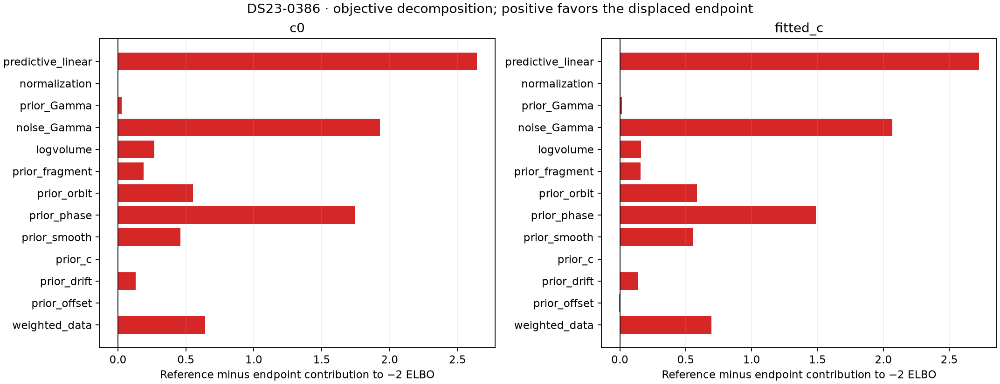

## DS23-0386 loss gradient 10km

## DS23-0386 persistent5s paths 1

## DS23-0386 persistent temporal associated GLRT

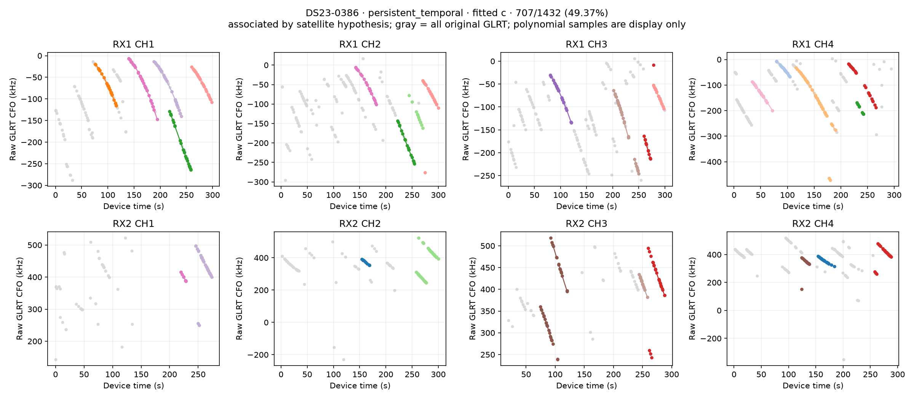

## DS23-0386 persistent temporal unassociated GLRT

## DS23-0386 track residuals

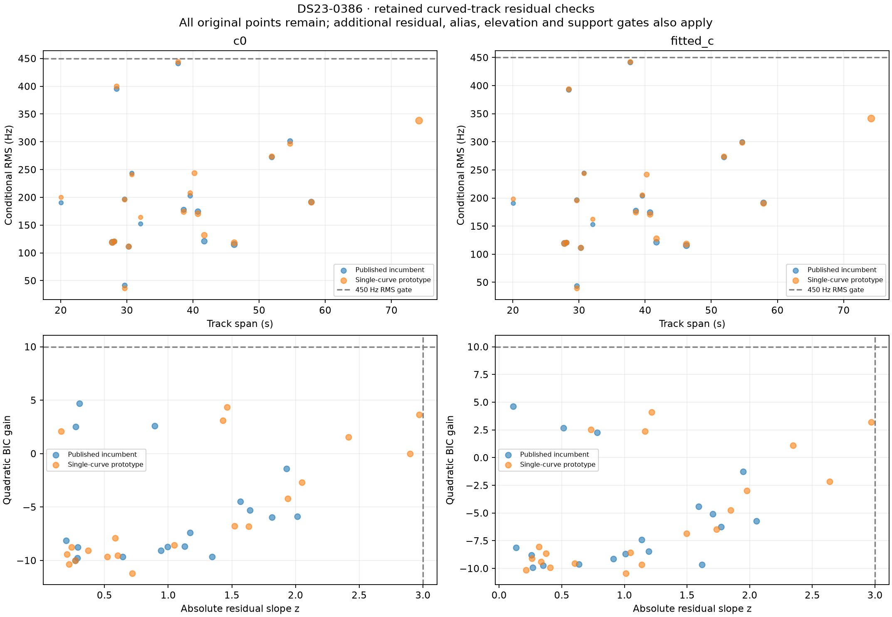

## DS23-0386 unused track TLE diagnostics

## DS23-0409 convergence 10km

## DS23-0409 extra curve associated GLRT

## DS23-0409 extra curve unassociated GLRT

## DS23-0409 graph recovery associated GLRT

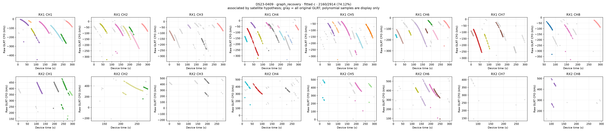

## DS23-0409 graph recovery unassociated GLRT

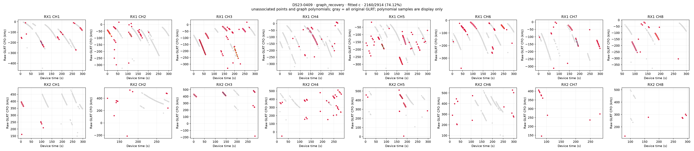

## DS23-0409 incumbent associated GLRT

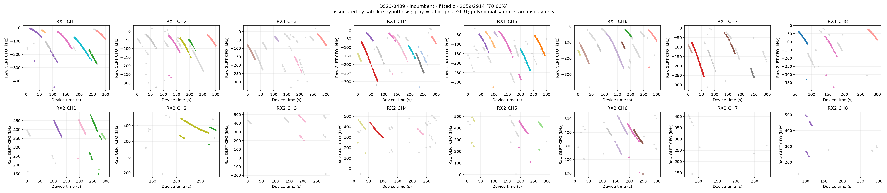

## DS23-0409 incumbent unassociated GLRT

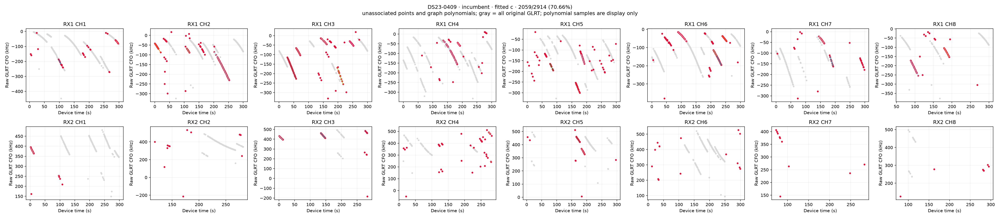

## DS23-0409 independent paths 1

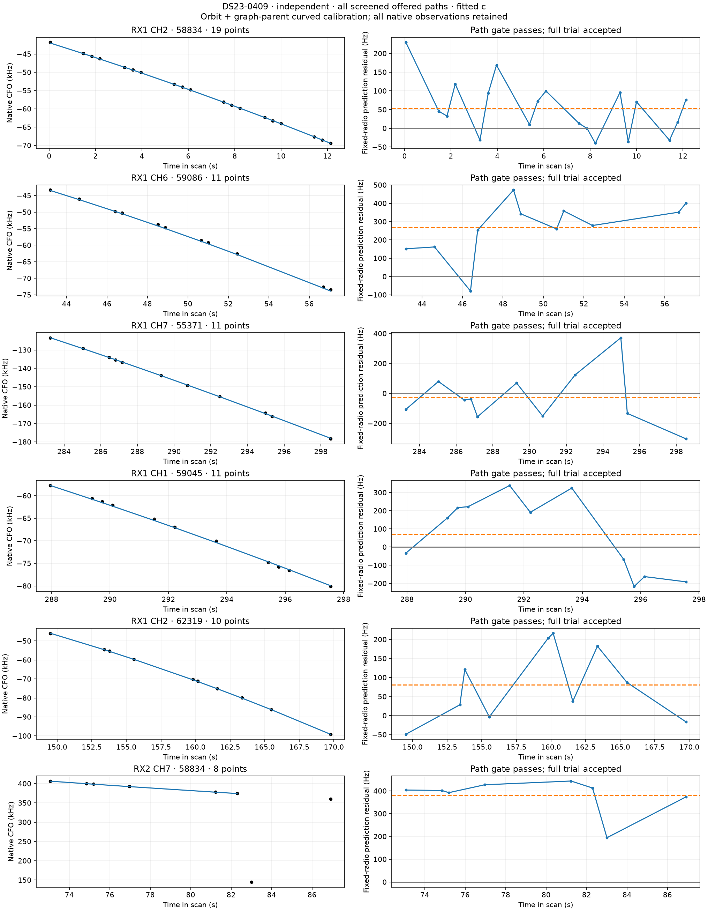

## DS23-0409 influence and controls

## DS23-0409 loss decomposition

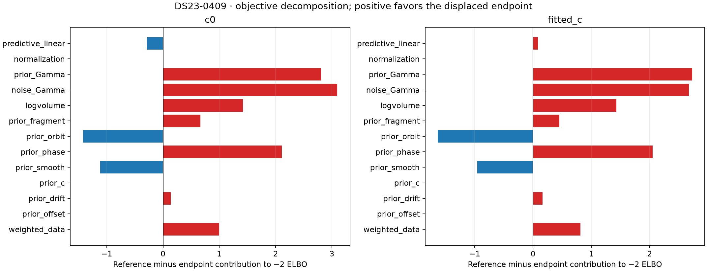

## DS23-0409 loss gradient 10km

## DS23-0409 persistent5s paths 1

## DS23-0409 persistent temporal associated GLRT

## DS23-0409 persistent temporal unassociated GLRT

## DS23-0409 temporal policy associated GLRT

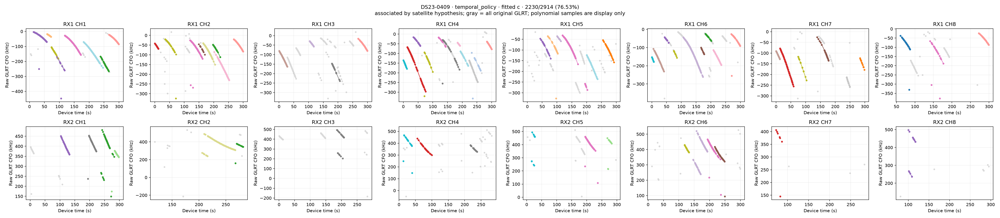

## DS23-0409 temporal policy unassociated GLRT

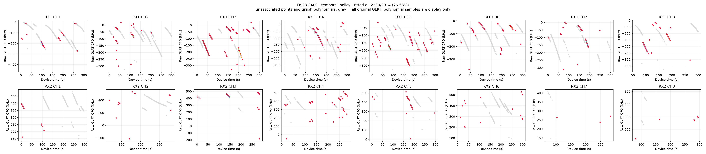

## DS23-0409 track residuals

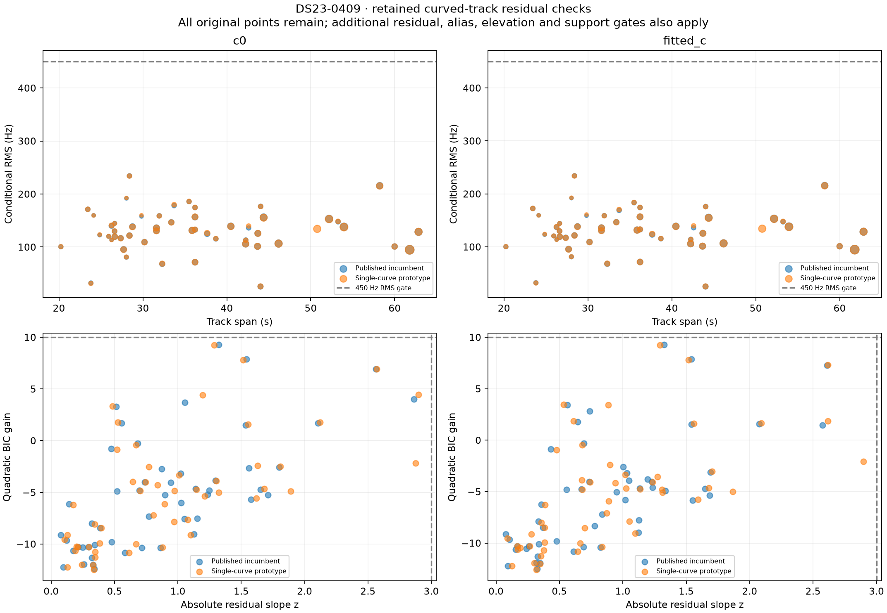

## DS23-0409 unused track TLE diagnostics

## iteration summary

