# DS23 DBG01 iteration016: 0386 and 0409

The existing ALGO02/ALGO03 graph recovery explains additional measurements in
both scans, but the accuracy gains remain limited. In0386, association rises
from38.90% to49.37% with the constrained persistent policy; fitted-c error falls
from2.850 to2.468km, while c=0 worsens. In0409, association rises70.66→76.53%
and fitted-c error improves2.845→2.741km. These are bounded development results,
not a new ALGO release or an adopted full-DS23 policy.

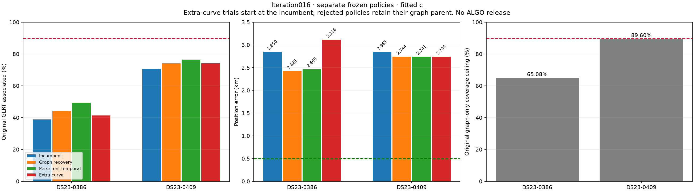

## Controlled outcomes

Every row uses the same original winning GLRT denominator. The two c arms share
observations, identities, aliases, priors, gate thresholds and search budgets
within each hypothesis. Policies retain their stated parent when qualification
fails. The extra-curve experiment starts from the incumbent and is separate
from graph and persistent recovery.

| Scan | Method | Associated original GLRT | Associated | c=0 error km | Fitted-c error km |
|---|---|---:|---:|---:|---:|
|0386|Incumbent|557/1432|38.897%|2.893030|2.850190|
|0386|Graph recovery|634/1432|44.274%|3.124179|2.424593|
|0386|Persistent temporal, constrained|707/1432|49.372%|3.161404|2.467997|
|0386|Separate extra curve|593/1432|41.411%|3.254077|3.115529|
|0409|Incumbent|2059/2914|70.659%|2.966538|2.845045|
|0409|Graph recovery|2160/2914|74.125%|2.852117|2.744005|
|0409|Persistent temporal|2230/2914|76.527%|2.805897|2.741104|
|0409|Extra-curve policy, graph fallback|2160/2914|74.125%|2.852117|2.744005|

The [complete table](tables/position_and_association.csv) also reports fragment
counts, points per fragment, calibration RMS, phase checks and original IDs lost.
Frequency RMS is evaluated on each model's calibration rows; changing these
rows prevents interpreting a lower RMS as a controlled accuracy improvement.

## 0386: missing curves are recoverable, but do not remove the position bias

The three longest wholly unused curved sources nominate64461(50points),
53224(28) and65833(27). The unchanged joint fitting budget tests all seven
nonempty combinations. The50- and27-point sources pass alone and together;
their77-point union is selected by the existing added-point ordering. Every
combination containing53224 fails. No identity is manually chosen.

The28-point RX1 CH1 T004 curve has graph-polynomial RMS111.23Hz, but the causal
53224 phase-only profile has1811.79Hz RMS. The following TLE gives1812.25Hz.
The joint fit is worse: fitted-c conditional RMS4119.52Hz, slope z4.267,
quadratic BIC gain59.99, maximum-step z5.011 and lag-one ACF0.786. This is
structured model disagreement, not a narrowly missed450Hz threshold. The
bounded search does not establish its identity; following elements do not
resolve it.

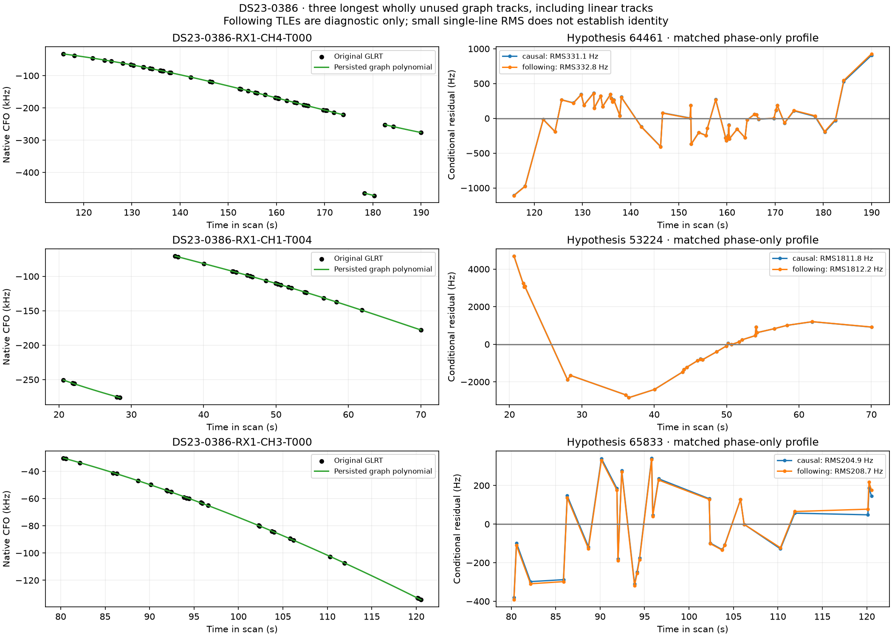

A diagnostic flags a high-leverage final point(0.968) separated by8.17s.
However, **the quadratic-only curvature test is insufficient here**. A general
degree2–4 test, with a degree-search penalty and every single-point deletion,
finds distributed degree4 curvature in both the full28-point source and its
27-point core. Minimum fitted nonlinear amplitudes are956.26 and760.22Hz.
The endpoint alone therefore does not explain the curvature. No point is
removed, no polynomial is rewritten, and this diagnostic does not prove that
the persisted join is physically correct.

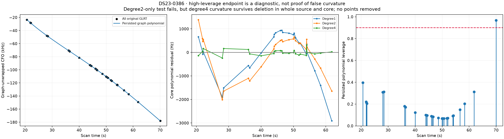

Native temporal recovery proposes73 persistent predictive points after the
graph parent. Its unconstrained endpoint fails the new27-point65833 source's
slope gate: z3.472(c=0) and3.320(fitted c), versus the original limit3.
Normalized minimum gate slacks−0.1574 and−0.1067 satisfy the existing−0.25
refinement trigger. The unchanged five-round,40-step constrained solver admits
the same73 points while retaining all parent IDs. It reaches707 associated
points, but fitted-c error worsens by43.4m relative to graph recovery alone.

The independent85-point control fails qualification. The separate26-point
58248 curved addition passes its checks but worsens fitted-c error to3.116km.
Passing gates and adding points are necessary evidence checks, not a guarantee
of better geographic accuracy.

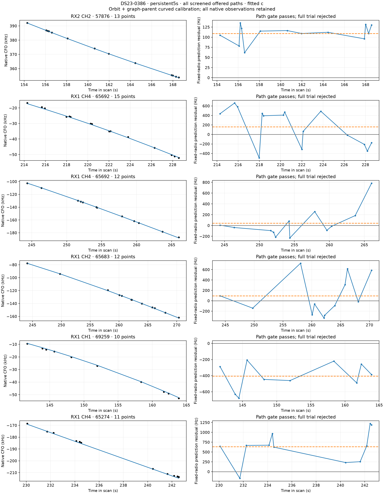
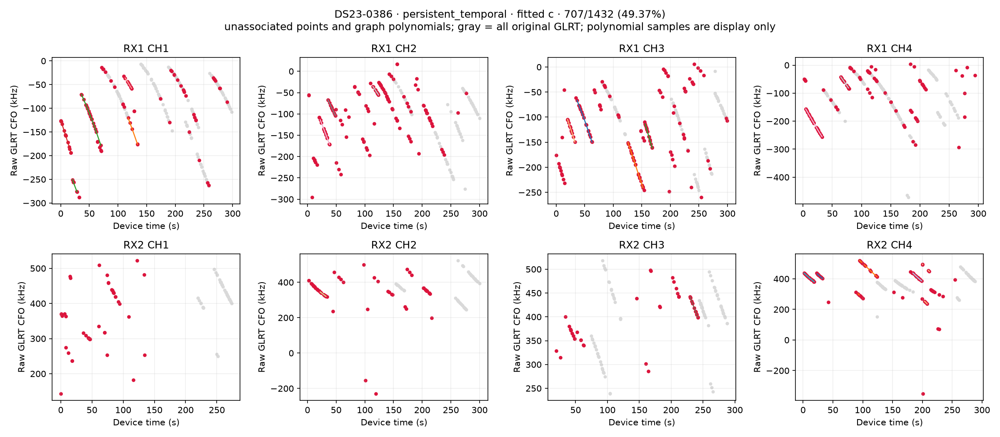

There are500 original GLRT points outside the graph. Its graph-only ceiling is
932/1432=65.08%; at least357 outside-graph points would need supported recovery
to reach90%. The goal cannot be met by relabeling the existing graph alone.

## 0409: low-RMS hypotheses still fail residual structure checks

The59-point RX1 CH2 T003 source passes as63122. Including post-fit extensions,
graph recovery adds101 associations, while only59 new points enter curved
calibration. Persistent and independent temporal searches return the same70
predictive points. Both qualify, preserve all parent IDs and reach2230/2914.
The extra position improvement beyond the graph parent is only2.9m with fitted c.

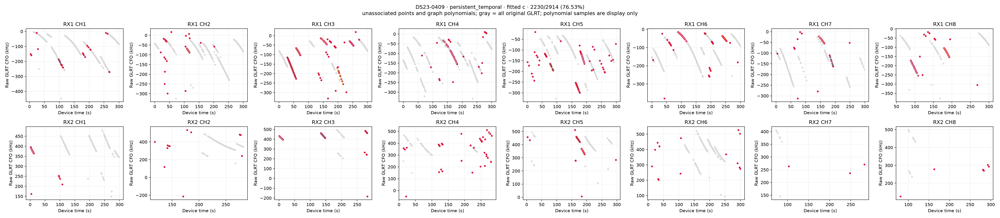
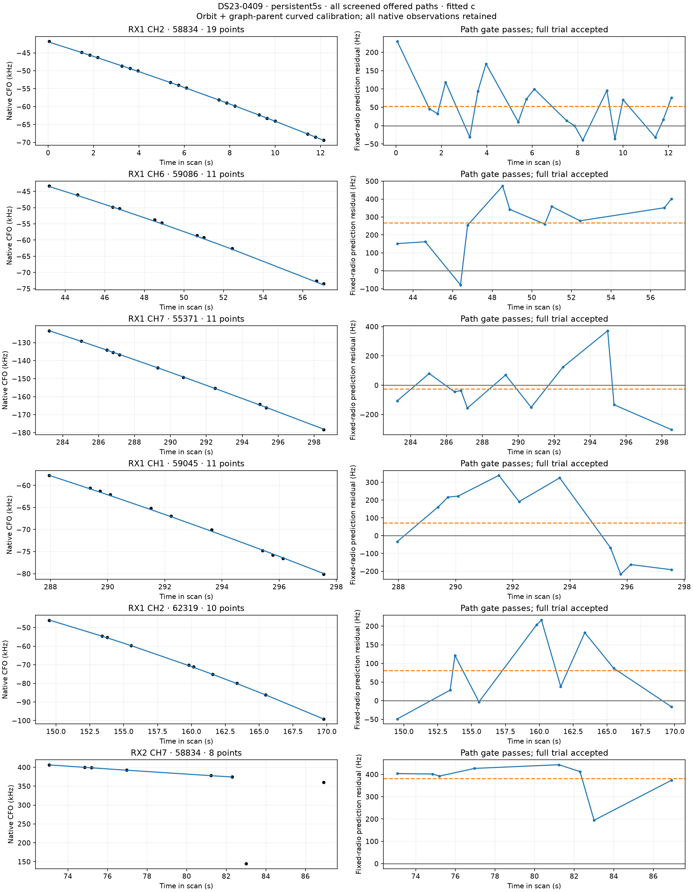

Two other37-point sources have plausible individual causal profiles:63577 at
123.48Hz and58834 at126.65Hz. Following elements change these to122.94 and
126.64Hz. Their complete joint fits nevertheless fail original structure checks.
For63577, fitted-c lag-one ACF0.658 exceeds4/sqrt(37)=0.658 approximately
(the full-precision comparison fails); c=0 ACF0.662 also fails. For58834,
quadratic BIC gains11.42 and11.33 exceed10, and an existing55371 source also
becomes incompatible. The threshold is not relaxed to admit these tracks.
The separate33-point59531 extra-curve prototype fails as well.

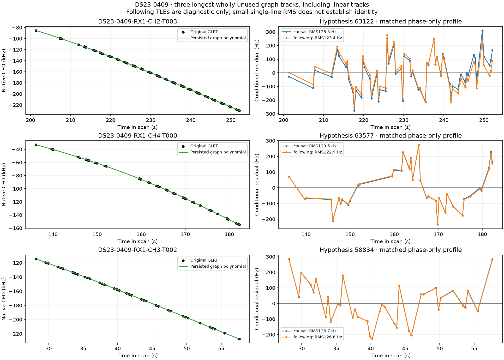

The original graph contains2611/2914=89.60% of the GLRT points. Reaching90%
requires at least12 supported points outside it, even if every graph point
could be explained. Current association remains393 points short of90%.

## DBG01 root-cause controls

Every scan has the standard10km conditional loss/gradient surface,81 cold
regional starts with finite-pool association reselection, satellite-family and
track deletions, nuisance-prior controls, residual plots and unassociated
source/TLE diagnostics. The loss grid recalibrates nuisance variables at each
point under the recorded incumbent hypothesis; it does not run acquisition or
complete catalogue discovery at every pixel. The81 descents can choose among
the recorded whole-assignment hypotheses, not arbitrary catalogue assignments
at every step. Neither visualization is an exhaustive association posterior.

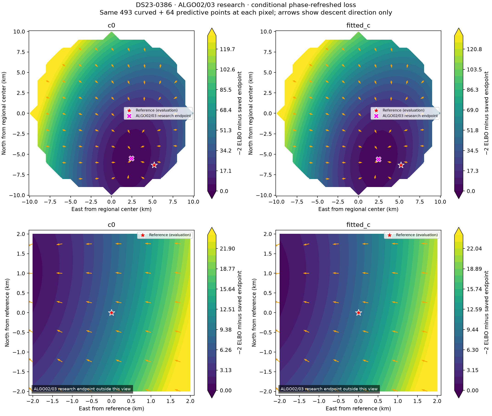
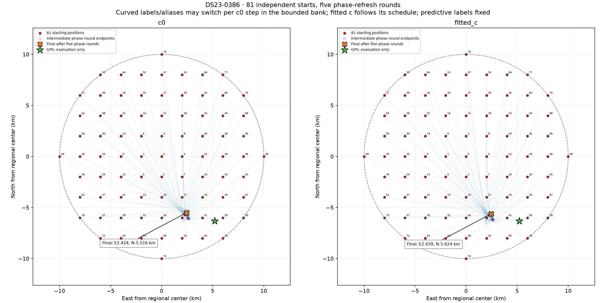
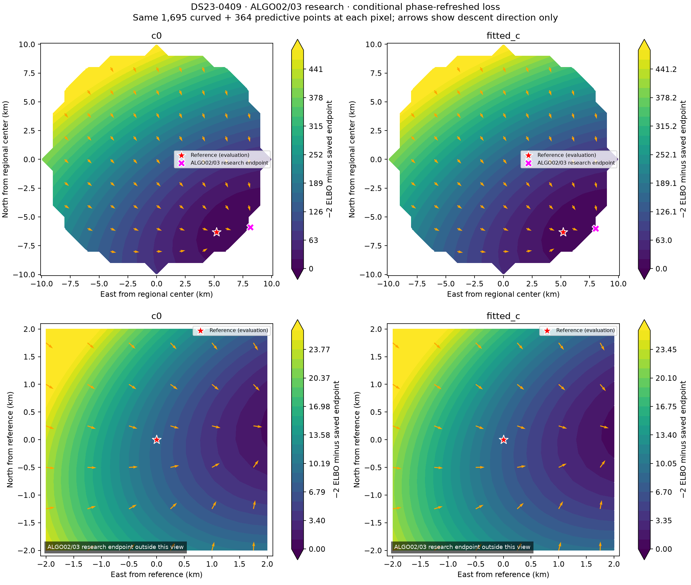
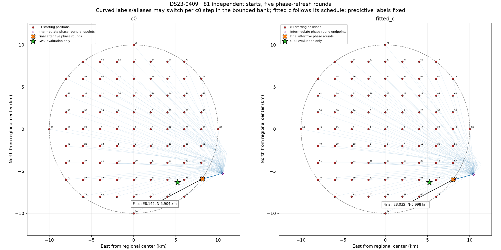

All81 endpoints qualify in each scan. The best RF restart gains are numerical
noise(−1.98e−9 and+1.89e−8), below2log4=2.773; neither restart policy changes
the incumbent. This finite-pool test provides no evidence that a simple
starting-point change fixes the bias.

The best fitted-c diagnostic family deletion gives0386 error2.481km after
removing65692 and0409 error2.261km after removing63577. Neither reaches0.5km.
These are GPS-ranked diagnostics, not valid satellite-removal policies. They
show influence, not proof of an incorrect identity. No independent original
curved-family witness qualifies a shared-step proposal in either scan, so the
existing event rules do not add a nuisance step.

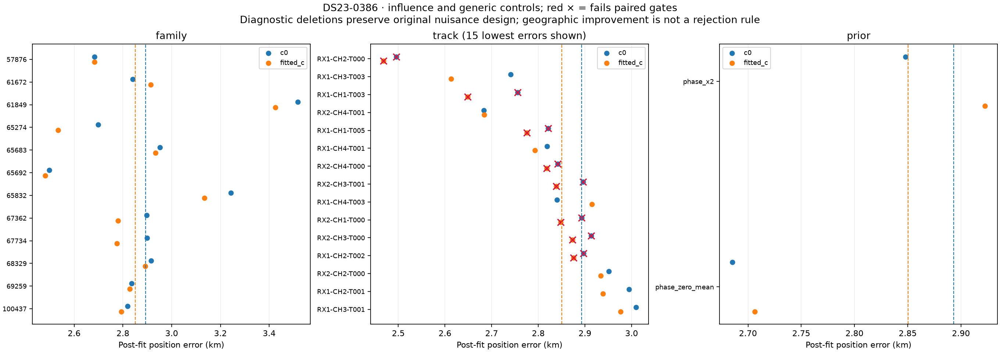
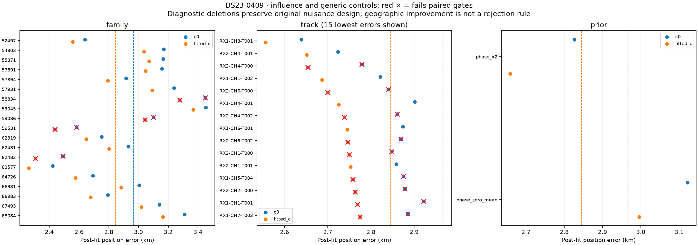

The related [original-calibration role control](../2026_10_23_ds23_distributed_calibration_roles_assessment/README.md)
tests a transferable hypothesis on these two scans and a frozen random20.
It retains all likelihood IDs but does not improve fitted-c mean accuracy and
is not promoted. These controls support moving to0075/0087, rather than
repeatedly tuning0386/0409 against their GPS errors.

## Reproduction and validation

Use the saved [sources](source/tools/report_ds23_dbg01_iteration_016.py),
[protocol](evidence/protocol.json), [evaluation](evidence/evaluation.json),
[tables](tables/position_and_association.csv) and [all37 figures](FIGURES.md).
The [archive manifest](evidence/archive_manifest.json) hashes all frozen raw
scientific receipts, including unsuccessful hypotheses. Run the archived
runner's13 stages, the recovery binding's diagnostic/path/feasibility/extra/
step/source stages, then the independent audit before rendering this report.
The following-element diagnostic uses cached following TLEs only for explanation.

All13 standard stages pass. Independent checks replay540 standard endpoint
arms and42 nomination densities, plus14 recovery endpoint arms, original gates,
predictive covariance and exact membership. The complete pixel grids are
recorded but not independently reintegrated at every pixel. Component-owned
tests cover the new bindings and the degree2–4 RF criterion.

Inference starts at[0,0] in the original25×25km box centered37.906,−122.545.
Only TLEs with epoch **and collection time** no later than the scan cutoff are
used for inference. GPS37.849061591561885,−122.48574968092912 ranks debug
priorities and evaluates frozen endpoints only. There is no receiver-history
pooling, new RF acquisition or IQ reprocessing.

The full410-scan reference is unchanged: fitted-c mean1.469461km,
median1.178102km and70.0804% association. The mean-and-median0.5km goal remains
unmet. Local graph gains are not evidence of a full-DS23 or new-location gain;
no new ALGO series is published from this iteration.
