# DS23 DBG01 iteration017: 0075 and 0087

Existing persistent native-path recovery improves fitted-c error0075
2.827→2.720km and0087 2.826→2.373km while retaining all original accepted
points. Neither reaches0.5km. A new whole-family identity test incorporating
recovered native evidence strongly rejects the proposed replacements in both
scans. A separate RF-only inventory finds residual energy concentrated in
individual points across the sampled population; it motivates a noise-model
control, but no such model or accuracy gain is claimed here.

This closes the bounded batch and moves to0239/0261 using the unchanged
ALGO02/ALGO03 reference. No new ALGO series or full-DS23 policy is released.

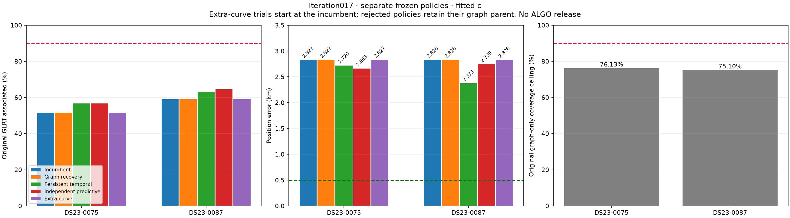

## Matched position and association results

| Scan | Method | Original GLRT associated | Associated | c=0 error km | Fitted-c error km |
|---|---|---:|---:|---:|---:|
|0075|Incumbent / graph fallback|686/1332|51.502%|2.459594|2.827352|
|0075|Persistent temporal|755/1332|56.682%|2.512840|2.720335|
|0075|Independent predictive|756/1332|56.757%|2.439969|2.662600|
|0087|Incumbent / graph fallback|584/988|59.109%|3.247776|2.826190|
|0087|Persistent temporal|624/988|63.158%|2.711484|2.373193|
|0087|Independent predictive|638/988|64.575%|3.257215|2.739392|

The [full table](tables/position_and_association.csv) includes both arms,
fragment counts, points per fragment, likelihood membership, phase checks and
IDs lost. Graph reentry has no accepted addition in either scan; the separate
extra-curve rule has no eligible target and falls back. These repeated baseline
rows are not additional algorithms or independent improvements.

In0075, persistent and independent variants add69 and70 predictive likelihood
points respectively. In0087, persistent adds40 likelihood points and40
associations; independent adds only21 likelihood points but54 associations,
including33 post-fit extensions. **The larger association percentage is not
the more accurate position estimator here.** These are separate fixed policies;
GPS is not used to select a per-scan winner or combine their outputs.

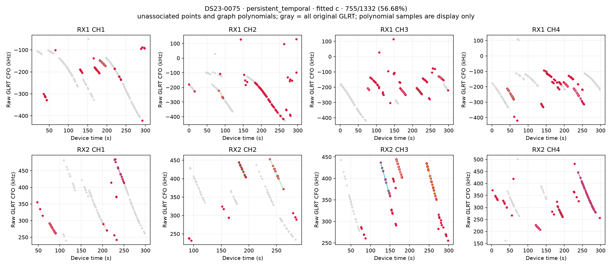
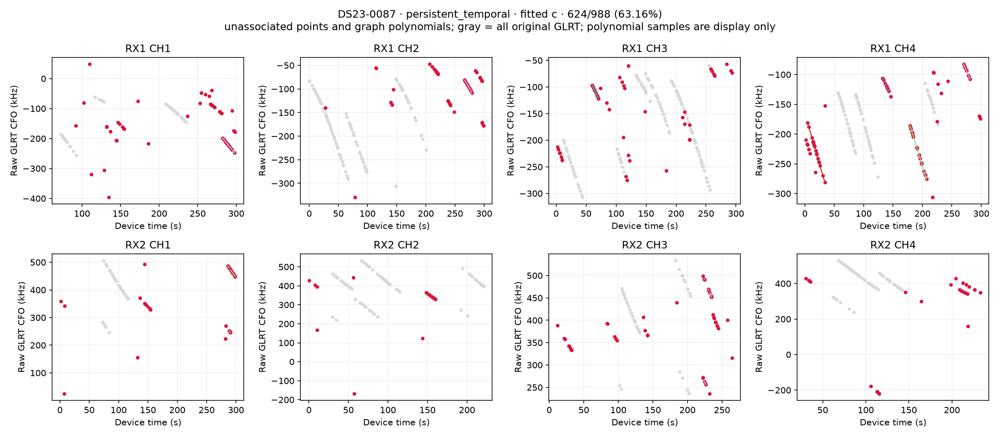
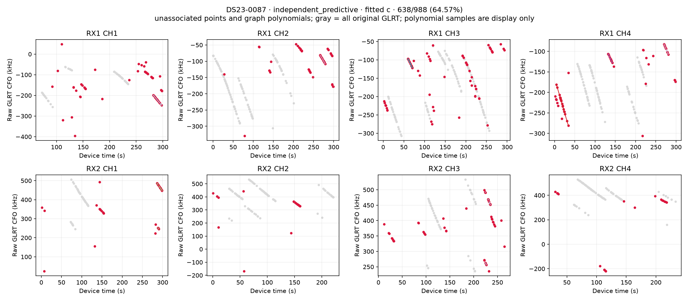

## 0075: small RMS can still contain systematic residuals

The unchanged curved-source nomination budget tests37points as57604,
21 as62812 and13 as61630, individually and in all seven nonempty combinations.
All fail the original final checks. The37-point source has a63.12Hz causal
single-source profile; following elements give41.81Hz. In its full joint fit,
RMS remains only about70Hz, but slope z is4.130 with c=0 and3.433 with fitted c,
above3. The21-point62812 fit has quadratic BIC gains26.23 and23.97, above10;
the13-point61630 fit has gains13.17 and13.79. No threshold is relaxed to turn
these low-RMS hypotheses into accepted calibration evidence.

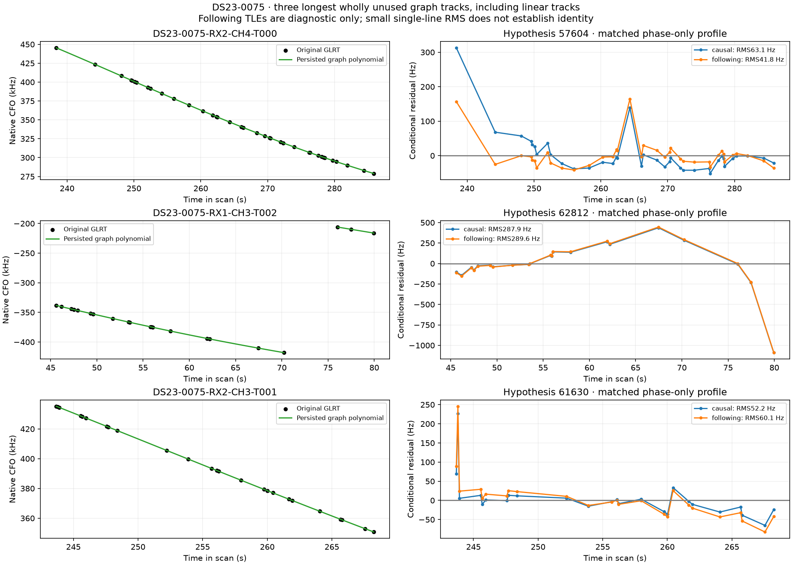

Native persistent recovery nevertheless explains69 unused original GLRT
points as predictive evidence under existing calibrated families. It passes
the original parent-retention checks without constrained refinement; normalized
minimum gate slacks are+0.1655 and+0.1618. The different evidence role and
position endpoint matter; this is not permission to relabel every rejected
curved-source fit as accepted.

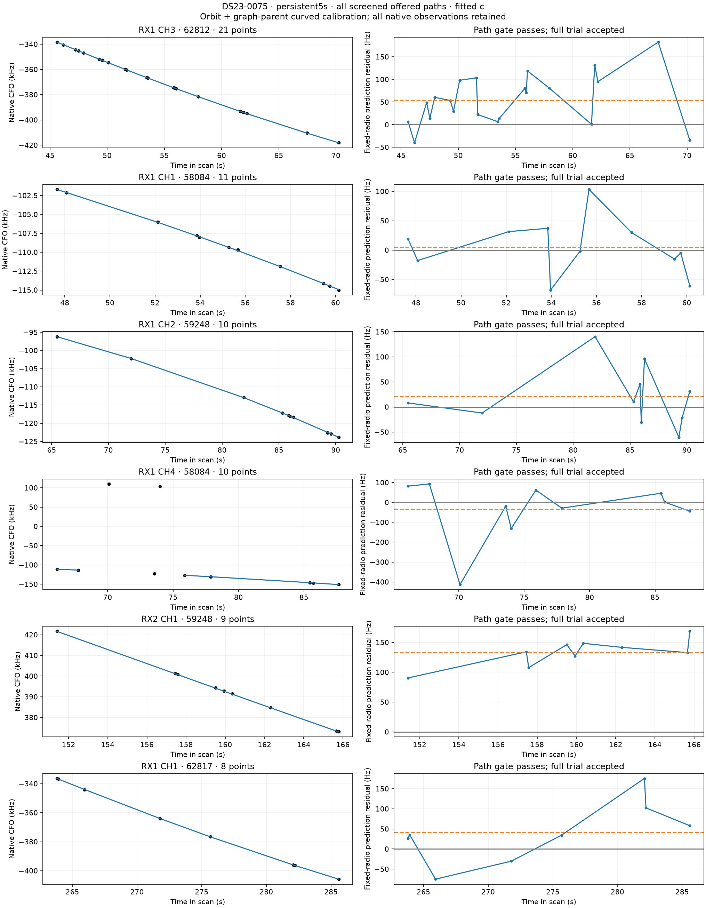

The original graph contains1014/1332=76.13% of the points. Even explaining every
original graph point would require at least185 supported outside-graph points
to reach90%. The native search can use such points, but the current result
does not justify forcing the remainder into a family.

## 0087: recovered evidence tests an influential family

The longest wholly unused graph sources are noncalibrating18-,21- and12-point
tracks. Their leading causal single-source hypotheses include59902,67944 and
68562; those nominations alone are not identity truth. Native persistent
recovery accepts13 RX2 CH4 points as62132, plus9 and18 RX1 CH3 points as68562.
The40 points pass both c-arm checks and retain all parent accepted IDs.

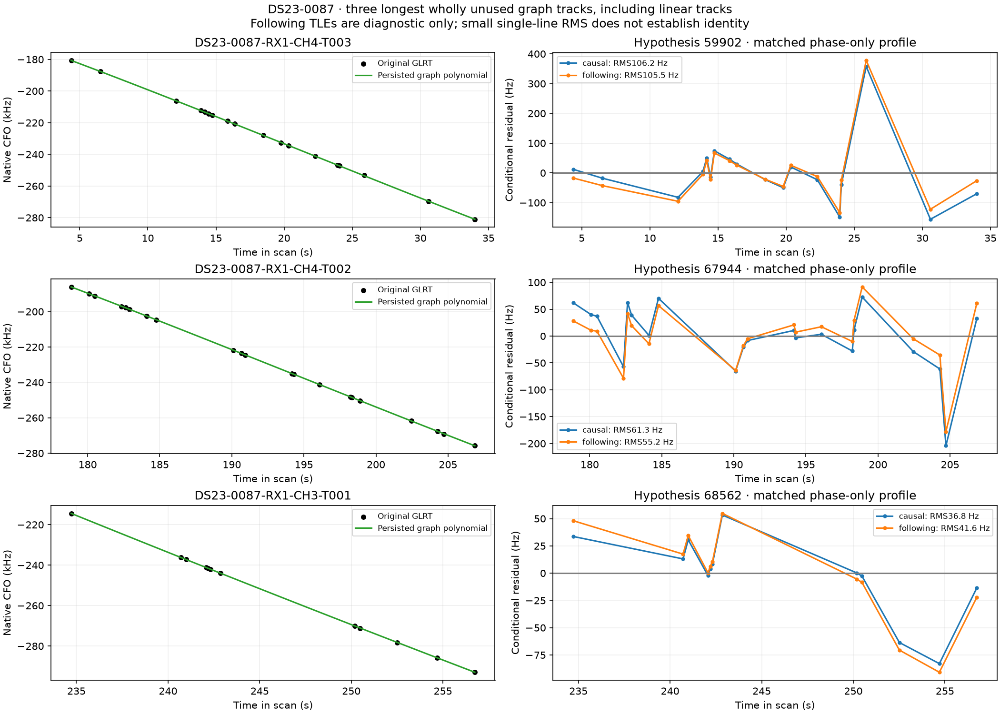
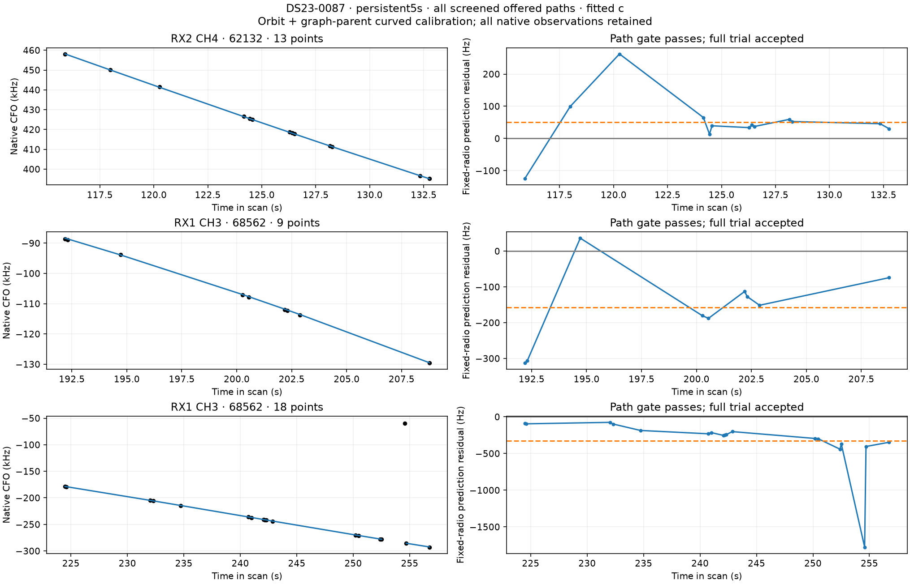

An original68562 family contains33 curved RX1 CH3 points and16 curved RX1 CH4
points. Its GPS-ranked diagnostic deletion reduces fitted-c error to0.961km.
That establishes influence, not a wrong identity: the previously published
family-excluded catalogue search already favors68562 over its strongest
qualified alternative by about934 predictive-score units. Deleting a family
because its removal improves GPS error is not an inference policy.

The new test chooses the existing family with the **largest count of newly
recovered persistent points**, with candidate-index tie-breaking. It never
uses family-deletion error or GPS to choose its target. This selects68562 with
27 new points in0087 and58084 with21 new points in0075. It differs from the
earlier augmented-family experiment, which used failed multi-source curved
additions and was not triggered in these scans.

For nomination, exclude the complete original family's curved observations
from radio calibration. Score all original and new family evidence together
using the remaining radio posterior and its covariance. Search the complete
causal catalogue coarsely, then refine the best seven candidates plus the
incumbent as needed with existing phase/orbital priors. Only the best
phase-qualified alternative gets the unchanged cold joint-fit budget. The
final comparison retains the exact same original-plus-native observations;
identities/aliases change only in the explicit complete-family hypothesis.
Both c arms must gain more than2log2 in normalized RF score, pass all original
gates and preserve every parent accepted ID. The null reuses its audited
persistent endpoint; no GPS-selected null is fitted.

| Scan | RF-selected family | Held original+new points | Alternative | c=0 RF gain | Fitted-c RF gain | Decision |
|---|---:|---:|---:|---:|---:|---|
|0075|58084|103|67866|−518.202|−528.389|Reject: RF loss and gates|
|0087|68562|76|54831|−617.086|−606.001|Reject: RF loss and gates|

The alternatives move to poor regional endpoints:18.756km error in0075 and
about16.610km fitted-c error in0087. Both lose parent IDs and fail several
original curved/predictive checks. No replacement or new association is
adopted. The point is not that these two identities are proved correct; the
tested alternatives do not explain the expanded evidence better. Prediction
scores here are bounded nomination scores, not calibrated identity probabilities.

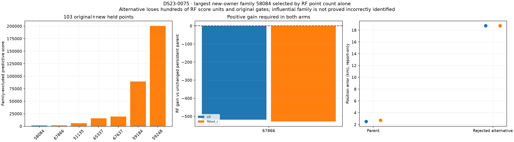
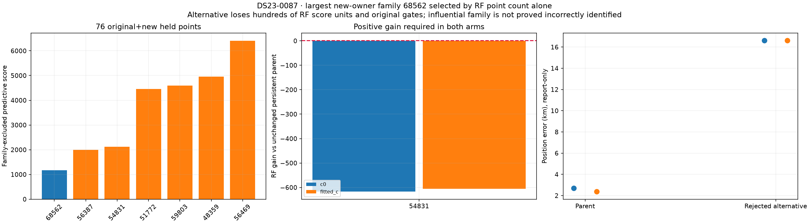
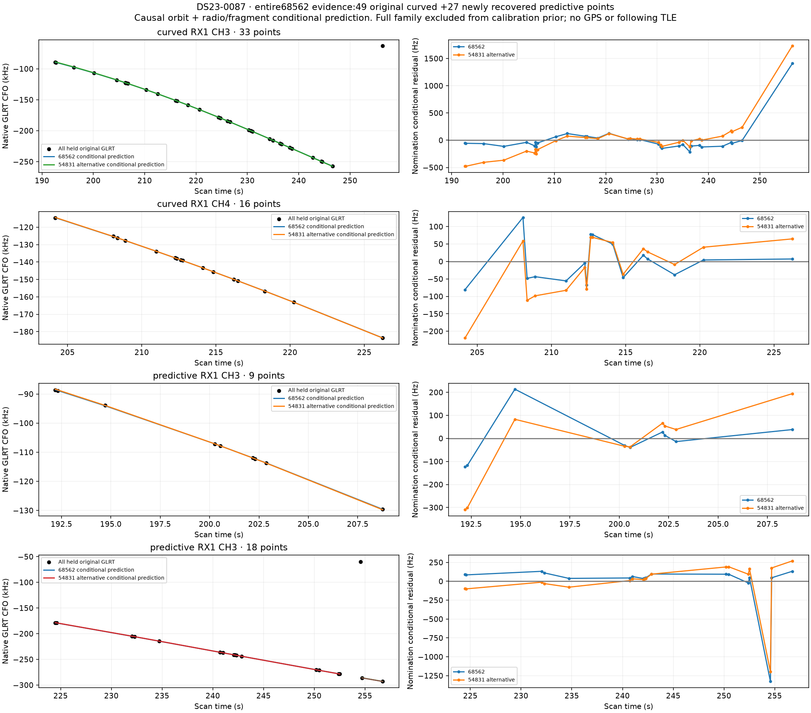

The CFO figure uses original native CFO and conditional causal orbit + radio /
fragment predictions, with alias discontinuities split into separate segments.
It does not plot a following TLE or a GPS-fitted orbit. The residuals are the
nomination's conditional residuals, distinct from the final joint-fit gates.

## A transferable diagnostic: one point can dominate a curve's noise estimate

The original noise model has one Gamma precision per curved fragment. Every
point in a fragment shares that estimated precision. In0087 RX1 CH3 T000,
the point at256.339188s has a fitted-c conditional residual1147.80Hz. It
contributes76.54% of raw residual energy and74.90% after standardizing by the
declared RF point noise. The original full33-point RMS is228.39Hz; the other
32 residuals have112.35Hz RMS **at the same unchanged endpoint**. The fitted
group precision0.1296 therefore downweights the whole source, including its
better-fitting observations. These are descriptive calculations, not a
truncated fit, a proven bad point or evidence that deleting it improves position.

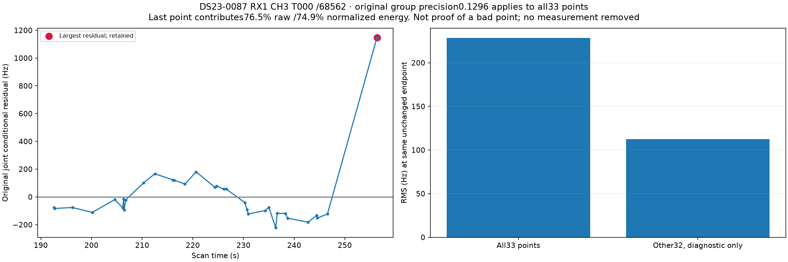

A new RF-only inventory uses these two engineering scans and the same ID-only
random20 cohort frozen for the earlier curvature inventory. Before any new
noise-model fit, it records all original incumbent residuals, RF sigmas and IDs
in both c arms. Among949 fitted-c calibration curves with at least12 active
points,79 have at least50% of their standardized squared residual energy in
one point. These occur in21 of22 scans, including all20 sampled scans.
The50% line is a descriptive flag, not a calibrated significance or acceptance
gate. No original point, curve, identity, alias, mask or prior changes.

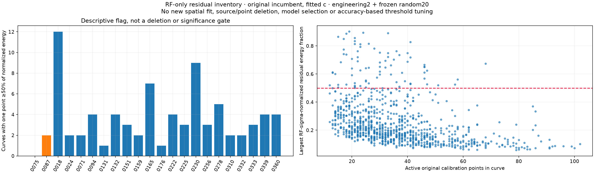

This motivates a future controlled comparison of fragment-shared versus
point-specific heavy-tailed measurement noise, with equal declared marginal
variance and every original observation retained. Existing Student/Gamma
fragment models and robust carrier-constant/predictive models are not by
themselves a test of that grouping change. **A point-specific model is not
implemented or evaluated in this report.** Any prototype must retain the
original raw residual gates, audit its normalized likelihood and predictive
covariance, keep c arms matched and confirm accuracy beyond the inspected scan.

## Loss, convergence and ablation controls

Each scan includes the standard10km conditional loss/gradient grid and81 cold
regional descents that can reselect from the recorded finite whole-assignment
bank. The grid recalibrates nuisance parameters under its recorded hypothesis;
it does not rerun acquisition or exhaustive catalogue discovery per pixel.
The descent bank is also finite, not arbitrary full-catalogue reassociation.

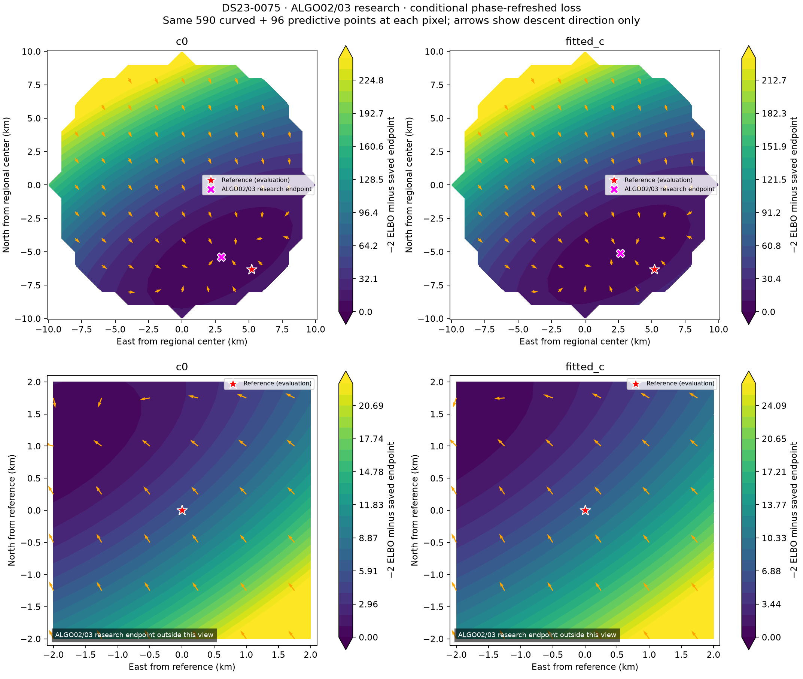
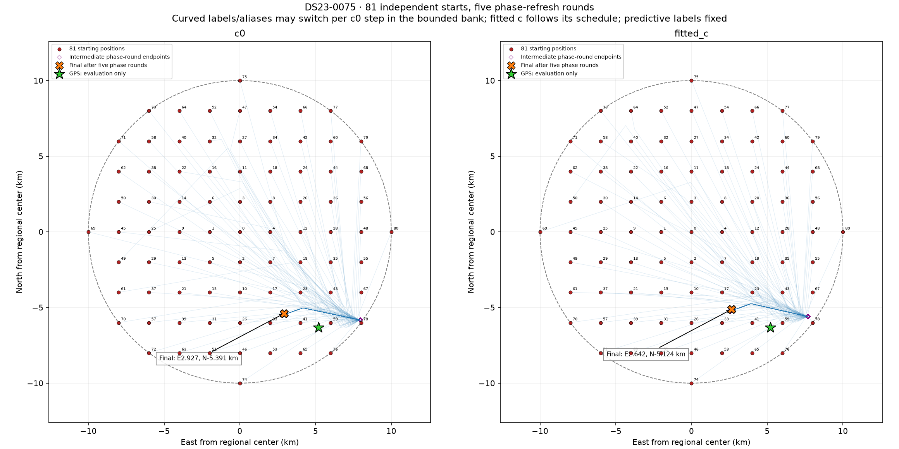
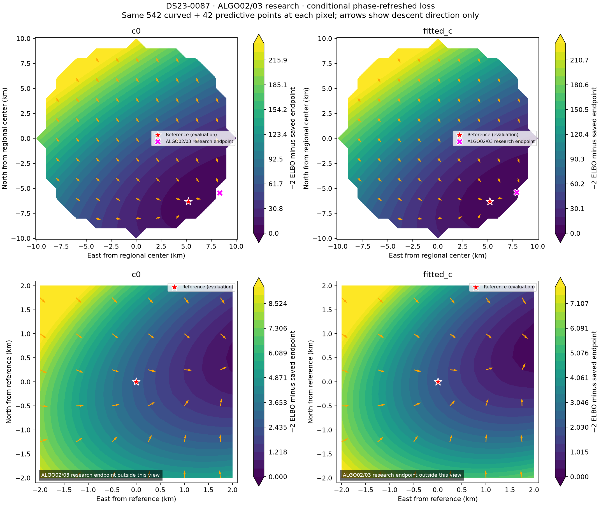
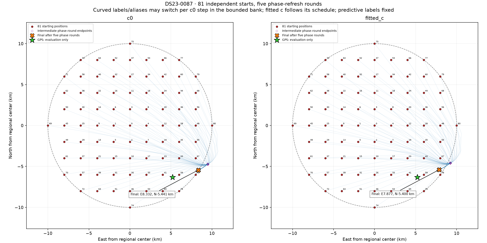

All81 endpoints qualify in each scan, but the largest RF restart gains are
4.12e−8 and5.43e−8, below the existing2log4 penalty. No restart is adopted.
Doubling phase-prior width worsens fitted-c errors to3.109 and3.498km.
The zero-mean control is unchanged. This budget offers no evidence that simply
widening the phase prior or changing the initial point fixes the errors.

0075's best fitted-c family deletion removes59248 and reaches2.089km;
0087's68562 deletion reaches0.961km. Neither is an admissible GPS-selected
policy, and neither reaches0.5km. No shared-step proposal has the required
independent original curved witness in these scans. Preserve these negative
controls and move to the next pair instead of tuning thresholds to the site.

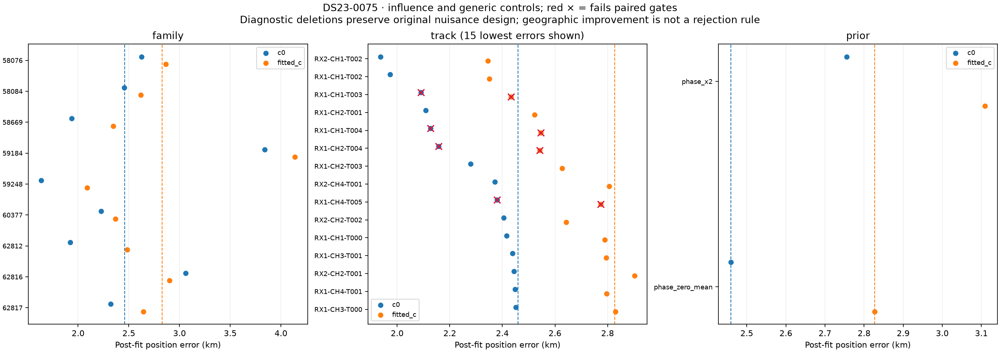
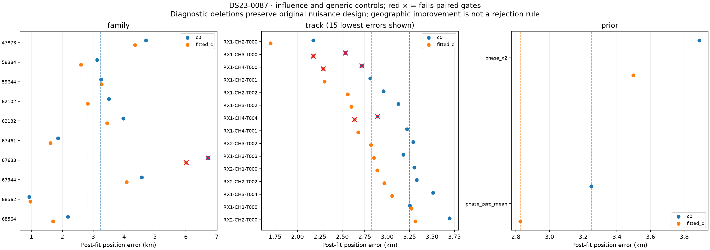

The original0087 graph covers742/988=75.10%;90% would require at least148
supported points outside it even if every graph point were matched. Missing
evidence, calibration/model tension and individual residual concentration are
distinct limitations. This investigation does not uniquely attribute the
remaining error to one satellite, a bad join, the radio or the causal TLE.

## Reproduction, validation and release decision

Use [all46 figures](FIGURES.md), [position/association table](tables/position_and_association.csv),
[family trials](tables/native_family_trials.csv), [nominations](tables/native_family_nominations.csv),
[RF residual inventory](tables/residual_concentration.csv),
[protocol](evidence/protocol.json), [evaluation](evidence/evaluation.json) and
[hashed evidence archives](evidence/archive_manifest.json). The report's
[source snapshot](source/tools/report_ds23_dbg01_iteration_017.py) records the
reused renderer and new experiment/audit scripts. Run the13 standard stages,
recovery/feasibility controls and audit, render the atlas, run the native-family
and residual-inventory studies and their audits, then render with `--finalize`.
These sources use the existing research environment and its archived dependencies.

All13 standard stages pass. Independent checks replay462 standard endpoint
arms and21 original nomination densities,8 native-recovery endpoint arms,
8 new family-control endpoint arms and14 new nomination covariance densities.
Original residual/visibility/phase gates and exact membership are retained.
The complete grid is recorded but is not independently reintegrated at every
pixel. The first native-family adapter attempt omitted its target field and
failed before nominations or new position fits; its source and failure receipt
remain archived. The repaired adapter has a regression test and retains the
same scientific rule and cohort. No scientific output is overwritten.

Both c arms start at[0,0] in the original25×25km box centered37.906,−122.545,
with matched observations, candidate/alias hypotheses, other priors and budgets.
TLE epoch and collection time must both precede the scan cutoff. Following TLEs
appear only in the marked diagnostics. GPS37.849061591561885,−122.48574968092912
ranks debug priorities and evaluates frozen endpoints only. There is no new
RF acquisition, IQ reprocessing, receiver-motion prototype or stationary
history pooling.

Full DS23 remains at the published410-scan reference: fitted-c mean1.469461km,
median1.178102km and70.0804% association; three unavailable scans remain
explicit. The0.5km mean-and-median goal remains unmet. The local persistent
improvements do not establish full-population or new-location gains. Publish
this debug iteration, keep the reference and continue to0239/0261.
