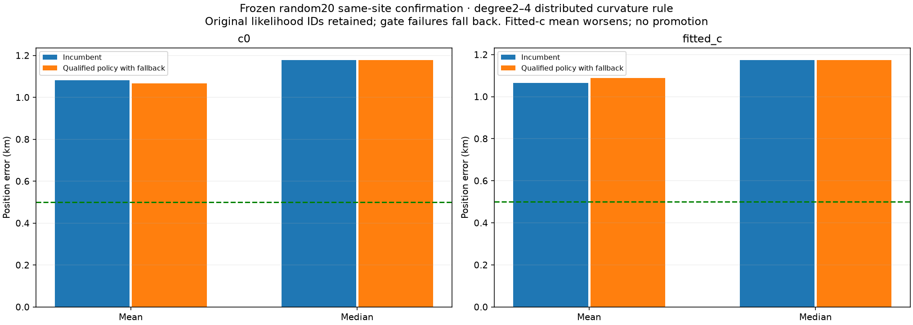
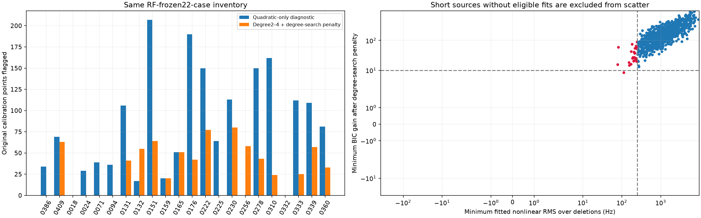
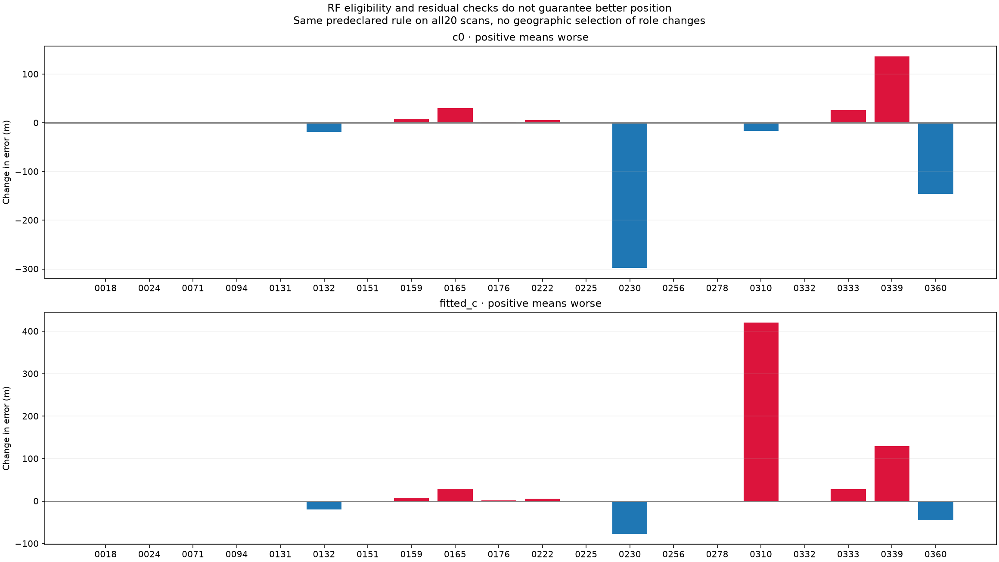
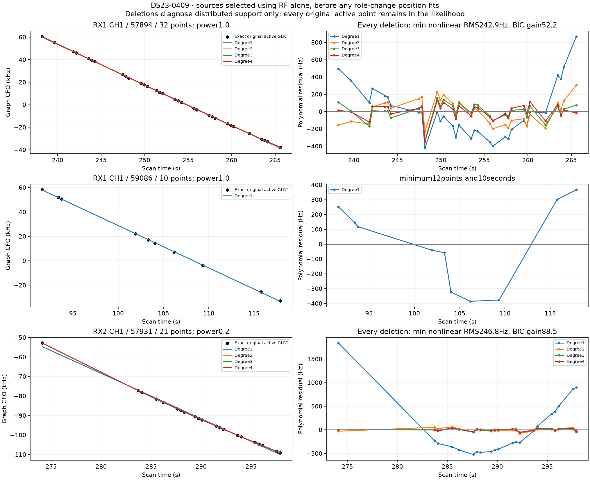
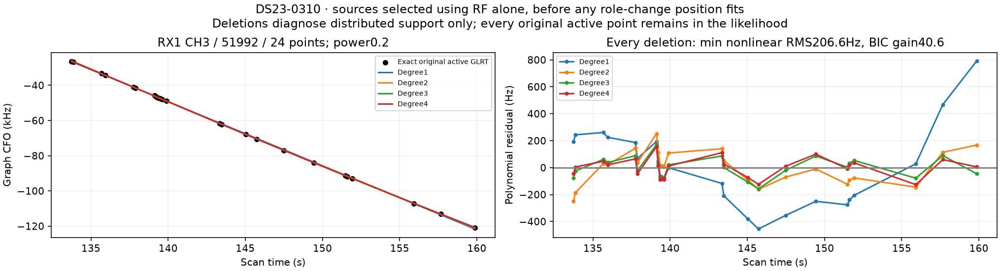

# Original calibration curvature: frozen22-case role control

Requiring distributed polynomial curvature before allowing an original track
to calibrate nuisance terms does **not** produce a transferable accuracy gain
in this test. On the frozen random20, fitted-c mean error worsens
1.064516→1.088453km, median stays1.173630km, three scans improve and seven
worsen. This is a negative result, published to prevent repeating the same
proposal. Keep the ALGO02/ALGO03 reference; do not roll this policy across DS23.

## Hypothesis and RF-only cohort

The original graph's curvature rule uses linear-fit residual RMS and duration.
An isolated endpoint, high-order fit or noise could create apparent curvature.
The hypothesis is that such original sources should remain associated evidence
but enter only as predictions from independently curved calibration sources.
This differs from prior experiments that promoted newly unused short curves;
this experiment changes the role of **originally active** observations.

Before any new position fits, we freeze engineering scans0386/0409 plus20
random scans selected by ID with seed2026102316, excluding closed DBG01 cases
and0405. The random20 are0018,0024,0071,0094,0131,0132,0151,0159,0165,0176,
0222,0225,0230,0256,0278,0310,0332,0333,0339,0360. They are scan-disjoint from
the engineering/closed queue, but have prior same-site analysis exposure.
They are neither untouched observations nor validation at a new location.

Each source uses its **actual active original mask**, not its unused prefix
or full persisted polynomial. All original observation IDs and source hashes
are saved in the inventories. Neither GPS nor a new position error is read to
choose the rule, cohort or demoted sources.

## Curvature criterion and the quadratic-only control

The first diagnostic reused the existing quadratic-only jackknife test:
at least12points/10s, linear RMS≥250Hz and quadratic BIC gain>10 after every
single-point deletion. It flags55sources/1739points across19 of22 scans.
However, a symmetric cubic inflection need not have a useful quadratic term.
This diagnostic must not be used as proof that its rejected sources are linear.

The pre-fit degree2–4 control fits a line and each eligible nonlinear degree
using Legendre least squares. It requires at least four points per coefficient
in **every** deletion. Its nonlinear amplitude is the RMS difference between
the best nonlinear prediction and the line, not the line's noisy residual RMS.
For the full source and every single-point deletion, require amplitude≥250Hz
and BIC improvement>10+2log(number of eligible nonlinear degrees). Every deletion
is diagnostic; no observation is actually removed. This criterion flags
32sources/733points across15 of22 scans, from35434 original calibration points.
The quadratic-only variant is an RF diagnostic, not a second position policy.

Degree4 support also survives deletion in0386's high-leverage28-point unused
source and its27-point core, as shown in [iteration016](../2026_10_23_ds23_dbg01_iteration_016/README.md).
Thus high leverage alone is insufficient evidence for truncation or a wrong
track join. Conversely, passing this RF test does not prove a satellite identity.

## Exact role and likelihood change

For a source that fails the frozen RF rule, its original active points move
from calibration into the existing predictive block. Every original likelihood
ID, satellite identity, integer alias, original curve slot and orbital-mode
coordinate remains. Partial masks are realized as explicit numerical subset
views; metadata and actual numerical rows are audited to match.

Remaining curved observations alone update radio/orbit coefficients. Demoted
observations contribute position information through the full shared posterior
prediction covariance and the existing300Hz per-source constant prior. They
do not update calibration normal equations. Their predictive noise variance is
**2σ_original² / original_power**, using the existing unseen-Gamma variance2
and retaining the original power downweighting. Existing predictive sources
keep their exact original σ. An explicit in-memory noise adapter supplies these
values; its positive selector flag is not a newly fitted BIC or persisted
noise-contract update.

This changes both evidence role and its predictive noise model. It is **not**
a pure calibration-feedback ablation. No comparison of the two model scores
alone establishes which localizes better. No noise precision is fitted from
the demoted points, and the rule is not selected using GPS or RF score gains.

Both c arms share IDs, identities, aliases, priors and budgets: cold[0,0],
original25×25km regional box, five phase rounds×48steps, and the unchanged
near-feasible five×40 refinement where eligible. Both arms must pass original
residual/visibility/phase gates and retain **every previously accepted ID**.
Any failure uses the complete incumbent as fallback. There is no source pruning
to rescue a failing policy. Evaluate all22 cases even when engineering fails.

## Position and coverage results

| Random20 policy | c arm | Mean error km | Median error km | Improved / worsened | Original GLRT associated |
|---|---|---:|---:|---:|---:|
|Incumbent|c=0|1.081003|1.177675|—|40283/54076|
|Qualified role policy + fallback|c=0|1.067356|1.177675|4/6|40283/54076|
|Incumbent|fitted c|1.064516|1.173630|—|40234/54076|
|Qualified role policy + fallback|fitted c|1.088453|1.173630|3/7|40258/54076|

The fitted-c policy gains24 post-fit associations but no new likelihood points:
all original likelihood IDs are unchanged. Coverage therefore cannot be used
as evidence that the role change improves position. The raw unqualified control
is worse still: fitted-c mean1.106655km, median1.197564km,40106 associated.
Raw and fallback results for every scan are in [positions.csv](tables/positions.csv).

Seven of22 scans have no role change. Of15 changed scans,10 qualify and five
fail. Four failures are in the random20;0409 is the fifth. Its demoted63points
do not remove the whole discrepancy: predictive sources57931/57894 fail, and
66 originally accepted IDs would be lost, so both arms retain the incumbent.
0131,0151,0256 and0278 also fail predictive or remaining-calibration checks;
the [gate-failure table](tables/failed_gates.csv) preserves each affected source.

The0386 engineering case has no role changes under the degree2–4 rule.
Among passing confirmation cases,0310 worsens fitted-c error0.4446→0.8650km
after moving24points. That result passes the stated evidence checks and still
loses about420m of position accuracy.0230 improves by77.7m and0360 by45.5m;
those isolated improvements do not justify selecting locations or sources using
the evaluation GPS.

These results reject the tested general role policy. They do not establish that
every weak curve is useful, that every original identity is correct, or that
all alternative robust curvature models fail. No threshold tuning follows
these geographic results. The next bounded worst-two DBG01 batch moves to
0075/0087 with the unchanged reference.

## Reproduction and validation

The [protocol](evidence/protocol.json) freezes the RF inventory hash, cohort,
source hashes, power-aware predictive variance, budgets, qualification and
fallback. Run the archived RF inventories, role runner and report sources in
[source/tools](source/tools/probe_ds23_distributed_calibration_roles.py).
The [manifest](evidence/archive_manifest.json) hashes the22-case source,
mask, result and inventory archives. [Summary](tables/summary.csv),
[source eligibility](tables/source_eligibility.csv),
[endpoint audits](tables/endpoint_audits.csv) and [evaluation](evidence/evaluation.json)
give the complete outputs rather than only favorable cases.

All22 jobs finish. All44 endpoint arms independently replay their expected
density, coefficient equations, dense predictive covariance and original gates.
Maximum discrepancies are3.56e−7 in expected density,8.48e−8 in coefficient
equations and5.59e−8 in predictive density; saved endpoint objectives replay
exactly. Tests cover cubic inflections, isolated endpoint/noise controls,
alias invariance, exact partial-mask membership, original noise powers and
preservation of unrelated observations. No golden fixture is changed.

Inference uses causal epoch-and-collection-checked TLEs and the original box
center37.906,−122.545. GPS37.849061591561885,−122.48574968092912 is report-only.
There is no new RF acquisition, IQ reprocessing, moving trajectory or stationary
history assumption. The full410-scan reference remains unchanged and the
0.5km mean-and-median goal remains unmet. No new ALGO series is released.
