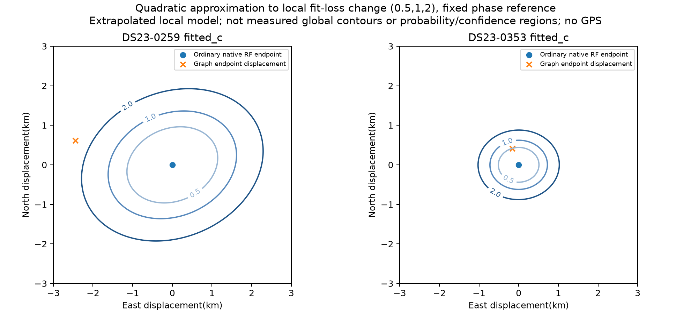
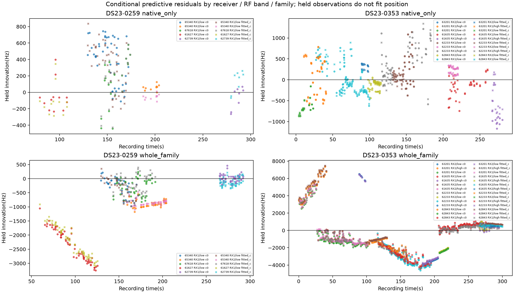
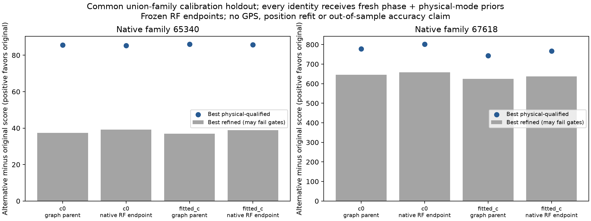

# DS23 family-held-out prediction, symmetric identities and position sensitivity

2026-10-23 · Completed bounded research iteration · **No new ALGO promotion or production position policy**

The next tests do not produce a defensible automatic family-rejection rule. On 0259, withholding 65340 or 67618 improves measured position accuracy, but the RF predictive diagnostics do not identify either family as an outlier under the current model. A symmetric causal identity comparison still favors their existing labels. The ordinary optimizer has converged locally: the poorer position is preferred by the current RF objective. On control scan 0353, the previous accurate result comes from constrained rescue, not ordinary native fitting; that rescue raises the common-data RF loss substantially.

We also implemented and tested a physical-ID rejection ledger that prevents postfit association from silently re-admitting excluded observations. This is a research wrapper, not a deployed change.

This follows the [native qualification study](../2026_10_23_ds23_native_qualification/README.md) and [native recovery mechanism study](../2026_10_23_ds23_native_recovery_mechanisms/README.md). Results here are **two-scan mechanism tests, not a new full-DS23 benchmark**. Retain the published ALGO02/ALGO03-derived reference. No new dataset-wide position or GLRT-association improvement is claimed.

## What was tested

The main protocol was frozen before execution. On each scan, choose the four new satellite families with the most native points, breaking ties by NORAD ID. This uses RF evidence only. All four 0259 families are included; four of twelve 0353 families are included.

| Scan | Selected family | Newly discovered native points |
| --- | ---: | ---: |
| 0259 | 65340 | 54 |
| 0259 | 67618 | 23 |
| 0259 | 61627 | 12 |
| 0259 | 62739 | 8 |
| 0353 | 63201 | 45 |
| 0353 | 61635 | 37 |
| 0353 | 62233 | 37 |
| 0353 | 62843 | 34 |

Each family has two interventions. **Native-only holdout** removes every predictive entry assigned to that family, including original parent entries, while retaining its curved calibration observations. **Whole-family holdout** additionally removes all retained curved observations of that family from calibration and position fitting. For example, 0353/62233 holds out 96 predictive observations, not just its 37 new points. These are diagnostic removals, not proposed deletion of protected original associations.

Both c arms use the same held physical IDs, identities, aliases, priors and optimization budget: cold regional-center start, zero phase reference, five refresh rounds of up to 48 ordinary iterations. This produces 16 paired jobs / 32 new position fits. All completed, with zero execution failures. Summed worker time was 85.35 seconds; maximum case-job time 9.52 seconds. This is bounded post-acquisition analysis timing, not an embedded runtime benchmark.

The region remains the 25 × 25 km box centered at 37.906, -122.545. Evaluation GPS enters only the reporting process. The causal catalogue, observations and existing noise/prior policies remain frozen. There is no future TLE, new RF, stationary pooling or location-based family selection. The frozen graph, aliases, discovery and estimated noise remain conditioned on the original data; even whole-family position holdouts are therefore **not independent cross-validation of the entire pipeline**.

## Prediction calculation

At each held-out position, reconstruct the joint predictive covariance of the withheld family H and remaining predictive observations R:

```text
K = measurement covariance
    + U × curved-calibration covariance × Uᵀ
    + per-path constant-offset covariance

innovation_H = residual_H − K_HR × K_RR⁻¹ × residual_R
S_H = K_HH − K_HR × K_RR⁻¹ × K_RH
Q = innovation_Hᵀ × S_H⁻¹ × innovation_H
score = Q + log|S_H| + n_H log(2π)
```

For whole-family holdout, the joint H includes the withheld curved and predictive observations. Shared cross-family and cross-receiver uncertainty is retained. Other predictive observations can condition the prediction through this covariance; they never enter the curved-calibration normal equations. Tests verify the conditional score equals joint score minus the remaining-observation score, and that held IDs never enter training.

The predeclared diagnostic flag uses a Gaussian chi-square upper tail below 0.01/8 in **both** c arms. It was explicitly not an adoption rule. Empirical precisions, selected identities, unknown noise and frozen discovery make these tails uncalibrated. The report retains native-only prediction statistics within whole-family predictions too; a low joint Q/n after adding uncertain curved observations is not proof of consistency.

## Position results and the misleading positive control

| Scan / fit | c=0 error, km | Fitted-c error, km | Paired RF qualification |
| --- | ---: | ---: | --- |
| 0259 graph parent | 0.8634 | 0.9515 | Pass |
| 0259 full ordinary native | 3.5621 | 3.4213 | Pass |
| 0259 hold native 65340 | 1.5018 | 1.4134 | Pass |
| 0259 hold whole 65340 | 1.5450 | 1.4322 | Pass |
| 0259 hold native 67618 | 1.8507 | 1.9174 | Pass |
| 0259 hold whole 67618 | 1.8478 | 1.8947 | Pass |
| 0353 graph parent | 1.8381 | 1.9288 | Pass |
| 0353 full ordinary native | 2.2844 | 2.2935 | Fail in fitted c |
| 0353 previous constrained rescue | 0.5789 | 0.5366 | Pass |

Neither useful 0259 removal returns to graph-parent accuracy. Removing 61627's whole family makes error worse still, to 4.274/4.229 km. All 0259 training fits pass the original gates, but none meets the paired predictive-tail flag. Thus influence is established, not a valid RF reason to discard the influential families.

On 0353, flags occur for 63201 in both holdout modes and 62233 in native-only mode. Every flagged job fails paired training qualification. There are **zero admissible paired flags**. This does not provide a guard that rejects harmful 0259 evidence while preserving useful recovery. The flag count and all failed gates are retained, rather than hiding unqualified endpoints.


The control requires particular care: ordinary native evidence worsens 0353, and its fitted-c endpoint fails two RMS gates on an original RX1/CH5 track. The low-error 0.537 km result is produced by the separate constrained rescue. It cannot be cited as evidence that unconstrained native fitting improved localization.

The earlier full-DS23 policy and coverage remain unchanged. These diagnostic held-out masks do not receive new production association percentages: several deliberately remove original evidence, and unqualified fits are not accepted outputs.

## The ordinary fit is locally converged, but its preferred position is worse

A posthoc audit evaluates the actual scalar optimized by `fit`, the squared `p.residual` vector including visibility penalties. It does not substitute negative twice ELBO or compare losses across changed masks. Hessians at 0.02 and 0.05 km steps agree closely. Ordinary endpoints have tiny local Newton steps; 0259's full fitted-c step is approximately 0.000026 km. This supports local convergence, not a claim of a global optimum.

At full fitted-c endpoints, the actual scalar Hessian eigenvalues are approximately **0.718 / 1.186 for 0259** and **3.814 / 5.173 for 0353**, in loss units per km². The corresponding condition ratios are 1.65 and 1.36. In these local coordinates, 0259 is broader in both directions; there is no evidence here for one nearly singular horizontal axis. These Hessians and the separately reported Gauss–Newton sensitivity are not calibrated position covariances.




The contours above extrapolate local quadratic fits. They are not sampled global loss surfaces, confidence regions or probabilities. An additional measured check scores 66 positions along fixed lines joining the RF-derived endpoints, keeping the full native observation mask constant and refreshing phase five times at each point. Maximum final phase change is 4.11e-9 seconds.

| Common-mask move | Change in actual RF fit loss, c=0 / fitted c | Change in position error, fitted c |
| --- | ---: | ---: |
| 0259 graph → ordinary native | −3.435 / −3.030 | 0.951 → 3.421 km |
| 0353 graph → ordinary native | −0.683 / −0.489 | 1.929 → 2.294 km |
| 0353 ordinary native → constrained rescue | +14.905 / +17.084 | 2.294 → 0.537 km |


On 0259 the loss decreases and all gates pass along the sampled graph-to-native line. The optimizer is following the model's preference, despite moving away from the evaluation site. More iterations on this local objective are not supported as a remedy.

On 0353 the graph position already passes all full-native gates in both arms, with much lower ordinary RF loss than the eventual constrained rescue. The latter is therefore not the lowest-loss feasible point among even these evaluated endpoints. Its favorable GPS error does not justify choosing it as an RF-optimal solution or tuning a general rescue policy around that error. The sampled line is a diagnostic, not a new solver comparison or deployment rule.

## Does the discrepancy follow a satellite, receiver or band?

Whole-family holdout exposes substantial uncertainty in the family mean. For fitted-c 0259/65340, native path mean innovations are about −535, −255, −843 and +53 Hz, but their marginal prediction SDs are approximately 2,352–3,140 Hz. The withheld original RX2/CH2 curve has mean −847 Hz with SD 3,378 Hz. For 67618, the native mean is −33 Hz with SD 1,536 Hz; its original curve is −211 Hz with SD 1,781 Hz.

These broad predictive scales explain why a family can have substantial position influence without being rejected by its holdout. They do not prove the family is correct or justify widening the prior further. The covariance retains relative information between paths, so these marginal bars must not be treated as independent measurements.




Both influential 0259 families are observed only in the low band; 67618's evidence is confined to RX1/CH4. 65340 has observations across both receivers, but the means vary by path and depend on the conditioning model. This support does not isolate a common receiver fault, a cross-band error, or a satellite-specific orbital error. Do not add a receiver correction or satellite correction solely from these residuals. The figures and point-level CSVs preserve the ambiguity.

## Symmetric causal identity comparison

The earlier identity screen gave supported originals a calibrated prior advantage. This study removes that advantage: for each target, withhold every curved observation belonging to any label in the frozen shortlist, and give **every identity** a fresh causal phase prior plus three physical orbit modes with the same prior construction. No fitted original phase or mode posterior is reused. All target native paths are scored jointly with shared radio uncertainty. Candidate-specific physical scales still come from the existing causal model.

The exact pools contain 13 candidates for 65340 and seven for 67618, automatically inherited from the previous screen. Eight comparisons cover graph/native RF positions × both c arms × both families. Every original wins and passes the physical and residual gates; no refined alternative passes both. The nearest 65340 alternative, 62890, loses 36.98–39.22 score units and needs excessive phase. The nearest 67618 alternative, 58744, loses 624.61–658.00 and likewise fails phase.



This is stronger evidence against the specific prior-asymmetry explanation, not external satellite identification. It remains a finite-shortlist, Gaussian, position-conditioned comparison. The 1,338-entry coarse screen is diagnostic and not exhaustive physical refinement. Radio calibration still depends on other graph identities; the two tested positions were originally fitted using the targets. Withheld curved observations are excluded rather than scored here. See the [identity report](identity/REPORT.md), protocol and saved candidate results.

## Postfit rejection ledger implemented

The pure `coverage_with_ledger` wrapper receives rejected physical observation IDs and original-parent accepted IDs. It refuses overlap with the protected parent. After the unchanged coverage helper runs, it removes whole association records touching rejected IDs, then consistently rebuilds ownership, counts and percentages. It refuses any collateral removal of protected IDs. Whole-record removal avoids retaining quality statistics for an uncertified sliced track; callers must audit collateral nonprotected removal.

The replay removes the nine re-admitted 0232 fitted-c observations, changing coverage 2,097 → 2,088, while leaving 0232 c0 at 2,088 and both 0365 arms at 2,194. No collateral IDs or original-parent IDs are lost. Position fits are unchanged. Five tests cover protection, ownership, accounting, idempotence and saved results. See the [ledger report](ledger/README.md). The diagnostic family holdouts above are not passed through this association filter because they intentionally withhold protected original evidence and do not propose accepted coverage.

## Decision and next work

Do not promote a new ALGO, discard 65340/67618 based on their GPS ablations, or broaden all path priors. The current test cannot distinguish useful and harmful evidence through a qualified predictive conflict rule. It has narrowed the problem: 0259 is not explained by the tested asymmetric identity prior or unfinished local descent, and its held-family mean remains poorly constrained.

Close this bounded 0259/0353 mechanism batch. Return to the next unresolved worst scans in the existing queue. Carry forward two requirements: compare candidate positions on identical observations with an explicit feasible incumbent, and distinguish satellite association support from the amount of new position information it provides. A future transferable calibration change needs independently supported cross-receiver/band evidence, not GPS-selected family deletion. Any proposed policy must retain the c ablation, protect original IDs, use the rejection ledger consistently, and earn promotion on full DS23 before receiving a new ALGO label.

## Reproduction, evidence and validation

The capsule includes frozen protocols, source/tests, 11 CSV tables, seven figures including the identity plot, complete identity/ledger results, scalar and line diagnostics, and input receipts. The 16 larger raw fit objects remain at `/srv/bulk/leo/research/algo04-family-predictive-20261023/raw`, bound by hashes in `reporting/receipt.json`. Preceding frozen corpus artifacts and numerical helpers are required; this is not a standalone distribution of the radio data.

Restore the capsule at its recorded bulk location because drivers derive output paths from their source location. Use the existing `.venv/bin/python -B`, `PYTHONDONTWRITEBYTECODE=1`, `OPENBLAS_NUM_THREADS=1`, `OMP_NUM_THREADS=1`, and this colon-separated PYTHONPATH from the repository root:

```text
/srv/bulk/leo/research/algo04-family-predictive-20261023/source
/srv/bulk/leo/research/algo04-native-mechanisms-20261023/source
/srv/bulk/leo/research/algo04-ordinary-full-ds23-20261023/source
/srv/bulk/leo/research/algo04-candidate-20261023/source/tools
/tmp/algo03-feasible-deps
src
tools
```

`source/family_predictive.py --freeze-only` verifies the protocol; `--workers 4` resumes saved cases. Preserve the frozen outputs. `source/scalar_curvature.py` and `source/common_mask_lines.py` reproduce the explicitly posthoc supplements. `reporting/report.py` regenerates tables and figures using GPS only for evaluation. Run reporting tests separately to resolve their local `report` import. All tests require their declared local numerical artifacts and fail if missing; none silently skip unavailable data. Identity and ledger subreports describe their runners.

Validation: **19 tests passed** (four conditional-prediction, two scalar-curvature, three identity, five ledger, five reporting). All 16 jobs and eight identity comparisons completed; no held/training ID overlap, matched held IDs across c arms, preserved frozen input hashes and causal element checks. The 786-file numerical dependency seal remains unchanged. No public persisted contract, golden fixture, production algorithm or QNAP recording was modified.
