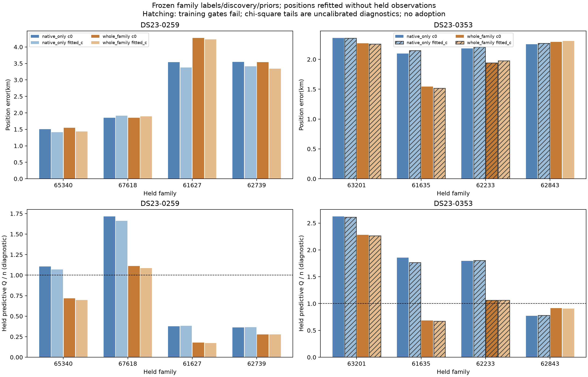
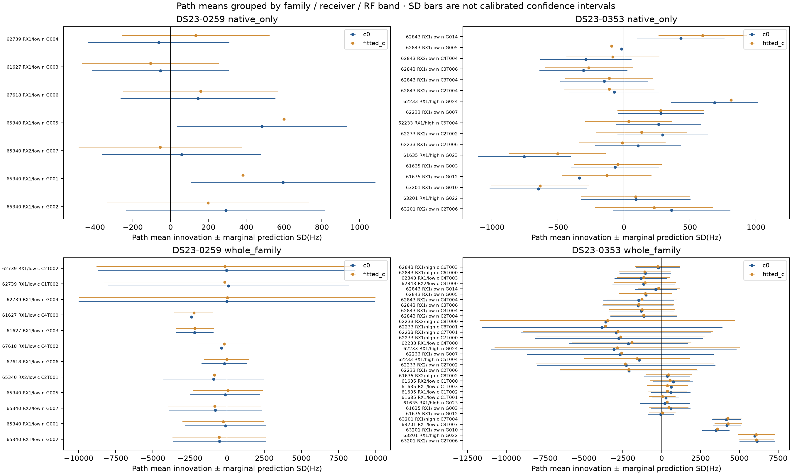
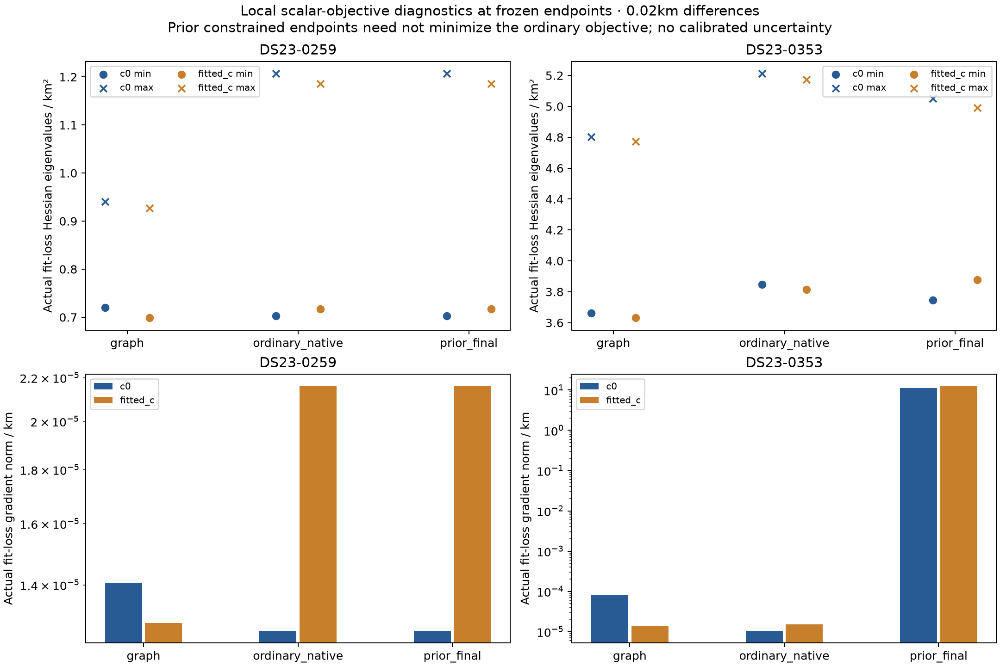
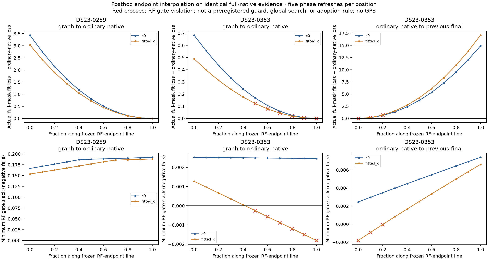

# Family-held-out reporting findings

All16 jobs completed (32 c-arm fits). No diagnostic selects or adopts a new endpoint. GPS enters this reporting process only. Family discovery, labels, aliases and learned prior policy remain frozen from the original evidence, so these position holdouts are not independent crossvalidation.

0259 ordinary full-native errors are3.5621/3.4213km (c0/fitted-c), versus graph-parent0.8634/0.9515km. Holding65340 native entries out reduces error to1.5018/1.4134km; holding its whole family out gives1.5449/1.4322km. For67618, native-only errors are1.8509/1.9169km and whole-family1.8484/1.8946km. All0259 training fits pass gates, and no family meets the paired diagnostic-tail flag. This supports family sensitivity without demonstrating a statistically calibrated inconsistency or a wrong identity.

0353 previous constrained-policy errors are0.5789/0.5366km. Ordinary full-native errors are2.2844/2.2935km, with the fitted-c arm failing training gates, so the control benefit belongs to the constrained policy rather than an unconstrained native fit. Paired diagnostic flags occur for63201 in both holdout modes and62233 native-only; all flagged jobs fail paired training qualification. There is no admissible paired prediction flag and no guard can be adopted from this result. Their tails remain uncalibrated diagnostics, not valid rejection probabilities or adoption criteria.

Native-only removes ALL predictive entries of the family, including original parent entries; whole-family additionally removes retained curved calibration points. For0353/62233 this means96 native observations, not merely37 newly discovered points;62843 holds86 native observations, not merely34 new points. The CSVs retain both counts.

The predeclared flag is p<0.01/8 in BOTH arms. Schur-complement covariance retains shared calibration correlations. Chi-square tails assume an empirical Gaussian approximation with frozen discovery/labels and therefore are not calibrated frequentist probabilities. Large whole-family predictive covariance can lower Q/n; that is not evidence of better localization.

Actual scalar-objective Hessians supplement Gauss–Newton residual sensitivity. At full fitted-c endpoints,0259 eigenvalues are approximately0.7175/1.186, versus0353 approximately3.814/5.173:0259 is broader in both local directions, rather than having one nearly singular axis. Neither Hessian nor GN condition is calibrated position uncertainty.0353 constrained prior-final has a substantial ordinary-objective gradient and need not be an ordinary minimum. Local quadratic contours are extrapolated approximations, not measured global basins or confidence regions.

Path means localize conditional RF discrepancies without identifying their cause. In0259 native-only fits,65340 RX1/low-band paths001 and005 have means of roughly382–599Hz but prediction SDs449–525Hz; no path mean exceeds1.31 in magnitude relative to its marginal SD. In0353 native-only fits,62233 RX1/high path024 has mean685/811Hz with SD330/332Hz, while61635 RX1/high path023 is negative. Whole-family63201 shows coherent positive means across RX2/low and RX1/high native paths (approximately6.0–6.1kHz, about5 marginal SDs), but its training fit is invalid. These are correlated, discovery-conditioned diagnostics rather than independent receiver evidence.

For0259 whole-family fitted-c predictions,65340 native means span about−843 to+53Hz with SDs2352–3140Hz; its original RX2/CH2 curve mean is about−847±3378Hz.67618 native mean is about−33±1536Hz and its curved mean about−211±1781Hz. Both influential families have only low-band support;67618 is only RX1/CH4. Such large withheld-family mean uncertainty makes nonflagging weak evidence rather than proof of consistency. The joint Q accounts for relative patterns, but family means remain poorly constrained. This support cannot separate receiver from band faults and does not justify broad prior relaxation.

Posthoc common-mask endpoint lines use identical full-native evidence and refresh phase nuisance five times at each fixed RF position. The0259 graph-to-native line prefers the worse-localizing ordinary endpoint in RF fit loss; the0353 ordinary-to-constrained line trades higher RF loss for gate qualification and better reported accuracy. These endpoint-conditioned sensitivity lines were added after the preregistered family diagnostics and cannot be presented as a preregistered guard or a regional/global search.

Tables include every fit, baseline, diagnostic flag, per-path mean, per-observation residual, training failure, local GN nuisance response and scalar curvature at0.02/0.05km finite differences. Figures mark invalid training fits with hatching; path-mean SD bars are marginal prediction scales rather than calibrated confidence intervals.

