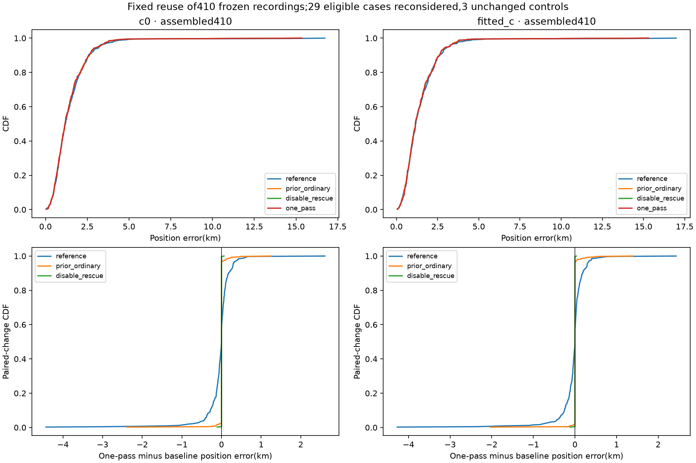
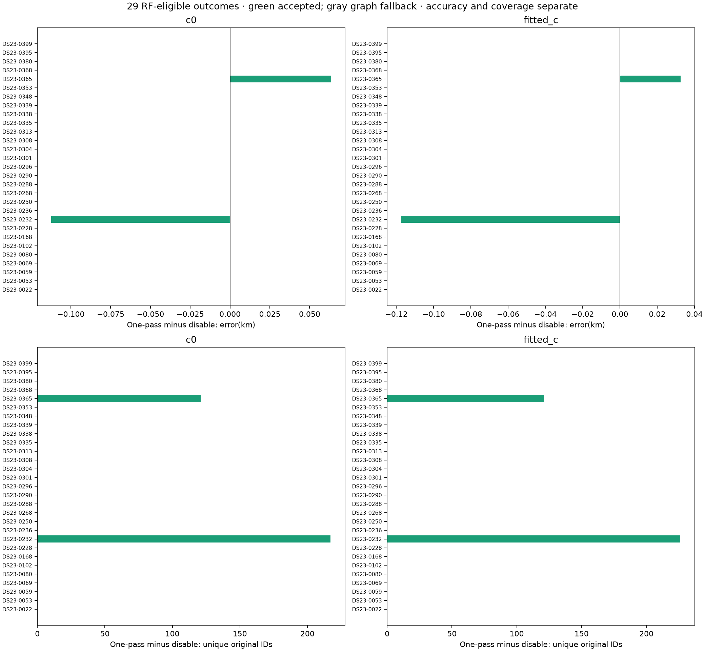
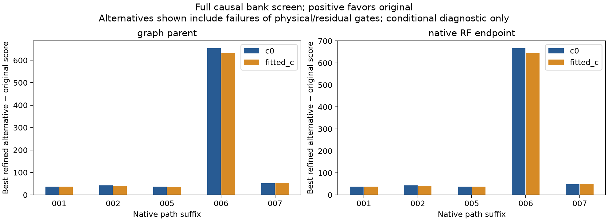

# DS23 native-path qualification and causal identity checks

Date: 2026-10-23. Status: completed bounded research iteration; **no new ALGO promotion or production prior change**.

The general one-pass path exclusion rule reproduces the useful 0365 result, and recovers additional evidence on 0232. It does not improve the full dataset enough to adopt. Most eligible failures occur on protected original curved evidence rather than on the newly added paths. Falling back in all those cases sacrifices useful recovery, particularly on 0353. A broader causal identity screen on 0259 finds no better qualified replacement among the refined candidates, and a limited RF holdout study does not support globally increasing native-path offset uncertainty.

This follows the [native-recovery mechanism investigation](../2026_10_23_ds23_native_recovery_mechanisms/README.md) and [full ordinary graph assessment](../2026_10_23_algo04_ordinary_full_ds23/README.md). The reference is the published ALGO02/ALGO03-derived family-cavity result, not an unmodified original ALGO02 run. The prior ordinary candidate remains unpromoted.

## Scope and experimental controls

The protocol was frozen before execution. All 29 scans eligible for the previous RF-based near-feasible native rescue were included, irrespective of whether that rescue had succeeded. Controls 0041, 0272 and 0259 were also inspected. There were 32 terminal results, zero execution failures, two accepted refits and 27 graph fallbacks. Only two scans needed new position fitting: four fits across the two c arms. Other cases replayed/evaluated saved results. Summed case worker time was 150.3 seconds, maximum 12.6 seconds; this is not end-to-end acquisition or full pipeline timing.

The 410-scan comparison **assembles frozen unchanged results with these policy changes; it is not 410 new pipeline runs**. All 381 scans outside eligibility reuse exact previous endpoints and ID vectors. The underlying run has 408 completed searches and two predeclared inherited cases: 0004's incomplete bank and 0068's phase exception. The 413-entry manifest has three unavailable recordings: 0012, 0184 and 0286. Available scans comprise 204 fast and 206 adaptive scans, with 1,036,559 original GLRT observations.

Inference uses the existing causal catalogue, original 25 × 25 km region centered at latitude 37.906, longitude -122.545, existing priors and aliases. No evaluation GPS enters candidate selection, exclusions or fitting. GPS is used only in this reporting stage to measure position error. No future TLEs, new RF collection, stationary pooling or manually selected replacement satellite are introduced. Both c=0 and fitted-c use matched fitting observations, candidates, priors and budgets within each method. Coverage can differ between arms through existing postfit extension, as discussed below.

## Rule and comparators

1. Reconstruct the frozen ordinary graph parent and selected persistent-5-second native paths.
2. Replay the saved full-native ordinary endpoint and score in both c arms. Require objective agreement within 1e-5.
3. Find negative individual linear gate slacks on **new whole native paths**. Exclude the union across both c arms from the fitting entries. Do not remove original predictive entries, curved evidence or any graph-parent accepted physical ID, including prior postfit additions.
4. Refit once from the regional center with zero phase reference, ordinary optimization and five phase-refresh rounds of up to 48 iterations. No constrained rescue or repeated pruning is attempted.
5. Require the unchanged paired RF gates, phase change at most 0.01 seconds, and preservation of every graph-parent accepted ID. Otherwise retain the graph parent. If no failing new path can be removed, retain the graph parent immediately.

The **disable-rescue** comparator uses the graph parent in all 29 eligible cases. Outside these cases, both policies reuse the prior ordinary candidate. This separates retained-path benefits from effects of simply dropping rescue.

The previous constrained rescue starts warm and uses five rounds of up to 40 iterations; the new refit starts cold and uses five by 48. This is a policy comparison, not an isolated solver ablation. Budgets remain matched across c arms. The code's `/linear/` label is the predictive-entry gate category; it does not establish that every native path is physically straight.

## Full available dataset

Coverage is summed unique accepted original observation IDs divided by the common original-GLRT denominator. Errors are per-scan distances in km. Table values are rounded; CSVs retain precision.

| Method | c arm | Mean km | Median km | p95 km | Worst km | Associated IDs | GLRT associated |
| --- | --- | ---: | ---: | ---: | ---: | ---: | ---: |
| Published reference | 0 | 1.479378 | 1.190706 | 3.224087 | 16.731744 | 726,622 | 70.0994% |
| Prior ordinary candidate | 0 | 1.433610 | 1.170002 | 3.160122 | 15.349837 | 771,683 | 74.4466% |
| Disable native rescue | 0 | 1.433715 | 1.168085 | 3.160122 | 15.349837 | 768,672 | 74.1561% |
| One-pass exclusion | 0 | 1.433596 | 1.168085 | 3.160122 | 15.349837 | 769,010 | 74.1887% |
| Published reference | fitted | 1.469461 | 1.178102 | 3.156696 | 16.979794 | 726,425 | 70.0804% |
| Prior ordinary candidate | fitted | 1.425987 | 1.156786 | 3.201762 | 15.311592 | 771,350 | 74.4145% |
| Disable native rescue | fitted | 1.429107 | 1.156786 | 3.201762 | 15.311592 | 768,339 | 74.1240% |
| One-pass exclusion | fitted | 1.428901 | 1.156786 | 3.201762 | 15.311592 | 768,686 | 74.1575% |

Relative to disabling rescue, one-pass exclusion adds 338/347 IDs (c0/fitted) and improves mean error by only 0.000119/0.000207 km. Relative to the prior ordinary candidate it loses 2,673/2,664 IDs; mean changes by -0.000015/+0.002913 km. The fitted-c p95 remains worse than the published reference. Six regressions exceed 0.5 km in each arm versus reference, including one above 1 km. Aggregate improvement over reference therefore does not establish a safe replacement.



The format split also matters. For fitted c, fast-scan mean changes 1.231419 → 1.228232 km and coverage 76.0968% → 75.8532%; adaptive mean worsens 1.618666 → 1.627620 km and coverage falls 70.4649% → 70.1765%. Both comparisons are prior ordinary → one-pass. Full c0, format-specific and eligible-only distributions are in [summary.csv](tables/summary.csv).

## Why the local fix does not generalize

Only two eligible scans have a failing new path that this rule is allowed to remove. The other 27 have failures on protected original evidence. Across the paired arms, those protected gate failures comprise 39 slope, 28 step, 10 quadratic, six lag-one and two RMS failures; these are gate instances, not independent scans or physical faults. This finding does not prove that those original tracks are wrong: added evidence can shift a fit until a previously acceptable original track fails.

| Scan, fitted c | Prior ordinary error | One-pass error | Prior IDs | One-pass IDs | Explanation |
| --- | ---: | ---: | ---: | ---: | --- |
| 0365 | 2.707491 km | 0.670890 km | 2,234 | 2,194 | Exclude one 40-point new path; preserve 121 new IDs above graph parent |
| 0232 | 1.536181 km | 1.418728 km | 1,871 | 2,097 | Exclude a nine-point fitting path; retain 13 native paths; postfit re-admission caveat below |
| 0353 | 0.536588 km | 1.928831 km | 2,267 | 1,965 | No failing new path; graph fallback loses 302 useful associations |

On 0365, path005/NORAD68553 fails the lag-one gate in both arms. Its 40-point exclusion exactly reproduces the prior diagnostic endpoint within 1e-7 km coordinate tolerance. The new result is still slightly worse than the graph parent: c0 0.465685 → 0.529120 km and fitted 0.638229 → 0.670890 km. It retains more supported observations without the previous constrained displacement; it is not an improvement over graph-parent position accuracy.

On 0232, path006/NORAD61724 has nine points and fails only the c0 quadratic gate, with slack -0.002874. The shared fitting mask removes it from both arms. Error improves 1.526006 → 1.413749 km for c0 and 1.536181 → 1.418728 km for fitted c. The c0 associated count becomes 2,088. These small gate violations illustrate why hard feasibility boundaries can change behavior sharply; they do not justify tuning the threshold from GPS error.



### Important postfit exclusion audit

The prototype excludes paths from **fitting**, not from every later association stage. The existing coverage helper scans all stored tracks using frozen calibration. On 0232, fitted c re-admits all nine excluded IDs as a postfit extension under NORAD61724 (RMS 209.585 Hz, bias -102.776 Hz). They do not re-enter the position fit. The c0 arm does not re-admit them; neither arm re-admits the excluded 0365 path.

The extension gate does not enforce this new paired exclusion ledger. The fitted-c postfit quadratic BIC is 9.9486 and passes the threshold of 10; c0 gives 10.0444 and fails. Thus 2,097 fitted-c IDs is the actual pipeline-reported result, not a claim that 226 points survived a strict whole-pipeline exclusion. A reporting-only strict-ledger sensitivity gives 2,088 IDs for 0232 and 768,677 dataset-wide fitted-c IDs (74.15661%), with unchanged position estimates. This is nine fewer than the main table. The [readmission audit](reporting/readmission_audit.json) replays all four changed coverage objects exactly. Before adopting a whole-pipeline exclusion policy, pass the rejection ledger through postfit extension and test it explicitly; do not quietly conflate a fitting mask with an association blacklist.

## Frequency scores versus position accuracy

Reduced-mask objective values cannot be compared directly with the original full-mask values. At the new endpoints, rescoring the identical original full mask changes the negative twice ELBO by +0.00739/+0.00631 on 0232 and +0.06400/+0.04449 on 0365 (c0/fitted). Positive means worse frequency score. The removed evidence still fails one full-mask gate on 0232 c0 and both 0365 arms. These are diagnostic common-mask scores, not an acceptance test or a posterior identity probability.

The reported RMS is the existing curved-calibration RMS, not pooled RMS over every associated GLRT point. In particular, 0353's fallback slightly improves this RMS while substantially worsening position. Tables retain both quantities separately. The c-ablation table also reports RMS and position changes separately; better frequency fit is not assumed to imply better localization.

## DS23-0259: broader causal identities

All 1,338 entries of the existing causal regional bank were screened for five influential native paths, with both TLE epoch and collection timestamp checked against the observation cutoff. For each path, the original label and the union of the top seven visible coarse nominees in each of four contexts were refined: graph-parent/full-native RF endpoint × c0/fitted. Every context uses the same union candidate pool. Refinement refreshes exact phase five times and retains existing visibility, ±15-second phase, 0.01-second convergence and fixed-radio residual gates.

No refined qualified alternative improves the original label's conditional score. Short path005 has a qualified alternative, 59377, but loses 45.86–51.41 score units to 65340. Candidate62890 requires 21.76–22.30 seconds phase and fails the bound. For path006, the closest refined alternative58744 requires roughly 59–60 seconds phase and fails. No replacement or new position fit was selected.



This is **not independent identity proof**. Calibration remains conditional on the graph's existing curved identities. Supported original labels retain calibrated orbital uncertainty, whereas unsupported replacement labels use the existing phase-only prior. Coarse nomination is not exhaustive nonlinear fitting. Joint changes to the curved graph, missed coarse candidates and unknown emitters remain possible. See the [identity diagnostic](identity0259/report.md) for complete scope and per-candidate evidence.

## RF support for path-mean uncertainty

The offset study removes a whole curved source from calibration, requiring another curved source in the same family. RF-only selection yields 12 distinct units: four on 0259, two on 0041, six on 0272. Both c arms use identical units. The held source's private constant feature is zeroed to emulate an unknown native path mean. Shared-calibration variance, measurement mean variance and centered residual scatter are kept separate.

After phase refresh, composite best additional offset SD is 89 Hz for c0 and zero for fitted c. Raising the added width from 300 to 600 Hz worsens the composite score in both arms. The result does not support the previously suggested blanket broadening, and the existing 300 Hz setting is retained without claiming it is physically correct.


The held-source position remains conditioned on the full-parent fit, so this is not full cross validation. Training observations are reused across holdouts, so the composite score is not an independent likelihood or a confidence interval. Most importantly, influential native families65340/67618 are absent from the eligible holdout set. These checks cannot directly identify their appropriate path-mean uncertainty. See the [offset diagnostic](offset_prior/README.md) for formulas, all observations and numerical summaries.

## Decision and next bounded investigation

Retain the published reference. Do not promote the ordinary candidate or this exclusion rule, relax gates to meet an association target, or widen every path's prior. The 0365 fix is real but is outweighed by losses elsewhere; 0259 remains unresolved.

The next transferable hypothesis is **whether a newly added family is pulling the position along a poorly constrained calibration direction**. Test that on common observations, with a paired leave-one-new-family-out predictive check and full phase refresh. Compare radio-group and satellite-family residual behavior to determine which uncertainty is shared. Use RF predictive disagreement and information conditioning to propose a rule; use GPS only after freezing it. The 0259 identity test should become symmetric by withholding the original family's calibration when comparing replacements, rather than granting the original label a better-conditioned prior.

Keep these tests bounded and include a positive rescue control such as 0353. A rule that fixes 0365 by removing all useful rescue is inadequate. Carry the rejection ledger through postfit association in any subsequent prototype. Close the present batch; revisit 0259 only for these new, specified hypotheses and continue the existing worst-scan queue if they do not resolve it.

## Reproduction and validation

The published capsule contains the numerical driver and owned tests, frozen protocol, reporting source, all tables/figures, compact execution evidence and complete small identity/offset diagnostics. Large raw fit objects remain under `/srv/bulk/leo/research/algo04-native-qualification-20261023/raw`; their hashes and original paths are recorded in `reporting/receipt.json`. This capsule depends on the preceding archived corpus and numerical environment and is not a standalone raw-data distribution.

Restore source at the recorded bulk path; the drivers derive their output root from their file location. From the repository root use the existing `.venv/bin/python -B`, `PYTHONDONTWRITEBYTECODE=1`, `OPENBLAS_NUM_THREADS=1`, `OMP_NUM_THREADS=1`, and this PYTHONPATH (colon separated):

```text
/srv/bulk/leo/research/algo04-native-qualification-20261023/source
/srv/bulk/leo/research/algo04-native-mechanisms-20261023/source
/srv/bulk/leo/research/algo04-ordinary-full-ds23-20261023/source
/srv/bulk/leo/research/algo04-candidate-20261023/source/tools
/tmp/algo03-feasible-deps
src
tools
```

Run `source/qualify_native.py --freeze-only` to verify the frozen protocol; `--workers 6` resumes saved execution. Preserve existing results and protocol rather than overwriting evidence. `reporting/report.py` regenerates the assembled tables/figures from the original recorded bulk files. Its tests require those local scientific inputs and fail if missing; no hardware or database access is required. The identity and offset subreports describe their respective runners. Run tests with `-p no:cacheprovider`; run reporting tests separately so their local `report` import is unambiguous.

Validation: nine driver/identity/offset tests, five reporting tests and two readmission tests passed (16 total), including exact frozen numerical parity, all 381 unchanged endpoints/ID vectors and every protocol input hash. The existing numerical dependency seal verified all 786 files. The execution audit checks primary score replay, paired acceptance, parent-ID preservation, terminal states and the 0365 canary; the separate readmission audit checks the postfit caveat. Artifact hashes accompany the publication. No golden fixture, live algorithm contract or QNAP recording was modified.
