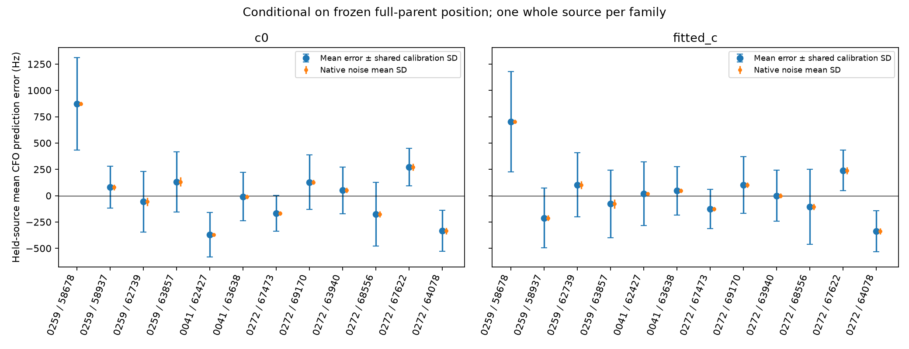

# RF-only native path mean uncertainty

**This bounded diagnostic does not support broadening 300 Hz to 600 Hz, and does not identify a transferable new-path offset prior.** Only 12 distinct source/family units meet the prespecified RF support rule: four on 0259, two on 0041, six on 0272. The 0259 influential native families 65340 and 67618 are absent from this holdout sample, so these results do not directly validate their offsets.

One longest retained whole curved source per family is removed from calibration, with at least one other retained curved source in that family. Six families maximum per case are selected by retained point count and component key. Cases have 13/15/15 supported families but only 4/2/10 eligible families; four eligible 0272 families are omitted by the declared cap. Selection is saved before case prediction. Both c arms use identical source sets. Linear/native paths never enter calibration. No GPS, future TLE, new RF, location optimization, or production change is involved.

Prediction conditions on the frozen full-parent position, which used the held source: **this is not full cross validation**. Each held-source fit refreshes nuisance parameters and phase at that fixed position, starting from the parent phase reference, for at most five rounds. All 24 arm/source fits converge below the existing 0.01 s update tolerance; maximum final update is 0.00887 s. The held source's fragment constant feature is zeroed for prediction, reproducing a native-like unknown whole-path mean. Full-source points are withheld and predicted; selected sources here have no partial masks.

For arithmetic mean feature vector a, training precision G, and n held points, shared-calibration mean variance is aᵀG⁻¹a. Independent native measurement mean variance is 2 Σσᵢ²/n² using existing fixed-window scales and the unseen-precision assumption E[1/τ]=2. Shared variance includes supported phase/orbit/radio uncertainty; it is not assigned to path offsets. Mean error is reported separately from centered within-source scatter. Per-source uncertainty is in results.json. Marginal fits for different held sources reuse training observations, so cross-family covariance is not available from one common training posterior; the summary below is a composite diagnostic, not an independent likelihood or calibrated confidence interval.

| RF summary across 12 family units | c=0 | fitted c |
| --- | ---: | ---: |
| Excess variance mean(error² − shared variance − noise variance), Hz² | 31,718 | −21,365 |
| Marginal composite best additional offset SD, Hz | 89 | 0 |
| Composite score difference, 300 Hz | 3.48 | 5.42 |
| Composite score difference, 600 Hz | 12.32 | 14.95 |
| Composite score difference, 3000 Hz | 46.72 | 49.79 |

Scores include log variance and squared mean error divided by total mean variance, relative to the arm's grid minimum. They compare common observations within each arm; lower is better. The optional delta-3.841 score bands in JSON are **not confidence intervals**. Negative method-of-moments variance means no positive extra component is resolved, not negative physical variance. Do not pool point residuals to estimate path prior width.

The strongest 0259 held-source mismatch (58678) is approximately 873/703 Hz (c=0/fitted c), against shared mean SD approximately 438/474 Hz. Other sources and controls mostly fit within their shared uncertainty. Broader widths worsen this limited composite score. Selection toward multiply observed, confidently assigned curved families, full-parent position conditioning, shared training, possible correlated measurement noise, and missing influential native families prevent transfer to all new native paths. Retain the 300 Hz production setting pending independent RF evidence; this does not establish that 300 Hz itself is physically correct.

Runtime was roughly 5.3 seconds total for final case diagnostics, below 60 s/case. The first frozen-phase pass is archived as frozen_phase_results.json; it showed updates up to 0.159 s and is superseded by the refreshed analysis. Source is run_offset.py; report.py rebuilds the figure and summaries; test_offset.py checks variance subtraction and saved selection/convergence. Reproduction uses the parent capsule PYTHONPATH and pinned runtime environment. No localization accuracy is assessed here, and no in-sample frequency result is interpreted as improved position.
