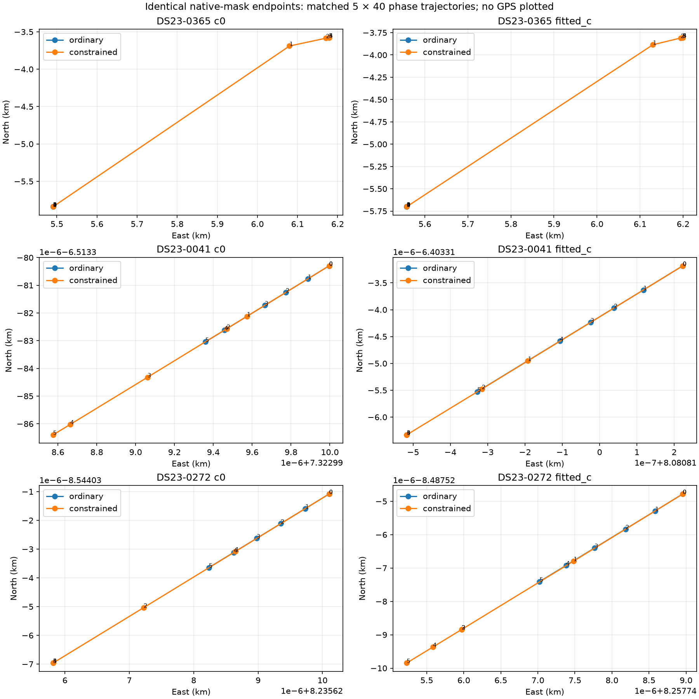
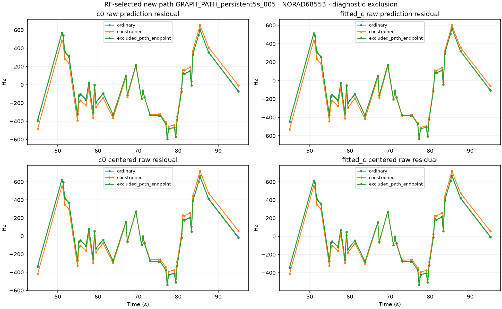
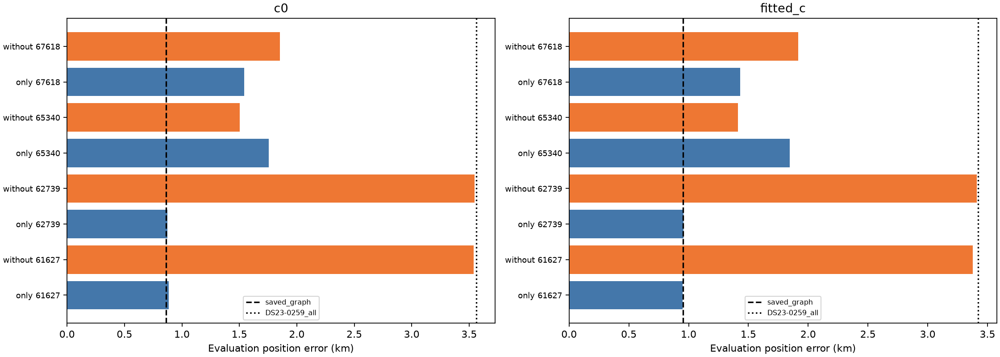
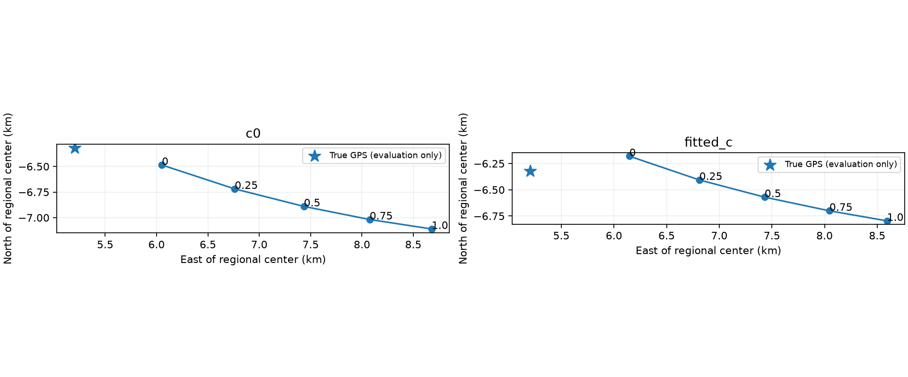
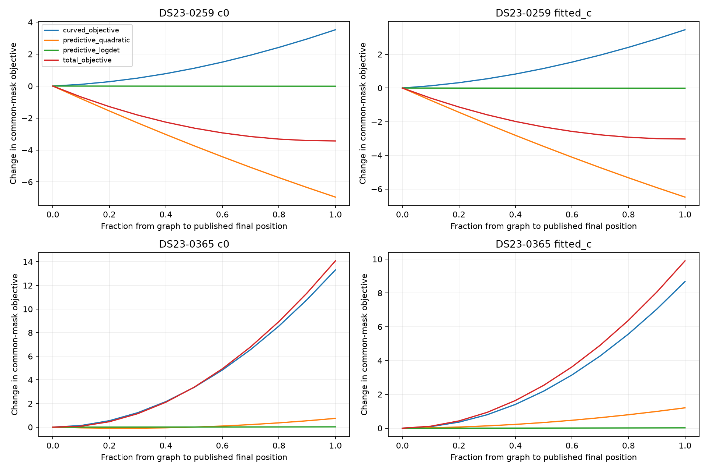
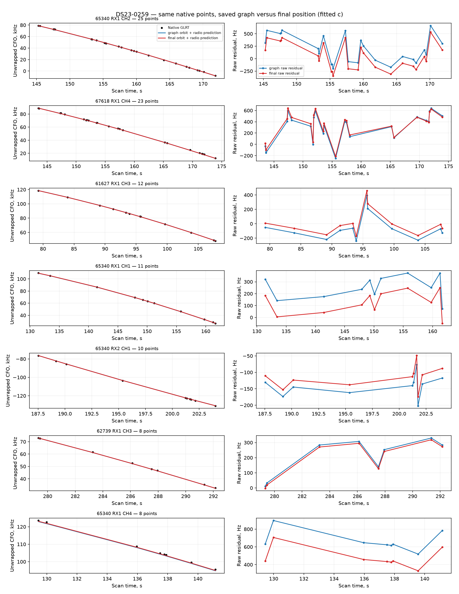
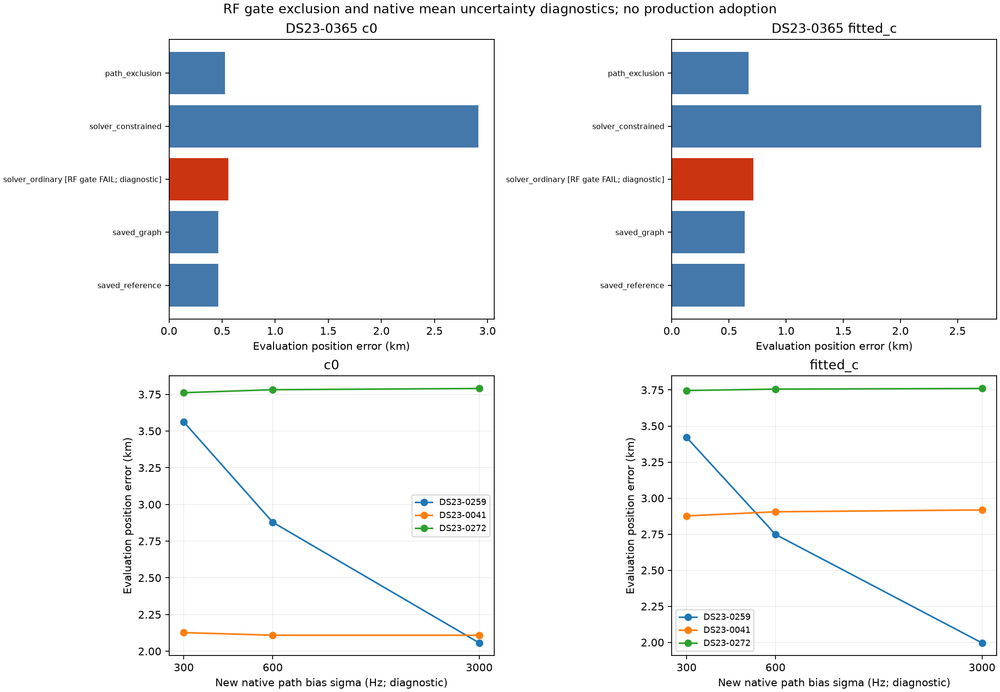

# DS23 native recovery: gate displacement and offset-prior sensitivity

**Two different mechanisms explain the investigated regressions.** On 0365, enforcing one new path's residual-correlation gate moves a substantially better ordinary solution away. Excluding that complete RF-identified path retains 121 other recovered associations and gives 0.529/0.671 km error (c=0/fitted c). On 0259, two families' new evidence pulls the ordinary likelihood optimum away; broadening only new-path offset uncertainty partially reduces that displacement but does not recover the graph parent's accuracy. No algorithm or prior is promoted.

This follows the [full-DS23 ordinary graph assessment](../2026_10_23_algo04_ordinary_full_ds23/README.md), which increased fitted-c association 70.08%→74.41% but improved mean position error by only 43.5 m and failed promotion. The comparator remains the published ALGO02/ALGO03-derived family-cavity reference. These are deliberately selected same-site mechanism experiments, not a new full-cohort evaluation or new-location validation.

## Scope and controls

Development cases are 0259 and 0365; controls are 0041 and 0272. The frozen ordinary-graph parents, causal satellite hypotheses, aliases, native paths and original measurement IDs are reused. Both c arms have matched data, priors other than the explicit intervention, starts and budgets. GPS is used only for reporting. The existing 25×25 km regional box is centered at 37.906°, −122.545°. No future TLE, stationary history pooling, new RF, catalogue expansion or acquisition rerun enters these experiments.

Native paths remain predictive evidence: they do not enter the curved-data calibration normal equations. They can nevertheless move position, and position changes can change the curved-data nuisance fit. We distinguish GLRT association coverage from the subset entering the likelihood; post-fit extensions can make association counts larger than likelihood counts.

## 0365: one gate drives the harmful constrained displacement

Compare ordinary SLSQP and the existing gate-constrained solver from the same saved native ordinary endpoint and phase reference, with five phase rounds and up to 40 iterations per round. All observations, labels, aliases and physical priors are identical. The ordinary endpoint is diagnostic because it fails qualification.

| 0365 method | Error c=0 / fitted c, km | Associated GLRT | Qualification |
| --- | ---: | ---: | --- |
| Published reference / graph parent | 0.466 / 0.638 | 2,073 / 3,013 = 68.80% | Existing parent |
| Ordinary full native fit | 0.560 / 0.714 | 2,194 = 72.82% compatible | **Fails one gate; not eligible** |
| Constrained native rescue | 2.915 / 2.707 | 2,234 = 74.15% | Passes |
| Exclude only the failing new path, ordinary refit | **0.529 / 0.671** | **2,194 = 72.82%** | Passes; all parent IDs retained |

The sole offending path is `GRAPH_PATH_persistent5s_005`: 40 points assigned to NORAD 68553, RX1 CH6, 44.976–95.033 s. Its absolute lag-one residual correlation is 0.633512/0.632839, just above the unchanged limit `4/sqrt(40)=0.632456`. Constrained fitting brings it to 0.626889/0.628138. The same-mask RF objective worsens by 14.351/10.121 units, while position moves roughly two kilometres away from the ordinary endpoint. This is a direct solver intervention, not a comparison of difficulty-selected solver groups.

The follow-up excludes exactly the new path identified by that RF gate, not an original association or an entire satellite family. Ordinary cold fitting then passes both c arms, preserving every parent ID and retaining 121 additional accepted observations. The complete-mask replay at these endpoints still fails the excluded path's lag-one gate. We therefore do not silently count the omitted 40 points as qualified. The result remains slightly worse than the graph parent's position, but retains additional evidence without the large rescue displacement.

Controls 0041 and 0272 show negligible ordinary-versus-constrained endpoint differences on their current native masks. The earlier useful *graph* rescue on 0272 is a different intervention; these controls do not establish that all constrained graph fits should be removed.

**Interpretation:** a slightly failing residual statistic can impose a strong positional constraint when its dependence on position is weak. Moving position until it passes can degrade the rest of the fit. This establishes the optimizer mechanism here, not that 68553 is the wrong satellite or that the track is physically invalid. No gate threshold was relaxed.

## 0259: two added families dominate a modest likelihood preference

The graph parent has fitted-c error 0.951 km with 581 associated points. Ordinary native recovery adds 97 points and reaches 3.421 km with 678/1,086 = 62.43% associated. There is no constrained rescue. Whole-family addition and removal tests isolate the new evidence without removing original parent points.

| New native family | Added points | Fitted-c error with only that family's additions | Fitted-c error with all additions except that family |
| --- | ---: | ---: | ---: |
| 61627 | 12 | 0.949 km | 3.377 km |
| 62739 | 8 | 0.959 km | 3.409 km |
| 65340 | 54 | 1.848 km | 1.413 km |
| 67618 | 23 | 1.430 km | 1.917 km |

All tested family subsets pass the original paired gates and preserve parent associations. Both 65340 and 67618 contribute to the regression; neither single-family deletion restores the graph result. These are influence diagnostics, not a GPS-selected deletion policy or proof of wrong identities. Raw losses across these different subsets cannot select the better model.

Tempering only the incremental native evidence gives fitted-c errors 0.951, 1.608, 2.239, 2.866 and 3.421 km at weights 0, 0.25, 0.5, 0.75 and 1. The weight-zero point is the graph parent. Every positive-weight trial passes the gates and retains all 678 associations. We used `L_parent + alpha*(L_full−L_parent)`, with the corresponding weighted residual-vector representation actually consumed by the optimizer. No weight is selected using GPS.

The dense joint-covariance replay distinguishes mean-fit and uncertainty-normalization effects. On the common full mask, moving from the graph to final fitted-c endpoint changes the curved objective by **+3.462**, the predictive residual quadratic by **−6.483**, and the predictive log determinant by **−0.009**: total **−3.030**. The determinant term is negligible here. The model prefers a much worse geographic position for a modest objective improvement, with the dominant pull coming from residual fit.

The plotted lines interpolate between saved positions, refreshing phase and refitting nuisance terms at each fixed point. They are not full regional loss maps or optimizer trajectories. Family gradient diagnostics hold the saved phase linearization fixed while recalculating nuisance means, precisions and covariance. Conditional family contributions are correlated and must not be added as independent evidence.

## A bounded offset-prior diagnostic

Several new native paths retain nonzero raw prediction means. We therefore predeclared 300, 600 and 3,000 Hz standard deviations for their marginalized whole-path constant offsets. Existing predictive entries remain at 300 Hz; curved calibration, measurement noise, aliases, labels, gates and fit budgets remain unchanged. The 600 Hz value is a variance diagnostic; 3,000 Hz is a deliberately broad sensitivity control, not a proposed deployment setting.

| New native offset prior SD | 0259 error c=0 / fitted c | Associated points | Fitted-c common-300-Hz objective change |
| --- | ---: | ---: | ---: |
| 300 Hz, existing | 3.562 / 3.421 km | 678 | 0 |
| 600 Hz | **2.879 / 2.748 km** | **678** | +0.186 |
| 3,000 Hz, broad diagnostic | 2.057 / 1.996 km | 678 | +0.856 |

All 18 final fits across 0259/0041/0272, three widths and both c arms pass qualification and preserve parent IDs. At 600 Hz, control error changes are −18.0/+28.6 m on 0041 and +20.3/+9.7 m on 0272 (c=0/fitted c). This is not consistent improvement across controls. The new objective's normalization changes with the prior, so the table separately evaluates every endpoint under the original 300 Hz model. The saved RMS statistic describes curved calibration residuals, not pooled native-plus-curved residuals.

**Interpretation:** the assumed uncertainty in native path means contributes to 0259's displacement. It does not explain all of it: even the broad control remains roughly 2 km wrong, versus the 0.951 km graph parent. Broader uncertainty has not independently verified either satellite identity, nor established a physically correct new prior. No prior is selected or promoted using these GPS outcomes.

## What the audits rule out—and leave unresolved

The final likelihood already scores all predictive paths jointly. Shared phase, receiver, hardware and supported orbit uncertainty creates cross-path covariance. The curved objective is counted once; separately scored discovery paths are not then summed as independent final likelihoods. Dense objective replay agrees at the saved endpoints, and physical observation-ID audits find no duplicates within roles or overlap between curved and predictive roles on either development scan. Independent fixed-position 300-versus-600 Hz checks confirm identical curved calibration coefficients and curved objective in both c arms.

The [0259 identity inventory](audit/identity0259.md) shows that discovery compared **13 active curved families plus clutter**, not the full causal catalogue. Archived probabilities round to one within that restricted, parent-conditioned set; that is not independent confirmation. Some 65340 paths have simultaneous RX2 curved support, but the early RX1 CH4 path has none. The 67618 path has same-receiver/channel curved support. The parent observations already condition the prediction, and alternative finite family scores are not fully archived. Wrong identities outside the active set, receiver mismatch and orbit/model discrepancy remain possible.

The [0365 all-path CFO plot](figures/DS23-0365_native_CFO_residuals.png), [active gates](figures/active_gates.png), [solver comparisons](figures/solver_and_gates.png), and [per-path evidence](evidence/DS23-0365_objective.json) retain the negative and ambiguous results. Nothing here establishes new-location generalization.

## Decision and next bounded tests

Retain the published reference. The strongest next candidate is a **general native-path qualification rule**: perform ordinary fitting, identify failing newly added whole paths from RF gates, make at most one bounded exclusion/refit attempt, and require every original parent ID and all unchanged gates to survive. The present 0365 experiment is the exact-path mechanism prototype, not that general deployed selector. Test the derived rule across the previously eligible native-rescue cases and useful recovery controls before a frozen full-DS23 comparison; retain failures and availability in the denominator. Do not combine case-specific GPS-best outcomes.

For 0259, next compare the influential 65340/67618 paths against the broader causal catalogue and examine independent receiver/channel evidence. In parallel, estimate a transferable native path-mean uncertainty from RF-only curved-source prediction errors, rather than selecting 600 Hz because it helps this case. Keep linear-only paths out of shared offset/drift calibration. A stronger orbit or receiver correction needs the appropriate independent witness; an arbitrary extra polynomial could absorb position information.

No full-DS23 rerun, synthetic geometry study, automatic new exclusion policy, new ALGO release or production default change is claimed in this report.

## Validation and reproducibility

The final experiment grid has 56 endpoint fits: 24 family/weight fits, 12 matched solver fits, two exact-path exclusion fits, and 18 bias-prior fits. **All 18 tests pass.** Saved ordinary baselines replay exactly where required; all numerical dependency hashes in the earlier 786-file seal still match. The source, protocols, table receipts and input/output hashes accompany this capsule. Raw fit banks remain in `/srv/bulk/leo/research/algo04-native-mechanisms-20261023`; the publication includes compact evidence and hashes rather than duplicating large fit arrays.

Two implementation/reporting corrections are disclosed. The initial tempering wrapper changed the reported scalar but not the solver residual, so its weighting intervention was ineffective; the initial source/results are archived locally and excluded from conclusions. The corrected wrapper has an explicit residual-objective/gradient test and all 12 jobs were rerun. The bias grid was rerun after fixing a cached common-model reporting score. Thus 98 small fit executions occurred in total, including repeated runs, rather than only the 56 final grid entries. No additional scientific settings were selected from those mistakes. Final tests and validation receipts are in [evidence](evidence/).

Reproduction uses the existing repository virtual environment and frozen upstream inputs. Set `PYTHONDONTWRITEBYTECODE=1`, `OPENBLAS_NUM_THREADS=1`, `OMP_NUM_THREADS=1`, and `PYTHONPATH=<this>/source:/srv/bulk/leo/research/algo04-ordinary-full-ds23-20261023/source:/srv/bulk/leo/research/algo04-candidate-20261023/source/tools:/tmp/algo03-feasible-deps:src:tools`, from the repository root. The dependency directory supplies the recorded scientific libraries; the bare virtual environment alone is insufficient. Run into a new artifact directory, preserving frozen originals.

Execution order is `source/mechanism.py`, `solver0365/run_solver.py`, `solver0365/followup/run_followup.py`, `solver0365/bias_prior/run_bias.py`, `source/inspect_objective.py`, then the reporting scripts in each folder and `reporting/report.py`. Cold ordinary fits use five rounds of 48 iterations; paired warm solver interventions use five rounds of 40. Main jobs cap at 240 s and solver-follow-up jobs at 180 s. All use existing recorded evidence, with no QNAP writes. Published scripts retain their relative folder structure; exact reproduction also requires the original absolute upstream banks and archived helper dependencies. Evidence-backed tests require the corresponding full `results.json` and raw job outputs, restored from the bulk workspace or regenerated first; compact published summaries alone are insufficient.
