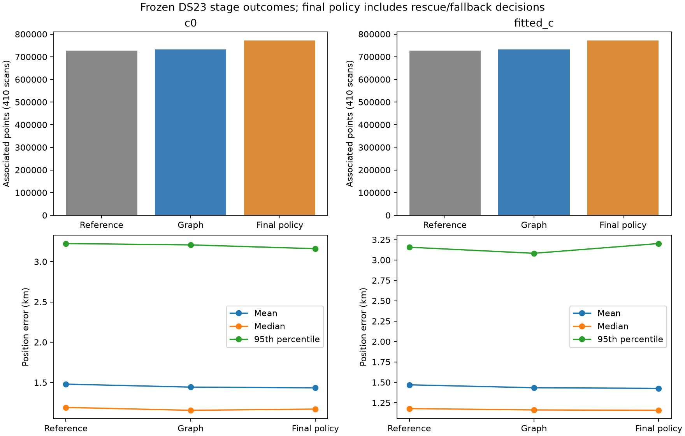
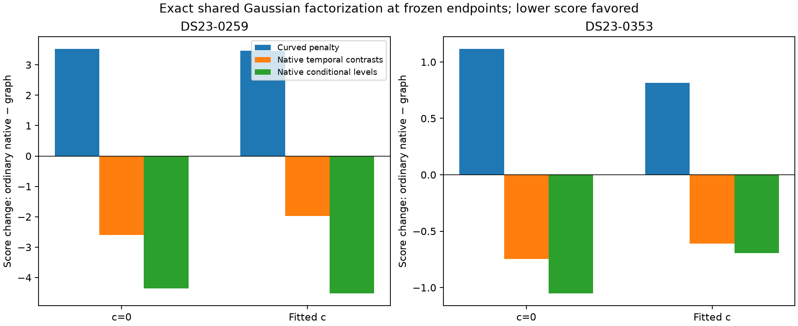

# DS23 opportunity review: separate association coverage from position information

Date: 2026-10-23. Status: diagnostic and next-experiment design; no production change or ALGO promotion.

The strongest next experiment is to keep the graph solution as the starting position and distinguish accepting a native GLRT path as an association from allowing its absolute frequency level to move that position. The existing native likelihood can reward a worse position because it explains whole-path frequency levels better. A new exact decomposition identifies that mechanism at two saved endpoints. It does not yet demonstrate that a replacement objective produces better positions.

The preceding [family predictive report](../2026_10_23_ds23_family_predictive/README.md) was independently verified on remote main at `cca36ed7b599f7cd8c0c146323d4cd7e1a25d2cb`: all 56 capsule hashes, 26 receipt inputs and local links passed. The background SOL agent also prepared this review's tables and figures. This review adds analysis rather than duplicating the preceding publication.

## Where the aggregate improvement comes from

These are recomputed summaries of the frozen, matched 410-scan experiment, not 410 new pipeline runs. The common denominator is 1,036,559 GLRT points. The final native policy includes its existing constrained rescue and fallback decisions; it is not simply the unconstrained native solution for every scan. Counts are accepted physical point IDs under the existing rules, not independently verified satellite truth.

The comparator is the published ALGO02/ALGO03-derived family-cavity reference. The available cohort contains 204 fast and 206 adaptive scans: 408 completed searches plus two inherited reference carries. Three of the 413 manifest scans are unavailable. These population summaries retain all 410 available scans and do not imply 410 fresh fits.

| Arm | Stage | Associated GLRT | Mean error km | Median km | 95th percentile km |
|---|---|---:|---:|---:|---:|
| c=0 | Reference | 70.10% | 1.479 | 1.191 | 3.224 |
| c=0 | Graph | 70.74% | 1.443 | 1.155 | 3.207 |
| c=0 | Final native policy | 74.45% | 1.434 | 1.170 | 3.160 |
| Fitted c | Reference | 70.08% | 1.469 | 1.178 | 3.157 |
| Fitted c | Graph | 70.71% | 1.434 | 1.161 | 3.082 |
| Fitted c | Final native policy | 74.41% | 1.426 | 1.157 | 3.202 |

With fitted c, graph recovery adds 6,539 points and improves mean error by 35.9 m. The next stage adds 38,386 points but improves the mean by only 7.6 m, while worsening the 95th percentile by 119 m. Relative to each preceding stage, graph has one regression over 0.5 km and nine improvements over 0.5 km; the final native policy has six regressions and nine improvements. The c=0 native transition has five such regressions and nine improvements.

These stage differences are descriptive, not a causal estimate of the information carried by each additional point. They nevertheless make association percentage an inadequate sole optimization target. The graph stage itself still has a large regression, so this table does not justify promoting it unconditionally.

## New diagnostic: frequency levels versus changes over time

We evaluated the original joint native Gaussian likelihood at the saved graph-parent and ordinary-native endpoints for DS23-0259 and DS23-0353, in both c arms. There were eight evaluations and no new position fits. Each evaluation retains its saved phase reference. Observations, aliases, candidate labels, uncertainty model and other priors are unchanged within each comparison. The predictive entries include existing parent entries as well as newly recovered paths.

For each path, an orthonormal basis separates its normalized constant component from its within-path temporal contrasts. With residual vector y and full shared covariance K, stack all contrasts C and all path-level components M. Then factor the joint density exactly:

`p(y) = p(C y) p(M y | C y)`.

The second factor uses the Schur-complement conditional covariance and its conditional mean adjustment. This retains covariance shared through receiver calibration and the original per-path 300 Hz constant uncertainty. Both factors include quadratic, log-determinant and normalization terms. The original score replays to numerical tolerance. Temporal contrasts remove path constants, but retain slopes; they are not a pure-curvature measurement. The two conditional factors are not independent causal mechanisms.

| Scan | Arm | Curved-objective change | Temporal-contrast change | Conditional-level change | Original total change | Curved + contrast change |
|---|---|---:|---:|---:|---:|---:|
| 0259 | c=0 | +3.524 | -2.605 | -4.354 | -3.435 | +0.919 |
| 0259 | Fitted c | +3.462 | -1.966 | -4.526 | -3.030 | +1.497 |
| 0353 | c=0 | +1.116 | -0.746 | -1.053 | -0.683 | +0.370 |
| 0353 | Fitted c | +0.814 | -0.610 | -0.693 | -0.489 | +0.204 |

All changes are ordinary-native minus graph-parent. Lower objective is preferred. The curved objective is the existing component and its priors, not a newly isolated data-only residual score.

On 0259 fitted c, conditional frequency levels account for about 70% of the native predictive score improvement: 4.526 out of 6.492. The native likelihood wins enough to outweigh the worse curved objective. Removing the level factor reverses the preference between the two saved endpoints in all four comparisons.

This is the specific new lead: the displacement is not supported strongly enough by native temporal changes alone to beat the graph endpoint under that proposed score. It is not evidence of a corrected position, a proven receiver fault, or an incorrect satellite identity. A refit could find a different problematic optimum. The previously tested 300-to-600/3000 Hz offset-prior widening is a related idea, and its mixed results remain relevant. Exact removal of level information is a stronger, explicit information choice, not a claim that prior widening was never tried.

## What earlier investigations rule out or leave unresolved

- DS23-0259 is locally stationary under the current objective, and that objective prefers the displaced solution. More optimizer iterations alone are unlikely to address this case. Tested replacement identities did not establish a better physical explanation. Removing a family using GPS error would overfit the evaluation.
- Shared covariance is already included, duplicate physical IDs were not found, and the score improvement is not dominated by a log-determinant artifact. These should not be presented as newly discovered bugs.
- Family-held prediction is not sufficiently discriminating in the difficult cases: whole-family mean uncertainty can be 1.5–3.4 kHz. Passing that check is not strong proof of correctness. Much of the 0259 evidence is low-band, with limited independent receiver/band witnesses.
- DS23-0353 exposes a separate optimizer-consistency issue. A constrained rescue can return a worse RF objective than an already feasible candidate evaluated on the same full mask. Retaining the best feasible incumbent is a valid engineering safeguard, but this example also shows that a lower RF objective need not mean lower GPS error.
- Prior uncertainty is a real information bottleneck. Earlier local diagnostics on 0239/0261 reduced major-axis position scales from roughly 1.50/1.25 km to 0.226/0.168 km when phase was artificially fixed. That is an oracle diagnostic, not an achieved error or justification to tighten phase priors without new evidence.
- Extreme scans 0081 and 0326 have weak independent geometry. Repairing only those two would not deliver population-wide 0.5 km accuracy. Reopen them only with a new falsifiable hypothesis; otherwise continue the established DBG01 queue at 0338 and 0185.

The preceding reports and the [iteration index](../DS23_DEBUG_ITERATIONS.md) contain the underlying ablations and their negative results. This review does not combine each scan's best GPS-selected prototype into a deployable algorithm.

## Recommended bounded experiments

### 1. Separate association acceptance from influence on position

Compare three variants on 0259, 0353, 0365, positive controls 0041/0272, and graph regression 0217:

1. Existing full native likelihood and final qualification policy.
2. Freeze the graph position; recover and qualify native associations there without allowing them to move position.
3. Fit graph evidence plus the native temporal-contrast likelihood, allowing shape information to affect position while removing native per-path constant-level information.

The existing term “predictive-only” means native evidence does not calibrate the radio parameters; it still moves position. Variant 2 would explicitly change that second behavior. Neither alternative can inherit the old association count automatically: all physical IDs, gates and accepted counts must be recomputed at its resulting position. Variant 3 may discard useful information and fail to improve accuracy.

Use the same causal catalogue, observations, aliases, starting box and candidate budget in both c arms. Record common-mask objective comparisons separately from final accepted coverage; a change of mask must not masquerade as a better fit. Preserve the post-fit exclusion ledger so rejected points cannot silently re-enter. Report RMS/structure, coverage, displacement, position error and uncertainty separately. No GPS-dependent family choice, prior or acceptance gate is permitted.

This is a small six-scan experiment, not an immediate full-corpus campaign. If it passes the existing acceptance criteria, freeze the rule before testing a broader randomly selected scan set, then the full matched DS23 cohort. A new ALGO series requires those full-cohort results.

### 2. Test whether selection makes recovered paths overconfident

Native path discovery uses a parent prediction to find coherent unused points; selected values subsequently influence the position fit. That raises a statistical selection question, not a demonstrated pipeline defect. Selection can change the distribution used for inference, as formalized by [Fithian, Sun and Taylor](https://arxiv.org/abs/1410.2597).

Run bounded synthetic closure tests on actual timestamps and causal geometry: known position, shared receiver/orbit uncertainties, clutter and noise. Compare inference with known assignments against inference after path selection. Measure position bias and interval coverage, not just fit loss. A path-level simulator tests recovery selection only; testing GLRT peak-selection bias requires alternative-peak or IQ-level generation.

For independent validation, randomize whole independent recording/frame groups or scans with a recorded seed and assignments. Keep correlated points from a group together and learn preprocessing only on the training groups. Do not treat random individual points from one curve as independent validation or relabel chronological splits as randomized.

### 3. Recover evidence that resolves calibration ambiguity

Prioritize active curvature and geometrically different satellite families, particularly simultaneous families within one receiver/band and one family observed across receivers. These comparisons can distinguish a receiver discrepancy from a satellite discrepancy. Rank recovery candidates using predicted information after nuisance projection, with no GPS-error input, then verify actual information gain.

This builds on the more productive graph stage. A long, dense path or an overlap cycle alone does not guarantee identifiability: linear evidence and shared errors can remain ambiguous. Accepted linear paths must not become the sole evidence calibrating receiver offsets or drift.

### 4. Preserve a feasible RF incumbent during constrained rescue

On an identical observation mask and objective, include the feasible graph and ordinary endpoints among the candidates retained by the constrained solver. Use a small fixed start budget. Test that rescue never returns a worse objective than a known feasible incumbent, while reporting GPS changes independently. This improves optimization consistency; it is not yet a localization improvement.

## Validation and reproducibility

Two decomposition tests verify exact correlated-Gaussian replay and invariance of temporal contrasts to arbitrary path constants. Two reporting tests verify the matched stage summaries and endpoint comparison construction. All four passed. The two figures were visually inspected. No RF was collected and no production inference code was changed.

Artifacts: [protocol](protocol.json), [eight endpoint evaluations](mean_shape.json), [diagnostic source](source/mean_shape.py), [diagnostic tests](source/test_mean_shape.py), [stage table](tables/stage_summary.csv), [endpoint table](tables/endpoint_score_changes.csv), and [reporting input receipt](reporting/receipt.json). Source execution relies on the previously retained research environment and its frozen inputs; this capsule is not a standalone installable pipeline.

The [posthoc provenance receipt](reporting/provenance.json) records hashes of the saved endpoint/selection inputs and research helper sources inspected at publication. It was assembled after the diagnostic evaluations and is not a prospective input freeze. The diagnostic decomposes the reported Gaussian/ELBO score; it does not replace the separately audited actual optimizer residual scalar. Restore the capsule to its recorded bulk location and use the preceding family report's Python environment and research PYTHONPATH, adding this capsule's `source` directory. Run the two test modules separately so reporting resolves its local `report` module. The [capsule manifest](artifact_manifest.json) seals every included file except the manifest itself.

The protocol was written before the eight evaluations, but the cases and decomposition were chosen after reviewing earlier failures. This is exploratory analysis, not preregistered confirmation. The 410-scan comparisons reuse existing results. The strongest supported conclusion is a focused next experiment, not a new achieved accuracy claim.
