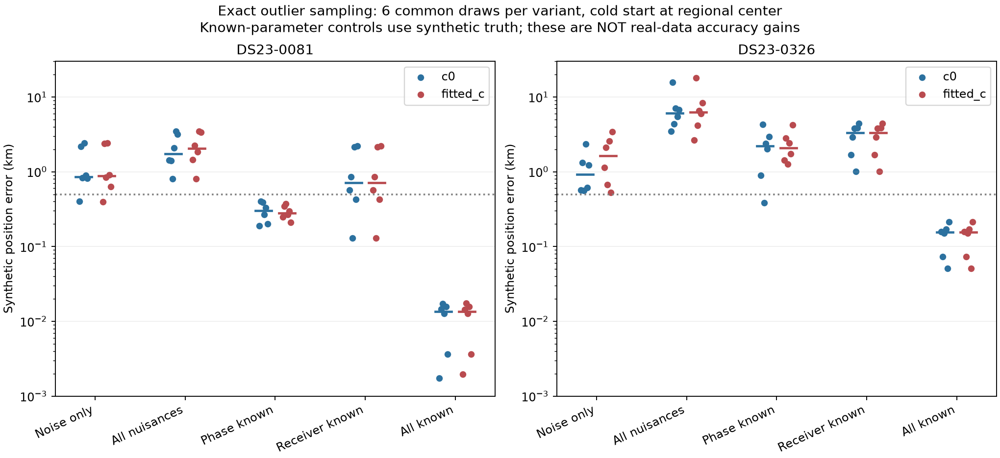
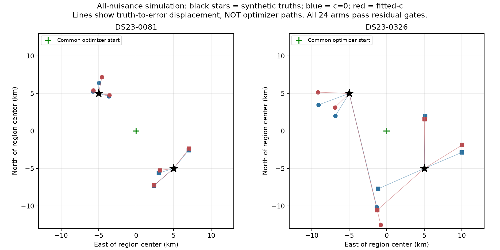
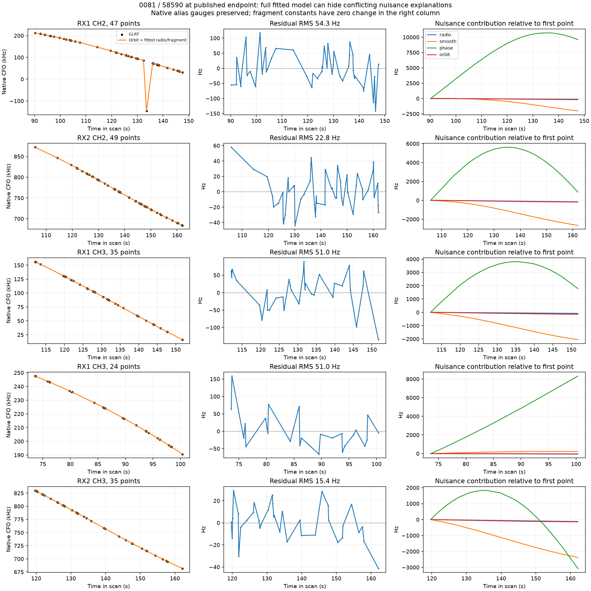
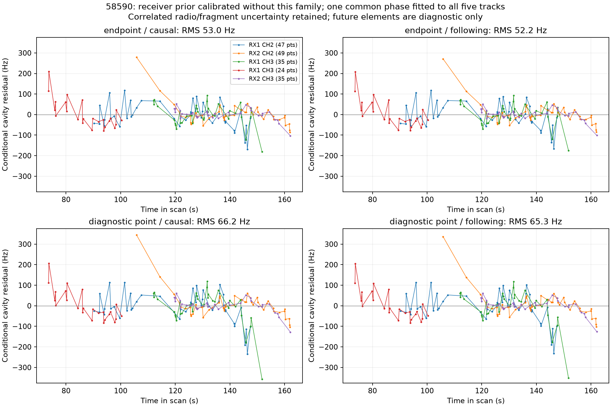
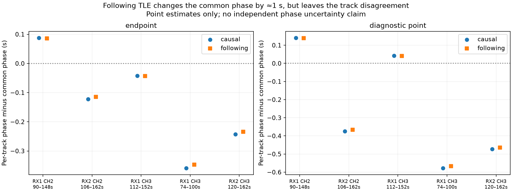
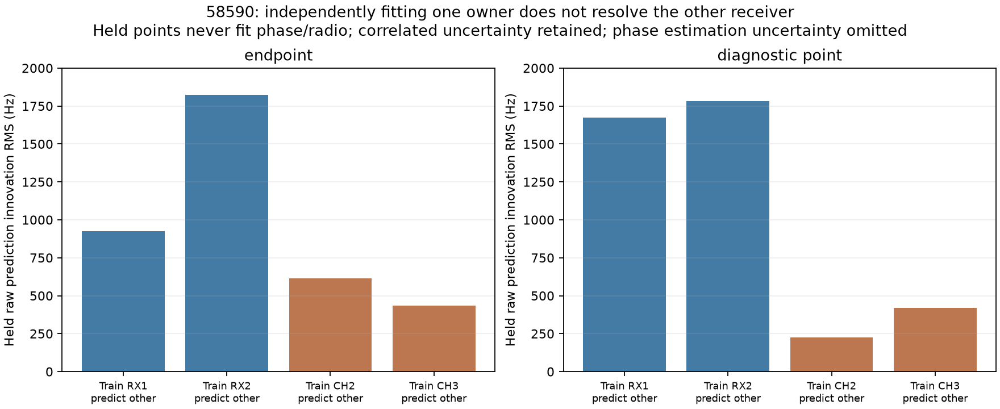
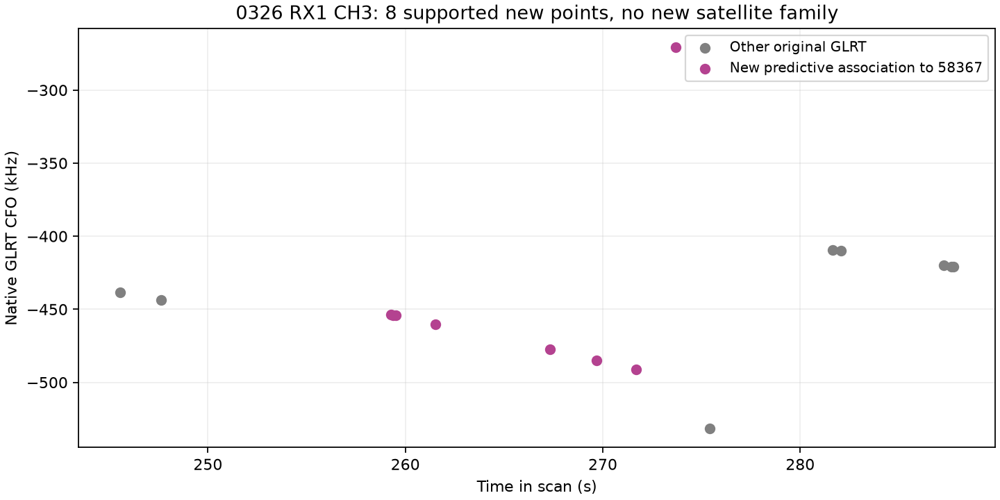
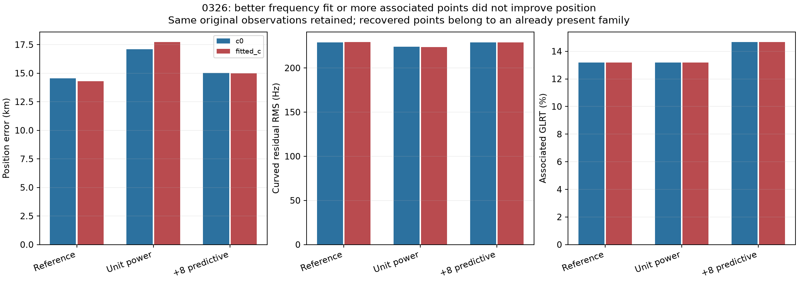
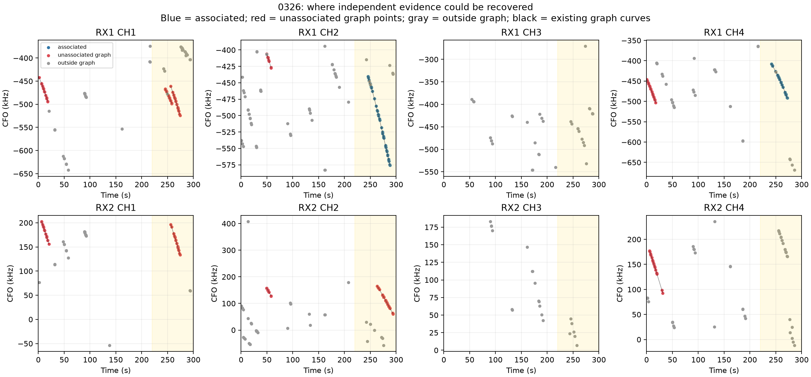

# DS23 worst-outlier mechanism tests: 0081 and 0326

This bounded iteration executes the first three diagnostic steps from the
[outlier review](../2026_10_23_ds23_worst_outlier_review/README.md). It provides
stronger evidence that the two failures have different causes, but **does not
establish a transferable position improvement or promote a new ALGO release**.

* **0326 can fail badly even with correct satellite identities.** With its exact
  observation times, masks, receiver/channel layout and weights, one conditional
  synthetic trial returns an **18.00 km** error while every original residual
  gate passes. Across six all-nuisance draws, fitted-c mean error is **7.61 km**.
* **0081's real error remains unusually large relative to these small synthetic
  controls.** Six all-nuisance draws have fitted-c mean **2.19 km**, maximum
  **3.45 km**, versus the real reference error **16.98 km**. This motivates
  further model-discrepancy investigation; six draws do not establish a tail
  probability or prove a particular fault.
* **A following TLE does not explain 58590's disagreement.** After matching
  phase, its diagnostic residual RMS changes **52.95→52.24 Hz** at the published
  endpoint and **66.19→65.26 Hz** at the evaluation site. The disagreement among
  tracks largely remains. No future element enters inference.
* **More weight or more points does not repair 0326.** Unit weights improve its
  frequency fit but worsen fitted-c position error **14.28→17.71 km**. Conservative
  native recovery adds eight supported points, raising association **13.17→14.66%**,
  but worsens error to **14.99 km**. Those points repeat an existing satellite.

The reference results remain unchanged. No GPS-selected deletion, fitted prior,
satellite replacement or postscan orbit is adopted.

## Frozen reference and scope

The parent is the published [410-scan family-cavity assessment](../2026_10_22_ds23_family_cavity_full_assessment/README.md),
with the current selected identities, aliases, physical observation IDs,
curved masks, powers and predictive entries replayed by
`probe_ds23_worst_association_bottleneck.setup`.

| Reference | c=0 error, km | Fitted-c error, km | Associated original GLRT | Curved calibration |
|---|---:|---:|---:|---|
|DS23-0081|16.732|16.980|630/1,583 = 39.80%|593 points, 18 fragments, eight families|
|DS23-0326|14.550|14.282|71/539 = 13.17%|71 points, two fragments, two families|

Both are adaptive scans. The regional box remains 25×25 km centered at
**37.906, −122.545**. Every new position optimization starts at its center,
east/north `[0,0]`. Synthetic truths are the two predefined regional offsets
`[-5,+5]` and `[+5,−5]` km. They are unrelated to the evaluation GPS.

The evaluation position **37.849061591561885, −122.48574968092912** is used only
to measure real-data error and to label the explicit fixed-site diagnostic.
It never selects candidates, weights, observations or an adopted model.
All inference elements pass both epoch and collection cutoff checks. All new
real-data fits and synthetic controls retain matched c=0/fitted-c observations,
candidate sets, aliases, other priors and search budgets. Generating synthetic
c is zero; estimating c remains an ablation of model flexibility.

## 1. What the exact sampling can identify

The [frozen protocol](synthetic/protocol.json) contains two scan geometries × two
artificial sites × three draws × five variants: **60 paired jobs, 120 position
fits**. Six worker processes each use one BLAS thread, with a 120-second paired
job cap. Every job completed. Position fitting uses the existing five phase
refreshes and 48 position iterations per refresh.

Generation uses exact propagated Doppler at the synthetic site, original
sampling and aliases, original declared point-noise scales, and the existing
physical nuisance basis. Phase draws use the corrected **unit-variance Student
law**, truncated to ±15 seconds. All-nuisance draws include receiver offsets,
drifts, smooth terms, supported satellite orbit modes and 300 Hz fragment
constants. Linear fragments remain predictive and cannot update calibration.
There is one Gaussian noise draw per original physical observation ID.

The all-nuisance, known-phase, known-receiver and all-known variants use exactly
the same simulated observations for each site/draw. Noise-only uses the same
point-noise realization with zero additive nuisance coefficients and phase at
its causal forecast mean. Known controls put the synthetic generating values
into the selected prior means and reduce their prior SD to 10⁻⁵ of its original
value. **These truth-conditioned controls are diagnostic oracles, not available
operational estimates or proposed real-data priors.**

| Scan | Synthetic variant | Mean c=0 / fitted-c error, km | Median c=0 / fitted-c, km | Maximum c=0 / fitted-c, km |
|---|---|---:|---:|---:|
|0081|Noise only|1.256 / 1.264|0.860 / 0.878|2.426 / 2.419|
|0081|All nuisance uncertainty|2.055 / 2.191|1.749 / 2.045|3.477 / 3.452|
|0081|Satellite phases known|0.298 / 0.290|0.300 / 0.282|0.402 / 0.375|
|0081|Receiver offsets/drifts/smooth terms known|1.053 / 1.053|0.715 / 0.715|2.197 / 2.197|
|0081|All nuisance coefficients known|0.0109 / 0.0110|0.0136 / 0.0136|0.0172 / 0.0174|
|0326|Noise only|1.111 / 1.740|0.922 / 1.632|2.360 / 3.405|
|0326|All nuisance uncertainty|7.104 / 7.614|6.092 / 6.248|15.570 / 17.996|
|0326|Satellite phases known|2.157 / 2.312|2.203 / 2.066|4.292 / 4.235|
|0326|Receiver offsets/drifts/smooth terms known|2.938 / 2.938|3.343 / 3.343|4.400 / 4.400|
|0326|All nuisance coefficients known|0.1365 / 0.1365|0.1555 / 0.1555|0.2137 / 0.2137|

Dots show all six outcomes per cell, with median bars. The dotted line is
0.5 km. All 120 fits pass their original curved/predictive residual gates and
all 60 pairs pass the existing paired qualification. One fitted-c endpoint
hits the regional boundary; no other synthetic endpoint does. The largest
final phase-refresh change is **0.00258 s**, below the 0.01 s diagnostic
tolerance.

The lines in this figure connect the artificial truth to the returned position;
they **are not descent trajectories**. Every optimization started at the green
regional-center marker. Correct labels and clean residuals did not prevent
the large 0326 error.

Interpretation:

* For 0081, independent orbital-phase information has high potential value:
  its six oracle-phase errors are all below 0.5 km. Receiver information helps
  less in these draws. This does not license tightening phase priors around
  estimates learned from the same RF data.
* For 0326, knowing phase alone still leaves multi-kilometer errors. Receiver
  and satellite nuisance ambiguity both matter. Correct identities are
  insufficient with only the two late RX1 curved sources.
* Neither result establishes an irreducible error bound. Noise-only and
  all-known controls show that a sufficiently constrained model has much more
  information. The issue is obtaining those constraints independently.

These are **conditional simulations**, not a full hierarchical prior-predictive
calibration: noise is Gaussian at the declared scales, rather than a complete
draw of the robust noise hierarchy; source selection/masks/weights are frozen;
labels and aliases are supplied by construction; association search is not
rerun. Six draws per geometry/variant are a bounded mechanism test, not a
reliable estimate of rare-event frequency. See all
[120 outcomes](tables/synthetic_instances.csv) and
[phase-recovery/replay evidence](evidence/synthetic_replay.json).

## 2. Where 0081's disagreement lives

58590 was selected for this diagnostic because the earlier family ablation
found it influential. It is not manually selected for operational association.
The real reference has five curved sources for this satellite, totaling 190
points, plus one 11-point predictive fragment. The following cavity profiles
use the **190 curved points only**; the 11 predictive points remain in the
unchanged published reference and in the synthetic template.

The left panels use original measured CFO looked up by physical observation
ID, with the full orbit-plus-radio-plus-fragment prediction returned to that
same native alias gauge. They do not plot normalized graph CFO against raw
GLRT. The right panels show the change in each fitted nuisance contribution
relative to its first point; constant fragment terms therefore have zero
change. A small full-model residual does not uniquely assign the correction
to a receiver or to the satellite.

### Other-family receiver calibration and following TLE

For each c arm and each fixed position (published endpoint and evaluation-site
diagnostic), all five 58590 curved sources are excluded from calibration.
The other curved families fit the radio model with five phase refreshes.
Its full correlated receiver uncertainty is carried into prediction of 58590.
Each fragment also retains its 300 Hz constant uncertainty. One common phase
is profiled over ±15 seconds for the entire 190-point family.

The causal and following profiles use identical locations, observation IDs,
aliases, receiver distributions and phase search; neither profile includes
satellite shape modes or a phase prior. The following element is the first
element epoch after scan end in the next 48 hours, breaking ties by collection
time, read through the digest-verifying local archive adapter. Both epoch and
collection are after the scan. The exact element/provenance is saved in
[DS23-0081_following.json](evidence/DS23-0081_following.json).

| Fitted-c fixed location | Elements | Common phase, s | Conditional RMS, Hz | Correlated quadratic |
|---|---|---:|---:|---:|
|Published endpoint|Causal|−7.6457|52.954|281.902|
|Published endpoint|Following|−6.6406|52.244|268.688|
|Evaluation-site diagnostic|Causal|−9.1334|66.188|497.318|
|Evaluation-site diagnostic|Following|−8.1285|65.264|478.633|

These are conditional residuals `D C⁻¹ r`: they remove the conditional
radio/fragment adjustment represented by the predictive covariance. Thus they
are **not raw held-family innovations or independently calibrated white-noise
samples**. The receiver *prior* comes from other families, but the conditional
residual transformation itself uses the held observations. The separate
cross-owner experiment below avoids using held-owner observations for phase or
radio updating.

The following TLE changes the best common phase by about **+1.005 s**, while
improving conditional RMS by less than one hertz. This is consistent with a
predominantly timing-like difference after alignment; it is not proof of a
particular orbital error. The following TLE is also not orbit truth. The
matched comparison provides little support for solving this case merely by
using newer orbital elements.

At the endpoint, the causal per-track phase estimates span approximately
−8.005 to −7.558 s. The following estimates retain nearly the same spread
relative to the common phase. At the evaluation site the causal spread is
larger, approximately −9.711 to −8.993 s. These point estimates have different
time support and receiver uncertainty; their differences are not statistically
independent estimates of a receiver clock offset.

### Cross-receiver and cross-channel prediction

The next diagnostic uses the other-family receiver prior, learns phase and
the conditional radio adjustment from **one receiver or one channel**, then
predicts the excluded receiver/channel. The held observations never fit phase
or the radio adjustment. It retains the exact Gaussian cross-covariance but
treats the estimated training phase as fixed, omitting phase-estimation
uncertainty. Therefore its quadratic is descriptive, not a calibrated
chi-square test or an acceptance gate.

| Fitted-c location | Training block → held block | Held raw innovation RMS, Hz |
|---|---|---:|
|Endpoint|RX1 → RX2|926|
|Endpoint|RX2 → RX1|1,822|
|Endpoint|CH2 → CH3|615|
|Endpoint|CH3 → CH2|436|
|Evaluation site|RX1 → RX2|1,675|
|Evaluation site|RX2 → RX1|1,784|
|Evaluation site|CH2 → CH3|226|
|Evaluation site|CH3 → CH2|422|

The large raw receiver-transfer errors are correlated calibration/phase
innovations, not new independent point noise. Their per-point marginal SDs
are roughly 374–458 Hz at the endpoint, with substantial correlation.
The conditional quadratic per held point is about 1.38–1.57 there; it cannot
be interpreted from RMS alone. Channel transfer uses evidence from both
receivers and is a different calibration experiment.

Around 90–162 seconds, the accepted curved evidence is almost entirely 58590.
There is no established simultaneous *different-satellite* witness to identify
a common receiver error during that interval. This remains the decisive
limitation: a receiver explanation is plausible, but the current data do not
justify a hardware correction learned from 58590 and then claimed as an
independent explanation of 58590. Nor do these tests prove a wrong identity or
a bad join. The earlier full-causal family screen still favors 58590 over its
best refined alternative.

## 3. 0326: changing weights and recovering evidence

### Unit-weight control

Both accepted curved fragments currently have power 0.2: 67994 on RX1 CH2 and
58367 on RX1 CH4. The explicit control changes their powers to 1, retaining
their original 71 observations, labels, aliases, priors and cold-start budget.
All original gates still pass. Absolute losses across different powers are
not treated as a model-selection criterion.

### Existing native-path recovery

The existing graph-seeded temporal recovery is applied to the frozen reference,
without changing calibration membership. It searches unused original GLRT for
the **two incumbent causal families**. It is not an all-catalogue discovery of
new satellites. Both the independent-path control and five-second-persistence
primary use existing rules: at least eight points and six seconds, maximum
ten-second gaps, 19 permutation controls, shared-covariance path validation,
paired identity/alias checks and whole-path residual gates. Selected paths
remain predictive-only. No point trimming or GPS choice is allowed.

Both methods select the **same eight physical points on RX1 CH3 for 58367**,
pass final paired gates, retain every parent-associated ID and converge to
the same position. These are one recovered source, not two independent
successes. The added points supply another frequency/channel measurement of
an existing family, not a new satellite direction or RX2 calibration.

| 0326 result | Error c=0 / fitted-c, km | Curved RMS c=0 / fitted-c, Hz | Original GLRT associated |
|---|---:|---:|---:|
|Reference|14.550 / 14.282|228.890 / 229.161|71/539 = 13.17%|
|Unit track power|17.104 / 17.712|224.056 / 223.783|71/539 = 13.17%|
|Native predictive recovery, either method|15.011 / 14.991|228.731 / 228.759|79/539 = 14.66%|

The exact reference RMS is available in the machine-readable
[real-control table](tables/0326_real_controls.csv). Real-data position errors
use the same great-circle calculation as the published benchmark; synthetic
errors use the declared artificial east/north coordinates. Preliminary planar
real-error calculations differ by about 15–22 m and are superseded by this
matched metric. Frequency RMS is reported separately from position accuracy.

The unit-weight control is rejected as an improvement. Native recovery is
RF-qualified under the existing rule, but **does not improve position on this
scan** and is not promoted as a new localization algorithm. Its inclusion is
not chosen or reversed operationally using GPS; the results are kept as a
separate experimental branch with the original reference intact.

### Where additional independent evidence is missing

Unlike earlier figures where gray represented all data, here **blue is
associated, red is unassociated graph evidence, and gray is outside the
graph**. Black lines connect existing graph-track measurements in their
original CFO gauges. The pale window marks 220–300 seconds. These colors are
explicitly stated in the figure.

There are **240 original GLRT points after 220 seconds**, including the 71
accepted points, 88 unassociated graph points and 81 outside-graph points.
RX2 has 85 late points and no accepted calibration. In particular, RX2 CH4
has 20 late points outside the graph; RX1 CH3 has 16, eight of which the native
recovery explains predictively. RX2 CH2 has a 31-point existing unassociated
track classified as linear. Linear sources can contribute predictive evidence,
but must not be used to force receiver calibration.

These counts locate evidence, not certify that it is a new curved satellite
source. The current conservative two-family recovery finds no additional RX2
path. The previously investigated 21-point early RX2 CH4 curved source remains
a separate competing-family problem; its local 59699 recovery result is not
silently combined with this experiment.

## Decision and next bounded iteration

The tested changes do not support a new receiver or satellite nuisance model
yet. **No new ALGO series release is justified by these results.** The reference
410-scan mean/median remain **1.469/1.178 km**, with 70.08% associated GLRT; this
iteration did not rerun or change that population evaluation.

For **0081**, prioritize a different-family calibration witness in the
58590-dominated interval or a causal orbit-shape discrepancy supported across
independent owners. Do not implement an unconstrained satellite polynomial or
receiver correction merely because it lowers the residual. This iteration's
following-element comparison does not provide that witness.

For **0326**, prioritize genuinely independent curved evidence, including the
unused late RX2/channel groups, over reweighting or adding more same-family
points. Any new extraction must pass original curvature/residual checks and
compete against the full causal catalogue. A 90% association target cannot
make unobserved receiver calibration identifiable by itself.

The stop condition from the approved plan is now applicable: both cases have
completed the bounded controls, and neither has a justified physical repair.
Keep their poor results in all benchmarks, retain the explicit boundary/weak
information diagnosis, and move the next general-method iteration to the next
worst scans. Revisit these two when that iteration supplies independent evidence
or a frozen, transferable uncertainty model. Do not repeat weight/phase sweeps
on these two cases to obtain a favorable GPS outcome.

## Validation, provenance and reproduction

* **23 focused tests pass**, covering existing alias/synthetic-law/known-prior
  contracts and new draw-key, mutation and held-prediction checks.
* The no-knowledge oracle implementation exactly matches the original
  coefficients, residuals and objective in both arms at two diagnostic positions
  for each template (eight model-parity comparisons).
* All 120 saved synthetic endpoint losses replay **exactly**, after regenerating
  their observations. Original measured arrays remain unchanged. Common draws
  are byte-identical across the four all-nuisance variants.
* Original real endpoint and true-site evaluations replay before decomposition.
  Dense solves independently verify all shared-profile quadratics.
* Native recovery independently replays the predictive density within
  **9×10⁻¹⁴**, and predictive additions change the curved calibration
  coefficients by **zero at a fixed position**. The final position itself can
  change because predictive evidence contributes to its objective.
* No new RF, IQ analysis, QNAP mutation, GPS-selected inference or future-TLE
  candidate adoption occurred. New outputs reside on the bulk filesystem;
  the root filesystem was full.

The first native-recovery adapter attempt stopped before discovery because
the wrapper omitted protected incumbent-label metadata; its failure receipt
is retained in `evidence/native_recovery`. The corrected metadata-only binding
ran in `native_recovery_v2` with unchanged scientific rules. The unit-power
script's first console print referenced an unavailable error field after its
complete result was written; the print was corrected without rerunning fits.
Neither issue alters the scientific results or hides a failed fit.

The [source directory](source/) contains the experiment adapters, tests, audit
and figure generator. It reuses the repository's existing research helpers.
The source/input hashes and [file manifest](manifest.json) identify the exact
artifacts. Full paired outputs are in `synthetic/`; real diagnostics and native
recovery receipts are in `evidence/`; all comparison tables are in `tables/`.

In the original repository environment, set
`PYTHONDONTWRITEBYTECODE=1`, `OPENBLAS_NUM_THREADS=1`, `OMP_NUM_THREADS=1`, and
`PYTHONPATH=<this-report>/source:/tmp/algo03-feasible-deps:src:tools`. Run the
source scripts with `.venv/bin/python -B`. Run `probe_worst_mechanisms.py`,
`audit_mechanisms.py`, `diagnose_family.py`, `cross_owner.py`, `power_control.py`,
`recover_0326.py`, then `plot_mechanisms.py`. Existing experiment outputs are
preserved; use a new report directory for a clean rerun. These scripts require
the frozen local corpus and reference receipts, rather than performing a new
acquisition or reconstructing source data from screenshots.
