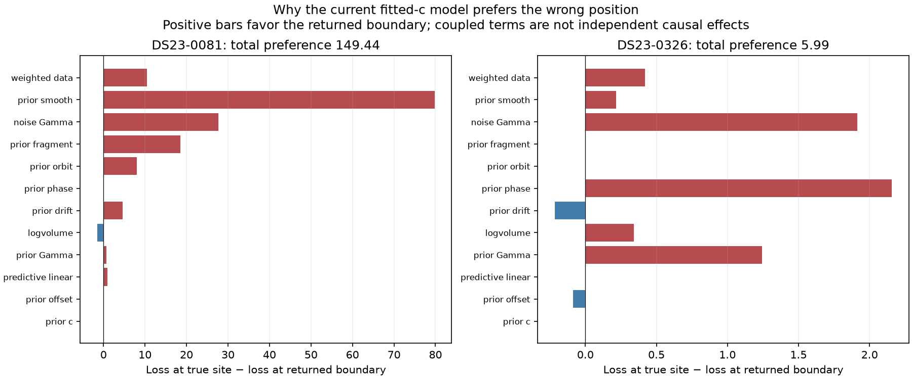
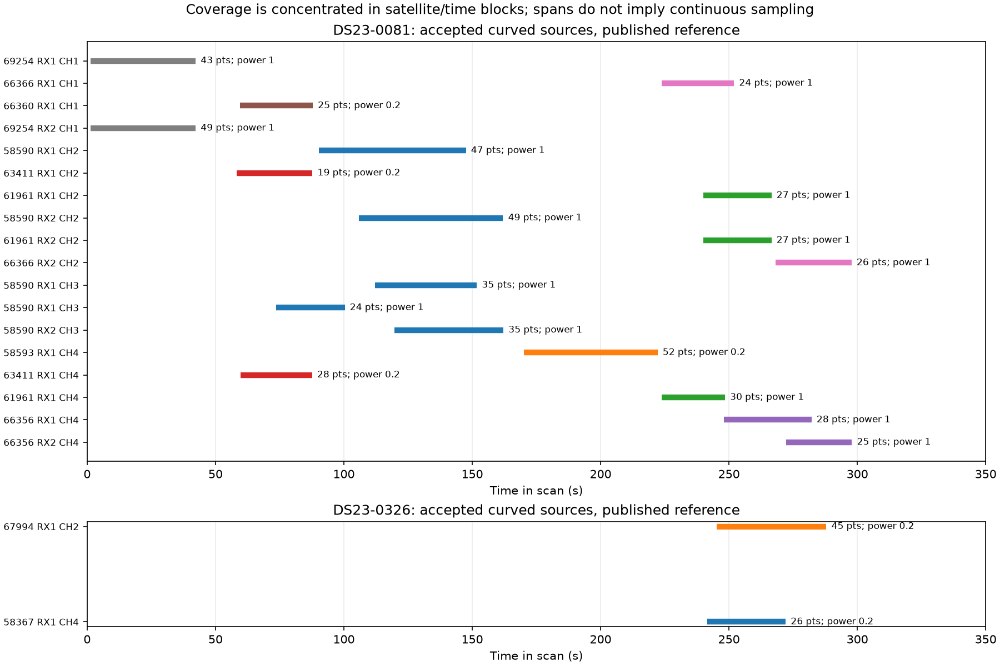
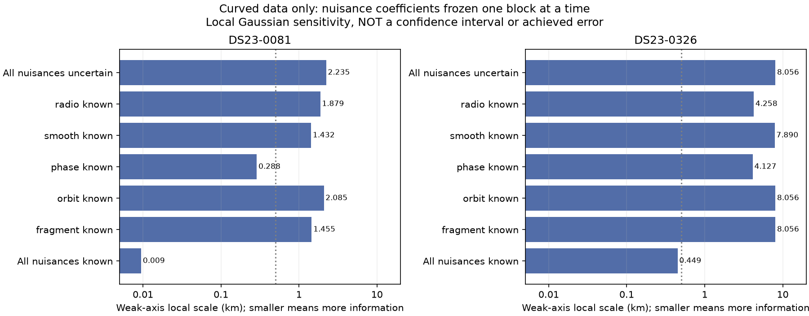

# DS23's two worst outliers: evidence review and next experiment plan

The worst pair is **DS23-0081 and DS23-0326**, both adaptive recordings. They
remain the worst pair across all three separately evaluated full-population
candidates. The evidence supports different working diagnoses: **0081 has a
strong, displaced model preference coupled to receiver and satellite nuisance
terms; 0326 has very little independent position information.** Neither has a
proven single bad satellite, bad join, or corrected physical model yet.

This review reproduces the saved reference endpoints and their fixed true-site
diagnostics, measures local information, and reviews previous negative controls.
It does not change an association, prior, observation, position estimate, or
algorithm release. The requested next step is a small set of falsifiable
experiments, rather than another broad hyperparameter sweep.

## Which results are being compared

The common reference is the [410-scan assessment](../2026_10_22_ds23_family_cavity_full_assessment/README.md).
The [matched distributions](../2026_10_23_ds23_algo_candidate_distributions/README.md)
keep the same 410 available scans and three explicit unavailable entries.

| Scan and result | Error c=0 / fitted-c, km | Associated original GLRT | Scope |
|---|---:|---:|---|
|0081 reference|16.732 / 16.980|630/1,583 = 39.80%|Full-population reference|
|0081 covariance and active-support recovery|15.418 / 15.343|727/1,583 = 45.93%|Iteration001 local prototype|
|0081 completed-candidate retention|12.258 / 12.256|709/1,583 = 44.79%|Separate full-population candidate|
|0326 reference|14.550 / 14.282|71/539 = 13.17%|Full-population reference|
|0326 covariance-aware recovery|9.761 / 8.889|92/539 = 17.07%|Iteration001 local prototype|

The 0081 completed candidate adds 79 curved points assigned to 65419 and uses
the saved recovery trial's finer receiver basis. Its result is not a pure
point-count ablation or a combination with iteration001's 97-point recovery.
The local 0326 result is not incorporated into the plotted full-population
candidates. These outcomes must not be combined by choosing the lowest GPS error.

Even an impossible perfect repair of just these two cases would only change the
410-scan reference mean **1.469461→1.393213 km** and median
**1.178102→1.162725 km**. They are valuable mechanism probes, but solving the
population target requires a transferable correction.

## What the optimizer is actually doing

Both reference estimates land at east=+12.5 km, the original regional boundary.
They are constrained boundary solutions, not interior stationary minima.
Starting the saved solver at the evaluation GPS also returns to these displaced
solutions. The fitted-c east gradient at the boundary is about −3.94 and −0.62
loss units/km respectively: the model still favors moving farther east.

At the true site, fitted-c loss exceeds the returned endpoint by **149.445**
units on 0081 and **5.987** on 0326. The corresponding RMS values are:

| Scan | Returned-position RMS | True-site RMS with nuisance refitting |
|---|---:|---:|
|0081|56.212 Hz|56.714 Hz|
|0326|229.161 Hz|244.584 Hz|

0081 therefore has a 17 km position error while the true-site residual RMS
differs by only **0.503 Hz**. Clean residuals alone cannot identify the position.
On 0326 the loss separation is small and the data support is sparse.

For 0081, about **79.79** of the 149.45 fitted-c loss difference is the smooth
receiver prior term, **27.72** is grouped-noise Gamma terms, **18.55** fragment
constants, **10.51** weighted data and **7.98** orbital modes. The phase-prior
contribution is only **0.116**. These terms are coupled; subtracting one bar is
not an estimate of the effect of changing that prior.

For 0326, the largest differences are phase prior **2.16**, noise Gamma **1.91**,
and prior Gamma **1.24**. This supports weak separation of location and nuisance
parameters. It does not establish that the phase prior is defective.

The original [0081 loss map](../2026_10_22_ds23_dbg01_iteration_001/figures/DS23-0081_loss_gradient_10km.png)
and [0326 loss map](../2026_10_22_ds23_dbg01_iteration_001/figures/DS23-0326_loss_gradient_10km.png)
refit nuisance terms and refresh phase at each grid point with fixed labels and
observations. They are conditional loss surfaces, not calibrated probability
maps or full catalogue reruns.

## 0081: a receiver–satellite–time ambiguity

The reference contains 18 curved fragments, 593 calibration points, 37
predictive points and eight families. The accepted curved fragments are each
one persisted polynomial piece. No multi-piece join has been established as
the explanation for this failure.

The timeline reveals an important limitation of the nominal family count:
around **90–162 s**, the retained curved evidence is almost entirely **58590**,
observed across both receivers and CH2/CH3. Earlier evidence is dominated by
69254; 58593 supplies a later isolated interval. Many observations therefore
repeat a satellite/time block rather than providing simultaneous independent
satellites against which to measure a common receiver drift.

Removing all of 58590's **190 curved + 11 predictive** points reduces fitted-c
error to **6.904 km**, still far from the target. No individual curved-track
deletion produces a comparable repair. This is a family-level influence
pattern, not proof of a bad satellite identity or grounds for GPS-selected
deletion. The existing full-causal held-family screen actually favors 58590
over its best refined alternative, 63916, by **826.97 predictive-score units**
at the incumbent location. That screen conditions on a potentially biased
location, so its margin is not a calibrated identity probability.

The new replay also shows several RX2 curves receiving noise precision around
4.4–5.8 while corresponding RX1 curves are nearer 1.0–1.5. These are fitted
weights, not independent receiver-quality measurements. Investigate whether
the smooth correction is supported by another satellite in the same interval,
and whether apparent cross-receiver support is repeated transmitter error.

**Working diagnosis:** the model can trade position against satellite phase,
receiver smoothness and fragment offsets, and strongly prefers a geographically
wrong combination. The unresolved physical alternatives are satellite/TLE
model error, receiver model error, or an incorrect family grouping. Current
evidence does not select one uniquely.

## 0326: an information deficit before association count

Only two curved tracks calibrate the reference model:

| Family | Receiver/channel | Points | Time interval | Likelihood power |
|---|---|---:|---:|---:|
|67994|RX1 CH2|45|245.3–287.9 s|0.2|
|58367|RX1 CH4|26|241.6–272.1 s|0.2|

Thus all 71 observations are concentrated within about 46 seconds near the end
of the scan, on one receiver. The inherited support rule gives both families
power 0.2: the sum of point powers is **14.2**, before robust noise weights.
This is a likelihood weighting total, **not** a count of independent samples.
The weights come from cross-receiver/owner support heuristics in
`tools/evaluate_ds23_family_weighting.py`.

There are no original predictive points. RX2's calibration is unconstrained by
these observations; the earlier analysis found approximately **65.6 kHz**
correlated calibration prediction uncertainty for its unused early curve.
Propagating that uncertainty recovered RX2 CH4 T000, 21 points at **5.5–31.4 s**,
with nominee 59699. This adds another receiver but also a separate satellite
and a widely separated time interval. It provides little direct overlap to
anchor the relative receiver correction.

59699 beats 50832 by only **2.283** conditional predictive-score units in that
screen. The 59699 joint fit passes gates and reduces error to 8.889 km, while
50832 fails residual curvature after fitting. This does not independently
verify 59699. The original two family identities also beat their tested
whole-family alternatives; there is no demonstrated simple replacement fix.

Only **260/539 = 48.24%** of all original GLRT points belong to any existing
graph track. Association of existing tracks alone cannot reach 90%: at least
226 points would need recovery from outside that graph. Some may be noise.
The [original unassociated GLRT view](../2026_10_22_ds23_dbg01_iteration_001/figures/DS23-0326_published_unassociated_GLRT.png)
is the starting point for targeted recovery, especially near 242–288 s and
on channels that can provide an independent family or receiver comparison.

**Working diagnosis:** sparse, strongly downweighted, short-duration evidence
cannot adequately distinguish location from receiver calibration and satellite
phase. Adding an isolated early RX2 curve helps but does not close the gap.

## New local information diagnostic

The review recomputes the CFO derivative with respect to east/north position
while holding nuisance coefficients fixed, then eliminates their uncertainty
using the existing nuisance design and prior precisions:

`I = Jᵀ W J − Jᵀ W U (Uᵀ W U + Λ)⁻¹ Uᵀ W J`.

A QR calculation avoids cancellation; a separate Schur calculation checks it.
The analysis includes curved calibration only, fixes the fitted Gamma
precisions and identities, and omits 0081's 37 predictive points. The reported
scale is `1/sqrt(min eigenvalue(I))`, in km. It is a local sensitivity measure,
**not a confidence interval, achieved accuracy, full posterior, or fundamental
information bound**. At a boundary, it is an unconstrained local tangent
diagnostic. Knowing a block means fixing its coefficients at their fitted
values, not supplying their physical truth.

| Fitted-c local weak-axis scale | 0081 | 0326 |
|---|---:|---:|
|All original nuisance terms uncertain|2.235 km|8.056 km|
|Receiver smooth coefficients fixed|1.432 km|7.890 km|
|Satellite phases fixed|0.288 km|4.127 km|
|All nuisance coefficients fixed|0.0095 km|0.449 km|

At the true-site diagnostic, the all-uncertain scales are **2.108 and
10.020 km**, respectively. Matched c=0 results and all block controls are in
[local_information.csv](tables/local_information.csv).

This separates two questions. Smooth receiver terms dominate 0081's preference
between the wrong and true positions; satellite phase uncertainty is the
largest single-block loss of local precision. These statements are compatible:
the source of bias need not be the largest source of uncertainty. Tightening
phase priors arbitrarily could create a more precise wrong answer.

## Previous work that should constrain the next plan

The review includes the earlier experiment receipts copied into
[evidence/previous_experiments](evidence/previous_experiments/), not just the
recent positive examples.

| Existing test | Result | Consequence |
|---|---|---|
|81 regional starts on each of these scans; up to four complete assignment branches|No qualifying RF-selected repair; true-site initialization returns to displaced solutions|More starts with the same objective are low priority. The branch bank was finite, so exhaustive identity search is not ruled out.|
|Phase width ×2 or phase mean reset on these scans|Neither resolves the failures|Do not start another global phase-width sweep.|
|Cold other-family position fits and local quadrature nomination, 24 other scans|No policy endpoint changed|Position covariance alone is not an established repair.|
|Automatic receiver/channel/time family partitions, 24 other scans|Primary changed no outcomes; unpenalized control worsened one|Splitting is a testable hypothesis, not an unused generic solution.|
|Multi-family deletion with predictive selection, development and confirmation|Failed joint mean/median improvement; some score gains worsened geography|A better predictive score still requires independent accuracy evaluation.|
|Soft predictive identities, random20|Mean error slightly worsened|An EM-like label update alone is not a demonstrated solution.|
|More accurate Gamma integration, seven other scans|Local predicted shifts about 1–19 m|A wholesale inference-engine rewrite is not the first explanation for 14–17 km failures. These two scans were not in that test.|
|Corrected known-label synthetic nuisance simulation, 20 templates|All-nuisance fitted-c mean/median 1.014/0.733 km; knowing phase gives 0.200/0.179 km|Large uncertainty can occur even with correct labels under the model. This is conditional simulation, not real-data accuracy.|
|Hypothetical independent phase measurements|Some 20 ms timing-factor simulations reach the target|Those orbital timing measurements are unavailable/unvalidated. RF carrier phase is not orbital timing.|
|Joint relative RF curves with uncertainty, 20-case confirmation|Mean and median worsened|More precise relative frequency does not automatically identify position.|

The first nuisance-component simulator had an incorrect Student-t scale; this
review uses its explicitly corrected **v2** results. No synthetic result above
establishes the true identities or physical error distribution in 0081/0326.

## Proposed next experiments, in order

### 1. Establish what these exact observations can identify

Reuse the existing corrected simulator on the **actual 0081 and 0326 sampling,
receiver/channel layout, masks, powers and causal orbits**. Use a small frozen
set of artificial positions within the original region, not the evaluation
GPS. Compare noise-only, all-nuisance, known-phase and known-receiver controls
with common random draws. Test both c arms from the regional center.

Deliver empirical error distributions, boundary-hit rates, nuisance recovery
and original gate results. Use a fixed small draw count and job cap; do not
expand into a large campaign. If model-consistent data repeatedly produce km
errors on 0326, treat its existing evidence as insufficient. If model-consistent
0081 data localize much better, concentrate on real-data model mismatch.
This transfers an existing diagnostic to these geometries; it is not a new
synthetic method or a claimed fix.

### 2. Isolate 0081's discrepancy before adding freedom

Start with 58590's five curved sources and one predictive source, retaining all
points. Plot native CFO, expected orbit, and separated receiver smooth,
phase/orbit and fragment contributions at fixed regional positions. Compare
the discrepancy across RX1/RX2 and CH2/CH3, and inspect actual overlaps with
other families. Separate raw CFO alias gauges from physical residuals.

Use independent receiver/channel/time blocks for diagnostic prediction, then
restore all observations in the final fit. A receiver correction needs support
from a different satellite in the relevant interval. A satellite correction
needs support across independent receivers/channels. If neither witness is
available, explicitly record that this scan cannot distinguish those causes.
Do not infer a hardware correction from a smooth term fitted to 58590 itself.

Compare the causal TLE with the nearest cached following TLE as a **diagnostic
only**, preserving the receiver model and matching phase alignment. Iteration001
did not run this test. A following TLE is not orbital truth, and no post-scan
element enters an inference candidate or population evaluation. A change that
follows 58590 across receivers would motivate a physical per-satellite orbit
correction; a change shared by different satellites on one RX would motivate a
receiver term. Test a family partition only if the sources disagree after
these controls; generic partitioning has already failed elsewhere.

### 3. Recover evidence that addresses 0326's missing constraints

Prioritize unused native GLRT around the two late RX1 tracks and any simultaneous
RX2/channel counterparts. Rank potential additions by whether they add another
satellite direction, temporal curvature, or an independent calibration overlap,
as well as residual quality. A hundred more points on the same uncertain curve
can add much less position information than a short independent curved source.

Keep the early RX2 candidates as competing hypotheses until there is joint
support. Test the inherited 0.2 family powers against unit-power as an explicit
matched diagnostic to measure how much prior domination comes from the support
heuristic; do not adopt unit weights because GPS error improves. Any replacement
weighting needs an RF-supported uncertainty justification and population checks.
Preserve the rule that linear tracks do not calibrate offsets/drifts.

### 4. Compare only the physical models supported by steps 1–3

Keep the original model as the null and add at most the specifically supported
receiver or satellite correction, with a general prior and explicit complexity
penalty. Compare on the same original IDs, candidate catalogue, aliases and
search budget in both c arms. Require original residual, phase, visibility and
support checks. Report changes in actual position error separately from RF
score, association and local information.

Use the two scans for mechanism development. Freeze the resulting rule before
evaluating a predeclared sample containing sparse adaptive, ordinary adaptive
and fast scans; include negative controls such as 0080 and 0390. Previously
inspected DS23 remains same-site development evidence. Proceed to a matched
full-410 comparison only if mean, median, tails and availability improve
without GPS-based case selection. Aim for supported 90% GLRT association as a
secondary coverage target; it is not a substitute for independent information.

Stop after the bounded controls if a scan lacks the required witness or
information. Keep its error in every benchmark and mark the estimate as weak
or boundary-limited. Then move to the next scan. A precise-looking coordinate
and passing residual gates should not imply a well-resolved location.

## Validation and reproduction

The new review replays **eight** saved evaluations exactly: two scans × two
c arms × returned endpoint/true-site diagnostic. Position-derivative step
halving agrees to better than 6×10⁻¹⁰ relative; independent Schur versus QR
information agrees to better than 5×10⁻¹¹ relative. Four focused tests pass,
including the existing nuisance-projection tests. No new position fit ran.

Run the [source snapshot](source/review_ds23_worst_outliers.py), restored to
`tools/`, in the existing research environment with
`PYTHONPATH=/tmp/algo03-feasible-deps:src:tools`, `PYTHONDONTWRITEBYTECODE=1` and
one BLAS/OMP thread. It requires the frozen prior experiment inputs and existing
local corpus, not a new RF or IQ analysis. The script writes the three figures,
exact [track table](tables/calibration_tracks.csv), local information table and
[audit](evidence/local_review.json). [Input hashes](evidence/inputs.json) and
the evidence manifest bind this review to its saved data and source.

Original [DBG01 iteration001](../2026_10_22_ds23_dbg01_iteration_001/README.md)
contains both scans' associated/unassociated GLRT, residual, family-ablation,
loss and restart figures. The [completed-candidate report](../2026_10_23_ds23_completed_deadline_assessment/README.md)
documents the separate 0081 improvement. No new ALGO series is proposed here.
