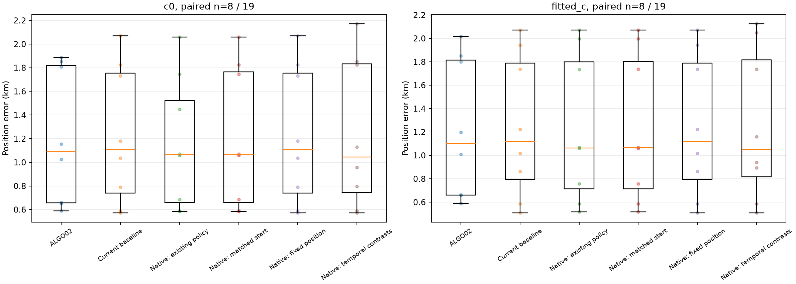
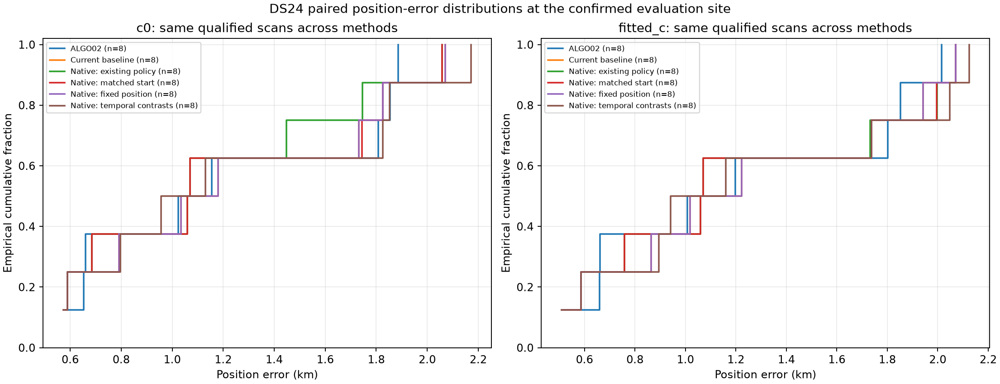

# Numerical results

Frozen DS24 population: 19 recordings. Errors below use the intersection of qualified final policies across all six methods; missing positions remain in the population denominator.

| Arm | Method | Paired n / dataset | Mean km | Median km | P95 km | Worst km | GLRT associated |
|---|---|---:|---:|---:|---:|---:|---:|
| c0 | algo02_historical | 8 / 19 | 1.204 | 1.089 | 1.875 | 1.886 | 76.53% |
| c0 | baseline | 8 / 19 | 1.224 | 1.108 | 1.985 | 2.071 | 76.57% |
| c0 | native_full | 8 / 19 | 1.155 | 1.064 | 1.949 | 2.058 | 79.31% |
| c0 | native_full_matched | 8 / 19 | 1.202 | 1.065 | 1.977 | 2.059 | 78.78% |
| c0 | native_fixed | 8 / 19 | 1.224 | 1.108 | 1.985 | 2.071 | 79.44% |
| c0 | native_contrasts | 8 / 19 | 1.237 | 1.043 | 2.060 | 2.172 | 77.86% |
| fitted_c | algo02_historical | 8 / 19 | 1.223 | 1.103 | 1.958 | 2.016 | 76.57% |
| fitted_c | baseline | 8 / 19 | 1.244 | 1.120 | 2.025 | 2.071 | 76.57% |
| fitted_c | native_full | 8 / 19 | 1.224 | 1.064 | 2.045 | 2.071 | 79.31% |
| fitted_c | native_full_matched | 8 / 19 | 1.225 | 1.065 | 2.045 | 2.072 | 78.78% |
| fitted_c | native_fixed | 8 / 19 | 1.244 | 1.120 | 2.025 | 2.071 | 79.44% |
| fitted_c | native_contrasts | 8 / 19 | 1.250 | 1.050 | 2.098 | 2.125 | 77.86% |

Percentiles describe only qualified paired recordings. This is the analysis-ready subset, not a random sample of DS24. Association percentage is pooled physical GLRT IDs over the same paired scans. RMS diagnostics refer to the original curved calibration observations and are not a pooled residual over recovered native points.
