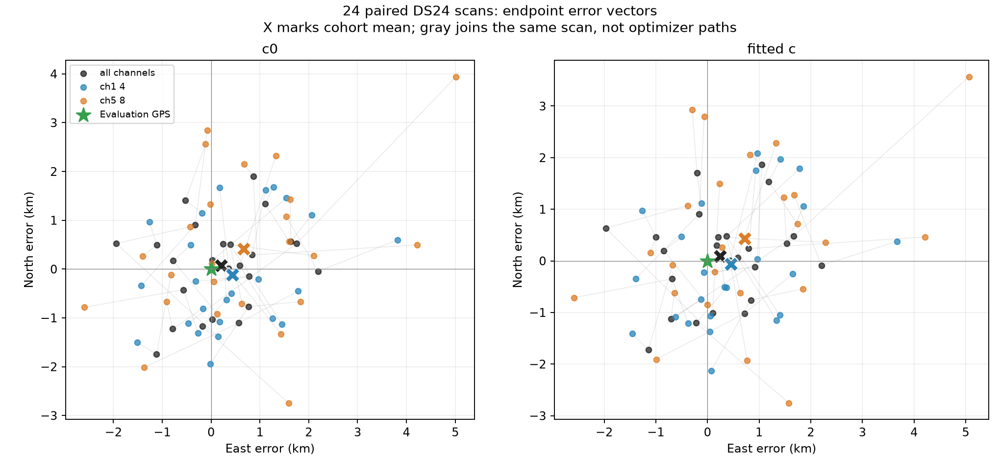
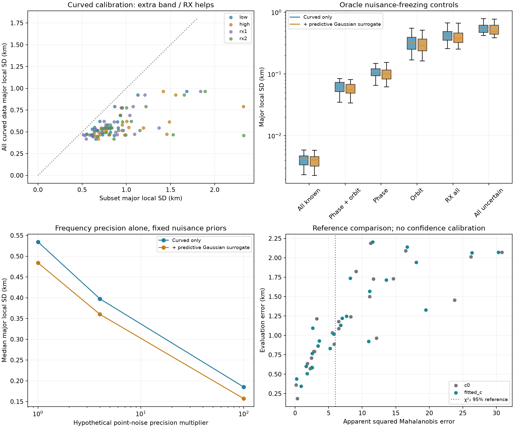
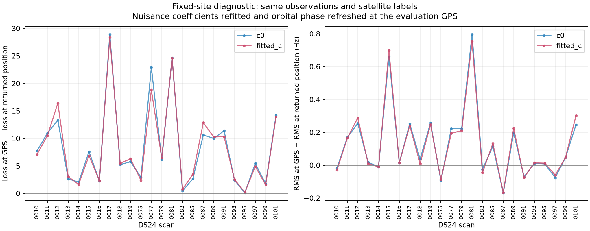

# DS24 localization bottlenecks: channel halves, optimization, geometry and RF precision

The strongest measured limitation is **ambiguity between position and satellite orbital timing/shape**, with receiver calibration and frequency precision also contributing. The targeted tests do not support a missed continuous-position minimum as the main explanation for the channel-half results. More channels help, but much of their evidence shares the same uncertain satellite geometry.

Three SOL agents at xhigh effort independently investigated restarts/assignments, nuisance-projected position information, and RF/association evidence. The coordinating analysis replayed the full objective at the evaluation site for every usable scan and reviewed previous DS23 negative controls. No new algorithm is promoted and no original position estimate is replaced by this investigation.

## Population and reference

These are the same **24 usable DS24 fast scans** from the 34-recording frozen fast population. Ten recordings still lack the required frozen GLRT inputs; they are not newly excluded for performance. All use 10 MS/s. Each channel-half run originally rebuilt its own tracks, calibration and associations before localization.

The primary reference is fresh ALGO02-v1 plus qualified causal signed phase priors and equal-assignment-prior family cavity. It is called `baseline` in the channel comparison, while `algo02` names the older historical control. This is not a claim that the later DS23-specific recovery candidate banks were applied to DS24.

| Channel group | Mean error, c=0 | Mean error, fitted c | Median error, fitted c | P95 error, fitted c |
|---|---:|---:|---:|---:|
| CH1–8 | 1.202 km | **1.220 km** | **1.114 km** | **2.131 km** |
| CH1–4 | 1.538 km | 1.558 km | 1.512 km | 2.509 km |
| CH5–8 | 2.040 km | 2.040 km | 2.001 km | 4.070 km |

Combining channels reduces mean error by about 22% relative to the low half and 40% relative to the high half. CH1–4 nevertheless wins on 9/24 fitted-c scans and CH5–8 on 7/24. Additional data improve expected precision under a correct model; they need not move every realized estimate closer to truth, especially when selection and nuisance fitting also change.

This figure joins the three estimates of each scan; its gray lines are not optimizer trajectories. The full-channel mean error vector is approximately +0.245 km east, +0.094 km north, accounting for only 3.8% of the mean squared error in this local coordinate calculation. A single constant position correction is not the dominant missing ingredient. The fixed, unweighted midpoint of the two half estimates gives mean error about 1.431 km, worse than the joint fit. These are same-site diagnostics, not a stationary-history estimator or a proposal to learn a GPS correction.

## 1. Do the half-channel results expose a missed local minimum?

We selected the worst full-channel case 0089, worst high-half case 0015, and three cases with the largest half-channel improvements: 0017, 0101 and 0081. This is deliberate post-hoc stress testing, not an unbiased new performance sample.

For each case, the complete full-channel objective was restarted from its incumbent position and the two independently inferred half-channel positions. Observations, labels, aliases, priors and search budgets stayed matched between c arms. Each fit used five orbital-phase refresh rounds and up to 48 bounded position steps per round.

**All 30 fits returned to the original solution**, with maximum endpoint movement only **2.06 cm** and maximum absolute objective difference **1.31e−8**. All paired gates passed. This rejects the specific hypothesis that the useful half-channel endpoint lies in a missed position basin for the unchanged full-channel model; it does not prove global optimality over all possible satellite assignments.

We then transferred four exact half-channel label/alias configurations onto matching full-channel tracks, preserving all original retained measurements. Both cold and half-endpoint starts were tested in both c arms. The alternative labels changed 24–137 retained points per case. **None qualified for adoption**: three failed gates and all four had worse full-data RF objectives. The 0017 alternative passed after the existing constrained refinement but worsened c0 loss by 86.53 despite improving evaluated position. That discrepancy is evidence to investigate the model, not a reason to select by GPS.

[Complete restart and assignment results](minima/RESULTS.md), including rejected fits, phase convergence, RF score and geographic error separately.

## 2. What information is being lost?

At each saved full-channel endpoint we differentiated predicted CFO with respect to east/north location and eliminated uncertain nuisance coefficients using their existing priors. The calculation keeps the selected labels, masks, geometry and fitted noise precisions fixed. Every same-solution channel/RX subset has no more information than the combined data, as expected.

The primary result uses curved calibration points only, matching which observations can estimate nuisance coefficients in the current algorithm. A separately labeled Gaussian surrogate also includes predictive measurements; neither is a calibrated position-confidence bound or achieved accuracy.

| Controlled local diagnostic, fitted c | Median weak-axis scale |
|---|---:|
| Current curved evidence and all nuisance uncertainty | **534 m** |
| Same evidence, half the point-frequency noise SD | 397 m |
| Same evidence, one tenth the point-frequency noise SD | 185 m |
| Receiver offsets/drifts/smooth terms treated as known | 386 m |
| Satellite orbital timing coefficients treated as known | **110 m** |
| Satellite timing and orbital-shape coefficients treated as known | **56 m** |
| RF-dependent coefficient c treated as known | 533 m |

“Known” is an unavailable-information control: coefficients are fixed at their fitted values to identify ambiguity. It does not establish that those values are physically correct or justify removing their uncertainty in production. The noise controls also do not establish that an estimator can achieve those noise levels.

The median strongest weak-position-axis correlation with an individual orbital timing coefficient is **0.935**. A small change in where a satellite is along its orbit can resemble a change in receiver position in the observed Doppler curves. Here “phase” means orbital time displacement, not RF carrier phase. Receiver terms matter, but phase/position ambiguity is the larger local effect in this cohort. The fitted RF coefficient c has negligible impact on this diagnostic; it slightly improves mean CFO RMS, 71.416→71.380 Hz, while mean geographic error changes 1.202→1.220 km.

For the primary curved-only calculation, median low-half and high-half scales are 760 and 938 m versus 534 m combined. Adding the other band reduces the per-scan scale by a median 26% or 37%, respectively. The median weak-axis separation is only **17.7° between bands** and **21.9° between receivers**. A median 11 calibration families are shared across bands and eight across receivers. Extra points therefore often repeat similar geometry and share orbital errors; they are not another set of independent, orthogonal position measurements.

[Full information report](information/REPORT.md) explains the projection, predictive surrogate, covariance assumptions, noise controls, c ablation and validation.

## 3. Why can the true site fit almost as well?

For all 24 scans and both c arms, the coordinator evaluated the same selected model at the known site, holding position fixed while refitting nuisance coefficients and refreshing orbital phase. These are evaluation-only diagnostics; GPS does not choose associations, priors, starts or adopted estimates.

All 24 fitted-c objectives prefer their returned position over the evaluation site. The median loss gap is **6.377**, ranging 0.206–28.381. Yet the median true-site minus endpoint curved RMS difference is just **0.032 Hz**, ranging −0.165 to +0.754 Hz. Clean frequency residuals therefore do not uniquely locate the receiver.

The fitted likelihood maximum need not coincide with truth even for a correct noisy model, so this comparison alone does not prove bias. However, the local conditional covariance is optimistic relative to observed errors: only 11/24 apparent squared Mahalanobis errors fall below the nominal two-dimensional 95% reference. This is descriptive, not a calibrated coverage test: labels were selected, nuisance/noise precision is conditioned on estimates, and scans can share orbital/systematic errors. It motivates testing uncertainty and prior calibration rather than claiming a precise wrong answer.

Loss decomposition is retained per case. Data, noise-Gamma, orbit, fragment and predictive terms all contribute; changes in one plotted term do not measure the causal effect of changing its prior. No arbitrary tighter phase prior is selected from these GPS results.

## 4. Are satellite identities the problem?

On points accepted into the position likelihood by both full and half runs, labels agree for **99.686%** of low-half points (39,159 common IDs, 123 disagreements in two scans) and **100%** of high-half points (31,346 common IDs). This does not independently certify those identities: related pipelines can share the same wrong answer. It does make widespread label disagreement a weak explanation for the channel comparison.

Track membership differs more than accepted identity. Failed, omitted or differently supported curves can change calibration and location even when overlapping accepted points keep the same satellite. The finite transfer experiments also test labels present on half tracks that the half's final gates may not accept; they are broader than the common-accepted-ID agreement statistic and are not contradictory to it.

Recovering evidence remains useful, particularly new satellite geometries and simultaneous cross-family observations that constrain receiver calibration. Adding many points on an already well-sampled, orbit-uncertain family can increase association percentage without proportionally improving position.

## 5. Is 10 MS/s or the 40° receiver arrangement limiting us?

All 34 inventoried fast recordings, including the 24 usable cases, use **10 MS/s**, with **200,000 complex samples per 20 ms window**. The estimator audit finds a 64-symbol, approximately 281.6 µs coherent CFO aperture within each frame, with frame spectral energies summed over the window. It does not coherently combine the entire 20 ms. Its 512-point residual frequency grid is about 443.9 Hz, combined with an interpolated acquired CFO; that grid is not a simple quantization step for the exported CFO. Neither sample spacing nor 1/20 ms alone specifies its estimation precision.

There is room to investigate the frequency estimator, especially RX1:

| Receiver/band | Median graph-based radio scatter | Median per-scan fitted curved RMS |
|---|---:|---:|
| RX1 low | 78.73 Hz | 82.95 Hz |
| RX1 high | 87.99 Hz | 86.41 Hz |
| RX2 low | 44.86 Hz | 33.71 Hz |
| RX2 high | 42.21 Hz | 36.52 Hz |

Residuals on different satellites observed by the same receiver have median pair correlation +0.354 within a band and +0.265 across bands, versus +0.072 for the same satellite across receivers in the c0 diagnostic. These are selected, post-fit, time-matched correlations, not independent causal tests. They make a remaining receiver/estimator common component a concrete hypothesis worth testing. Passing the current residual gates does not establish that every residual is independent white noise.

The same sample rate on both receivers makes sample rate alone insufficient to explain the discrepancy. SNR, waveform content, oscillator behavior and estimator effects remain possible; this observational comparison does not identify the hardware cause. The detailed evidence report separates graph scatter, fitted residuals and their uncertainty assumptions. A native-product audit also reconciles the acquired and residual CFO with the exported fractional CFO; it is not an unexplained frequency-grid bookkeeping error.

The hardware authority documents a nominal **40° included feed-axis angle**, but installed boresights, base pose and RF phase centers are not measured. These nearby feeds are not two separated geolocation stations. The current likelihood uses a common receiver site and CFO; it has no measured bearing, calibrated antenna-pattern likelihood, TDOA or inter-receiver RF phase measurement. Pointing affects which satellites and signal strengths are observed, rather than directly supplying a triangulation angle. The local information calculation shows real geometric overlap despite that nominal feed separation. We cannot infer that another mounting angle would improve localization without evaluating its observed satellite diversity.

[RF, receiver and association evidence](evidence/FINDINGS.md) and its figures provide estimator code pointers and exact per-receiver comparisons.

## Reporting correction: GLRT point totals

The audit found an omission in the previous reporting script: some saved fits call their predictive count `additional_predictive_points`; the table read only `predictive_points` and defaulted to zero. The estimates, retained observations and all position-error statistics are unchanged.

The corrected count is the unique union of accepted curved calibration and explicit predictive position-likelihood IDs. It excludes additional post-fit-only associations and is not independently verified satellite identity truth.

| Group | Previously reported likelihood points | Corrected points | GLRT denominator | Corrected percentage |
|---|---:|---:|---:|---:|
| CH1–8 | 76,403 | **78,067** | 108,600 | **71.88%** |
| CH1–4 | 41,593 | **42,621** | 60,059 | **70.97%** |
| CH5–8 | 32,560 | **33,339** | 48,541 | **68.68%** |

Both c arms have these same memberships. All 144 scan/group/arm ID audits verify uniqueness, disjoint curved/predictive roles, original-observation membership, count parity and compatible saved gates. [Correction by scan](evidence/likelihood_count_audit.csv). The prior report is annotated; its original archived numerical files are preserved for provenance. The new `reporting_counts.py` reader handles both saved schemas, preserves an explicit zero and rejects conflicting fields; four regression checks include the complete 144-arm frozen cohort. Future summaries should use this reader or the native-ID union audit instead of the older default-to-zero expression.

## Recommended next bounded work

1. **Test the causal orbit-error model.** Evaluate orbital timing/shape forecasts using reproducible randomized whole-group validation, with each forecast restricted to history available before its prediction time and correlated transitions kept together. Record seeds and group assignments; fit preprocessing on training groups only. Include correlations between orbital coordinates where supported. Compare uncertainty calibration and position, not just a smaller prior or improved in-sample loss. The present result identifies the value of independent timing information; it does not yet supply it. Avoid another global phase-width sweep, which prior DS23 tests already failed to establish as a general repair.
2. **Recover informative evidence.** Rank remaining curved sources by additional position information after nuisance elimination, new satellite direction and simultaneous cross-family/RX support, alongside the existing whole-curve residual/identity gates. Carry frozen existing graph/native recovery methods onto DS24 before inventing scan-specific changes. Increased GLRT percentage remains a coverage goal, not the localization objective.
3. **Test the receiver discrepancy with an independent-family witness.** First test whether a receiver residual component learned from one family predicts another simultaneous family, retaining whole tracks. Compare a justified shared residual covariance/correction against the current null on identical data; do not add unconstrained per-track polynomials. Then run one small paired CFO-estimator test on existing IQ, holding windows, native IDs, timing, satellite catalogue and inference budgets fixed. Separate a precision-only fixed-label control from an end-to-end recovery run. Better coherent use of the waveform is worth testing; purchasing more sample rate or changing hardware is not yet justified by these data.
4. **Validate the frozen change on all eligible scans.** Preserve both c arms, failures and tails. Require better position distributions and calibrated uncertainty as well as RF/gate improvements before an ALGO release. Do not select per-scan identities, priors or receiver exclusions using GPS.

No new RF, future TLE inference, stationary-location pooling, manual satellite whitelist or evaluation-GPS correction was used. The original 25×25 km search box remains centered at 37.906, −122.545. The evaluation coordinate is 37.849061591561885, −122.48574968092912. All c controls retain matched observations, candidates, other priors and budgets within each experiment.

## Reproduction and audit

The source scripts are archived with each sub-analysis and `cohort_review.py`. Use the existing repository environment with `.venv/bin/python -B`, `/tmp/algo03-feasible-deps`, repository `src` and `tools` on PYTHONPATH, and one BLAS/OMP thread per process. Frozen inputs remain under the previously published DS25/full and DS24/channel-half experiment roots. This investigation used bounded local CPU analyses, not a new acquisition campaign.

The 48 fixed-site endpoint replays have maximum absolute objective difference 2.780e−5 under guarded absolute <1e−3 and relative <1e−8 tolerances. Every fixed-site phase iteration converges below 1e−5 s. Information derivatives, independent QR projection and Hessian step-size checks are recorded; three focused information tests pass. Original published result hashes are independently checked. [Audit](audit.json) and [archive manifest](archive_manifest.json) bind the report to its results. Larger per-case records, residual rows and fit histories are preserved in `raw_results.tar.gz`; source snapshots and small tables remain directly browsable.
