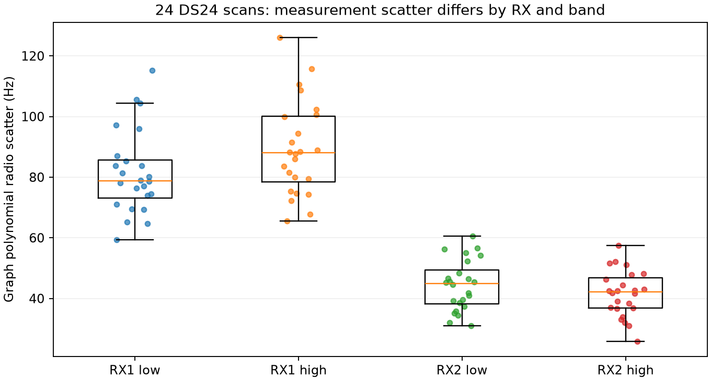
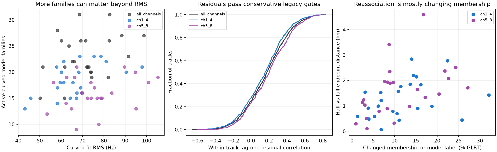

# DS24 measurement and association evidence audit

All 24 common usable scans were audited in CH1–8, CH1–4, and CH5–8, with matched c=0 and fitted-c controls. This is replay of existing observations and saved fits; no RF collection, raw-IQ read, new association search, or inference change occurred. Satellite labels below are model assignments, not independently verified emitter identities.

## What the sample rate establishes

All 34 inventoried fast scans, including all 24 usable scans, have 10 MS/s acquisition. Each full/half comparison uses the same CFO values and exact original observation IDs in the appropriate channel partition. Consequently, this experiment cannot estimate the causal effect of sample rate.

The native policy fixes 200,000 samples per 20 ms window. The visible native/Python scorer coherently combines 64 pilot symbols per frame (64 × 4.4 µs = 281.6 µs), then sums power across supporting frames. It discards the common frame phase; this is not 20 ms of coherent carrier phase. The 512-point residual-frequency grid has spacing 443.892045 Hz. Published CFO equals the off-grid acquired CFO plus this residual bin. Thus neither 1/20 ms = 50 Hz nor 443.9/√12 Hz is a justified accuracy floor for these published estimates. The 100 ns sample spacing likewise does not directly set carrier-frequency precision.

For representative DS24-0101, all 106 sealed GLRT product hashes were verified, and the canonical parsed-product aggregate exactly matches the frozen tracking input's analysis digest. Across its bracketed fractional candidates, residuals lie on that grid within 6.37e-12 bins, and CFO − acquired CFO − residual is at most 5.83e-11 Hz. These are all candidate outputs, not only accepted winners. The sealed products retain acquired CFO even though the adapted tracking contract omits it. See [acquisition_provenance.json](acquisition_provenance.json) and its replay script.

Source locations: `src/leo/contracts/fast_scan_native.py`; `src/leo/analysis/starlink/fast_scan_scores.py`; `native/adaptive/detector/kernel/private/full_search.c` (`full_fractional_epoch`); `native/adaptive/detector/kernel/private/native_presence/presence.c` (`glrt`). Source semantics and discrete-grid parity do not establish a calibrated physical CFO error distribution or certify every historical binary setting.

## Measurement scatter depends strongly on receiver

Use the same original graph-polynomial degrees and eligible-piece rule as `tools/ds23_radio_noise.py`, before satellite/GPS fitting. Residual squares are corrected by 1 − leverage; no 40 Hz floor is imposed on these descriptive scatter values. The first two numerical columns are medians of per-scan values across all 24 scans; the final column is the median standardized track RMS.

| Receiver/band | Radio-polynomial scatter | Conditional localization residual RMS | Median conditional RMS / supplied point sigma |
|---|---:|---:|---:|
| RX1 CH1–4 | 78.73 Hz | 82.95 Hz | 1.112 |
| RX1 CH5–8 | 87.99 Hz | 86.41 Hz | 1.225 |
| RX2 CH1–4 | 44.86 Hz | 33.71 Hz | 0.316 |
| RX2 CH5–8 | 42.21 Hz | 36.52 Hz | 0.317 |

The conditional columns use fitted-c CH1–8; c=0 gives nearly the same values. The current radio uncertainty learner pools receivers and learns a margin-dependent law. The pooled constant-sigma median is 70.81 Hz full, 67.74 Hz low-only, and 75.09 Hz high-only. The RX disparity is therefore obscured by a pooled scan RMS. Conditional residuals also reflect fitting/shrinkage: the table does not itself calibrate new weights or prove RX1 hardware causes the position bias.

On retained curved tracks the legacy lag-one ACF statistic has fitted-c median 0.178 full, 0.158 low-only, and 0.203 high-only. All tracks pass the existing conservative residual screen. Full-fit absolute first-half/second-half residual mean difference has median 11.62 Hz and P95 77.49 Hz. Passing the legacy screen is not proof of white error at a future 10 Hz precision target.

After jointly fitted satellite/receiver corrections, nearest-distance-first distinct measured pairs within 0.5 s, with at least six pairs, give:

| c=0 residual pairing | Lane pairs | Median Pearson correlation | Median of per-scan medians |
|---|---:|---:|---:|
| Same RX/band, different model family | 1,371 | +0.354 | +0.348 |
| Same RX, different band/family | 1,462 | +0.265 | +0.293 |
| Same family/band, different RX | 344 | +0.072 | +0.070 |

Fitted-c medians are +0.357, +0.262, and +0.071. Lanes merge retained fragments of one family/RX/channel; no interpolation creates votes. These dependent, conditional correlations support investigating a shared receiver/model discrepancy through held-out prediction. They do not independently identify hardware, exonerate TLEs, or establish identities. See [residual_correlations.json](residual_correlations.json).

## Halving channels mainly changes support and nuisance estimates

| Comparison against full | Both use observation | Same model identity | Identity disagreements | Full-only membership | Half-only membership |
|---|---:|---:|---:|---:|---:|
| Low-only | 39,159 | 39,036 (99.686%) | 123 | 3,742 | 3,462 |
| High-only | 31,346 | 31,346 (100%) | 0 | 3,820 | 1,993 |

Counts and identities are identical between the two c controls. Assignment membership or identity changes for 12.20% of low-band GLRT observations and 11.98% of high-band observations. Most of this is entering/leaving accepted likelihood membership, not replacing one accepted identity with another. Mean active curved-family counts fall from 23.04 full to 18.29 low-only and 16.00 high-only. These are fitted model families, not 23 independent geometric constraints of equal quality.

Common active-family phase estimates change with channel support: median absolute full-versus-half phase shift is 0.0852/0.0802 s (c0/fitted-c) for low and 0.1374/0.1345 s for high. Fitted-c P95 shifts are 0.336 and 0.392 s. Full-versus-half endpoint separation has fitted-c median 1.102 km low and 1.556 km high. This is direct evidence that nearly stable labels can still support materially different position/nuisance solutions.

Counterexamples to explaining all half-band failures as wrong labels:

- DS24-0015 high-only shares 1,351 accepted observations with full, all with the same identity, yet the endpoints separate by 4.585 km. Fitted-c evaluation error changes from 1.738 km full to 6.190 km high-only. Its full-only/half-only membership counts are 106/297.
- DS24-0097 high-only is an exact identity-preserving 1,048-point subset of full's 1,201 high-band accepted points. Nevertheless, endpoints separate by 3.412 km; evaluation error is 0.833 km full versus 4.228 km high-only.
- There are two real model-label disagreements in low-only: DS24-0016 assigns 111 common points to 61933 rather than full's 58028; DS24-0019 assigns 12 to 64176 rather than 61916. Neither experiment establishes which is physically correct.

The supplied coordinate enters only the two evaluation-error examples. Label agreement and endpoint separation do not use it.

## A reporting count correction

The earlier report reads `predictive_points` but falls back to zero for older saved arms that instead store `additional_predictive_points`. Exact compatible-gate ID unions give:

| Channels | Curved likelihood IDs | Predictive likelihood IDs | Exact union / GLRT | Corrected percentage |
|---|---:|---:|---:|---:|
| Full | 66,110 | 11,957 | 78,067 / 108,600 | 71.8849% |
| Low-only | 37,262 | 5,359 | 42,621 / 60,059 | 70.9652% |
| High-only | 29,553 | 3,786 | 33,339 / 48,541 | 68.6821% |

This changes reported likelihood membership counts, not positions, residuals, gates, or inference. No postfit extension is included. All 144 scan/group/arm records assert compatible gates, unique IDs within curved and predictive sets, disjoint curved/predictive sets, original-observation containment, and equality to the corresponding saved count fields. The former totals omit 1,664/1,028/779 predictive points. Per-case omissions are in [likelihood_count_audit.csv](likelihood_count_audit.csv).

## Existing evidence and limits

Prior DS23 work already demonstrated an estimator-dependent RX2 scatter component reducible to roughly 10–13 Hz on bounded archived-IQ panels, with much smaller position improvement. It also found concrete native interpolation bias on a receipt-verified binary, while warning that archive/build identity must be established before applying a correction. These are prior DS23 results, not new DS24 measurement results: see repository reports `2026_10_19_ds23_raw_pilot_refinement`, `2026_10_19_ds23_refined_precision`, `2026_10_19_ds23_clock_measurement_controls`, and `2026_10_19_ds23_association_evidence`.

The current evidence favors a combination of unequal measurement scatter, correlated calibration/model discrepancy, reduced family support, and position/phase/receiver tradeoffs. It does not establish a sample-rate bottleneck or widespread gross identity mistakes. A bounded next measurement experiment should refine fixed existing-IQ windows from both receivers/bands, preserve canonical IDs and aliases, qualify effective CFO times and independent uncertainty, then assess matched c0/fitted-c localization separately. This audit does not choose new noise weights, priors, or identities from GPS.

Replays cover all 144 saved arm endpoints: active-point counts match exactly and the maximum saved-versus-replayed RMS difference is 6.50e-7 Hz. Scripts and detailed JSON/CSV are local to this evidence directory. No repository core files or golden fixtures were changed.
