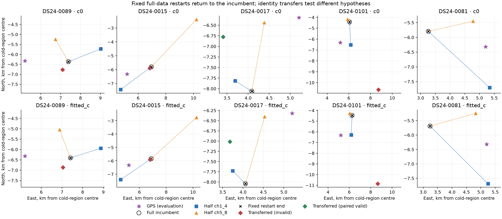
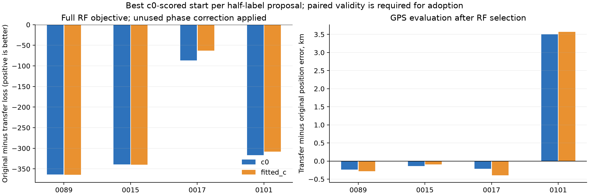

# DS24 targeted full-data restart and association diagnostics

The five targeted scans show no meaningful position-optimizer basin repair under the incumbent full-channel assignments. All 30 bounded fits pass paired gates and return to the incumbent: the largest endpoint displacement is 0.02059 m and the largest absolute normalized-loss difference is 1.31e-08. Four finite half-label transfers also provide no acceptable full-data RF improvement. These checks do not establish a global association optimum.

## Protocol

Cases 0089 and 0015 were selected as worst all-channel and high-band cases; 0017, 0101 and 0081 were selected because prior channel-halves evaluation showed the three largest current-primary half-channel gains. The current primary is labelled `baseline` in the channel-halves position table; `algo02` there denotes historical ALGO02-v1. This is a targeted post-hoc mechanism test, not an unbiased performance cohort. No new RF was collected. All inference stays inside the original ±12.5 km east/north box centred at 37.906, −122.545.

The full source is `/srv/bulk/leo/research/ds25-20261024`; the channel-half source is `/srv/bulk/leo/research/ds24-channel-halves-20261024`. Each actual incumbent endpoint and phase reference is read from `cavity_context(...)["arms"][arm]`, because the context’s `x` can predate cavity adoption. Original endpoint objectives replay to <1e−5.

Fixed tests use the full incumbent labels, aliases, mask, powers, causal signed phase prior and physical priors. Each c arm starts at its own incumbent, CH1–4 endpoint and CH5–8 endpoint. Every fit uses five phase-refresh rounds and at most 48 bounded Gauss–Newton steps per round, with phase references initialized to zero. Both c arms use matched observations, candidate assignments, other priors and budgets.

RF selection is recorded in each raw result before this report reads GPS. A numerical floor of 1e−4 objective units prevents numerical noise from being labelled an improvement. Fixed restarts use the same assignment; transfers compare the corrected normalized c0 objective under equal assignment priors, preserve the incumbent as an explicit alternative, and require both-arm gates and phase convergence. GPS is used only to evaluate saved endpoints.

## Fixed assignments: all starts return to the same solution

| Case | Arm fits | All paired valid | Max absolute loss change | Max endpoint shift, m |
|---|---:|---|---:|---:|
| DS24-0089 | 6 | True | 7.82e-10 | 0.020586 |
| DS24-0015 | 6 | True | 2.36e-10 | 0.000014 |
| DS24-0017 | 6 | True | 5.92e-09 | 0.000106 |
| DS24-0101 | 6 | True | 1.31e-08 | 0.000134 |
| DS24-0081 | 6 | True | 2.45e-09 | 0.013539 |

This rejects the specific explanation that the useful half-channel endpoint lies in a missed position basin for the unchanged full-channel objective. It does not test every possible starting position or every association.

## Explicit finite association alternatives

For 0017 CH5–8, 0101 CH1–4, 0015 CH1–4 and 0089 CH5–8, copy the saved half-channel labels and aliases onto exactly matching full-channel track components. Common observation IDs, times and values are asserted equal before transfer. All full observations, retained points, powers, hyperparameters and predictive factors survive; newly introduced candidates receive the full run’s causal phase prior means. Both cold zero and corresponding half-endpoint starts are fitted in both c arms. Near-feasible candidates may use the existing paired constrained-refinement rule (minimum original slack ≥−0.25). No broad catalogue discovery is run.

The table uses the lowest c0-scored start for each proposed assignment, even when that proposal is invalid, so its failure is visible. Positive loss gain would favour the transfer.

| Case | Half labels | Changed retained points | Best start | Constrained refinement | Paired valid | c0 loss gain | fitted-c loss gain |
|---|---|---:|---|---|---|---:|---:|
| DS24-0089 | ch5_8 | 137 | cold | False | False | -363.392 | -364.534 |
| DS24-0015 | ch1_4 | 24 | cold | False | False | -339.465 | -339.771 |
| DS24-0017 | ch5_8 | 137 | half_endpoint | True | True | -86.530 | -62.760 |
| DS24-0101 | ch1_4 | 55 | cold | True | False | -316.816 | -307.827 |

The 0017 transfer qualifies only after constrained refinement; its original minimum gate slacks were −0.142 and −0.123 for c0 and fitted-c. The 0101 proposal remains invalid after the same refinement rule. These are 16 matched-arm transfer results; eight use the additional paired constrained-refinement stage.

| Case | c arm | Original RMS, Hz | Transfer RMS, Hz | Original error, km | Transfer error, km |
|---|---|---:|---:|---:|---:|
| DS24-0089 | c0 | 66.136 | 975.178 | 2.188 | 1.949 |
| DS24-0089 | fitted_c | 66.096 | 993.700 | 2.205 | 1.921 |
| DS24-0015 | c0 | 69.100 | 1584.099 | 1.826 | 1.690 |
| DS24-0015 | fitted_c | 69.216 | 1588.099 | 1.738 | 1.646 |
| DS24-0017 | c0 | 68.422 | 69.083 | 2.071 | 1.853 |
| DS24-0017 | fitted_c | 68.507 | 68.937 | 2.071 | 1.678 |
| DS24-0101 | c0 | 74.034 | 75.178 | 2.089 | 5.590 |
| DS24-0101 | fitted_c | 74.056 | 75.307 | 2.141 | 5.712 |

The 0081 half-label differences occur only on points excluded by the full run’s retained mask; its useful half-channel endpoints therefore do not demonstrate an active full-data identity change. No 0081 label-transfer fit was needed.

Frequency residual RMS, normalized RF objective and geographic accuracy are separate diagnostics. A more accurate endpoint with a worse full RF objective is not adoptable under the current model. Labels remain model associations, not externally verified identities. The finite transfers test the half-channel alternatives only; unexplored joint identity/alias combinations or observation/model errors remain possible.

## Files and reproduction

`run_fixed.py CASE` and `run_transfer.py CASE {ch1_4,ch5_8}` run independent bounded case processes. Runtime uses `.venv/bin/python -B`, `PYTHONPATH=/tmp/algo03-feasible-deps:/srv/bulk/leo/research/ds25-20261024/engine:src:tools`, and `OPENBLAS_NUM_THREADS=OMP_NUM_THREADS=MKL_NUM_THREADS=1`. No repository modules were changed. All hand-written experiment files are confined to this directory.

[Fixed arm-level results](fixed_restarts.csv), [transfer arm-level results](association_transfers.csv), [machine summary](summary.json), and the per-case JSON files retain phase convergence, fit histories, gates and RF selections. The report asserts phase amplitudes remain within ±15 s and verifies selections were recorded before GPS evaluation.
