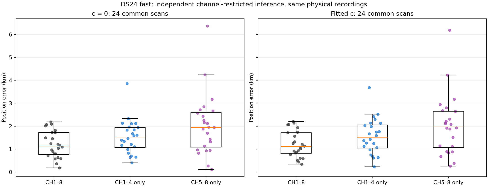
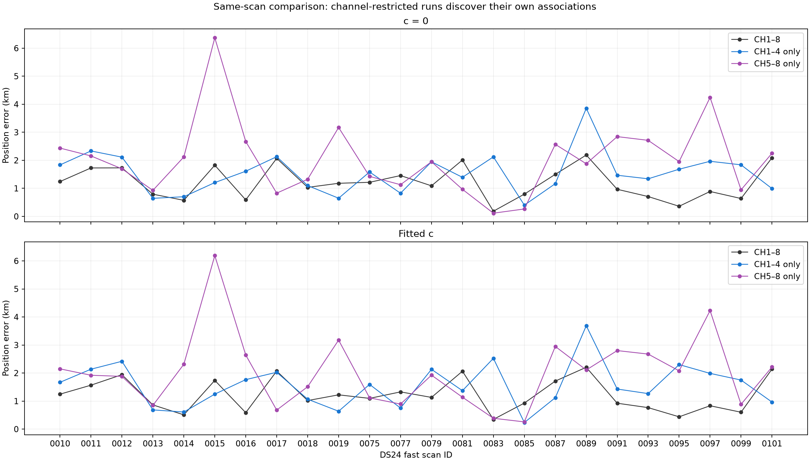
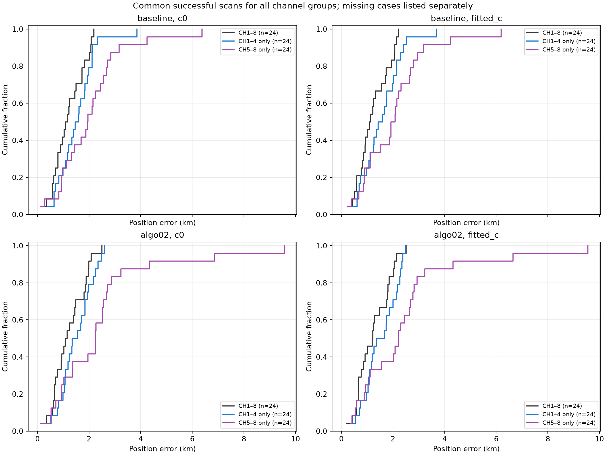

# DS24 fast channel-restricted results

All position errors are kilometres. The primary comparison uses the same successful scans across all three channel groups. All available results and failed/missing cases are retained separately.

| Method | c arm | Channels | Localized / 34 | Common n | Mean | Median | P95 | Worst |
|---|---|---|---:|---:|---:|---:|---:|---:|
| baseline | c0 | CH1–8 | 24/34 | 24 | 1.202 | 1.135 | 2.087 | 2.188 |
| baseline | c0 | CH1–4 only | 24/34 | 24 | 1.538 | 1.526 | 2.303 | 3.857 |
| baseline | c0 | CH5–8 only | 24/34 | 24 | 2.040 | 1.952 | 4.083 | 6.372 |
| baseline | fitted_c | CH1–8 | 24/34 | 24 | 1.220 | 1.114 | 2.131 | 2.205 |
| baseline | fitted_c | CH1–4 only | 24/34 | 24 | 1.558 | 1.512 | 2.509 | 3.687 |
| baseline | fitted_c | CH5–8 only | 24/34 | 24 | 2.040 | 2.001 | 4.070 | 6.190 |
| algo02 | c0 | CH1–8 | 24/34 | 24 | 1.223 | 1.118 | 2.075 | 2.500 |
| algo02 | c0 | CH1–4 only | 24/34 | 24 | 1.499 | 1.449 | 2.457 | 2.585 |
| algo02 | c0 | CH5–8 only | 24/34 | 24 | 2.432 | 2.252 | 6.483 | 9.575 |
| algo02 | fitted_c | CH1–8 | 24/34 | 24 | 1.240 | 1.209 | 2.127 | 2.508 |
| algo02 | fitted_c | CH1–4 only | 24/34 | 24 | 1.526 | 1.521 | 2.378 | 2.481 |
| algo02 | fitted_c | CH5–8 only | 24/34 | 24 | 2.432 | 2.219 | 6.304 | 9.548 |

## Paired changes from CH1–8

| Method | c arm | Subset | Mean error change, km | Improved scans | Worsened scans |
|---|---|---|---:|---:|---:|
| baseline | c0 | CH1–4 only | +0.336 | 8 | 16 |
| baseline | c0 | CH5–8 only | +0.838 | 7 | 17 |
| baseline | fitted_c | CH1–4 only | +0.337 | 9 | 15 |
| baseline | fitted_c | CH5–8 only | +0.820 | 7 | 17 |
| algo02 | c0 | CH1–4 only | +0.276 | 10 | 14 |
| algo02 | c0 | CH5–8 only | +1.209 | 5 | 19 |
| algo02 | fitted_c | CH1–4 only | +0.287 | 10 | 14 |
| algo02 | fitted_c | CH5–8 only | +1.192 | 4 | 20 |

## RF evidence on the common cohort

Association percentages use each subset’s own GLRT denominator. These are accepted model labels, not independently verified satellite identities. RMS measures retained curved calibration evidence; different channel groups use different observations.

| c arm | Channels | GLRT points | Associated points | Associated % | Mean curved RMS, Hz |
|---|---|---:|---:|---:|---:|
| c0 | CH1–8 | 108600 | 76403 | 70.35 | 71.42 |
| c0 | CH1–4 only | 60059 | 41593 | 69.25 | 67.07 |
| c0 | CH5–8 only | 48541 | 32560 | 67.08 | 75.75 |
| fitted_c | CH1–8 | 108600 | 76403 | 70.35 | 71.38 |
| fitted_c | CH1–4 only | 60059 | 41593 | 69.25 | 67.02 |
| fitted_c | CH5–8 only | 48541 | 32560 | 67.08 | 75.71 |

## Missing or unsuccessful primary runs

| Case | Channels | Status | Reason |
|---|---|---|---|
| DS24-0001 | CH1–8 | input_unqualified | ValueError: existing fast tracking contract unavailable |
| DS24-0002 | CH1–8 | input_unqualified | ValueError: existing fast tracking contract unavailable |
| DS24-0003 | CH1–8 | input_unqualified | ValueError: existing fast tracking contract unavailable |
| DS24-0004 | CH1–8 | input_unqualified | ValueError: existing fast tracking contract unavailable |
| DS24-0005 | CH1–8 | input_unqualified | ValueError: existing fast tracking contract unavailable |
| DS24-0006 | CH1–8 | input_unqualified | ValueError: existing fast tracking contract unavailable |
| DS24-0007 | CH1–8 | input_unqualified | ValueError: existing fast tracking contract unavailable |
| DS24-0008 | CH1–8 | input_unqualified | ValueError: existing fast tracking contract unavailable |
| DS24-0009 | CH1–8 | input_unqualified | ValueError: existing fast tracking contract unavailable |
| DS24-0103 | CH1–8 | input_unqualified | ValueError: existing fast tracking contract unavailable |
| DS24-0001 | CH1–4 only | input_unqualified | ValueError: existing fast tracking contract unavailable |
| DS24-0002 | CH1–4 only | input_unqualified | ValueError: existing fast tracking contract unavailable |
| DS24-0003 | CH1–4 only | input_unqualified | ValueError: existing fast tracking contract unavailable |
| DS24-0004 | CH1–4 only | input_unqualified | ValueError: existing fast tracking contract unavailable |
| DS24-0005 | CH1–4 only | input_unqualified | ValueError: existing fast tracking contract unavailable |
| DS24-0006 | CH1–4 only | input_unqualified | ValueError: existing fast tracking contract unavailable |
| DS24-0007 | CH1–4 only | input_unqualified | ValueError: existing fast tracking contract unavailable |
| DS24-0008 | CH1–4 only | input_unqualified | ValueError: existing fast tracking contract unavailable |
| DS24-0009 | CH1–4 only | input_unqualified | ValueError: existing fast tracking contract unavailable |
| DS24-0103 | CH1–4 only | input_unqualified | ValueError: existing fast tracking contract unavailable |
| DS24-0001 | CH5–8 only | input_unqualified | ValueError: existing fast tracking contract unavailable |
| DS24-0002 | CH5–8 only | input_unqualified | ValueError: existing fast tracking contract unavailable |
| DS24-0003 | CH5–8 only | input_unqualified | ValueError: existing fast tracking contract unavailable |
| DS24-0004 | CH5–8 only | input_unqualified | ValueError: existing fast tracking contract unavailable |
| DS24-0005 | CH5–8 only | input_unqualified | ValueError: existing fast tracking contract unavailable |
| DS24-0006 | CH5–8 only | input_unqualified | ValueError: existing fast tracking contract unavailable |
| DS24-0007 | CH5–8 only | input_unqualified | ValueError: existing fast tracking contract unavailable |
| DS24-0008 | CH5–8 only | input_unqualified | ValueError: existing fast tracking contract unavailable |
| DS24-0009 | CH5–8 only | input_unqualified | ValueError: existing fast tracking contract unavailable |
| DS24-0103 | CH5–8 only | input_unqualified | ValueError: existing fast tracking contract unavailable |

[All results including unavailable cases](tables/positions.csv), [paired errors](tables/paired_errors.csv), [full summary](summary.json), [protocol and interpretation](README.md).
