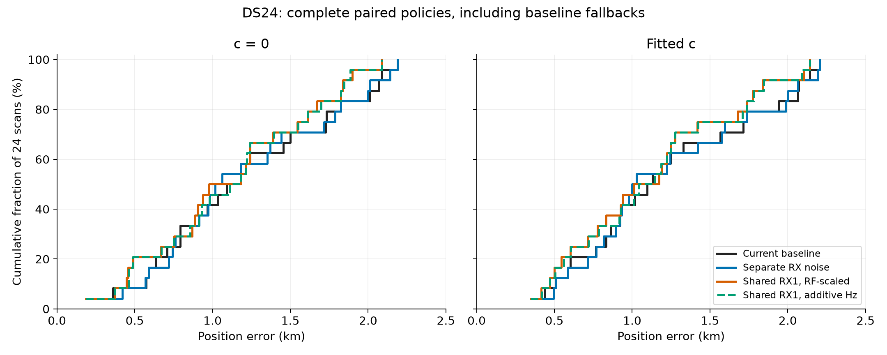
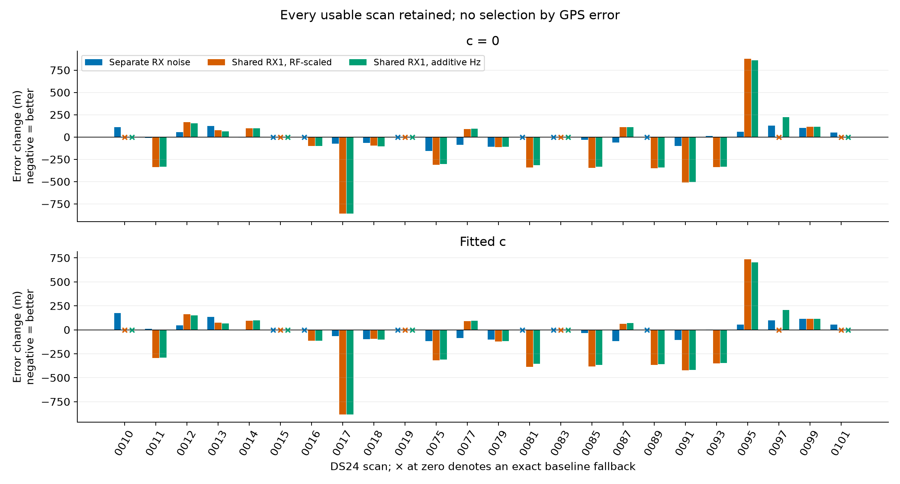
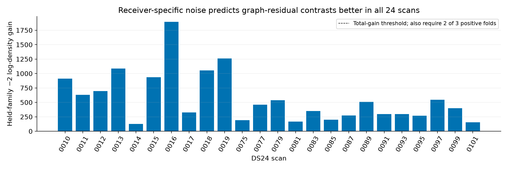
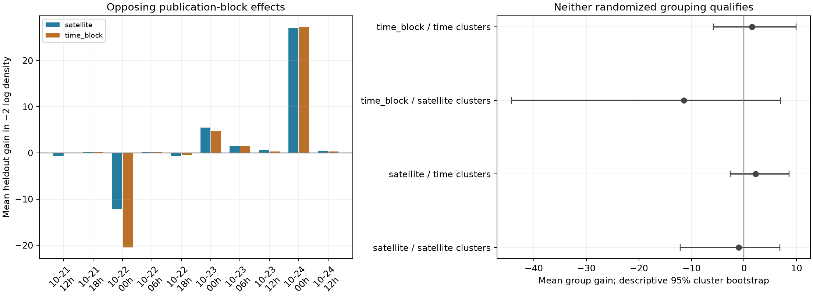
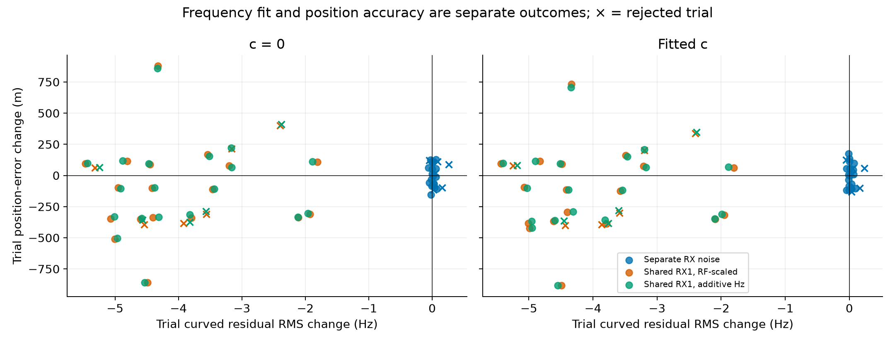

# DS24 receiver-noise, shared receiver and causal orbit controls

The RF-qualified shared RX1 correction modestly improves DS24 position error: fitted-c mean **1.220→1.120 km**, median **1.114→1.090 km**, and P95 **2.131→2.064 km** across all 24 usable scans, including six exact baseline fallbacks. It also causes a substantial regression on one scan, so it remains a candidate rather than a new ALGO release. Receiver-specific noise improves the median but leaves the mean essentially unchanged and worsens the tail. The causal phase/orbit correlation proposal fails grouped qualification and is not propagated to position.

This iteration tests three specific explanations from the [DS24 bottleneck investigation](../2026_10_24_ds24_bottlenecks/README.md): pooling unequal receiver noise, missing receiver-common frequency structure, and ignored correlation between satellite orbital timing and shape. Three SOL agents at xhigh developed or audited the receiver experiment, causal orbit forecast, and matched position evaluation. The coordinator implemented the receiver-specific noise control and geographic reporting.

The work uses the same 24 usable DS24 fast scans, all at 10 MS/s. Ten of the frozen 34 recordings still lack the required frozen inputs; their status is unchanged. This is a controlled model experiment on existing observations and associations, not a new acquisition, GLRT or full-catalogue rerun. It neither assumes a stationary receiver across scans nor combines different scans into a position estimate.

## What the comparison holds fixed

The reference is fresh **ALGO02-v1 + qualified causal signed phase prior + equal-assignment-prior family cavity**, called `baseline` in the earlier channel-half comparison. It is not the older historical `algo02` control or the later DS23-specific graph-recovery candidate bank.

Every candidate retains the same native observations, track membership, satellite labels, aliases, powers, causal catalogue and other priors except its declared intervention. The search starts at the center of the existing **25×25 km box, 37.906, −122.545**, with five phase-refresh rounds and at most 48 bounded position steps per round. Both **c=0 and fitted-c** are run with matched inputs and budgets. There is no added multistart, constrained rescue, scan-specific parameter tuning or satellite whitelist.

An RF-only qualification is frozen before a model's geographic evaluation. A qualifying trial replaces the saved reference only if the original gates pass in **both** c arms; otherwise the exact saved baseline pair is retained. Models are separate policies. There is no choice of the best model per scan using GPS, no hybrid of favorable cases, and no threshold relaxation after inspecting errors. Raw rejected trials remain in the tables.

The evaluation-only coordinate is **37.849061591561885, −122.48574968092912**. It appears in the reporting script, not the qualification or fitting harness. The geographic results describe this development cohort at one site; they do not establish accuracy at unseen locations. Random whole-family validation below also conditions on graph membership and labels previously selected from all RF data.

## Position outcomes

Each table entry is the **complete gated policy**, including exact reference fallbacks; all distances are km. The RF-scaled primary was chosen by RF prediction before inspecting geographic errors.

| Method | c arm | Mean | Median | P95 | Worst | Trial pairs retained |
|---|---|---:|---:|---:|---:|---:|
| Current baseline | 0 | 1.202 | 1.135 | 2.087 | 2.188 | — |
| Separate receiver noise | 0 | 1.200 | **1.039** | 2.121 | 2.188 | 18/24 |
| Shared RX1, RF-scaled | 0 | **1.112** | 1.079 | 1.889 | **2.089** | 18/24 |
| Shared RX1, additive Hz | 0 | 1.123 | 1.146 | **1.880** | **2.089** | 19/24 |
| Current baseline | fitted | 1.220 | 1.114 | 2.131 | 2.205 | — |
| Separate receiver noise | fitted | 1.218 | **1.013** | 2.175 | 2.205 | 18/24 |
| Shared RX1, RF-scaled | fitted | **1.120** | 1.090 | 2.064 | **2.141** | 18/24 |
| Shared RX1, additive Hz | fitted | 1.130 | 1.093 | **2.055** | **2.141** | 19/24 |

The RF-scaled policy improves fitted-c error on 11 scans, worsens seven and retains six unchanged. Its mean gain is **100 m (8.20%)**; the median gain is only **23 m**. The additive-Hz result is close and its c=0 median slightly worsens. Noise-only weighting has a **101 m median gain but just 1.8 m mean gain**, with a 45 m P95 regression. These distributions do not support combining the best row from each metric into a claimed new algorithm.

For transparency, raw trials before the paired gate/fallback rule have fitted-c mean/median/P95 **1.219/1.013/2.166 km** for receiver noise, **1.100/1.021/1.840 km** for the RF-scaled correction, and **1.105/1.027/1.859 km** for additive Hz. Those include invalid outputs and are not eligible production accuracy. Gates were not relaxed to obtain these numbers.

All position policies retain **78,067 of 108,600 GLRT points, 71.8849%**, comprising 66,110 curved calibration and 11,957 predictive points. Both c arms have identical membership. The count is the unique accepted position-likelihood union, not a new claim of verified satellite identities. This iteration changes how existing evidence is modeled; it adds no associations.

The distributions include every fallback. Crosses on zero in the paired-change plot indicate exact baseline retention, not a successful zero-change trial. [Complete positions](report/positions.csv), [summary statistics](report/summary.csv), and [adoption counts](report/adoption.csv) include both raw trials and gated policies.

## 1. Receiver-specific noise

The existing noise learner pools RX1 and RX2 despite the measured scatter difference. The prototype preserves its constant-or-margin variance law and 40–600 Hz sigma bounds, fitting separate receiver laws. It uses three randomized whole-family folds across all channels and receivers, with variance-law fitting and constant-versus-margin selection restricted to training groups; graph membership and polynomial degrees remain frozen. Held polynomial-residual contrast vectors are scored with their complete covariance and log determinant; leveraged residuals are not treated as independent held observations.

All **24/24** scans qualify; median total held-group density gain is **429.55**. The qualification requires total gain above 2 log 2 and at least two positive folds. The adapter clones the scan and gives curved and predictive observations the identical per-ID noise map, preserving original contracts and time-only whitening/gates. Its explicit positive selector field is not presented as a measured BIC statistic.

These are conditional graph-residual proxies, not external measurements of hardware noise. Polynomial selection, association grouping and unmodeled cross-piece correlation limit the inference. The original training variance/BIC procedure is heuristic, and transfer to predictive-only pieces is not independently validated; the held contrast covariance calculation itself is exact under its model. A better uncertainty model can change weighting without supplying the missing orbit/position information. [Full construction and tests](noise/FINDINGS.md), [independent review](orbit/NOISE_REVIEW.md).

## 2. Independently predicted receiver-common structure

The witness begins with alias-lifted CFO minus nominal causal-TLE Doppler at the fixed regional center, not incumbent fitted residuals or GPS. Random whole-family holds exclude every receiver/channel owner of each target satellite. Fixed design-only contrasts remove fragment-affine, family phase, physical orbit and local position-derivative directions. The remaining 60,468 contrast dimensions test the part of the shape that those nuisance directions cannot explain.

The original slow receiver covariance is trained on the other families. Two predeclared additions put 31 Gaussian coordinates on RX1 at 10-second spacing, 5-second width and fixed 50 Hz coefficient scale: one RF-scaled and one additive in Hz. Held families are scored jointly with the shared posterior covariance. Wrong-receiver training and a 75-second time shift provide negative controls.

| Held-family predictor | Total −2 log-density gain | Pooled mean-prediction contrast RMS |
|---|---:|---:|
| Existing slow receiver model | 0 | 70.910 Hz |
| RF-scaled RX1 addition | 2,383.30 | **70.090 Hz** |
| Additive-Hz RX1 addition | 2,376.71 | **70.082 Hz** |
| RF-scaled, wrong-RX training | 1,604.21 | 71.220 Hz |
| RF-scaled, time-shifted training | 341.32 | 72.565 Hz |

The native RF-scaled mean improves on **19/24 scans** and **326/553 family/scan blocks**. It predicts some shared discrepancy, but the pooled RMS gain is only **0.819 Hz**. Wrong-RX training obtains much of the density gain while worsening mean prediction: added uncertainty accounts for a substantial part of the score improvement. The full quadratic and log-volume terms are retained and published.

Both loadings pass the frozen global qualification and apply to the entire cohort, including the one scan with negative native density gain. RF scaling wins density by only **6.592 units**, so this does not identify oscillator, template, interference or other hardware physics. The RF-scaled model is the RF-only primary; additive Hz is a separate physical-loading control, not a GPS-selected replacement.

The witness is analytically c-invariant because the per-fragment constant c feature is projected out. Position propagation still runs both c arms. The fixed 75 Hz independent-noise reference, inherited RF selection and possible nonlinear physical-model remainder are limitations. [Full witness report](receiver/FINDINGS.md).

## 3. Causal phase/orbit correlations: rejected before position fitting

The historical forecast test uses only TLEs available before each source scan and before each forecast target. It deduplicates identical TLE-byte triples shared among scans. A predeclared random sample of 1,024 satellites supplies **6,476 triples** from 68,686 unique historical triples. No post-scan TLE enters the experiment.

Historical state differences are projected into the current engine's four physical coordinates: orbital timing, mean motion, inclination and RAAN, with Earth rotation and the correct phase-aligned basis. This replaces an incompatible legacy single-time coordinate approximation for the diagnostic. All projections have rank four; median unexplained state energy is 0.00988%. A separate check against the engine's interpolated states verifies basis agreement.

The single candidate shrinks the learned correlation halfway toward identity. Four randomized whole-satellite folds and four randomized six-hour publication-block folds each use past-only training and purge shared TLE endpoints. Both grouped qualification schemes fail despite favorable pooled density sums: gain varies too strongly across satellites and publication blocks. No position adapter is produced.

| Randomized holdout | Held rows | Pooled density gain | Satellite-cluster mean-gain 95% interval | Time-block mean-gain 95% interval |
|---|---:|---:|---:|---:|
| Whole satellite | 5,908 | 10,790.6 | [−12.10, +6.84] | [−2.60, +8.56] |
| Publication block | 5,139 | 4,859.3 | [−44.25, +6.99] | [−5.81, +9.92] |

The cluster intervals measure equally weighted mean group gain, not the pooled total. Both lower bounds must be positive under the declared rule. The forecast proxies are later historical TLEs, not authenticated orbit truth.

The measured correlations are also too weak to resolve the position ambiguity: the median phase/mean-motion correlation is about **0.054**. A nominal Gaussian-curvature diagnostic says even exact knowledge of all three shape coordinates would reduce phase standard deviation by only **0.16%**. This is not the exact Student conditional distribution, but it shows why the earlier phase-known information oracle is not achievable through these weak correlations.

Baseline phase-proxy central-95% coverage is only **87–89%** in the grouped forecasts. Arbitrarily narrowing the timing prior is therefore unsupported. Moreover, correlating a Student phase with Gaussian shape coefficients via a Cholesky transform preserves nominal covariance diagonals but changes physical marginal tail laws; it is not a drop-in covariance-only change. [Full negative result and causal audits](orbit/REPORT.md).

## Why better frequency fits need not improve position

The previous study measured strong position/orbital-timing ambiguity: the median largest weak-axis correlation with phase was 0.935. Additional channels often observe the same orbit-uncertain families in similar directions. CH1–8 did improve fitted-c mean error over CH1–4 and CH5–8, **1.220 versus 1.558 and 2.040 km**, but did not supply independent timing knowledge for every additional point.

Noise reweighting and receiver flexibility can improve predictive density or CFO residuals while leaving that ambiguity largely intact. The controls below compare frequency and geographic changes for every attempted fit. Rejected trials are marked explicitly; favorable residuals alone do not bypass physical/residual gates.

All **17 model/scan fallbacks** arise from original residual screens, not failure to finish phase refresh. No fallback exceeds the broad RMS/bias thresholds or fails alias/visibility checks. Most expose slope, step, quadratic or residual autocorrelation; one includes a support cascade after a member fails. The largest final phase change among fallback arms is 0.00151 s, below the unchanged 0.01 s criterion. More iterations would not address the recorded rejection reason.

Some failures are close to a threshold: RF-scaled 0101 has slope z=3.0028/3.0047 against 3; 0097 has predictive quadratic BIC gain 10.1988/10.3358 against 10; noise-only 0089 has step z=4.0121 against 4. Proximity does not establish a false positive. Profile and conditional checks can duplicate the same residual feature; they are not independent votes. [All criteria and magnitudes](evaluation/fallback_gate_failures.csv), [case-level classification](evaluation/fallback_gate_breakdown.json).

Two cases illustrate why the candidate needs more scrutiny:

| Scan | Fitted-c baseline error | RF-scaled policy error | Error change | Curved RMS change |
|---|---:|---:|---:|---:|
| 0017 | 2.071 km | 1.188 km | **−0.883 km** | −4.490 Hz |
| 0095 | 0.439 km | 1.173 km | **+0.734 km** | −4.334 Hz |
| 0089, previous worst full-channel scan | 2.205 km | 1.839 km | −0.366 km | −4.614 Hz |

These are descriptive examples, not a GPS-driven rule to enable or disable the correction. They do not prove a wrong identity or hardware fault. The same common-frequency flexibility can move the location along a weak physical direction while improving residuals in either case.

## Decision and next bounded experiment

Keep the current baseline as the released method and preserve the frozen RF-scaled RX1 model as the leading candidate. Do not tighten the orbital timing prior, promote noise-only weighting from its median alone, combine variants per scan, or tune the residual thresholds to rescue favorable GPS cases. The shared correction addresses part of the receiver discrepancy but does not solve the dominant phase/position ambiguity.

The most discriminating next steps are:

1. **Test whether receiver prediction constrains position, not only projected residual shape.** On the contrast between 0017 and 0095, inspect which shared receiver directions trade against location and family phase. Use whole-family omitted prediction at frozen candidate positions, retaining covariance and log-volume terms, and report whether independent curved families support the movement. The present witness deliberately projects out local position and orbit directions, so it cannot by itself validate the location-sensitive part of the correction. Do not select a new rule from the two GPS outcomes.
2. **Measure actual frequency-estimator improvement on existing IQ.** Run a small fixed-window, fixed-ID precision control with stronger coherent use of the waveform or an independently justified CFO refinement. Compare receiver-common discrepancy and held-family CFO prediction before a matched location fit. No new RF collection or sample-rate hardware change is warranted yet; the current experiment does not measure a sample-rate causal effect.
3. **Recover new geometric information, then validate on a broader frozen cohort.** Prefer additional well-supported curved families and independent orbital directions over more samples on the same phase-uncertain family. Carry the existing graph/native recovery controls forward with matched c arms. Before a new ALGO release, test the frozen receiver candidate on the wider DS23 cohort and additional locations when available, retaining failures and tails. The earlier DS23 100 Hz receiver and covariance experiments had mixed or worse median results; see [prior negative controls](evaluation/NEGATIVE_CONTROLS.md).

These are bounded next experiments, not claims of completed IQ reprocessing, new associations or cross-location validation. No static GPS correction or pooling of receiver positions across scans is proposed.

## Reproduction and verification

The raw experiment root is `/srv/bulk/leo/research/ds24-receiver-orbit-controls-20261025`; its suffix is UTC. This report uses the October 24 local research date. Original frozen inputs are the DS25/full analysis at `/srv/bulk/leo/research/ds25-20261024` and DS24 channel comparison at `/srv/bulk/leo/research/ds24-channel-halves-20261024`.

Qualification protocols, random-group assignments, input/source hashes, individual trials, baseline bindings and complete endpoint histories are preserved. The initial receiver position manifest was superseded during adapter finalization; hash validation rejected it **before any fits**, so no intermediate results were mixed into the final comparison. The two final manifests are separately bound.

Three candidate models × 24 scans × two c arms give **144 new position fits**. All finish; no case reaches the 240-second cap. Position work uses at most four concurrent workers and one BLAS/OMP/MKL thread each. Independent replay checks reconstruct objectives, residual RMS and decomposition at every endpoint, preserving predictive-to-calibration separation. The batch seal verifies identical baseline measurement bindings across all three models.

The source and tests are included alongside each sub-analysis. Use the existing `.venv/bin/python -B` with `/tmp/algo03-feasible-deps`, repository `src`, repository `tools`, and this report's `evaluation` directory on `PYTHONPATH`; set `OPENBLAS_NUM_THREADS=1 OMP_NUM_THREADS=1 MKL_NUM_THREADS=1`. RF qualification precedes `evaluation/run_cohort.py` with the relevant position manifest. Then run `evaluation/audit_endpoints.py`, `evaluation/seal_batch.py`, and finally `report_results.py` for geographic reporting. The sources retain absolute frozen input bindings intentionally; moving the input corpus requires an explicit path remap, not silent substitution.

Independent replay of all **144 arms** reproduces objective and RMS exactly; the maximum loss-decomposition reconstruction difference is **7.28e−12**. Gamma precision convergence is below 1e−5 and predictive observations never feed back into calibration. The two receiver adapters additionally pass **96 construction checks**, with maximum loading-unit discrepancy **1.42e−14 Hz**, zero extra RX2 loading and unchanged physical inputs. Nineteen numerical/component checks cover noise contrasts and grouping, receiver prediction/negative controls, orbit basis/validation, harness contracts and fallback classification. Independent geographic recomputation checks all 336 report rows and 14 summary rows against raw endpoints.

The reused `reporting_counts.py` handles both `predictive_points` and legacy `additional_predictive_points`, rejects conflicting counts, and uses the prior audited native-ID count for genuinely absent legacy fields. `likelihood_count_audit.csv` is preserved from the previous investigation. A reporting assertion caught the legacy schema before any table was emitted; inference and saved results were untouched.

Small reports, protocols, tables, figures and sources remain directly browsable. The publisher's `archive_manifest.json`, `source_manifest.json`, `input_manifest.json` and `audit.json` bind those files and the `raw_results.tar.gz` containing individual fits and larger forecast diagnostics. Extracting the archive restores the original relative evidence layout. Original input corpora are referenced by hashes rather than republished as raw IQ. No production component, scientific golden, recording or QNAP path was changed.
