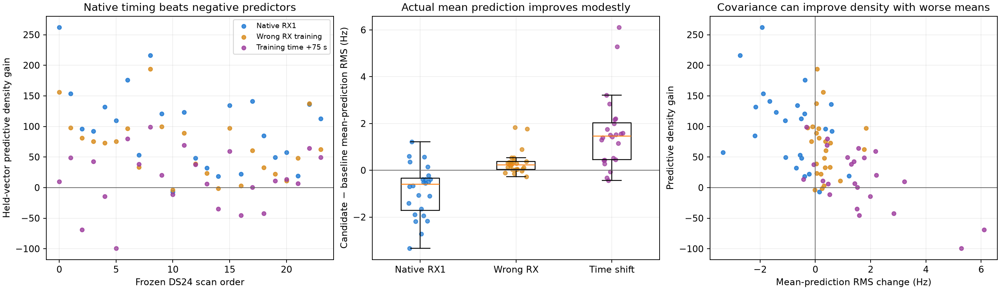

# DS24 independent-family receiver witness

The frozen RX1 addition predicts a small part of the shape of held-out families. Its pooled mean-prediction contrast RMS improves from **70.910 to 70.090 Hz**, with improvement on **19/24 scans** and **326/553 family/scan blocks**. This supports a predictable shared discrepancy, but not a claim that hardware accounts for the whole localization error.

The negative controls are consequential: training the extra component on the wrong receiver or at shifted times still improves predictive density, despite making the predictive means worse. Added uncertainty therefore explains a substantial fraction of the density gain. The experiment does not equate all density improvement with a learned receiver signal, better CFO accuracy, or better localization.

## Frozen experiment

All 24 existing common usable DS24 scans remain in the denominator. They contain 66,110 active curved observations and 553 eligible family/scan blocks. Three random folds use seed **20261025 + numeric scan suffix**, assigning every fragment, channel, and receiver owner of a family to one fold. Every family is a target once; there are 72 fold predictions.

The target starts with the original alias-lifted CFO minus nominal causal-TLE Doppler at the existing regional search center, with zero fitted phase reference. No incumbent fitted position, conditional residual, nuisance coefficient, Gamma precision, GPS coordinate, new IQ fit, or RF collection enters the witness.

Design-only orthogonal contrasts discard each fragment's affine component plus family-shared phase, three physical orbit modes, and the two local position-derivative directions. These are fixed physical/timestamp designs, not arbitrary higher-degree track polynomials. No target nuisance coefficient is learned. However, those target directions are deliberately discarded: this predicts only the remaining identifiable shape, not the full native CFO vector or the absolute target affine/orbital correction. There are 60,468 retained contrast dimensions.

The baseline refits the existing 200 Hz slow receiver covariance using training families only. Two predeclared additions put a zero-mean Gaussian process on RX1, shared across bands, at 10-second centers and 5-second widths. Each coefficient has a fixed 50 Hz scale at 11.5 GHz. One loading is additive Hz; the other scales by RF/11.5 GHz. Constant/linear parts are removed on the fixed 0–300 second reference grid. Independent noise is a fixed **75 Hz engineering reference**, not learned from held targets or asserted to be calibrated. The parent separately tests receiver-stratified radio noise.

All held family contrasts in a fold are scored jointly with their shared posterior covariance. They are not treated as independent frequency votes. The low-rank predictive density matches a dense Gaussian calculation in an independent numerical test.

Two negative predictors preserve native target times/loadings while changing only extra-component training: use RX2 instead of RX1, or shift training time by +75 seconds modulo 300. The existing slow baseline remains trained normally. These are diagnostic predictors, not alternative physical receiver models for final position fitting.

## Frequency prediction results

Positive density gain means lower complete-vector negative-twice log predictive density.

| Frozen RX1 loading / predictor | Total density gain | Pooled mean-prediction contrast RMS | Scans with better mean RMS |
|---|---:|---:|---:|
| Existing slow baseline | 0 | 70.910 Hz | — |
| RF-scaled, native training | 2,383.30 | 70.090 Hz | 19/24 |
| RF-scaled, wrong-RX training | 1,604.21 | 71.220 Hz | 4/24 |
| RF-scaled, shifted training | 341.32 | 72.565 Hz | 3/24 |
| Additive Hz, native training | 2,376.71 | 70.082 Hz | 19/24 |

RF-scaled native prediction has positive density gain on 23/24 scans, with median 102.73 units per scan. Its median mean-RMS change is **−0.602 Hz**; the mean of scan RMS changes is −0.870 Hz. The one negative density case, DS24-0075, remains included: −7.002 units. Across individual held families, only 326/553 mean predictions improve; the result is not universal.

The RF-scaled native predictor beats wrong-RX and shifted predictors by 779.09 and 2,041.98 density units. Its mean prediction improves, whereas both controls' pooled means worsen. There is evidence beyond simply increasing variance. Nevertheless, wrong-RX training achieves about two thirds of native density gain without improving the pooled mean. Reporting all 2,383 units as receiver signal would be incorrect.

For the RF-scaled model, the baseline/native/wrong-RX/shifted total quadratic terms are 53,116.51 / 50,195.56 / 50,911.34 / 52,290.04; corresponding predictive log-volume terms are 212.03 / 749.68 / 812.99 / 697.18. The covariance and complexity contributions remain in every score.

## What is qualified for position propagation

The predeclared rule required total native gain above 2 log 2, positive median case gain, at least 13/24 positive cases, and a native advantage above 2 log 3 over each negative predictor. Both loadings qualify. RF-scaled has the smaller aggregate predictive loss by only **6.592 units**, so it is the RF-only primary; additive Hz remains a separately frozen physical-loading control. The small loading difference does not establish the physical source of the discrepancy.

The paired position adapters retain all original measurements, labels, aliases, masks, priors, bounds, powers, and predictive entries. They add 31 active RX1 receiver coordinates; 31 corresponding RX2 columns remain zero. The same addition applies to both c controls. The witness itself is analytically c-invariant because the fitted-c feature is constant within a fragment and is annihilated by the affine contrast: maximum relative projected c norm is 1.13e-15. Position propagation must still refit and report both arms separately.

Both models apply to the entire frozen cohort, including DS24-0075. There is no per-scan GPS or geographically favorable model choice. Parent-owned propagation accepts an RF-qualified model only when the original gates pass in both c arms; otherwise it retains the exact baseline pair. This report contains no position-accuracy comparison. A better held-family frequency score alone does not establish better localization.

Ready protocols: [RF-scaled primary](position_protocol_rf.json), [additive-Hz control](position_protocol_hz.json). Their adapters and all scientific bindings were SHA256-verified before handoff. A real DS24-0010 audit verifies both arms preserve physical factors and leave the original scan unchanged. Seven numerical tests pass, including dense predictive parity, nuisance invariance, joint target covariance, shared-signal recovery, wrong-RX isolation, a white-noise null, and adapter cloning/scaling.

## Relationship to prior work and limits

The earlier DS23 receiver study already tested a 100 Hz RX1 process with the same 10-second/5-second temporal design. It selected three large cross-receiver families, held one receiver side, retained the opposite side of the same family in training, and used full-data noise proxies. That conditional prediction qualified 12/20 scans, but fitted-c median position error worsened from 0.896 to 0.974 km; scan 321 qualified while c0 error worsened from 0.270 to 0.910 km. Those negative localization controls remain relevant. See repository report `reports/2026_10_19_ds23_dense_receiver_prediction/README.md`.

This witness differs by random whole-family holds across all owners and training-only common-calibration fits, starting with raw CFO/nominal geometry rather than incumbent conditional residuals. It still conditions on labels, aliases, and masks selected previously using all RF data. It is therefore conditional omitted-family evidence, not untouched identification/generalization validation. Existing selection can contribute correlation artifacts. The projected physical tangent model can also leave nonlinear orbit/site/model discrepancies, and the fixed 75 Hz noise reference is imperfect. Receiver-common estimator/template effects, interference, shared clocks, and physical receiver drift remain possible sources; this test does not identify one uniquely.

The observed mean gain is under 1 Hz. It supports bounded propagation of the frozen covariance model and separate accuracy measurement, not a claim that the receiver bottleneck is solved. No core repository files, scientific goldens, raw IQ, or recording paths were changed.

Detailed evidence: [frozen protocol](protocol.json), [RF-only selection](selection.json), [summary](summary.json), [fold scores](fold_scores.csv), and [family scores](family_scores.csv). The original statistical protocol was preserved. A validation-only assertion initially used unnormalized nuisance units and stopped before any case completed; the column normalization fix and unchanged scientific specification are recorded in [implementation_amendment.json](implementation_amendment.json).
