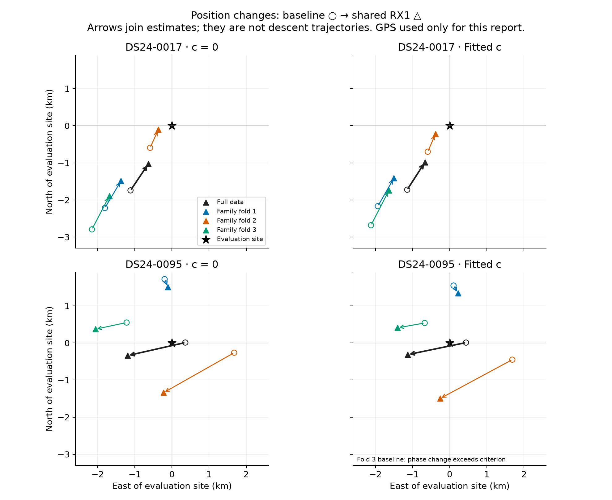
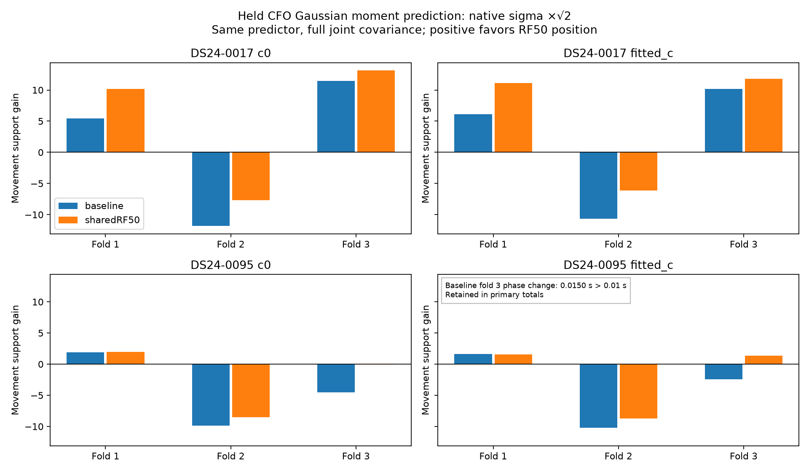
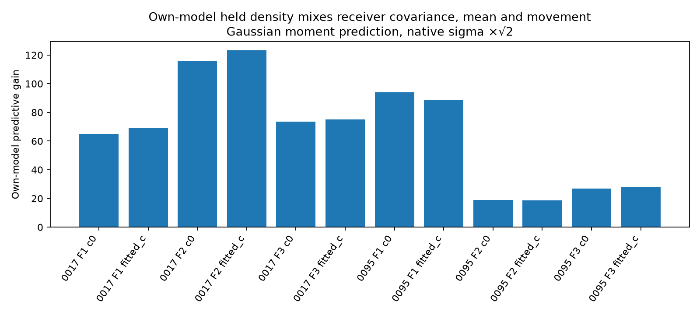
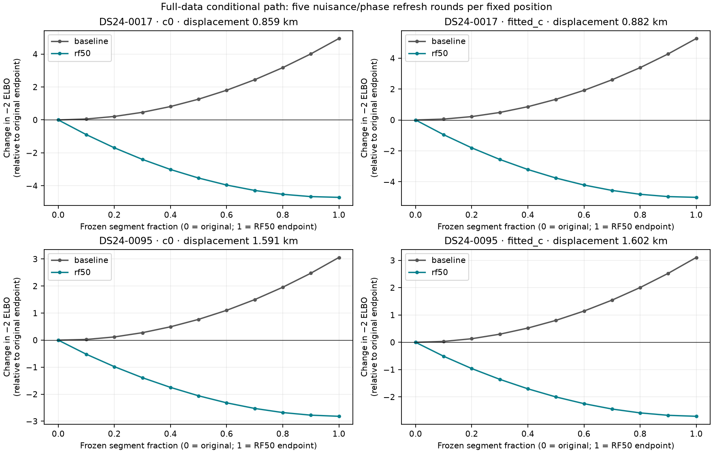
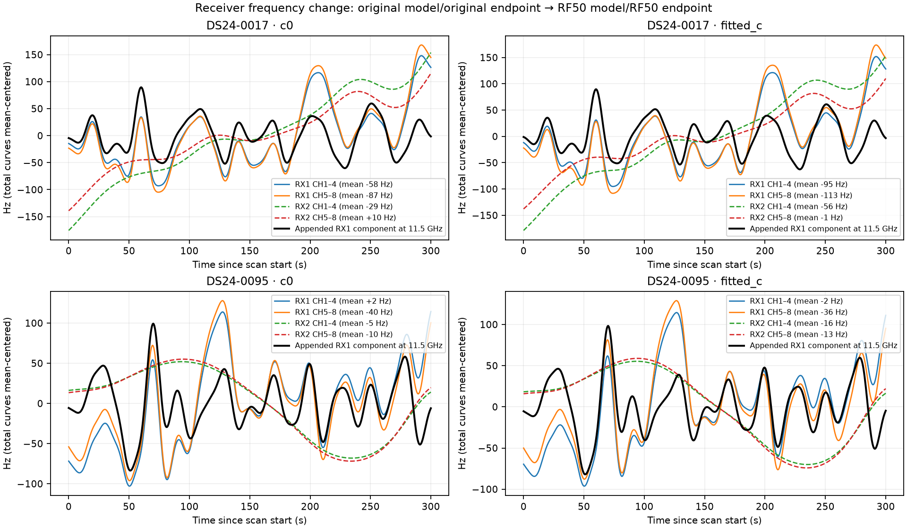
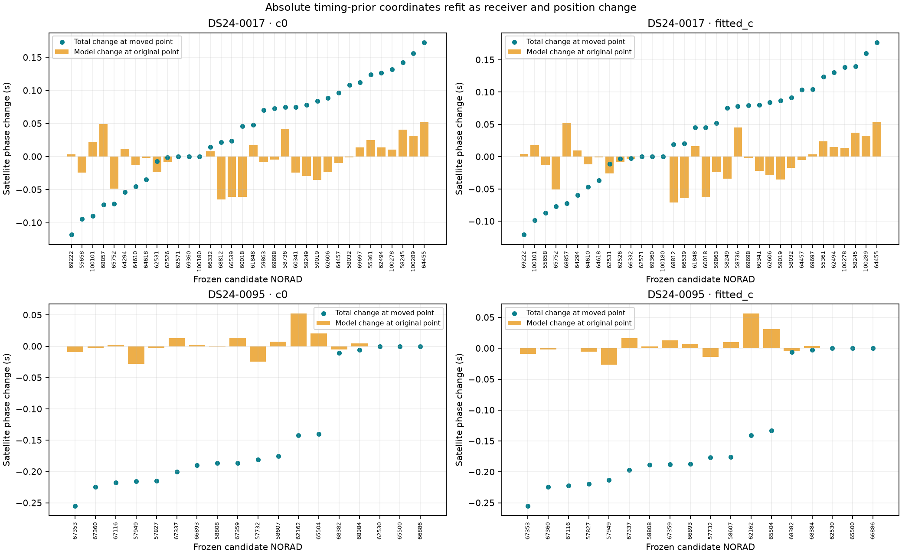
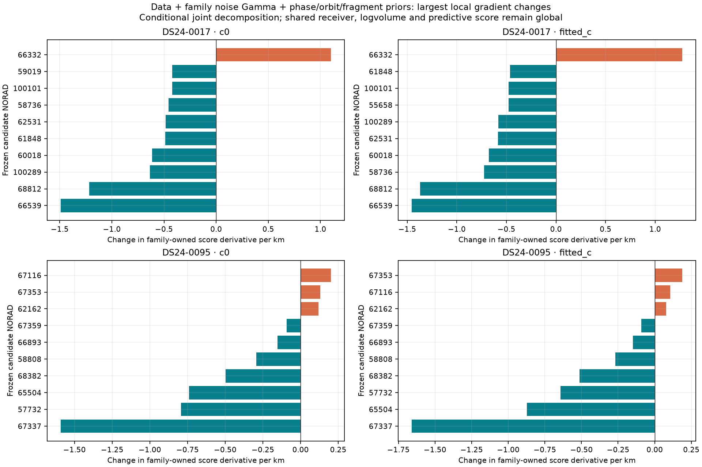

# DS24: when a shared receiver correction justifies moving the position

The new whole-family test separates the two opposing cases. Omitted satellite families collectively support the receiver-induced position movement in **0017**, but oppose it in **0095**. This holds under both predictor models, both c settings and all three predeclared held-noise scales. Individual folds disagree, so this is evidence for a movement-validation test, not proof that every family agrees or that a new production policy is validated.

The distinction matters: the shared RX1 model improves its overall held-data predictive score in **both** scans. That gain includes changed receiver prediction and uncertainty as well as position. It cannot, by itself, justify the location movement. The larger 0095 shift follows a weaker position/orbital-phase direction and provides only a small extra objective improvement once the receiver model has been added.

Three SOL agents at xhigh implemented the independent-family study, decomposed the physical/nuisance tradeoffs and audited the results. This iteration adds **24 train-only position fits**, **48 joint held predictive vectors**, and **88 fixed-position profile evaluations**. It uses existing data and the previously frozen receiver correction; it changes no satellite identity, track membership, prior width or GLRT association policy.

## Starting point and scope

The [previous 24-case DS24 study](../2026_10_24_ds24_receiver_orbit_controls/README.md) found a fitted-c mean improvement from 1.220 to 1.120 km with the RF-qualified shared RX1 correction, alongside a substantial regression on 0095. These two scans were deliberately selected after observing opposite geographic effects. They are diagnostic examples, not a fresh unbiased accuracy sample.

The baseline remains ALGO02-v1 plus qualified causal signed phase priors and equal-assignment-prior family cavity. The candidate adds the same 31 RX1 Gaussian receiver coefficients: 10-second spacing, 5-second width, 50 Hz coefficient scale, loading proportional to RF/11.5 GHz. Original receiver offsets/drifts/slow terms and satellite phase/orbit/fragment priors remain present.

| Scan | c=0 error, baseline → shared RX1 | Fitted-c error, baseline → shared RX1 | Fitted-c position displacement |
|---|---:|---:|---:|
| 0017 | 2.071 → 1.211 km | **2.071 → 1.188 km** | 0.882 km |
| 0095 | 0.360 → 1.239 km | **0.439 → 1.173 km** | 1.602 km |

These are unchanged full-data endpoints from the previous experiment. The new fits below omit families for diagnostic prediction; they are not replacements for the full-data estimates. Geographic truth **37.849061591561885, −122.48574968092912** is used only in this reporting layer. Every new fit starts at the original 25×25 km regional box center **37.906, −122.545**, never the evaluation site.

| Evidence | 0017 | 0095 |
|---|---:|---:|
| Curved calibration points | 2,881 | 2,262 |
| Predictive position-only points | 888 | 0 |
| Curved satellite families | 31 | 15 |
| Curved families spanning both receivers | 6 | 6 |
| Curved families spanning both bands | 14 | 8 |

The point union is unique and curved/predictive roles are disjoint. More families do not automatically mean more independent position information; the geometry diagnostics quantify that distinction. [Native-ID inventory](inventory.json).

Circles are baseline estimates and triangles are shared-RX1 estimates. Arrows join endpoint pairs; they are not optimizer trajectories. Colored pairs each use a different training-family subset. The larger variation in 0095 shows sensitivity to which evidence remains, not a receiver movement between measurements. [All 32 evaluated endpoints](report/position_errors.csv).

## A test that retains position-sensitive information

The previous receiver witness deliberately projected out position and orbital directions. It established predictable residual shape but could not establish that a resulting position shift was supported. The new experiment retains the entire held CFO vector.

For each scan, seed **2026102503 + scan suffix** randomly assigns whole satellite families to three folds. Every curved/predictive fragment and both receiver/channel owners of a family stay together. Each training problem removes all held-family factors from position fitting, calibration and Gamma updates. Training-family predictive points can still affect position, following the original algorithm, but cannot update curved calibration. Frozen graph rows remain solely to preserve the coordinate and physical-mode layout.

Each fold runs baseline and shared RX1 from the cold regional center in both c arms, with five phase-refresh rounds and up to 48 position steps per round. The candidate models, raw observations, aliases, causal prior inputs, masks and budgets remain matched within each comparison. No target CFO is used to fit its own phase, offset, orbit correction or noise scale.

At each training-only endpoint, the held vector is predicted with the training nuisance posterior plus the untouched held-family phase/orbit/fragment prior uncertainty. Shared covariance across all held families and points is retained, along with both residual quadratic and log determinant. Held phases are linearized at their causal prior means, not at their full-data fitted phases.

The primary reference is a **Gaussian moment approximation**, using original per-ID sigma ×√2 for the unseen Gamma(2,2) noise inverse-precision moment. Held Student phase variance is restored to its unit marginal variance, rather than using its untouched variational mean precision. Native-sigma multipliers ×1 and ×2 are predeclared sensitivities. This is not the exact original Student/Gamma predictive distribution, nor a fully untouched holdout: graph membership, labels, aliases, powers, noise maps and mode support are inherited from earlier all-RF processing. Training position is a plug-in estimate; its uncertainty is not integrated.

## Separate model improvement from support for movement

Each held predictor is evaluated at **both** training-only endpoints. Nuisance terms are refreshed using training evidence at each fixed position. Define movement support as:

`held loss at baseline endpoint − held loss at shared-RX1 endpoint`

Positive values support moving to the shared-RX1 endpoint. The predictor model is the same on both sides. This controls for adding receiver-model flexibility, although covariance can still vary with physical position. The following values sum the three fold-wise conditional scores; they are not calibrated significance levels.

| Scan | c arm | Movement support under baseline predictor | Movement support under RX1 predictor |
|---|---|---:|---:|
| 0017 | 0 | **+5.035** | **+15.629** |
| 0017 | fitted | **+5.636** | **+16.724** |
| 0095 | 0 | **−12.541** | **−6.625** |
| 0095 | fitted | **−11.031** | **−5.807** |

The signs persist for all predeclared noise multipliers. For fitted c, 0017 ranges from +5.394 to +5.829 under the baseline predictor and +12.572 to +21.882 under the shared predictor. 0095 ranges from −14.014 to −8.871 and −6.932 to −5.098 respectively. The same-predictor changes are predominantly residual-quadratic effects; log-determinant changes are small, about +0.010/+0.042 units for 0017 and −0.017/−0.013 for 0095 at the primary scale.

Folds disagree: 0017 has one opposing fold under either predictor. For 0095 fitted c, two folds weakly favor movement under the shared predictor, but the opposing fold is stronger and the total is negative. These are three disjoint held-family groups with overlapping training sets, not three independent experiments. Family marginal scores are nonadditive and are not substituted for the joint covariance score.

By contrast, comparing each model at its own endpoint gives fitted-c held-score gains of **267.279** on 0017 and **135.298** on 0095. Both favor adding the receiver model. The comparison combines changes in predicted mean, covariance and position; calling it location validation or a covariance-only gain would be incorrect.

One bounded training fit, 0095 fold 3 fitted-c baseline, finishes with a phase-reference change of **0.01502 s**, above the original 0.01 s criterion. It remains in the primary results. All fixed-position crossover refreshes converge below 0.000396 s. A separately labeled sensitivity removes that entire fold symmetrically for both c arms, predictors and all noise scales; 0095 still opposes movement throughout. There was no extra optimization, gate relaxation or removal based on GPS. [Full construction, sensitivities and tests](heldout/FINDINGS.md).

## Why 0095 can move so far for so little gain

We evaluate both models at 11 common positions on the straight segment between their original full-data endpoints. At each fixed position, nuisance coefficients and phase are refreshed five times. This is a one-dimensional conditional loss profile, not a two-dimensional loss-surface search or an optimizer trajectory.

| Fitted-c model and scan | Loss at baseline endpoint | Loss at RX1 endpoint | Change from movement |
|---|---:|---:|---:|
| 0017 baseline | 32,775.521 | 32,780.795 | +5.274 |
| 0017 shared RX1 | 32,593.113 | 32,588.104 | −5.009 |
| 0095 baseline | 20,472.323 | 20,475.429 | +3.106 |
| 0095 shared RX1 | 20,281.795 | 20,279.087 | −2.709 |

Most of the receiver-model gain is already available at the original position. On 0095, adding the receiver model there improves normalized objective by about **190.53**, while moving 1.60 km buys only another **2.71**. These are normalized variational objectives on identical observations, not calibrated probability ratios or position-error estimates.

Local nuisance-projected information also distinguishes the cases. The following matched diagnostics use the shared-RX1 model at its own full-data endpoint, holding fitted Gamma precisions fixed. The extra-mode fraction compares freeing versus fixing only the appended RX1 coordinates at that same model state; it is not a raw before/after accuracy comparison.

| Fitted-c local diagnostic | 0017 | 0095 |
|---|---:|---:|
| Curved-only weak-axis scale | 0.493 km | **1.042 km** |
| Angle between displacement and weak axis | 31.9° | **18.0°** |
| Maximum displacement/phase correlation | 0.918 | **0.968** |
| Directional information removed by extra RX1 modes | 3.29% | **18.31%** |

These scales are conditional information sensitivities, not calibrated confidence intervals. They omit uncertainty in labels, Gamma precisions and broader model misspecification. The numbers support a specific mechanism: the receiver addition relaxes more of an already weak position/phase direction in 0095. They do not prove the original position was physically correct or identify a hardware fault.

## Receiver and family terms move together

Although only RX1 receives extra fast coordinates, refitting can change old RX2 terms and satellite phases too. The curve figure separates the newly added RX1 component from total receiver correction changes. The extra RX2 component is exactly zero. The largest family phase changes between full-data endpoints are approximately **0.177 s** on 0017 and **0.255 s** on 0095.

The phase plot retains the complete frozen candidate-coordinate layout, including inactive coordinates with zero change. The evidence-count table counts only families with retained likelihood observations.

The score decomposition does not isolate one obviously incorrect satellite. At the original endpoint in fitted c, the shared model's derivative along the eventual movement is about −11.386 units/km on 0017 and −3.327 on 0095. Family-owned terms contribute −8.743 and −3.740; shared/global terms contribute −2.643 and +0.412. The latter include common receiver priors, log volume and predictive covariance. We do not assign them to individual satellites.

For 0095, the largest changes in family-owned directional derivatives relative to baseline come from **67337, 65504, 57732 and 68382**. These terms include each family's data, noise-Gamma, phase, orbit and fragment prior costs. Weighted residual data alone can even give a different sign, so a residual-only family ranking would be misleading.

There is a useful consistency check in the held-family folds. Omitting 67337, 57732 and 68382 together leaves a fitted-c shift of only **0.237 km** on 0095. A different fold retains those drivers and shifts **2.207 km**, while its held families oppose the shift. This is group influence evidence, not a controlled one-family ablation and not proof those satellites are wrongly associated. The labels were never changed.

The detailed [geometry report](geometry/README.md) includes both c arms, all objective terms, per-family/receiver/time contributions, curve units and derivative closure. Additional views show the [movement loss decomposition](geometry/movement_loss_decomposition.png), [data-only family derivatives](geometry/family_gradient_changes.png), and [receiver/band/time derivatives](geometry/time_receiver_band_gradient.png).

## Recommendation

Require separate evidence for **the receiver model** and **the position movement**. The existing projected residual-shape witness can qualify a common frequency component. A position-sensitive whole-family crossover can then test whether the proposed move helps evidence that did not determine the training position.

The concrete next candidate is a conservative RF-only movement gate: keep the frozen receiver model and original paired physical/residual gates, then require reproducible positive omitted-family movement support under both predictor models and matched c arms before replacing the baseline position. The numerical acceptance rule and handling of convergence failures must be frozen before broader evaluation. This two-case study motivates that rule; it does not independently validate a threshold, justify selecting favorable scans, or establish its population error distribution.

A broader test should retain all cases and failures, compare against both existing baseline and ungated receiver policies, and report association coverage, frequency scores, mean/median/tail position error separately. The held prediction currently uses Gaussian moment approximations and inherited all-data noise/graph inputs; transfer to fully training-only noise estimation and better heavy-tail prediction remains a necessary robustness question. Do not replace the test with a GPS-trained family blacklist, a tighter phase prior, an arbitrary limit on position movement or a receiver-mode orthogonality constraint without independent physical justification.

No new ALGO is promoted. The released baseline and full-data estimates remain unchanged. There is no new dataset-wide accuracy claim and no additional GLRT recovery in this iteration.

## Audit, artifacts and reproduction

All 24 bounded train-only fits complete without runtime failures; the phase-convergence exception above remains explicit. Six case/fold jobs take at most 28.79 seconds each with two workers and single-threaded BLAS. The 48 crossover vectors produce 144 predeclared noise-scale scores. An independent observation-space SVD recomputes every joint Gaussian score with maximum difference **7.46e−11**. It verifies exact whole-family native-ID removal, held phase references, native sigma maps, zero held/trained local-coordinate covariance and source/input seals.

All **88** fixed-path points converge; eight original full-data objectives replay exactly. Maximum objective decomposition discrepancy is **1.46e−11**; the additional family-owned derivative reconstruction closes within **9.29e−10**. Ten component-owned numerical tests cover Gaussian covariance algebra, held-target redaction, family partitioning, score decomposition and geometry. The redaction test changes held CFO by 12,345 Hz and verifies unchanged training calculations plus one identical eight-step optimization trajectory; it is not claimed to rerun all 24 trajectories.

The independent auditor additionally reconstructs 156 held-report rows/1,104 numeric cells and checks the geographic reporting separately. [Audit findings](audit/FINDINGS.md), [raw artifact audit](audit/artifact_audit.json), [held table audit](audit/heldout_table_audit.json), [study protocol](protocol.json), and [inventory source](inventory.py) are included. The small parent reporting script runs only after the scientific result seal and records GPS separately.

Raw experiment root: `/srv/bulk/leo/research/ds24-receiver-shift-witness-20261025`. The UTC directory date is October 25; the report follows the October 24 local research date. Use the existing repository `.venv/bin/python -B`, `PYTHONPATH=/tmp/algo03-feasible-deps:src:tools` plus the previous study's `evaluation` and `receiver` directories, and set BLAS/OMP/MKL threads to one. The sources retain explicit frozen corpus paths and hashes. Do not run `freeze.py` over an existing result batch; version any new experiment separately.

All reports, figures, small tables, protocols and source files are published directly. Larger fit records and joint predictive arrays are preserved in the case archives `raw_results_DS24-0017.tar.gz` and `raw_results_DS24-0095.tar.gz`, restoring their original relative paths on extraction. Each archive stays below 50 MB. Publication manifests bind source/input hashes and archive contents. No RF collection, IQ reprocessing, QNAP mutation, production-component edit or scientific-golden change occurred.
