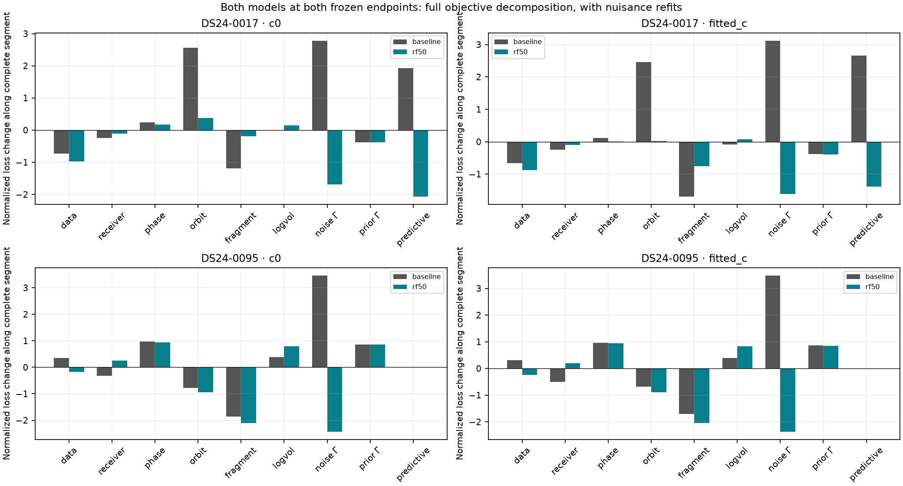
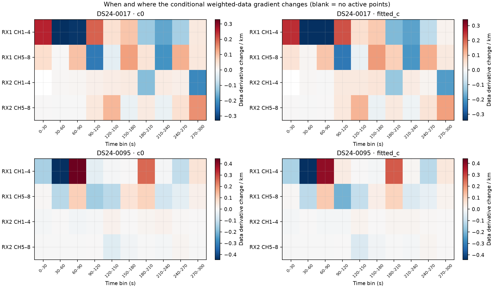

# Why the same RX1 correction moves 0017 and 0095 differently

The frozen RF50 model changes the preferred position in both scans, but the larger movement in **0095 follows a substantially weaker position/timing direction**. The fitted-c movement is **0.882 km in 0017** and **1.602 km in 0095**. The normalized RF50 loss gained by moving between the two frozen endpoints is only **5.009** and **2.709**, respectively. Most of the much larger cross-model score gain is already available at the original position.

These are **full-data conditional mechanism diagnostics**. Both endpoints, memberships and satellite labels were previously selected using the full RF data. No GPS coordinate is read here, no position is optimized, and these results are not heldout prediction or independent localization validation. The separate whole-family prediction experiment is outside this directory.

## Frozen experiment

The code calls the prior experiment's `load_baseline` helper without alteration, retains the RF-selected `fast_rx1_rf50` adapter, and reads its stored trial endpoints. Observations, labels, aliases, native-ID masks, powers, predictive membership, physical priors, and bounds remain fixed. The correction adds the existing 31 RX1 coordinates with 10-second spacing, 5-second width and 50 Hz coefficient scale; no width/scale search is performed.

Each case and c arm is evaluated under both models at eleven positions
`x(alpha) = original_endpoint + alpha * (RF50_endpoint - original_endpoint)`,
with `alpha = 0, 0.1, ..., 1`. Every model/position starts its phase reference at zero and receives exactly five nuisance/phase refresh rounds. There is no position fit along this path. The 88 conditional path evaluations therefore require 440 nuisance/phase solves, sequentially with BLAS/OMP/MKL fixed at one thread.

The implemented normalized objective is preserved in full: weighted-data quadratic, all nuisance-prior quadratics, shared log-volume, noise/prior Gamma costs, normalization constants, and the full shared predictive score. The fixed likelihood powers make it generalized evidence, rather than an ordinary normalized sampling likelihood. RMS is recorded separately and does not replace this objective.

0017 has 2,881 curved and 888 predictive points from 31 active curved families; 0095 has 2,262 curved points from 15 active families and no predictive points. Counts are descriptive support differences, not a count of independent position constraints.

## Both models at both frozen endpoints

All cells below are freshly phase-refreshed normalized **−2 ELBO**; lower is better. Each row uses the same two locations for both models.

| Case | c arm | Baseline at original | Baseline at RF50 endpoint | RF50 at original | RF50 at RF50 endpoint |
|---|---|---:|---:|---:|---:|
| 0017 | 0 | 32776.841311 | 32781.788356 | 32601.007047 | 32596.300159 |
| 0017 | fitted | 32775.520652 | 32780.795107 | 32593.113031 | 32588.103722 |
| 0095 | 0 | 20480.042722 | 20483.100875 | 20286.063557 | 20283.245950 |
| 0095 | fitted | 20472.323105 | 20475.428779 | 20281.795443 | 20279.086538 |

For fitted-c, changing the model at the original location improves the loss by **182.408** in 0017 and **190.528** in 0095. Subsequent movement adds only 5.009 and 2.709. The baseline model penalizes that same movement by 5.274 and 3.106. The c=0 results have the same direction: RF50 movement gains 4.707 and 2.818 while baseline penalties are 4.947 and 3.058. The effect therefore survives the controlled c ablation.

The decomposition separates receiver-frequency accommodation from location-sensitive improvement:

| Fitted-c loss term | 0017 model change at original | 0017 movement under RF50 | 0095 model change at original | 0095 movement under RF50 |
|---|---:|---:|---:|---:|
| Weighted data | −31.782 | −0.872 | −39.518 | −0.239 |
| Noise Gamma | −162.930 | −1.610 | −219.935 | −2.365 |
| Log-volume | +49.440 | +0.075 | +52.376 | +0.826 |
| Appended RX1 prior | +17.481 | +0.554 | +20.110 | +0.701 |
| Slow receiver prior | −1.244 | −0.749 | −3.723 | −0.462 |
| Physical orbit prior | −9.009 | +0.022 | +0.400 | −0.892 |
| Phase prior | +0.021 | +0.003 | −0.004 | +0.948 |
| Fragment prior | −4.903 | −0.760 | −0.327 | −2.041 |
| Prior Gamma | −0.051 | −0.388 | +0.067 | +0.854 |
| Shared predictive score | −38.937 | −1.380 | 0 | 0 |

Offset, drift and c prior terms complete each total in [cross_evaluation.csv](cross_evaluation.csv) and [movement_loss_terms.csv](movement_loss_terms.csv). In particular, the fitted-c movement in 0095 reduces orbit/fragment and noise-Gamma costs while increasing phase and prior-Gamma costs. The apparently similar residual improvement is not the same physical tradeoff in the two cases.

## Receiver curves and satellite timing

The appended RX1 function at the RF50 endpoint has reference-frequency (11.5 GHz) RMS about **33.4 Hz in 0017** and **32.5 Hz in 0095**, with maximum absolute values about **89.7 and 98.3 Hz**. Its coefficient prior scale is not a bound on the resulting summed function.

The total fitted radio correction changes more broadly because offset, drift, the original slow receiver coordinates and c also refit. At each scan's low-band median RF, the fitted-c mean-centered total change has RMS **58.6 Hz on RX1 / 80.8 Hz on RX2** in 0017 and **51.0 / 42.0 Hz** in 0095. Every appended RX2 loading remains exactly zero; its nonzero total change comes from refitting existing nuisance coordinates. The figure mean-centers total radio differences for shape visibility and states their removed means in the legend. The black appended RX1 curve is shown directly at 11.5 GHz.

The maximum absolute family-phase change between each model's own frozen endpoint is **0.177 s in 0017** and **0.255 s in 0095** in fitted-c; across all frozen label coordinates their RMS changes are 0.087 and 0.167 s. The largest changes are mostly induced by movement rather than the receiver-model change at the original position. For example, 0095 candidate 67360 changes by −0.2244 s in total, of which −0.2226 s occurs on the RF50 position segment; its local displacement/phase correlation is −0.968. In 0017 the largest phase change is +0.1770 s for candidate 64455, of which +0.1239 s occurs on the segment. Candidate numbers are frozen labels, not newly verified identities.

## Which families and time bands change the gradient

At the original fitted-c position, the full RF50 directional derivative toward its frozen endpoint is **−11.386 loss units/km in 0017** and **−3.327 in 0095**. Baseline derivatives there are approximately zero. These are central finite differences with the center's phase linearization held fixed and all nuisance/Gamma posteriors refit for each evaluation. They are local conditional derivatives, distinct from the five-round-refreshed path above.

Weighted-data derivatives alone do not explain these values. We also reconstruct and attribute each family's own noise-Gamma cost, phase-prior/Gamma, physical-orbit-prior and fragment-prior terms. The shared receiver priors, covariance/log-volume, normalization, and joint predictive score remain global. The decomposition closes numerically and does not convert correlated families into independent votes.

| At original fitted-c position | 0017 baseline | 0017 RF50 | 0095 baseline | 0095 RF50 |
|---|---:|---:|---:|---:|
| Sum of family-owned derivatives / km | −1.408 | −8.743 | +0.176 | −3.740 |
| Shared global derivatives / km | +1.408 | −2.643 | −0.176 | +0.412 |
| Full normalized derivative / km | ≈0 | −11.386 | ≈0 | −3.327 |

In 0017 the global movement support includes **−2.504/km** from the shared predictive term. In 0095 there is no predictive term; **+0.583/km** of log-volume offsets part of the family-owned support. This support structure is materially different even before comparing any geographic outcome.

The largest fitted-c changes in family-owned directional derivative, relative to the baseline model at the original location, are:

| Case | Toward movement: candidate and derivative change / km | Against movement |
|---|---|---|
| 0017 | 66539 −1.454; 68812 −1.371; 58736 −0.725; 60018 −0.678; 62531 −0.584 | 66332 +1.272 |
| 0095 | 67337 −1.658; 65504 −0.873; 57732 −0.644; 68382 −0.513; 58808 −0.268 | 67353 +0.187; 67116 +0.105 |

The interpretation depends on retaining the actual objective. In 0017 candidate 58736's weighted-data derivative change is **+0.164/km**, yet its family-owned sum changes by **−0.725/km** once noise and orbit/fragment priors are included. A residual-only ranking would give the wrong sign for this family's conditional score contribution. None of these influence results identifies a wrong satellite or justifies deleting an association.

The finer time/receiver/band map is deliberately restricted to the additive weighted-data term; a fragment's Gamma cost is not split into artificial independent time votes. The strongest fitted-c changes toward movement are RX1 CH1–4 at **30–60 and 60–90 s** in 0017 (−0.339 and −0.342/km), and RX1 CH1–4 at **30–60 s** in 0095 (−0.441/km). In 0095 the immediately following **60–90 s** interval opposes movement by +0.391/km. RX1 CH5–8 at 90–120 s contributes −0.244/km in 0017 and −0.207/km in 0095. The signs are mixed across time and band; there is no single uniformly supportive RX1 residual event.

All family, component and time-band rows are published in the corresponding CSV files, including smaller or opposing terms. [family_owned_score_derivatives.csv](family_owned_score_derivatives.csv) contains both models at both locations; [family_owned_score_derivative_changes.csv](family_owned_score_derivative_changes.csv) compares models at the original location. The data-only [family_gradient_changes.png](family_gradient_changes.png) is retained separately to expose how the ranking changes when the complete objective is used.

## Local physical ambiguity

The local mean Jacobian differentiates physical frequency with nuisance coefficients held fixed. Its information is computed after eliminating nuisance coordinates with their actual fitted prior precisions:
`I = J' W J - J' W U (P + U' W U)^(-1) U' W J`.
This is a **Gamma-fixed, mean-only curved-data Gaussian approximation**, conditional on labels and the linearization. It excludes predictive terms and log-volume curvature and is not a calibrated accuracy interval.

| RF50 at its own endpoint | 0017 c=0 | 0017 fitted-c | 0095 c=0 | 0095 fitted-c |
|---|---:|---:|---:|---:|
| Movement (km) | 0.859 | 0.882 | 1.591 | 1.602 |
| Weak local information eigenvalue / km² | 4.126 | 4.112 | 0.903 | 0.920 |
| Weak-axis local Gaussian SD (km) | 0.492 | 0.493 | 1.052 | 1.042 |
| Movement angle to weak axis | 31.0° | 31.9° | 19.6° | 18.0° |
| Largest absolute displacement/phase correlation | 0.919 | 0.918 | 0.969 | 0.968 |
| Directional information removed by appended modes | 3.13% | 3.29% | 18.12% | 18.31% |

The final row compares the RF50 design with and without its appended coordinates **at the same J, Gamma precisions and other priors**; it does not compare differently fitted model Fisher matrices. The regularized RX1 angle proxy in the CSV is derived from this information fraction, not a literal principal angle between unregularized physical subspaces.

0095 is weaker, more timing-correlated, and more aligned with the weak direction. 0017 also has substantial timing ambiguity; its movement is about 32° from the weak axis rather than exactly parallel. The appended modes change the residual preference and nuisance solution; the small information reduction in 0017 alone would not explain the location shift as a simple loss of rank.

## Verification and limits

All eight saved original/RF50 endpoint objectives replay **exactly**. 0095's legacy baseline records store the posterior-updated phase reference: we reconstruct the reference used by the final fit from the first four history steps, excluding the final update. The differences from the recorded posterior reference are 5.65e−5 s in c=0 and 1.75e−5 s in fitted-c. Fresh fixed-location refresh results are published separately and never overwrite either original endpoint.

Every one of the 88 path points converges under the unchanged 0.01 s phase criterion and 1e−5 Gamma criterion. Maximum final phase-reference change is **0.000577 s** and maximum final log-precision change is **9.93e−6**. Maximum normalized-objective reconstruction error is **1.46e−11**; grouped data-derivative closure is **1.22e−11**; family-owned/global score-derivative closure is **9.29e−10**. Predictive feedback into calibration is exactly zero. Original input and objective-source seals are verified at run start/end and in the report audit.

Five component-owned numerical tests cover block membership, Gaussian Schur projection, exact curved/predictive normalization decomposition, legacy reference reconstruction, and reconstructed group Gamma costs. [tests.log](tests.log), [audit.json](audit.json) and [family_score_detail.json](family_score_detail.json) retain the checks. Final case computations take about 28 s and 13 s; the initial unsealed 0017 execution was discarded and rerun under the frozen, hash-checked source before producing these artifacts.

The path does not measure a new global optimum, identity robustness, cross-location accuracy, or independent movement support. Shared receiver/covariance terms cannot be allocated as independent family votes. Local Gaussian uncertainty is conditional and can miss nonlinear, heavy-tail and model-selection effects. Better frequency fit is not evidence of better position accuracy, and the two selected examples cannot establish an RF-only enable/disable rule.

Reproduce from `/home/mouse9911/gits/leo-tracker-reduxredux` using `.venv/bin/python -B`, `OPENBLAS_NUM_THREADS=1 OMP_NUM_THREADS=1 MKL_NUM_THREADS=1`, and `PYTHONPATH=/tmp/algo03-feasible-deps:src:tools:/srv/bulk/leo/research/ds24-receiver-orbit-controls-20261025/evaluation:/srv/bulk/leo/research/ds24-receiver-orbit-controls-20261025/receiver`. Run `geometry.py --case DS24-0017`, then `geometry.py --case DS24-0095`, `family_score_detail.py`, and `report_geometry.py`; use `MPLCONFIGDIR` beneath this directory for the plotting runtime. No new RF collection, QNAP mutation, production code change or scientific fixture update occurs.
