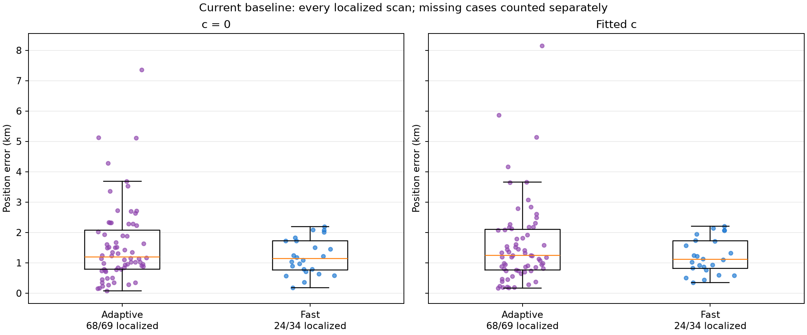
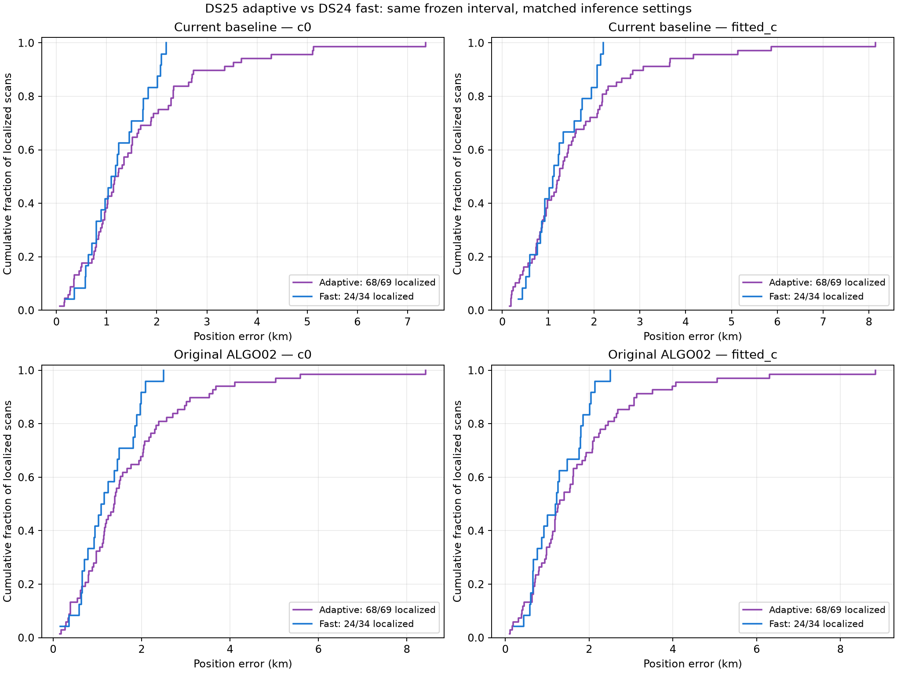
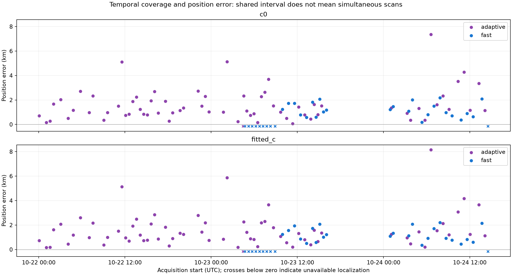

# DS25 adaptive versus same-interval fast position error

All errors are kilometres. Statistics use every paired localization produced by the stated method. Coverage is reported against 69 adaptive and 34 fast scans; missing inputs and failed runs have no fabricated position error.

| Method | c arm | Mode | Localized / total | Mean | Median | P90 | P95 | Worst | Within 1 km |
|---|---|---|---:|---:|---:|---:|---:|---:|---:|
| baseline | c0 | adaptive | 68/69 | 1.587 | 1.199 | 2.918 | 4.075 | 7.362 | 26 |
| baseline | c0 | fast | 24/34 | 1.202 | 1.135 | 2.053 | 2.087 | 2.188 | 10 |
| baseline | fitted_c | adaptive | 68/69 | 1.595 | 1.241 | 2.913 | 3.992 | 8.145 | 28 |
| baseline | fitted_c | fast | 24/34 | 1.220 | 1.114 | 2.069 | 2.131 | 2.205 | 10 |
| algo02 | c0 | adaptive | 68/69 | 1.725 | 1.381 | 3.224 | 3.958 | 8.427 | 22 |
| algo02 | c0 | fast | 24/34 | 1.223 | 1.118 | 1.987 | 2.075 | 2.500 | 10 |
| algo02 | fitted_c | adaptive | 68/69 | 1.724 | 1.278 | 3.094 | 4.041 | 8.840 | 23 |
| algo02 | fitted_c | fast | 24/34 | 1.240 | 1.209 | 2.039 | 2.127 | 2.508 | 10 |

## Shared time blocks

This comparison gives equal weight to shared 3-hour UTC blocks. Intervals resample whole blocks and describe adaptive minus fast mean error; they do not remove input-availability bias.

| Method | c arm | Shared blocks | Adaptive mean | Fast mean | Difference | Block-bootstrap 95% interval |
|---|---|---:|---:|---:|---:|---|
| baseline | c0 | 8 | 1.727 | 1.219 | +0.509 | [-0.235, +1.335] |
| baseline | fitted_c | 8 | 1.710 | 1.229 | +0.481 | [-0.243, +1.320] |
| algo02 | c0 | 8 | 1.802 | 1.223 | +0.578 | [-0.140, +1.350] |
| algo02 | fitted_c | 8 | 1.764 | 1.232 | +0.532 | [-0.147, +1.254] |

## Frequency fit, reported separately

These RMS values describe retained curved calibration evidence. The two acquisition modes have different observations; lower RMS is not itself better localization.

| Method | c arm | Adaptive mean curved RMS, Hz | Fast mean curved RMS, Hz |
|---|---|---:|---:|
| baseline | c0 | 91.62 | 71.42 |
| baseline | fitted_c | 91.52 | 71.38 |
| algo02 | c0 | 91.58 | 71.41 |
| algo02 | fitted_c | 91.49 | 71.37 |

## Cases without a completed primary localization

| Case | Mode | Status | Reason |
|---|---|---|---|
| DS25-0037 | adaptive | input_unqualified | no_active_curvature |
| DS24-0001 | fast | input_unqualified | ValueError: existing fast tracking contract unavailable |
| DS24-0002 | fast | input_unqualified | ValueError: existing fast tracking contract unavailable |
| DS24-0003 | fast | input_unqualified | ValueError: existing fast tracking contract unavailable |
| DS24-0004 | fast | input_unqualified | ValueError: existing fast tracking contract unavailable |
| DS24-0005 | fast | input_unqualified | ValueError: existing fast tracking contract unavailable |
| DS24-0006 | fast | input_unqualified | ValueError: existing fast tracking contract unavailable |
| DS24-0007 | fast | input_unqualified | ValueError: existing fast tracking contract unavailable |
| DS24-0008 | fast | input_unqualified | ValueError: existing fast tracking contract unavailable |
| DS24-0009 | fast | input_unqualified | ValueError: existing fast tracking contract unavailable |
| DS24-0103 | fast | input_unqualified | ValueError: existing fast tracking contract unavailable |

[All per-scan rows](tables/positions.csv), [machine-readable summary](summary.json), [full protocol and dataset details](README.md).
