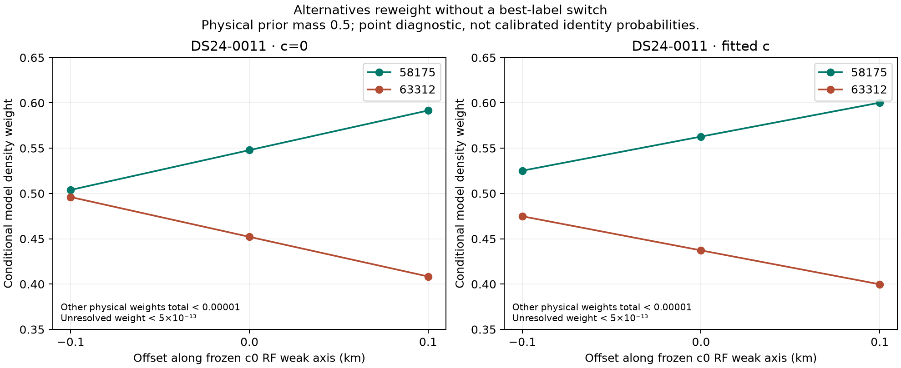
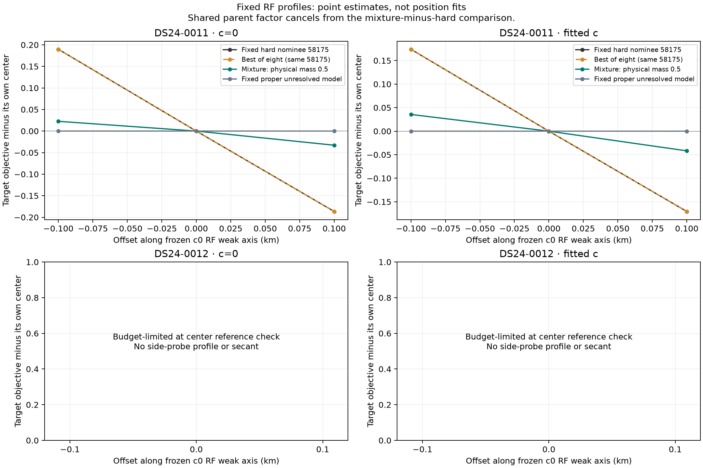
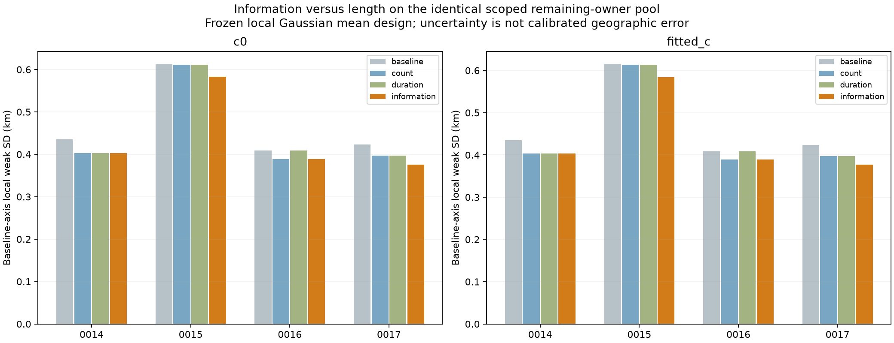

# DS24: identity ambiguity, remaining information and next directions

Completed 2026-10-26 UTC, following the 2026-10-25 source-challenge review.
Three SOL xhigh agents handled the ambiguity pilot, the full usable-cohort
information inventory and independent auditing. The coordinator reviewed prior
results and checked one original recording's availability. No new position was
fitted and the operational reference is unchanged.

The useful new finding is that **the same satellite can remain the best match
while uncertainty over competing satellites materially changes a track's
position influence**. Separately, the existing corpus still contains potentially
informative unused curves, but several of their assumed identities already fail
compatibility checks. These results support targeted qualification and a small
ambiguity-policy experiment; they do not establish improved location accuracy.

The [cumulative review and ranked next steps](REVIEW.md) cover what worked,
what failed to transfer and what should not be repeated. The current reference
remains fresh ALGO02-v1 with qualified causal signed orbital-timing means and
equal-assignment-prior family comparison. There is no new ALGO release.

**Whole-source ambiguity changes the RF slope in DS24-0011.** We retain one
complete unused source in each of 0011 and 0012, their eight archived causal
satellite candidates, symmetric alias hypotheses and a proper unresolved-curve
alternative. Both c arms use the same saved c0 position and two offsets of
±100 m along its model weak direction. At each fixed position the original
parent calibration is refreshed without using the new target.

For 0011's 20-point RX1 CH1 T006, 58175 remains the best point-evidence candidate
at every probe. Its declared mixture weight changes from about 0.50 to 0.59
with c=0 and 0.53 to 0.60 with fitted c; 63312 takes virtually all remaining
weight. These are model-dependent density weights, not calibrated probabilities
that the satellites are correct. The unresolved model's very small weight does
not establish that all relevant physical explanations have been modeled.

| Arm | Hard-label target slope | Mixture target slope | Scaled difference | Propagated score-bound interval |
| --- | ---: | ---: | ---: | ---: |
| c=0 | -1.8810 objective/km | -0.2772 objective/km | -304.9 m | [-385.7, -224.0] m |
| fitted-c | -1.7226 objective/km | -0.3864 objective/km | -254.0 m | [-332.2, -175.9] m |

Slopes are central finite differences, not derivatives. The last two columns
scale their difference by the same archived c0 local position curvature. They
are neither fitted displacements nor bounds on geographic error. Their signs
refer to the frozen model axis, not a direction toward known GPS. All three
predeclared physical-class masses, .25/.5/.75, pass the 25 m materiality screen
in both arms. Because the unresolved factor is negligible here, these masses
mostly change constants rather than the slope.

The source is presently rejected by the full parent mask despite a compatible
original canonical nomination. Mixture versus hard addition compares two
potential new-source models; it does not show improvement over the retained
reference, which adds neither. Original identity/adequacy requirements remain.

DS24-0012 hits its fixed 293.216 s case budget during the last center reference
check. It provides no side-probe profile or secant. All 108 declared slots are
retained: 71 complete and 37 failed or missing. All 63 complete physical
point-quadrature checks are stable; none certifies absolute evidence to the
0.001 objective tolerance. Conservative full-evidence intervals nevertheless
support the reported 0011 secant decision. Total preparation and calculation
use 445.290 worker-seconds within the 600 s cap; no rescue or budget extension
occurred. [Full findings and limits](ambiguity/FINDINGS.md).

**The unused-source inventory finds opportunities, not accepted satellites.**
All 24 usable DS24 reference scans contribute 3,265 original owners. Keeping
complete curved sources with no overlap with either arm's accepted-ID union
leaves 148 eligible owners. Designs complete for 146; two are blocked because
their active parent families lack the required physical uncertainty columns.
Among 115 outside the audited prior complete-owner challenge coverage, 24 in
12 scans meet the frozen 5% weak-direction variance threshold in both arms.

The first four chronological selected scans are 0014–0017. Their conditional
weak-axis SD reductions are only about 20–47 m, assuming their archived
identities. The choices differ from count ranking in two cases and duration
ranking in three. Three of the four have no archived feasible satellite
candidate; only 0016/59786 was canonically compatible. Polynomial smoothness
and an attractive information score do not override those failures.

No target CFO value enters the new design ranking; changing target CFO leaves
the design unchanged. The calculation retains shared parent/target receiver
and orbital covariance. Its uncertainty scale is conditional on identity,
Gamma and a local Gaussian model, not calibrated geographic confidence.
All 24 scans remain exposed development data. The inventory's 132.888
worker-seconds include preparation and tests; no new position fit or satellite
search runs. [Every source, exclusion, zero case and selected track](inventory/FINDINGS.md).

**The next work should answer explicit decisions.** First compare no addition,
hard addition and a conservative whole-source mixture in a small matched
position experiment, contingent on source adequacy and a feasible objective
that agrees with the bounded diagnostic. In parallel, explain and qualify the
four information-selected complete owners before any position addition. Keep
unresolved outcomes and exact baseline fallback. Recompute information if a
qualified satellite differs from the assumed label.

A distinct preparation task is one original-IQ detector-parity replay. The
[availability check](REPLAY_AVAILABILITY.md) verifies a DS24-0011 chunk's
manifest/index hashes and declared payload size, but reads no IQ and runs no
detector. Original window metadata contain aggregate digital power and clipping
summaries; these do not provide calibrated satellite RSSI or a bearing. Only
after payload integrity, detector parity and signal/noise authority are
established should a small clean/weak/crossing injection test investigate the
selection stage absent from current curve-level controls.

The [full review](REVIEW.md) explains why more generic restarts, more coverage,
lower RMS and broad receiver flexibility have low priority without a new
mechanism. No present result demonstrates the desired 0.5 km accuracy or
generalization to a new location.

Independent terminal audits pass [119 ambiguity checks](audit/ambiguity_terminal.json)
and [660 inventory checks](audit/inventory_terminal.json), preserving the
scientific failures described above. Owned harness tests pass eight ambiguity
and four inventory tests. The [independent scientific review](audit/REVIEW_CRITIQUE_B.md)
and [replay/artifact guide](REPLAY.md) describe interpretation and external
input requirements. The published copy keeps all figures, compact complete
tables, protocols, sources and audit receipts; large numerical inputs and
arrays are retained locally with hashes.

Both c arms retain matched observations, candidate sets, other priors and
budgets within each comparison. No evaluation GPS, postscan TLE, new RF
collection, stationary pooling, motion prototype or operational association is
introduced. Inference remains in the 25×25 km region centered at
37.906, -122.545. Frequency fit and geographic accuracy remain separate outcomes.
