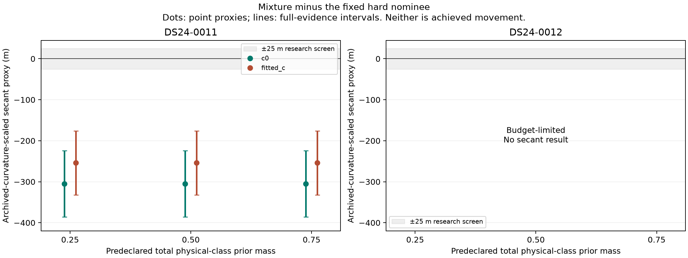

# Whole-source ambiguity at fixed RF probes

DS24-0011 shows a material change in the target score's weak-axis secant when
retaining alternative whole-source identities. The fixed hard nominee remains
the best single model at every probe. DS24-0012 is budget-limited and supplies
no positional contrast. Neither source is adopted; no position fit or geographic
evaluation was performed.

The authoritative law and stopping rules are [PROTOCOL02.md](PROTOCOL02.md)
and [protocol02.json](protocol02.json). The pilot preserves the complete
20/59-observation owners, their eight archived causal candidates, all aliases,
original priors/noise, and the same common RF coordinates for c=0 and fitted c.
At each probe, all candidate and unresolved models use one common refreshed
parent/background. Their union cavity removes zero parent likelihood IDs; all
candidate families are absent from the active parent curved and predictive
likelihood. Target observations do not update parent calibration or Gamma.

## Completed result

Three probes are the saved c0 position and ±0.1 km on its frozen weak axis.
The proxy is −0.5 times the mixture-minus-hard objective secant, divided by the
archived c0 parent information along that axis. It is a finite-difference
diagnostic under a fixed old curvature scale, **not a derivative, displacement
bound, or position gain**. Its sign has no established geographic benefit.

| DS24-0011 arm | Hard secant (objective/km) | Mixture secant (objective/km) | Point proxy (m) | Conservative proxy interval (m) |
|---|---:|---:|---:|---:|
| c=0 | −1.8810 | −0.2772 | −304.9 | [−385.7, −224.0] |
| Fitted c | −1.7226 | −0.3864 | −254.0 | [−332.2, −175.9] |

Every declared physical-class mass (0.25, 0.5, 0.75; uniform within eight
physical candidates) gives the same displayed secant to numerical rounding.
All six intervals exceed the frozen 25 m materiality screen in the two arms.
This qualifies the RF **research triage**, not a source, policy, or position.
Full-evidence bounds are propagated conservatively through each mixture and
the two-point contrast; correlated endpoint errors are not assumed to cancel.

Candidate 58175 is the point-score winner at all six probe/arm combinations;
the descriptive best-of-eight envelope therefore equals the hard comparator.
At physical-class mass 0.5, its weights at minus/center/plus are
0.50394/0.54784/0.59160 (c=0) and 0.52515/0.56279/0.60022 (fitted c).
Candidate 63312 supplies nearly all remaining weight. Other physical weights
total less than 0.00001; unresolved weight is below 5×10⁻¹³. Thus the effect
comes from alternative reweighting, without a best-label switch. These are
conditional density weights under declared priors, not calibrated identity
probabilities. The negligible broad unresolved model also limits what this
class-weight sensitivity test establishes about realistic unknown sources.
This pilot does not validate unknown rejection or abstention calibration.

[All-probe weights](report02/all_probe_model_weights.csv),
[discrimination](report02/discrimination.csv),
[score profiles](report/profiles.csv), and
[secants](report/secants.csv) retain the exact values. The
[profile figure](report02/fixed_RF_profiles02.png) shows target scores separately
from the parent score; the table additionally saves the inherited
parent-plus-target surrogate objective. Its parent factor is shared and
cancels from the mixture-minus-hard comparison.

## Denominators, numerical limits, and source status

The fixed 600-worker-second allocation was not extended or transferred between
cases. Charged time was **445.2895150863938 seconds**, including setup/tests:
13.56850 preparation, 138.50418 for DS24-0011, and 293.21683 for DS24-0012.
DS24-0012 timed out during the last center candidate's independent GL64
reference check (fitted c, 62529). Its primary checkpoint is retained without
being upgraded to a completed comparison. No side probes ran for that case.

All **108 declared slots** remain: 71 complete (63 physical, eight proper
unresolved); 37 failed or missing. There are 64 physical primary checkpoints,
including that one partial result. All 63 final physical point quadratures
pass the independent check, while **zero** satisfy the stronger absolute
1e-3 −2 log-evidence objective-precision criterion. Valid wider analytic
enclosures nevertheless resolve the DS24-0011 secant screen. This distinction
does not authorize higher-precision retries. The saved
[component table](report/component_contexts.csv) includes every declared slot.
The independent [terminal audit](../audit/ambiguity_terminal.json) passes
119 checks, including proper-null, mixture, interval, and immutable-binding
replays, without additional propagation or integration.

Both original whole owners remain rejected by their final parent masks, each
offers one receiver/channel owner, and neither has an independently qualified
association. DS24-0011 was historically nomination-compatible; DS24-0012 was
not. Persisted active-curvature metadata is not accepted likelihood ownership.
These statuses are saved in [source_status.csv](report/source_status.csv).
The refreshed parent guards pass at all eight available probe/arm contexts;
that does not qualify the excluded targets. The experiment compares potential
added-source factors, rather than modifying an already deployed hard source.

## Scope and replay

Physical scores retain the causal Student phase law on [−15,+15] s, full
three-mode physical covariance, nine uniform aliases, original prior mass,
and zero likelihood on nominally invisible phases. Shared radio covariance
and existing-predictive conditioning are preserved. The parent VI/Gamma plus
Gaussian predictive construction remains an approximation to a full joint
hierarchy. The proper unresolved model is a zero-mean degree-four Legendre
prior in fixed graph-frequency coordinates, never recentered at a candidate
or probe. Prior choices, finite exposed candidate pools, and the two
development owners limit generalization.

Revision01 was never scientifically run: independent preflight found that
serialized prepared-center completion omitted its derived one-owner group
array. Revision02 restores that array and adds actual redacted prepared-input
port tests; all prior bytes remain archived. Eight owned tests and the final
independent preflight pass. No score-dependent scientific repair was made.

The local [artifact locator](local_artifacts.json) identifies hash-bound raw
backgrounds and outputs intentionally omitted from compact publication.
Full replay requires those local artifacts and the original corpus; public
tables alone cannot recreate calibration. In the original environment,
`pilot02.py run` verifies inputs and the exact B preflight before dispatch,
but refuses to overwrite existing outputs. Reporting used `report.py` once,
then the separate saved-only `report02.py`; their
[original](report/seal.json) and [addendum](report02/seal.json) seals preserve
both versions. No new scientific evaluation occurs in either reporter.

The next discriminating step is a separately frozen, bounded whole-source
mixture position-policy comparison on an eligible owner panel, preserving
original association/support/coverage gates and exact baseline fallback.
It must establish cohort applicability and out-of-sample positional value;
this one completed secant does neither. No further scientific run was performed
in this pilot.
