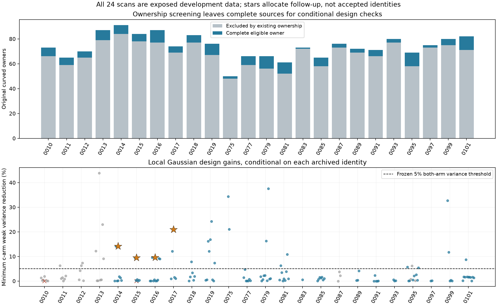
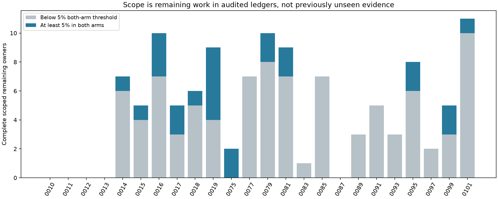

# Remaining conditional source information across 24 DS24 scans

The frozen ownership screen leaves **148 complete curved owners** outside
either arm's original accepted-ID union. Their archived identities are assumed,
not qualified. Of 146 owners with complete local design calculations, 115 are
outside the declared prior complete-owner challenge coverage and four-case
exclusion. **24 of those 115 exceed the frozen 5% weak-variance threshold in
both c arms, across 12 scans.** This identifies remaining follow-up work rather
than a measured position gain.

All 24 scans are exposed development data. The first four chronological
qualifying scans are 0014--0017. They are not selected by geographic error,
target CFO, a new catalogue search, or the largest cohort-wide gain. No source
is accepted and no position is fitted. The operational baseline is unchanged.

Gray design points are previously covered sources/four excluded cases, blue
points are outside the declared coverage, red crosses are blocked owners and
stars mark the frozen chronological allocation. All complete native owners,
including noncurved and already accepted exclusions, are retained in
[all_owners.csv](report/all_owners.csv).

## Pool and exposure

The exact 24 usable cases come from the frozen movement-study cohort, ordered
by recording UTC and case ID. The metadata ledger contains **3,265 complete
native owners**. The information pool contains only original active-curvature
graph rows with an archived canonical candidate/alias, preserving every native
ID. Any curved, predictive or postfit-only accepted-ID overlap in **either**
arm excludes the whole owner; there is no trimming or replacement.

Four prior ownership receipts have exact parent/track/observation hash
bindings. The other 20 cases, including older 0087/0095 receipts without
independent input hashes, were replayed at their unchanged saved RF endpoints
and phase references. All 24 ownership ledgers are complete. Preparation
and the actual 0014 context smoke took 62.061 seconds; both smoke objectives
replay exactly and Gamma changes are below 2.7e-6. No optimization was run.

Previous information results for 0010--0013 were reused only after **all**
their original source/input bindings matched; their numerical calculations
were not repeated. These four cases are excluded from new selection. Prior
0087/0095 whole-source recovery targets also remain covered sources.

The [scope audit](scope_audit.json) verifies that the original recovery
execution contains only 0087/0095 and the later four-source transfer panel
contains only 0010--0013. It also records the earlier 22-case rejected-binding
metadata inventory, all-case baseline/channel-half work, and accepted-source
bottleneck/minima studies. This is a bounded audit of named ledgers, not an
exhaustive history search. "Remaining" means **not covered by the audited
complete-owner challenge ledgers**; it does not mean never inspected,
geographically held out, newly nominated, or newly discovered satellite.

## What the design calculation measures

The [frozen protocol](PROTOCOL.md) reuses the original
`ds24-nomination-information-r01/information/ranking.py` kernel unchanged.
Both arms retain the same whole-owner pool, native IDs and archived labels.
Each uses its own saved RF endpoint, old coefficients, phase reference and
converged frozen noise precisions. No new source noise/Gamma is estimated.
Original per-ID nominal noise retains the explicit unseen-Gamma inverse-moment
factor two, and each new owner has one independent 300 Hz constant prior.

The old curved and predictive observations enter one Gaussian nuisance
elimination. If G is their posterior nuisance precision and R their nuisance
response to position, the new conditional covariance and mean sensitivity are

`C = N + h G^-1 h' + B B'`, `J_effective = J_target - h R`.

The additional local information is `J_effective' C^-1 J_effective`, added to
the old Schur position precision. This retains old/new shared receiver and
orbital covariance and existing predictive-source constants. It does not sum
independent same-family information gains. Active families share their existing
phase and full physical-mode slots. Inactive families receive local causal
Gaussian phase and all three physical prior modes, with dormant parent slots
zero. The original coefficient/noise layout elsewhere is unchanged.

This is a **fixed local Gaussian mean-sensitivity diagnostic**, conditional on
identity, aliases, phase reference, Gamma, priors and the inherited layout.
It is not a nonlinear phase-mixture Fisher calculation, identity evidence,
calibrated covariance, or a prediction of realized geographic error. Physical
modes include level/phase overlap as well as projected curvature. Lack of
measured orbit support is not treated as known zero physical uncertainty.
Every completed new target/arm passed an exact CFO-redaction invariance check: changing
only target values changes none of its design arrays. Original parent
calibration and archived nomination remain response-selected limitations.

## Frozen allocation and paired results

The materiality rule requires at least **5% variance reduction in both arms**
along each arm's fixed baseline weak axis. That threshold is only about 2.53%
reduction in weak standard deviation. Choose at most four distinct scans in
chronology, then the greatest minimum-arm reduction within each scan; ties
use points, duration and component. Full ownership-pool and restricted
remaining-pool count/duration ranks are both retained, including blocked
length winners. No threshold or ordering changed after results.

| Case / assumed catalogue label | Complete owner | Points / span | Variance reduction c0 / fitted | Weak SD c0, km | Weak SD fitted, km |
|---|---|---:|---:|---:|---:|
| 0014 / 59733 | RX1 CH1 T004 | 87 / 69.818 s | 14.135% / 14.160% | .435190 → .403261 | .435218 → .403228 |
| 0015 / 68904 | RX2 CH4 T004 | 29 / 27.996 s | 9.435% / 9.478% | .612217 → .582621 | .614402 → .584561 |
| 0016 / 59786 | RX2 CH2 T004 | 40 / 28.704 s | 9.572% / 9.562% | .409174 → .389099 | .408845 → .388808 |
| 0017 / 100180 (A0180) | RX1 CH5 T004 | 51 / 42.174 s | 20.955% / 20.969% | .423129 → .376192 | .423744 → .376705 |

The original catalogue contains the Alpha-5 A0180 entry behind numeric label
100180. All four nominees are inactive in the original position likelihood;
their physical uncertainty is target-local here. Full precision and exact
component/native-ID bindings remain in [selection.csv](report/selection.csv)
and the locally retained frozen ledgers.

All four original polynomial tracks have `no_structure_detected` quality
status, which is not satellite-identity qualification. The archived canonical
nomination is compatible only for 0016/59786 (one feasible candidate);
0014/59733, 0015/68904 and 0017/100180 have zero archived feasible candidates.
The design calculation does not reverse those rejection records. Their
physical adequacy is an explicit prerequisite to treating the predicted
information as usable.

For 0014, all three allocators choose the same owner. For 0015, the count and
duration winner 62288 has 77 points over 59.532 s but only .270%/.239% modeled
variance reduction, versus 9.435%/9.478% for 29-point 68904. For 0016, count
also chooses 59786; the longest owner 66333 has 21 points over 43.944 s and
only .0443%/.0439% reduction. For 0017, the longest/count winner is another
owner of **the same** 100180 family, RX1 CH4 T003, giving 12.076%/12.081%,
versus 20.955%/20.969% for CH5. The two owners must not be combined as
independent satellite geometry.

The selected local SD changes are approximately 20--47 m. They are conditional
design effects, not geographic improvements. Some later sources have larger
design gains; they do not replace earlier qualifying cases under this rule.

## Blocks, zero cases and runtime

There are **146 complete owners / 292 complete arm designs**, including 25
owners / 50 arm designs reused from the old four cases. The new calculation
therefore completes 121 owners / 242 arm designs. Two owners are blocked in
both arms because their active incumbent family lacks all three physical-mode
slots: old 0010 RX1 CH5 T000 / 69148, and new 0015 RX1 CH1 T005 / 68267.
They remain in count/duration denominators; there is no zero-shape shortcut.
There are no unavailable owners or failed cases.

Among cases with scoped remaining owners, 0077, 0083, 0085, 0089, 0091, 0093
and 0097 have none above the threshold. Original cases 0010--0013 are excluded
from new allocation and 0087's three eligible owners are all already covered;
their zero remaining bars do not mean no eligible source exists.
[case_summary.csv](report/case_summary.csv) retains all 24 cases and zero rows;
[information_ranks.csv](report/information_ranks.csv) retains all 148 owners.

Total tracked numerical work is **132.888360 worker-seconds** within the 600 s
cap, using one worker and one BLAS thread. This includes metadata,
ownership/context preparation, owned tests and frozen-source hashing. There
were no scientific timeouts, retries, new catalogue searches, position fits,
GPS/error reads or RF/IQ processing. Four owned tests pass. A prelaunch
bookkeeping revision preserved `preparation01/` and added nested authority
binding plus safe partial-arm/global-cap handling before any new rank ran.
An initial scope-helper integer/list mismatch was corrected before output;
the scope and source choices did not change.

## Next decision and reproducibility limits

The positive outcome is a bounded, source-bound follow-up panel beyond
0010--0013. It is evidence against declaring the existing corpus exhausted,
and evidence that point count alone can allocate effort poorly. It does not
show that any selected archived identity is correct or improves localization.
The next separately reviewed step can test these complete owners' ordinary
causal nomination and physical-versus-unresolved adequacy with shared
uncertainty; passing that would still precede a matched position comparison.
The four exposed cases and this threshold must not be called fresh validation.

Sources [ledger.py](ledger.py), [expand.py](expand.py),
[test_expand.py](test_expand.py) and [report_information.py](report_information.py)
are retained with the [protocol](protocol.json),
[independent preflight](../audit/inventory_preflight.json) and RF hash inventory.
The lean public report retains every owner as a compact CSV row and all
outcomes, but does not duplicate large ownership JSON, tracking/bank contracts,
or design arrays. [local_artifacts.json](report/local_artifacts.json) binds
their exact local paths, bytes and SHA256 values. Recomputing ranks requires
those external inputs plus the unchanged original scientific modules named in
the protocol; public tables alone are not a standalone scientific-input
closure. Saved tables/figures and numerical regeneration are separate claims.
