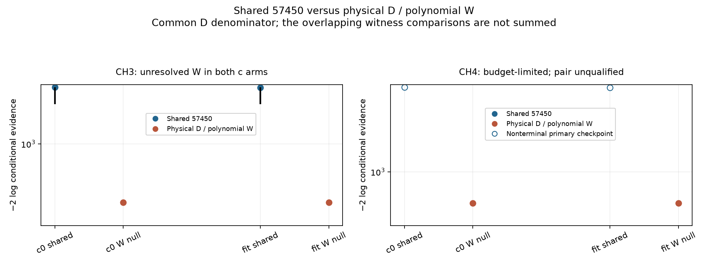
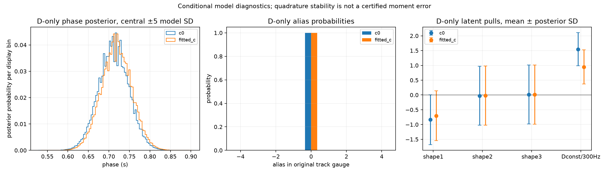
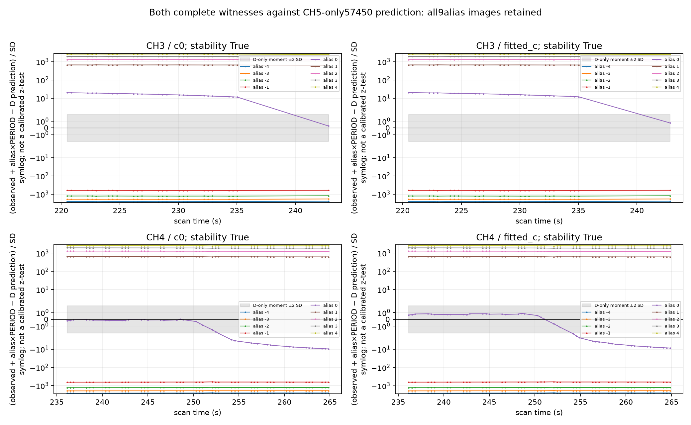
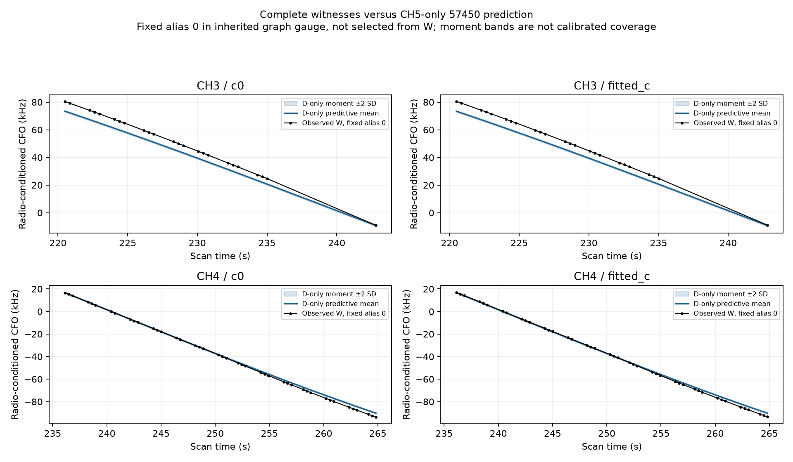
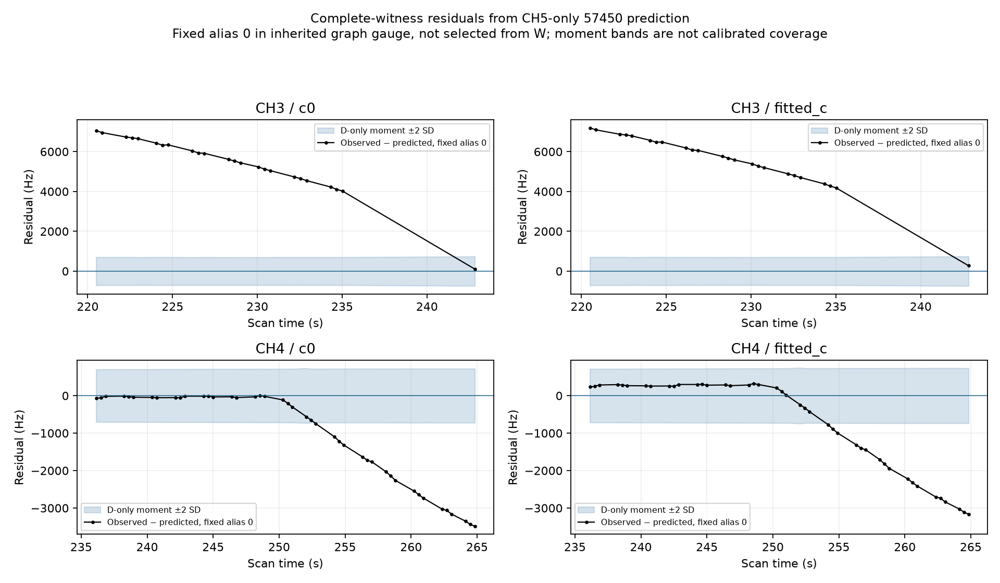
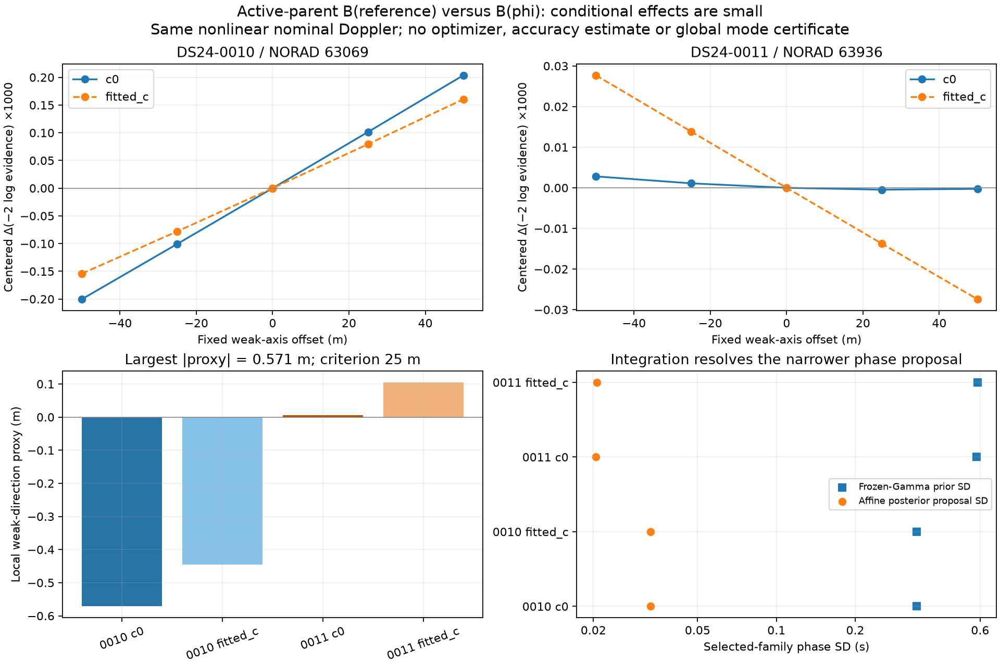

# Fast-scan review: conditional CH5 prediction and orbital-correction control

Completed 2026-10-25. Two bounded experiments test the most concrete follow-ups
from the preceding RX2 investigation. Neither establishes a new position gain.
The operational reference, accepted IDs and DS24-0013 position-likelihood
coverage remain unchanged: **3,784/4,808 points, 78.7022%, in both c arms**.
No position optimizer or geographic truth is used in these experiments.

The [updated review and next decisions](REVIEW.md) evaluates the wider ALGO and
DS23/DS24 evidence. It prioritizes a targeted test of source switching in CH4,
a small consistent-law nomination diagnostic and recovery of independently
supported geometry, with explicit stop decisions.
More associated GLRT points alone has repeatedly failed to improve accuracy.

**Correction to the preceding report:** the cached 2,442.510 Hz CH5 diagnostic
was not recomputed when its row was relabeled 57450. It must not be described
as a verified 57450 orbit residual. Actual saved partial-support salvage fits
were about 37–42 Hz, followed by rejection in refitting. The current whole-source
evidence was reconstructed independently and is unaffected. The
[provenance investigation](mechanism/FINDINGS.md) preserves the exact records,
source hashes and limits of what can be reconstructed.

## 1. Does the complete CH5 curve predict the other complete sources?

Discovery D is DS24-0013 RX2 CH5/T001, all 57 native points. It conditionally
favored 57450 in the previous ordinary-nominated finite-pool comparison. No
accepted 57450 family exists in the baseline. Witnesses W are all 24 CH3/T002
points and all 43 CH4/T000 points, tested separately, including the witnesses
that previously preferred an unresolved polynomial. All 124 IDs are distinct
and remain retained in the experiment.

For each W, compare two models on exactly D+W: both share one physical 57450
correction, or D remains physical 57450 while W is a proper degree-four
unresolved polynomial. Both retain the same radio covariance, native noise law,
independent 300 Hz owner constants and uniform whole-owner aliases −4 through
+4. D's posterior is not replaced by a null. The common D evidence cancels in
the odds, and the two D-reusing comparisons are never summed as independent
evidence. This tests shared 57450 versus unresolved W; it does not rank other
identities for W or establish a calibrated acceptance probability.

The original CH5 cavity membership and saved c0 RF position are common to both
arms. Each arm retains its own saved calibration, held fixed across D alone,
shared-family and mixed models. W observations never refit the radio/noise background or
the discovery-only prediction. The physical model retains its causal phase
prior conditioned on [−15,+15] s, all three physical modes and shared radio
uncertainty. Visibility is explicitly checked, without renormalizing away
invisible prior mass. Native versus graph CFO differs by a known uniform
two-period gauge; alias indices are stated in that graph gauge.

| Complete witness | c=0 result | Fitted-c result | Operational decision |
| --- | --- | --- | --- |
| CH3, 24 points | Unresolved favored; shared-minus-mixed log-evidence bounds [−1194.00, −839.08] | Unresolved favored; bounds [−1192.94, −838.05] | No shared-family grouping |
| CH4, 43 points | Budget-limited during independent reference integration | Same budget limit and stage | Unqualified; retain partial artifacts, no promotion |

The CH3 finite-comparison order is established despite neither individual
joint score reaching the stricter 0.001 absolute-score target. For CH4, the
mixed model completes and the shared model writes its primary checkpoint;
the required independent reference does not complete before the frozen cap.
Its partial score is not promoted to a qualified ordering. No retry or extra
scientific integration follows the cap.

The discovery-only evidence replays the preceding CH5 score exactly in both
arms. Its phase mean/SD is 0.711916/0.036753 s for c=0 and 0.718675/0.036760 s
for fitted c. Standardized physical-mode means have magnitude below 0.84.
CH5's constant is 464±169 Hz / 284±173 Hz, with the original 300 Hz prior SD.
Two of the three shape-mode variances remain about 0.9997 of their standardized
prior variance; small posterior means do not mean those modes are well measured.
These are conditional assigned-model posterior diagnostics, not proof of
57450's identity or a causal ablation identifying why the old pipeline rejected
the track. GL32/64 stability passes; moment error is not analytically certified.

The prediction plot uses only D to set physical/radio posterior weights. Its
bands are moment mean ±2 SD conditional on an alias-adjusted CFO coordinate,
not calibrated 95% intervals or the variance of the full raw-alias mixture.
The full alias plot retains all nine translated images. A fixed graph-alias-zero view is supplied for visual
inspection; it does not choose W's alias from a good-looking residual. CH4
initially follows this prediction and departs around 250 s. That is a clue to
inspect its construction and competing identity, not proof of a bad join and
not a substitute for its unfinished evidence comparison.

CH3's rejection of a common correction and CH4's incomplete comparison supply
no independent corroboration. They do not prove CH5/57450 false: the witnesses
may represent different satellites. Keep CH5 as a development candidate and
move to another defensible witness or a different informative source rather
than forcing a grouping.

## 2. Does varying orbital-shape design with phase change position materially?

The current active-parent approximation evaluates its three physical-mode
columns at a saved orbital-timing reference. The distinct test reevaluates
those existing columns B(phi) at each integrated phase, while both branches
already use the same nonlinear nominal Doppler f(phi). It appends no covariance
or new mode and does not repeat the already-dynamic target kernels.

Select chronological DS24-0010/0011, one existing full-mode family per scan
using the largest archived RF timing/weak-position correlation: 63069/63936.
At the common saved RF center and ±25/±50 m along the old weak axis, compare
frozen versus dynamic B in both c arms: 20 fixed contexts. Remove the family's
original phase and three mode columns from the full curved/predictive design
before conditioning and integrating them once.

| Scan / family | c=0 signed weak-direction movement proxy | Fitted-c proxy | Decision |
| --- | ---: | ---: | --- |
| DS24-0010 / 63069 | −0.571 m | −0.445 m | Close this tested local mechanism |
| DS24-0011 / 63936 | +0.006 m | +0.105 m | Close this tested local mechanism |

The signs refer to the saved weak axis, not movement toward or away from GPS.
All 20 probes complete and both pairs pass the predeclared numerical checks.
The largest proxy, 0.571 m, is far below the frozen 25 m materiality criterion.
It is a local gradient/curvature calculation, not a new estimated position.

This is a frozen-Gamma conditional Gaussian test. It preserves the explicitly
conditioned phase domain and Normal law in both branches; it is not full
Student/VI or hierarchical marginalization. Numerical rules agree around the
resolved modes, but a narrow proposal and finite reference grid cannot exclude
every remote nonlinear mode. Full/conditional affine closure agrees within
6.59e−10 objective units, score differences within 2.00e−7 and gradient
differences within 6.71e−8 per km. These results justify stopping this particular
branch without an optimizer, not ruling out all joint orbital/noise effects.
The [detailed findings](parent_coupling/FINDINGS02.md) describe the matrices,
normalizers, checks and limitations.

## 3. Historical CH5 provenance: what was actually tried

| Historical evaluated stage | Support | Recorded outcome |
| --- | --- | --- |
| Discovery fit under 65871 | All 57 points | RMS 2,518.603 Hz c=0 / 2,514.516 Hz fitted c; incompatible |
| Selected salvage under 57450 | First 32 points, [0,32) | RMS 37.461 Hz; phase 0.50 s |
| Saved alternative under 57450 | Last 31 points, [26,57) | RMS 42.441 Hz; phase 0.75 s |
| Subsequent paired refit | Selected prefix offered | CH5 rejected at epoch 0; no CH5 IDs in current baseline |

The two partial supports overlap in six IDs and use a 0.25 s phase grid. They
are not independent cross-owner confirmation, and their phase difference does
not establish a physical drift. The archived history lacks the per-gate
intermediate metrics needed to identify the exact subsequent failing gate.
The retained-gate implementation uses active masks correctly; there is no
evidence that excluded points were inadvertently tested as retained points.

Only label fields changed between the cached seed and later row; cached residual,
innovation and time vectors, RMS, bias and cost stayed identical. The matching
historical source confirms the relabel behavior. The origin of the cached
2,442.510 Hz residual is not reconstructed; it must not simply be reattributed
to another label either. No historical scientific record or current inference
source has been rewritten. The published correction retains the original
immutable report commit and exact original Markdown bytes.

## Execution, audit and scope

| Branch | Completed scientific work | Runtime / limit |
| --- | --- | --- |
| A: whole-source conditional prediction | D-only diagnostics in both arms; CH3 comparisons complete; CH4 comparisons budget-limited in both arms | 599.984 cumulative worker-seconds / 600 s, two workers |
| C: active-parent mode coupling | All 20 fixed probes complete | 43.153 cumulative scientific seconds / 300 s, one worker |
| Independent audit | Separate preflight and terminal checks for both branches; provenance check | Under 180 numerical seconds; exact receipts linked below |

The first A execution encountered a filename Path/string error before evidence
integration, after 7.320 s. A narrowly scoped path repair and owned port test
were authorized; the original sources/failure were preserved, and that elapsed
time was deducted from the unchanged 600 s cap. The repaired run passed eight
owned tests. C passed four owned tests. No scientific retry, prior tuning,
point removal, GPS-based selection, new IQ/RF acquisition or position fit occurs.

Two non-scientific sealing issues are explicitly preserved: a test updated a
previously bound pytest cache, and C's final stdout print filled a log sealed
while empty. Exact original cache/log bytes were restored, later text retained
separately, and every scientific/source binding reverified. These are reporting
repairs, not exclusions from the scientific hashes or score changes.

[A terminal audit](audit/prediction_terminal.json) passes 40 checks, including
all 124 IDs, discovery replay, joint covariance, 81 paired alias hypotheses,
posterior normalization and all four complete/incomplete slots.
[C terminal audit](audit/coupling_terminal.json) passes 48 checks, including
independent full-covariance closure and movement calculations.
[Historical audit](audit/archival_check.json) confirms the label/cache finding.
Protocols and original authorization are retained in
[the coordinator plan](COORDINATOR_PLAN.md),
[A's revised protocol](prediction/PROTOCOL02.md),
[C's protocol](parent_coupling/PROTOCOL.md) and
[the path-repair record](HARNESS_REPAIR_AUTHORIZATION.md).

All contexts are exposed development data. These conditional comparisons use
the same saved RF position in both arms; they do not rerun the 25 by 25 km
regional search. The region remains centered at 37.906, -122.545 in the upstream
pipeline. Source/runtime/corpus bindings and retained limitations are documented
in [the publication replay record](REPLAY.md). No new-location generalization or improved
position accuracy is claimed.
