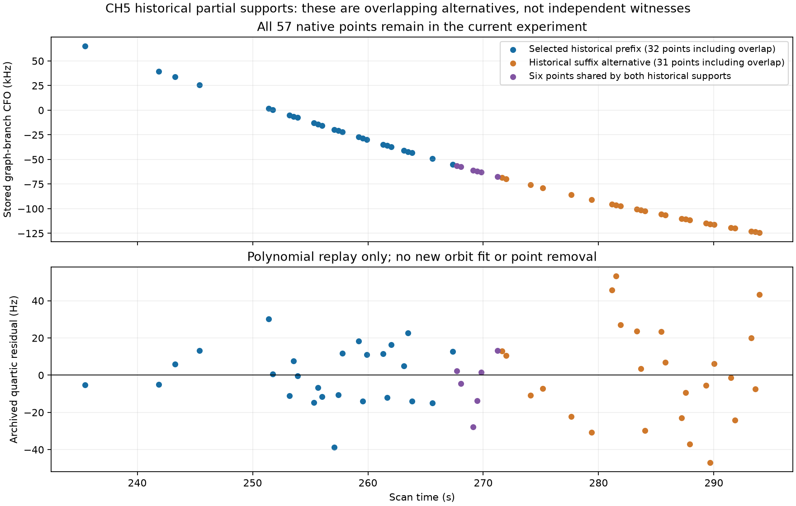

# Correction: the cached 2.4 kHz diagnostic is not a verified 57450 fit

The previous report and chat attributed an archived 2,442.510 Hz residual to
the row's later satellite tag, 57450. A deeper provenance check establishes
that the tag and residual were not updated together. That attribution should
be withdrawn. The current ordinary-catalogue and conditional-evidence results
were reconstructed independently and are unaffected.

The selected discovery record's CH5 seed row is tagged 65871. The later ALGO01
and family-cavity rows are tagged 57450. The only two changed row fields are
`candidate_index` and `candidate_norad`; the residual, innovation and time
vectors, RMS, bias and cost are byte-equivalent as parsed values. The matching
historical source `run_algo01_ds23_sample.salvage` updates only those label
fields and the external alias when a salvage candidate is selected. It does
not recompute the cached row diagnostics. Both the discovery and salvage
source SHA256 digests match their original recorded execution digests.

This establishes stale association between a label and its cached diagnostic.
It does not reconstruct the original calculation that first produced the
2,442.510 Hz vector. The seed state is also reset to zero after seed rows are
copied, so that reset cannot establish the original residual-generating state.
The old number must not be treated as a contemporaneous orbit-model residual
for either later label without further provenance.

## What the historical numerical records actually show

| Saved stage | Satellite | Support | Recorded RMS / outcome |
| --- | --- | --- | --- |
| Selected discovery hypothesis, evaluated fit | 65871 | Complete 57-point source | 2,518.603 Hz c0 / 2,514.516 Hz fitted c; both incompatible |
| Subsequent salvage selection | 57450 | First 32 points, indices [0,32) | 37.461 Hz, phase 0.50 s, alias 0 |
| Saved salvage alternative | 57450 | Last 31 points, indices [26,57) | 42.441 Hz, phase 0.75 s, alias 0 |
| Following paired refit/rejection | 57450-tagged source | Selected prefix offered | CH5 rejected at epoch 0; no source IDs retained in the later baseline |
| Current completed whole-source evidence test | 57450 preferred in finite pool | All 57 original points | Conditional model preference; no operational identity or position acceptance |

The salvage search examined 35 candidate identities and 78 supports. Its
prefix and suffix alternatives overlap by six native IDs; they are not
independent witnesses. The phase grid step was 0.25 s, so the two recorded
phase choices do not establish a physical timing rate or a discontinuity.
The later history preserves the rejection but not the intermediate per-gate
metrics needed to identify its exact cause. The gate implementation correctly
uses the active observation mask; there is no evidence here that excluded
points were inadvertently included in that retained-prefix gate.

The figure replays the existing quartic and native graph-branch CFO. No new
polynomial, orbit, radio or position fit is performed. Every native point is
retained in the current D-only prediction experiment. This source was examined
and briefly offered to calibration historically; “unused” means excluded from
the current baseline ledger, not never seen by an earlier algorithm.

## Implication for the next experiment

The useful question is no longer why a supposedly verified 2.4 kHz 57450 fit
became a successful fit. No such before/after fit comparison was established.
We have historical partial-support compatibility followed by rejection, and a
new complete-source conditional model preference under a different background
and uncertainty treatment. The ongoing whole-owner prediction test asks whether
CH5's proposed correction explains independent complete source observations.
It does not use the stale RMS or assume the historical salvage identity true.

[Extraction and assertions](archive_provenance.py), [exact metadata and source
bindings](summary.json), [figure/source seal](seal.json), and the independent
[audit](../audit/archival_check.json) retain the evidence. The successful
artifact-only extraction took 0.27 s. No inference source, archived record,
accepted ID or current frozen scientific protocol was modified.
