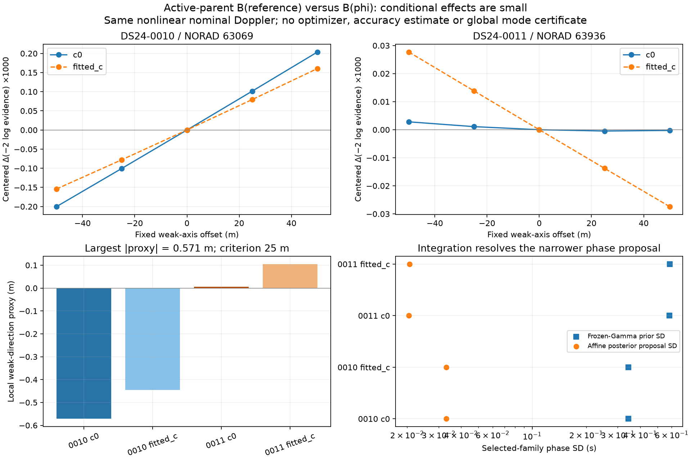

# Active-parent timing-dependent physical modes: small resolved local effect

The omitted B(phi) dependence is real in the source, but it produces a small
conditional local effect in these two tested contexts. All **20 fixed probes**
complete; both c pairs pass the predeclared resolved-mode numerical checks.
The largest weak-direction movement proxy is **0.571 m**, far below the frozen
25 m practical criterion. Both cases therefore close this tested conditional
neighborhood **without an optimizer**. No position accuracy was measured.

| Context / existing family | c arm | Central dynamic−frozen objective | Weak-direction movement proxy, m |
| --- | --- | ---: | ---: |
| DS24-0010 / 63069 | c0 | −0.002202 | −0.571330 |
| DS24-0010 / 63069 | fitted c | −0.002133 | −0.445016 |
| DS24-0011 / 63936 | c0 | +0.000298 | +0.005946 |
| DS24-0011 / 63936 | fitted c | +0.000054 | +0.104961 |

The sign is along the frozen old weak axis, not toward/away from a true
coordinate. The proxy is `−Δgradient/(2 × old weak precision)`, not a new
regional position estimate. [Exact saved triage](summary.json) and
[comparison table](comparison.csv) retain both arms and all diagnostics.

## A specific omitted term, not another covariance intervention

Current parent geometry evaluates the nonlinear nominal Doppler and all three
existing physical modes at `p.reference`, then uses an affine phase column.
Reference refresh between fits moves that point but does not integrate B(phi).
The previous missing-covariance variant appended modes for unsupported families;
this diagnostic appends **none**. Existing target/identity phase kernels already
evaluate B(phi), and the older nonlinear parent slice kept B fixed. These are
different questions.

Chronological contexts 0010/0011 and one family each were selected before scores
from the old RF-only timing/weak-axis correlations, restricted to families
already having three modes. This deterministically chose 63069/63936. The same
saved c0 RF center and weak axis are used in both arms, with offsets
−50,−25,0,+25,+50 m. Family 63069 contributes 94 of 3,186 joint likelihood rows;
63936 contributes 310 of 2,241. Native observations, aliases and ownership remain
unchanged.

Both branches retain **the same exact nonlinear nominal f(phi)**. Only the
three physical-mode columns differ: B(saved reference) versus B(phi), with all
level/phase overlap retained and identical original mode precision. The tested
family's old phase and three mode columns are removed from curved **and**
predictive designs before conditioning on all other data and integrating them
once. Other nuisance means/precisions, radio/fragment covariance, likelihood
powers and noise remain matched. No same-family posterior is added again as
an independent prior.

The selected phase law is explicitly a **frozen-Gamma conditional Normal** with
the causal prior mean and SD `phase_sigma/sqrt(original phase precision)`,
conditioned on [−15,+15] s with its original domain normalizer. It is **not**
the parent's full marginal Student law or unchanged full VI evidence. Other
Gaussian precision coordinates are frozen at the common RF center. Equivalent
Gaussian variances encode fixed likelihood powers; old VI/generalized constants
are not claimed as a normalized unchanged sampling model.

All original affine-f/frozen-B Gaussian decompositions replay to at most
**6.59e−10** objective units, and reference B replay error is zero. Full nominal
visibility certificates pass. The physical matrix is not accidentally frozen:
at the saved prior probe phases, changes reach about 0.81 Hz RMS and 1.91 Hz
maximum across these center contexts. [Preparation and all native IDs](preparation.json)
preserve the actual matrices, removed columns, laws and certificates.

## Numerical evidence and its limits

The analytic affine-posterior proposals have phase SDs **0.0330/0.0331 s** for
0010 and **0.0204/0.0206 s** for 0011, versus frozen conditional-prior SDs
0.344/0.344 and 0.582/0.586 s. Gauss-Legendre 81/161/321 integrates in the
proposal's CDF coordinate, retaining exact prior/proposal normalizers. A
separate direct-phase adaptive rule uses a fixed global grid plus local
proposal-centered partitions. Every saved output exports sampled phase ranges,
prior/proposal masses, edge/max weights and reference error. The center prior
and proposal operational masses round to one; no visible-mass renormalization
or prior tightening occurs.

Maximum score disagreement is **2.00e−7** and maximum weak-gradient disagreement
**6.71e−8 per km**, below frozen 1e−3 limits. Independent rank3 versus dense-node
objectives agree within **2.73e−12**. Four owned tests pass, including exact
truncated affine-Gaussian evidence, full/conditional closure, dense rank3
equivalence and a phase posterior roughly a millisecond wide. The two finite
position steps also agree within their declared tolerance.

These checks establish stability around resolved modes. A narrow importance
proposal and finite global reference grid do **not** certify the absence of
every remote nonlinear phase mode. This is not global absolute precision,
full hierarchical marginalization or a claim that all families jointly lack
material coupling. It closes these two one-family conditional neighborhoods;
no further integration or position fitting is justified by their small effect.

## Execution and reproducibility

All scientific processing takes **43.153 cumulative seconds** under the 300 s
cap, one worker/BLAS thread, including owned tests and source freeze. No corpus
preparation/integration starts before the exact B preflight. There are no
scientific retries, new draws, position fits, GPS reads, IQ/RF work or production
changes. [Protocol](PROTOCOL.md), [frozen bindings](protocol.json),
[complete raw scores](results.json) and [RF seal](RF_seal.json) preserve the test.

A reporting-only issue was preserved: the runner sealed redirected stdout while
empty, then its final print filled that log. The full text is retained in
`execution_stdout.log`, and the exact sealed empty `execution.log` was restored.
[The restoration receipt](stdout_restoration.json) records both hashes. Every
scientific/source byte and the original RF seal are unchanged; no hash exemption
or numerical rerun occurred. Existing external corpus/runtime dependencies remain
required; these prepared conditional matrices are not a standalone full input
closure. The broader study reports independent terminal audit separately.
