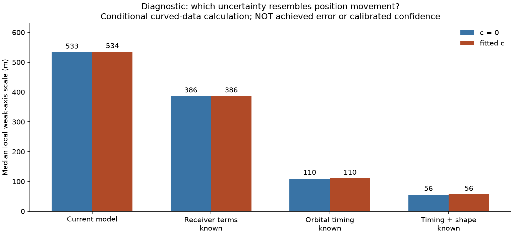
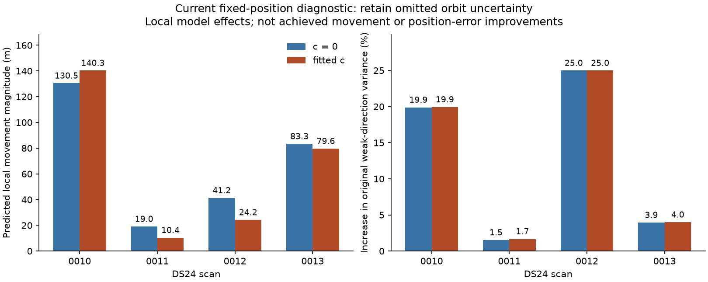

**Fast-scan localization: evidence review and the next useful experiments**

Review date: 2026-10-25. This reviews the ALGO02-derived comparisons, full-DS23
recovery assessments, and recent DS24 receiver, identity and information studies.
Three continuing SOL xhigh agents supplied implementation context, independent
scientific critique and evaluation/publication review. The figures below are
regenerated from saved summaries; this retrospective runs no new position fits.

My assessment is that **orbital timing/shape uncertainty and partially redundant
geometry are the strongest demonstrated precision limitations**. Ambiguous
satellite identities and missing physical uncertainty can make individual scans
worse. Receiver discrepancy contributes, but cleaner frequency measurements and
more flexible receiver fits have not delivered a consistent large improvement.
The evidence does not identify one universal defect or prove a physical accuracy
floor. The current research reference remains fresh ALGO02-v1 plus qualified
causal signed orbital-timing means and equal-assignment-prior family cavity.
No new ALGO is promoted.

**What has worked, and what has not transferred**

These are separate matched experiments on different populations. Their gains
cannot be added together or read as one chronological performance curve.

| Experiment | Measured result | Assessment |
| --- | --- | --- |
| Graph, EM, Hough and multiple-hypothesis track construction | Approximately 90–93% polynomial membership on DSX01 S01. | Track finding improved substantially; a smooth polynomial is not yet an identified satellite. |
| ALGO01 → ALGO02, 404 common qualified DS23 scans | Fitted-c mean/median 1.870/1.602 → 1.508/1.249 km. Qualified outputs 407/413 → 404/413. | A substantial within-site gain, with a qualification tradeoff. |
| Family-excluded identity replacement, all 410 available DS23 scans | Mean c0 1.509 → 1.479 km; fitted-c 1.498 → 1.469 km. Fitted-c improves 40, worsens 34, retains 336. | Useful but modest; timing-block uncertainty makes the fitted-c aggregate gain provisional. |
| Full ALGO04 recovery candidate, same 410 scans | Fitted-c associated points 70.08% → 75.08%; mean 1.469 → 1.591 km; P95 3.157 → 3.473 km. c0 also worsens. | Rejected. Additional plausible curves can pull the estimate in the wrong direction. |
| All channels versus halves, same 24 DS24 fast scans | Mean c0/fitted-c: CH1–8 1.202/1.220 km; CH1–4 1.538/1.558; CH5–8 2.040/2.040. | All channels already help. The unresolved issue is limited incremental information. |
| Shared smooth RX1 correction, 24 development scans | Mean c0/fitted-c 1.202/1.220 → 1.112/1.120 km. | Promising development result, with individual regressions. |
| Frozen RX1 correction, eight later scans | Mean c0/fitted-c 1.243/1.239 → 1.240/1.224 km; P95 2.830/2.829 → 2.999/2.956 km. | The roughly 100 m development mean gain did not replicate; retain the reference. |
| RX2 pilot remeasurement, 322 curves | Median fixed-degree scatter 78.07 → 22.18 Hz, without qualified cohort accuracy improvement. | Frequency scatter alone is not the demonstrated main limitation. |

Sources: [track comparison](https://github.com/misko/leo-tracker-reduxredux/blob/main/reports/2026_10_17_dsx01_full_data_tuning/comparison.csv),
[ALGO02](https://github.com/misko/leo-tracker-reduxredux/blob/main/reports/2026_10_19_algo02_ds23_full/README.md),
[family replacement](https://github.com/misko/leo-tracker-reduxredux/blob/main/reports/2026_10_22_ds23_family_cavity_full_assessment/README.md),
[rejected recovery candidate](https://github.com/misko/leo-tracker-reduxredux/blob/main/reports/2026_10_23_algo04_candidate_full_ds23/README.md),
[channel comparison](https://github.com/misko/leo-tracker-reduxredux/blob/main/reports/2026_10_24_ds24_channel_halves/README.md),
[receiver controls](https://github.com/misko/leo-tracker-reduxredux/blob/main/reports/2026_10_24_ds24_receiver_orbit_controls/README.md),
[later test](https://github.com/misko/leo-tracker-reduxredux/blob/a3ae6254d2dee7dc25e794eac06279fee9631c03/reports/2026_10_25_ds24_phase_shape_validation/README.md),
and [remeasurement](https://github.com/misko/leo-tracker-reduxredux/blob/main/reports/2026_10_19_ds23_rx2_measurement_cohort/README.md).

The upper-right plot compares complete policies; it does not isolate a causal
effect of association count. Its vertical axis is expanded to show the changes.
Postfit association coverage, position-likelihood membership and earlier
polynomial membership have different meanings. The current 24-scan DS24
position likelihood uses 78,067/108,600 original GLRT winners, 71.8849%; postfit
extensions need not contribute to position. The frozen DS24 population has 34
recordings, of which this comparison has 24 usable saved inputs. All failures,
fallbacks and availability limits remain in the underlying reports.

**Why the extra channels do not deliver the expected precision**

The observed Doppler curve changes when the receiver moves, but also when a
satellite moves slightly along its predicted orbit. Over the observed time
interval these effects can look very similar. An additional channel observing
the same satellite shares that orbit uncertainty. It provides more data, but
not an independent measurement of where the satellite is along its orbit.

The conditional information analysis quantifies this. In fitted-c the median
weak-direction scale is 534 m. Treating receiver terms as known reduces it to
386 m; treating satellite orbital timing as known reduces it to 110 m; treating
timing and shape as known reduces it to 56 m. The median strongest orbital
timing/weak-position correlation is 0.935. Bands share a median 11 calibration
families and their weak directions differ by only 17.7 degrees.
[Bottleneck evidence](https://github.com/misko/leo-tracker-reduxredux/blob/main/reports/2026_10_24_ds24_bottlenecks/README.md).

These are local, fixed-identity, conditional uncertainty calculations, not
achieved localization errors or calibrated confidence intervals. Knowing an
unknown parameter is an explanatory control, not an implementable algorithm.
The known-label noisy simulations reinforce the distinction: all original
gates can pass while position error reaches 1.09 km. Removing generating timing
and shape deviations lowers simulated fitted-c mean 0.469 → 0.297 km, but that
does not authorize shrinking the real priors. The historical causal forecast
test already failed grouped qualification and found weak timing/shape
correlation. [Synthetic evidence](https://github.com/misko/leo-tracker-reduxredux/blob/a3ae6254d2dee7dc25e794eac06279fee9631c03/reports/2026_10_25_ds24_phase_shape_validation/README.md).

Thirty targeted continuous-position restarts agree within 2.06 cm, and four
half-channel assignment transfers provide no qualified better full-data
solution. This makes generic multistart low priority for those tested
assignments; it does not rule out discrete identity alternatives. All current
usable DS24 scans have 10 MS/s, so this comparison cannot establish a sample-rate
effect. The nominal 40-degree feed separation supplies coverage, not a measured
bearing or a separated triangulation baseline.

**The most concrete current model issue**

The latest saved-state audit finds that 33 of 89 active scan-family instances
across DS24-0010–0013 lack the three physical orbit-mode priors. Their 1,544
curved/predictive observations are 12.41% of the position-likelihood points.
The condition is fewer than two distinct receiver/channel owners. Insufficient
evidence to estimate a physical correction is being coupled to absence of that
uncertainty. This may overstate information; its actual positional effect is
not yet established. These families still retain other modeled uncertainties.
[Inventory and interpretation](https://github.com/misko/leo-tracker-reduxredux/blob/79f8bc300848c930e1a2879f8e268362cd97f232/reports/2026_10_25_ds24_nomination_information/README.md).

An earlier DSX01 all-family uncertainty experiment already used this mechanism,
with mixed results. The current bounded implementation tests its effect in the
present fast model. It retains one shared physical covariance per satellite,
all original observations/labels/aliases, and original support thresholds. New
prior-only correction means cannot be used to make an otherwise unsupported
track pass the gates. The frozen protocol first compares the objective gradient
and information at saved RF positions, then permits at most 16 matched cold
fits only after a material effect and numerical checks. The operational output
remains the reference throughout this development study. This report makes no
accuracy-gain claim from these local proxies.

During this review the first fixed-state stage completed. All eight scan/arm
contexts pass their numerical and ownership controls. Retaining the missing
covariance increases original weak-direction variance by about 20% on 0010 and
25% on 0012; local objective gradients imply movement proxies of 130/140 m on
0010 and 83/80 m on 0013, for c0/fitted-c. These are RF-only diagnostics at saved
endpoints, not actual refitted positions or geographic improvements. All four
cases, including the two smaller movement proxies, proceed together to the
predeclared matched comparison after independent review. The hypothetical
research policy also requires successful matched-control execution, separately
from the scientific gates. [Compact checkpoint](current_fixed_diagnostic.json)
binds these values to the frozen protocol and full fixed-state seal.

The subsequent 16 matched fits all finish without runtime failures. All four
candidate pairs fail the frozen conservative curved residual checks; phase and
noise-precision convergence and predictive checks pass. This is not the
mechanical introduction of new owner-support gates: original support is frozen.
The candidate loses 20 original postfit accepted IDs in each arm on 0011, while
preserving the accepted-ID union on the other three scans. Thus the frozen
hypothetical research policy retains all four baselines. This terminal RF
checkpoint is [saved with source hashes](current_fit_RF_checkpoint.json).
Independent reconstruction of all 16 endpoints, gates and ownership passes;
no geographic outcome is used to change the decision. The literal diagnostic
that uses new correction means has no primitive residual failures, but fails
the original owner-support requirement. Thus fitted new corrections explain
the structure without establishing the independent support required to accept
them. The conservative gate failures are genuine residual-test outcomes under
the declared adapter, not a proof that retaining physical uncertainty is wrong.
This demonstrates a material modeling sensitivity, not a qualified
localization improvement. The separate experiment report will carry the full
endpoint replay and diagnostic geography.

**Recommended sequence**

1. **Close the missing-uncertainty control without promoting it.** This is a
   specific, testable modeling omission. Isolate covariance by freezing old
   derivatives, weights and fitted noise; independently compare the actual
   refitted objective. Preserve shared curved/predictive covariance. The frozen
   engineering trigger requires both c arms of a case to show either at least
   50 m predicted movement or a 5% original weak-direction variance change.
   Those allocate work, not certify accuracy. The trigger passed, but the
   matched trials failed the declared residual requirements. Independent
   endpoint auditing passes; report raw geographic changes as diagnostics. Retain
   the covariance omission as a documented model limitation; do not launch a
   larger rollout or loosen the gates to admit this variant. Its next use should
   answer a specific physical or predictive question, rather than repeat this
   same attempted fix.

2. **Make the identity test usable and falsifiable before adding more families.**
   DS24-0011 has close 58175/63312 alternatives; 0012 has close 57743/66259
   alternatives and changes preferred identity between c arms. Smoothness is
   insufficient to resolve these. The recent conditional synthetic challenge
   shortlisted and raw-ranked all eight true sources correctly, but only seven
   physical orderings qualified and no null ordering qualified. A losing
   satellite crossing below the horizon invalidated one complete ordering;
   clearly terrible physical fits triggered numerical failures in the null
   trials. Fix these specific behaviors: assign zero likelihood to impossible
   visibility phases under the original prior normalization, and use verified
   score bounds to stop refining alternatives that cannot change the decision.
   Replay old failures as regression tests; use new frozen draws for subsequent
   qualification. Keep an explicit unresolved result. No threshold is currently
   calibrated from these few examples.

3. **Close the gap between known-label simulation and actual source selection.**
   The existing simulations inherit labels, selected times and parent
   calibration. They cannot measure errors introduced by finding and assigning
   tracks. The recent nomination test also generates under the full parent but
   scores under a different, family-excluded parent. A small next control should
   generate a consistent curve-level observation pool, parent and candidate
   catalogue, including plausible wrong satellites and unresolved sources.
   Compare the real nomination/assignment path with an otherwise identical
   known-label control. Include complete-source and whole-owner prediction;
   do not force the true identity into a shortlist. Start with two geometries
   and fixed seeds under a short cap. This is a mechanism test, not full IQ/GLRT
   simulation or calibrated posterior coverage. If the blind path fails while
   the known-label path succeeds, investigate selection. If both fail similarly,
   focus on physical information/inference before expanding recovery.

4. **Recover the most informative qualified curve, not simply the longest.**
   In the completed four-scan ranking, information and point count select
   different sources in three scans. After retaining nuisance uncertainty, the
   fitted-c weak-axis scale reductions for the information choices are only
   about 5, 21, 18 and 127 m. DS24-0013/60108 is the strongest present geometry
   opportunity. Its four proposed owners contain 189 distinct points, but all
   are RX1 and were previously found under that label. Verify identity and seek
   separately selected support before allowing them to move position. Compare
   one qualified source per scan against a count-based allocator on the same
   pool and budget. Abandon additions with negligible information or unresolved
   identities. A 90% coverage objective must not override those outcomes.

5. **Test omitted phase–shape coupling only if it can materially change the
   objective.** Earlier nonlinear-phase work already evaluated 829,440 draws
   and found at most 22.8 m local predicted movement with shape design and noise
   precision fixed. Repeating that calculation unchanged has little value. A
   distinct experiment would let physical orbit-mode design change with orbital
   timing under the same prior law, at a few fixed RF-selected positions, using
   two numerical rules. Stop if disagreement or a negligible gradient correction
   prevents a meaningful position test. Do not narrow priors or remove likelihood
   normalization to pull estimates toward the evaluation coordinate.

Prior work and limits for steps 2–5 are recorded in the
[identity study](https://github.com/misko/leo-tracker-reduxredux/blob/main/reports/2026_10_25_ds24_identity_components/README.md),
[nomination/information study](https://github.com/misko/leo-tracker-reduxredux/blob/79f8bc300848c930e1a2879f8e268362cd97f232/reports/2026_10_25_ds24_nomination_information/README.md),
and [methods inventory](https://github.com/misko/leo-tracker-reduxredux/blob/main/reports/2026_10_25_ds24_next_directions_review/methods/FINDINGS.md).

Generic receiver flexibility is now a lower priority. A measured same-satellite
cross-receiver discrepancy could justify a specific correction. Existing
whole-family contrast prediction improves pooled projected RMS only
88.996 → 88.411 Hz. Such differences reuse original measurements and cannot
be added again as independent position observations. A new IQ experiment needs
a physical hypothesis and fixed windows, rather than another broad cleaner-CFO
campaign. Sample-rate hardware changes are not currently supported by a
controlled accuracy comparison.

**How I would allocate the next SOL xhigh work**

Keep one agent on the bounded physical-uncertainty experiment, one on independent
mathematics and ownership/gate audit, and one on identity failure analysis and
sealed-result evaluation/publication. Do not launch another full-dataset search
until one small experiment changes a falsifiable explanation. Each numerical
pilot should have a predeclared short budget, retain failed cases and stop when
its proposed mechanism is too small or unresolved. Every iteration should state
the new question, result and next decision; re-documenting the same negative
finding without a changed hypothesis is not progress.

Every localization comparison retains matched c=0/fitted-c observations,
candidates, other priors and budgets. Report mean, median, P95, qualified output
rate, likelihood membership, postfit membership and frequency fit separately.
Use causal TLEs and the existing 25×25 km region centered at 37.906, -122.545.
The evaluation site 37.849061591561885, -122.48574968092912 remains outside
inference and model selection. No stationary pooling, trajectory prototype or
new RF collection is part of this plan. The 24 DS24 cases and eight later RX1V
cases are now geographically exposed; repartitioning them does not produce
new validation. Same-site success also does not demonstrate new-location transfer.

**Literature cross-check**

Stock, Schwarz and Knopp identify orbit information as the largest error
contributor in their standalone static Starlink Doppler study. That supports
this research priority but does not diagnose our recordings; this review checked
their [primary abstract](https://www.ion.org/publications/abstract.cfm?articleID=20093).
Qin et al. report abrupt and loosely disciplined Starlink frame timing, so a
frame-arrival estimate cannot simply be treated as a GNSS-like pseudorange
([primary paper](https://arxiv.org/abs/2501.05302)). Hasan et al.'s differential
approach uses an additional known-position base receiver; its assumptions differ
from our two co-located feeds ([primary paper](https://arxiv.org/abs/2409.05026)).
These pages were checked on 2026-10-25. No literature accuracy number is adopted
as an expected result for this setup.

Figure source hashes, exact plotted values and population assertions are in
[figure_data.json](figure_data.json); [make_figures.py](make_figures.py) regenerates
the PNG/PDF artifacts using the existing scientific environment and saved
summary paths. No new fit, RF data or inferred satellite identity is produced
by that script. The sources are externally referenced, not a standalone archive
of all historical scientific inputs.
