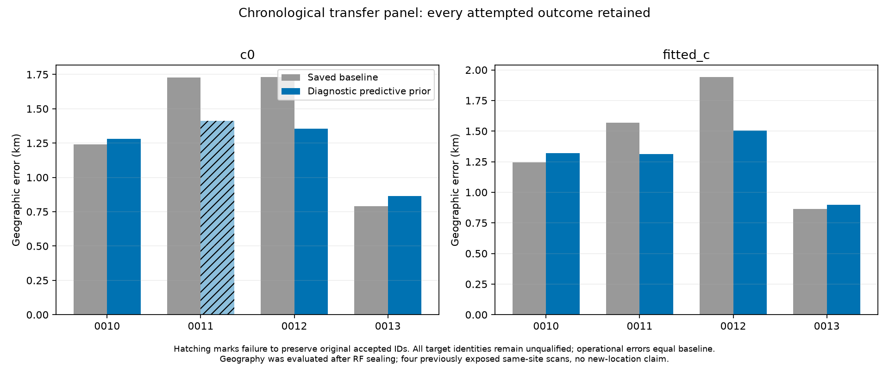

# DS24 fast-scan controls: mixed recovery transfer, known-label ambiguity, and direct receiver contrasts

Three SOL xhigh agents completed the next bounded experiments following the
[new-family uncertainty study](https://github.com/misko/leo-tracker-reduxredux/blob/7c11ca70240bbb029c2cb070992f3baa2979f288/reports/2026_10_25_ds24_new_family_uncertainty/README.md).
Uncertainty-aware additions improve two of four chronological fast scans and
worsen two. Known-label synthetic data recover artificial positions within
metres when noiseless, but produce errors up to 1.09 km with declared nuisance
and noise draws. Direct simultaneous receiver differences show a small,
heterogeneous predictive benefit across 24 scans.

These results narrow the next work. They do not qualify a new satellite
association or establish a new operational algorithm. All real-data operational
positions remain the saved baseline: fresh ALGO02-v1 with the qualified causal
signed phase prior and equal-assignment-prior family cavity.

| Experiment | Completed work | Main result |
| --- | --- | --- |
| Archived new-family transfer | 80 fixed branch checks and 8 position fits, 143.75 s | Two scans improve, two worsen; one arm loses 29 original accepted IDs. |
| Conditional fast-scan simulation | 24 position fits, 63.56 s | Noiseless 0.8–2.5 m; stochastic 0.12–1.09 km with correct identities. |
| Direct receiver contrasts | All 24 usable fast scans, 3.83 s | Projected held differential RMS 88.996 to 88.411 Hz; positive density gain on 13/24 scans. |

The durations are separate scientific execution times, not total development or
publication time. The localization branches use matched c=0/fitted-c observations,
candidate sets, other priors and search budgets. Fits start at the original
25 x 25 km regional box center, 37.906, -122.545. Real geographic evaluation at
37.849061591561885, -122.48574968092912 follows RF sealing and is never used to
choose candidates, priors or endpoints. The synthetic branch uses artificial
positions only. No new RF collection, IQ processing or production edit occurred.

## 1. Does predictive orbit uncertainty transfer to other recovered curves?

The previous two-case study showed that removing an unsupported orbital
correction also removed its uncertainty, allowing a recovered curve to pull
position too strongly. Preserving the existing physical covariance prevented
most of that regression, but did not beat the 0095 baseline. This iteration
tests the same evidence role on other archived candidates.

The earlier inventory contained 97 provisional rejected graph rows. Their full
accepted-ID ledgers, including postfit-only extensions, were not archived. We
reconstructed those ledgers at unchanged parent positions and phase references,
without fitting position or searching for new satellites. The first four
eligible distinct scans in recording-time order were 0010, 0011, 0012 and 0013.
Their proposed sources contain 50, 20, 59 and 53 points respectively, with exact
nonoverlap against the complete original accepted IDs in both c arms.

The nominees and aliases remain their archived proposals: 64023/0, 58175/1,
57743/1 and 60108/1. These identities were not validated by this experiment.
Each new source enters only as an experimental predictive factor; it cannot
update fixed-position parent receiver calibration or noise. Existing predictive
evidence and the new source retain their shared covariance. The unchanged
physical three-mode covariance is retained; no variance is tuned to geography.

The original causal Student phase distribution is integrated nonlinearly after
explicit conditioning on the operational +/-15 s domain. The same fixed
1281-node rule passed all 80 baseline/axis checks against 2561 nodes and an
adaptive reference, including score and gradient agreement. Every final endpoint
passes the corresponding numerical check. There were no retries, backfills,
multistarts or constrained rescues.

| DS24 scan | Candidate points | c=0 baseline to diagnostic error, km | Fitted-c baseline to diagnostic error, km | Original accepted IDs preserved? |
| --- | ---: | ---: | ---: | --- |
| 0010 | 50 | 1.242 to 1.281 | 1.246 to 1.319 | Both arms |
| 0011 | 20 | 1.728 to 1.413 | 1.567 to 1.311 | Fitted-c only; c=0 loses 29 |
| 0012 | 59 | 1.731 to 1.356 | 1.942 to 1.506 | Both arms |
| 0013 | 53 | 0.792 to 0.863 | 0.863 to 0.897 | Both arms |

Across every attempted endpoint, mean error changes from 1.373 to 1.229 km in
c=0 and 1.405 to 1.258 km with fitted-c. These are **diagnostic means including
the unqualified 0011 c=0 endpoint**, not policy gains. Seven of eight endpoints
preserve the full original accepted-ID ledger; all eight preserve original
likelihood IDs and pass the original curved/predictive/phase predicates.
The 29 lost IDs illustrate why checking only position-likelihood membership
would miss a regression in postfit compatibility.

Both arms improve on 0012 by 375/436 m, despite a slight rise of about 0.018 Hz
in the parent curved residual RMS. On 0010, position worsens while that RMS
slightly decreases. Frequency fit and geographic accuracy remain separate
outcomes. The 182 target points are experimental likelihood inputs and yield
**zero newly accepted target associations**. Every operational output stays at
its original baseline.

The [transfer findings](transfer/FINDINGS.md) contain the complete
[eight-row table](transfer/evaluation.csv), original ownership and endpoint
gate records, [native target CFO](transfer/figures/target_native_cfo.png),
[descriptive residuals](transfer/figures/target_residuals.png), and
[fixed-position target gradients](transfer/figures/fixed_target_gradients.png).
Those residuals omit target-local posterior constant/shape adjustments and are
not full-fit RMS or independent identity validation.

## 2. Can the estimator recover fast-scan positions with known identities?

This extends earlier conditional simulations to the first two usable fast
scans, 0010 and 0011, selected by metadata before outcomes. Artificial positions
are (-4,+3) and (+4,-3) km relative to the original regional center. The two
random seeds were frozen in advance. Labels, aliases, graph/source selection,
likelihood masks and powers remain known or inherited; this does **not** test
the association or source-selection stage.

The noiseless null uses direct bank-propagated Doppler at the causal phase mean,
with all other truth coefficients and measurement noise zero. Inference retains
its original positive noise and nuisance priors. The stochastic controls draw
domain-conditioned Student phase, original Gaussian receiver/smooth/physical
mode coefficients, 300 Hz source constants and per-curve Gamma precision with
conditional Gaussian noise. Synthetic true c is zero in both inference arms.
Four independent, recorded random streams separate shared latent variables,
point noise, predictive fragment constants and Gamma precision. Construction
tests caught and corrected a draft stream-reuse issue before freezing or fitting.

| Synthetic condition | c arm | Fits | Mean error | Median error | Maximum error | Original gates pass |
| --- | --- | ---: | ---: | ---: | ---: | ---: |
| Noiseless | 0 | 4 | 1.605 m | 1.563 m | 2.510 m | 0/4 |
| Noiseless | fitted | 4 | 1.603 m | 1.560 m | 2.502 m | 0/4 |
| Stochastic | 0 | 8 | 0.460 km | 0.391 km | 1.059 km | 8/8 |
| Stochastic | fitted | 8 | 0.469 km | 0.389 km | 1.094 km | 8/8 |

All 24 fits complete, and all phase/Gamma convergence checks pass. The noiseless
endpoints are 0.8–2.5 m from truth. Their objective is only 8.12e-6 to 3.53e-5
lower than at truth under the same final phase reference; covariance-volume
terms explain the small displacement. Forward construction closes within
1.35e-10 Hz. This panel provides no evidence of a kilometre-scale optimizer
failure under the noiseless declared model.

The original noise gates nevertheless reject all eight noiseless endpoints.
Exact saved-endpoint replay identifies 367 curved-track records failing both
profile and conditional lag-one autocorrelation, 54 additional owner-support
cascades, and 21 predictive ACF failures. These are repeated records across
arms/sites, not counts of independent physical tracks. No null RMS, bias,
alias, visibility, mean, slope, quadratic or step predicate fails. Tiny
deterministic residuals can have strong normalized autocorrelation. This is
an edge case in the gate statistic, not permission to loosen it on real data.

Conversely, all 16 stochastic fits pass the unchanged gates while errors reach
1.09 km with correct identities. Thus a kilometre-scale error does not itself
prove a wrong satellite. These eight stochastic realizations are too few to
estimate a population accuracy distribution or a precision floor. They do not
identify which nuisance component causes each displacement.

The generator uses linear engineering shape modes and explicitly conditioned
phase priors; conditioning removes up to 8.43%/4.09% of original phase mass in
the two cases. Inference retains fractional likelihood powers, parent
variational/phase approximations and Gaussian predictive approximations.
This is conditional model checking, not full generative or simulation-based
posterior calibration. See [synthetic findings](synthetic/FINDINGS.md),
[per-fit results](synthetic/per_fit.csv), [exact gate replay](synthetic/gate_replay.json)
and [null objective components](synthetic/figures/null_objective_components.png).

## 3. Is there directly measurable shared receiver behavior?

The contrast analysis uses all 24 usable fast scans, with accepted curved
satellite labels and physical IDs identical between parent c arms. It compares
the same satellite and exact RF/channel on RX1 and RX2 using measured,
alias-lifted CFO. It never subtracts a fitted position or orbital residual.
RX1 anchor times must be bracketed by RX2 points with a gap at most 2 s;
there is no extrapolation. Frequencies are normalized to 11.5 GHz.

Unknown per-track-pair constants and linear trends are removed in a whitened
orthonormal basis. The exact interpolation matrix retains covariance from
reused RX2 endpoints. Noise uses the original per-ID sigma times sqrt(2), the
declared unseen-Gamma inverse-precision moment; held-family noise is not fitted.
The analysis contains 154 family blocks, 5,724 unique RX1 anchors, 5,372 unique
RX2 endpoints and 5,186 retained contrast dimensions, with 1,752 nonzero
off-diagonal interpolation covariance entries.

One family is held out at a time. Other families predict it using the already
specified receiver basis: 31 Gaussian coefficients, 10 s spacing, 5 s width,
50 Hz prior SD. Controls reverse only training polarity, apply an orthogonal
75 s circular coefficient shift preserving training covariance, or retain only
untrained prior covariance. All compare the same held vector and full Gaussian
normalization.

Training can pool families from different bands after RF normalization,
assuming a shared fractional receiver process; this does not separately
validate each band's time-varying behavior.

| Predictor | Pooled held density gain over zero | Projected differential RMS, Hz | Scans with positive density gain |
| --- | ---: | ---: | ---: |
| Zero/affine baseline | 0.000 | 88.996 | — |
| Native training | +14.406 | 88.411 | 13/24 |
| Reversed training polarity | -40.967 | 90.076 | 7/24 |
| Circular 75 s training shift | +2.326 | 88.820 | 12/24 |
| Untrained prior covariance | -8.056 | 88.996 | 8/24 |

Native prediction reduces mean squared discrepancy on 19/24 scans and 97/154
family blocks, but the pooled RMS benefit is only 0.585 Hz. Positive density
gain does not always mean an improved prediction: 42 held families have no
training point within 5 s, and their gain is essentially supplied by prior
covariance while their RMS slightly worsens. The 43 fully time-covered families
improve from 88.038 to 86.340 Hz. This descriptive support breakdown is not a
post-hoc admission rule. Training folds overlap, so summed gains are not
independent significance evidence.

A nominal nine-position bank-curvature sensitivity changes the pooled gain
only to +14.393. It is not a bound over unknown phase/orbit error. Affine removal
does not eliminate arbitrary nonlinear transmitter/path differences. A relative
RX1-minus-RX2 contrast cannot identify which receiver causes the discrepancy or
recover absolute position after common Doppler has been removed. Adding these
same-data contrasts as independent localization observations would double-count
their source measurements.

The [receiver findings](receiver_contrasts/FINDINGS.md) include
[support and time coverage](receiver_contrasts/figures/support_and_time_coverage.png),
[family prediction versus overlap](receiver_contrasts/figures/family_prediction_and_overlap.png),
[chronological examples](receiver_contrasts/figures/chronological_examples.png)
and exact native-ID ledgers. This cross-RX GLRT diagnostic is distinct from the
previous independent same-RX IQ differential factor. Original labels and noise
proxies were selected from all RF data; the holdout does not undo that selection.

## Decisions and next work

Keep the operational baseline and do not promote a new ALGO. The four-case
transfer is promising in mean error but contains regressions, unresolved target
identity and an accepted-ID preservation failure. The synthetic results show
that passing residual gates is not a geographic accuracy certificate, and the
direct receiver witness is modest and time-support dependent.

The next useful checks are concrete:

1. Challenge every transfer nominee against archived causal alternatives and
   independent owners using the same rule, including the worsening examples.
   An attractive geographic endpoint must not qualify an identity. Reuse
   existing candidate/mixture machinery where appropriate; do not invent a
   satellite blacklist or tune only the favorable 0012 case.
2. Measure whether the low-amplitude ACF edge case actually occurs among real
   rejected curves before changing a gate. Separate normalized correlation
   from structured residual energy relative to independently specified noise.
   No gate relaxation follows from a noiseless synthetic limit alone.
3. Build the missing association-selection control or reuse the same synthetic
   draws for a predeclared nuisance ablation. Known-label tests cannot quantify
   association mistakes, and these combined nuisance draws do not isolate a
   single physical cause. Broad receiver flexibility searches have weaker
   support than tests with independent timing overlap.

## Artifacts and scope

The [coordinator plan](COORDINATOR_PLAN.md) and each branch's protocol record
the bounds. Seventeen owned tests pass (3 transfer, 7 synthetic, 7 contrasts),
alongside numerical transfer checks and exact synthetic endpoint/gate replays.
All failures are retained. Research sources and numerical artifacts are kept
separate from unchanged production components and unrelated dirty workspace
files. The [publication index](publication_index.json),
[declared input bindings](input_bindings.json), and [restore guide](RESTORE.md)
describe the compact archived outputs and exact numerical replay prerequisites.
This publication does not newly archive the entire frozen 24-scan input corpus.

This is previously examined, same-site DS24 evidence. No result establishes
new-location performance or a moving receiver trajectory. The active objective
remains improving fast-scan localization with general evidence-supported rules.
