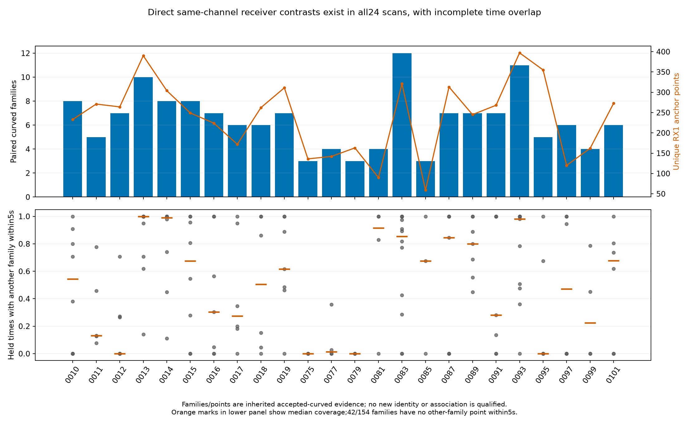
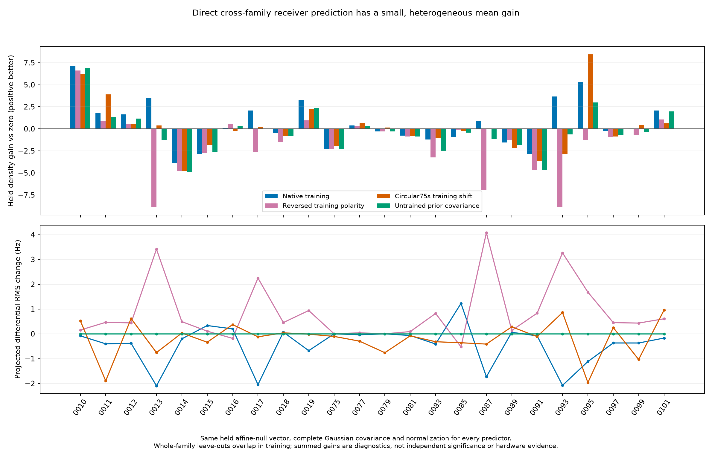
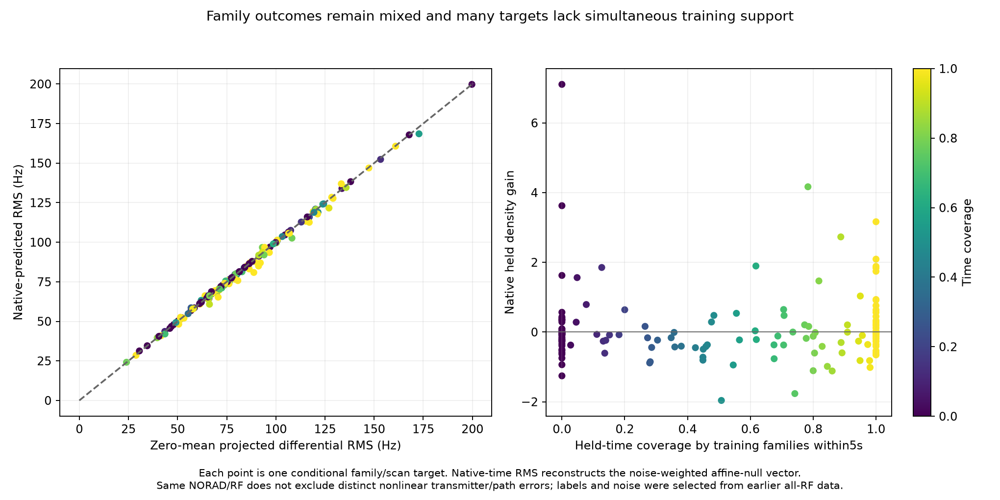
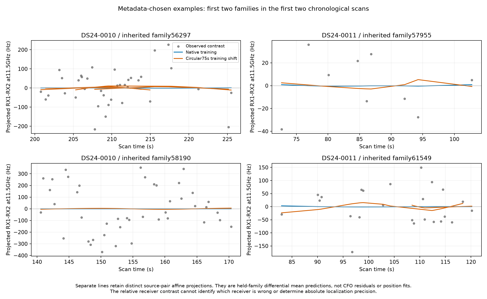

# Direct receiver contrasts reveal a small predictable relative component

Same-family, same-channel RX1−RX2 contrasts provide a measurement-level check
distinct from the earlier residual-shape witness. Predicting each held family
from other families reduces pooled projected-differential RMS from **88.996 to
88.411 Hz** at a common 11.5 GHz reference. Mean prediction improves on 19/24
scans and 97/154 family/scan blocks. The mean gain is small, time support is
incomplete, and the data do not identify hardware drift or absolute position
precision. No position fit, IQ operation, geographic reference or new nomination
was used. Nothing is adopted operationally.

## Existing evidence and what this adds

The prior `ds24-receiver-orbit-controls-20261025/receiver/witness.py` started
with measured CFO minus nominal Doppler, then removed fragment affine, orbital,
phase and local-position tangent directions. It found a small held-family
receiver-shape gain, while wrong-receiver/time controls also gained density.
The subsequent `ds24-receiver-shift-witness-20261025/heldout` study fitted
training-only positions and tested whole-family movement support. This study
repeats neither analysis: its target is the direct difference of simultaneous
measurements from different physical receiver IDs, with matching inherited
family, channel and RF. No nominal or fitted Doppler is subtracted from the
primary measured difference.

Differential RF work already exists in `tools/ds23_windowed_differential_factor.py`:
that factor uses independent finite-window same-RX, different-curve IQ contrasts
inside the original hierarchy and quarantines the original IQ support. This
study uses existing native-GLRT CFO estimates across receivers, reads no IQ,
and constructs no new localization factor. It is not an independent second
RF extraction from the original waveforms.

## Frozen construction and ownership

All 24 previously examined usable DS24 fast scans are included in chronological
order. The frozen [protocol](protocol.json) binds 172 source/input files and
predates the differential outcomes. Both parent c arms have exactly identical
accepted-curved family labels and physical IDs; that equality is asserted in
every scan. Only these original curved owners are eligible, with no predictive
or postfit-only point promoted into calibration. The raw contrast has no fitted
c dependence, so no new c-arm fit is required or performed.

Each RX1 anchor is bracketed by RX2 native points from the same inherited NORAD,
identical channel and exact RF. There is no extrapolation. The predeclared
maximum bracket is 2 seconds; actual maximum is 1.7774 seconds. A track pair
needs at least four matched anchors, enough for two contrasts after removing
its affine span. Lexicographic track order resolves overlapping proposals;
every physical RX1 anchor occurs once. Graph-lifted measurements are checked
against native CFO to be exact integer carrier aliases. Constant alias choices
vanish with the per-pair constant direction.

There are **154 paired family/scan blocks**, 269 source-track pairs, **5,724
unique RX1 anchors**, **5,372 unique RX2 endpoints**, and **5,186 retained
dimensions** after per-pair affine removal. All scans have at least three paired
families, so all 24 can be scored by leaving one whole paired family out.
Support is restricted to the observed receiver/band overlap; this does not
represent every accepted family or all times in a scan.

Native measurement noise uses the persisted original per-ID nominal sigma
times sqrt(2), the same unseen-Gamma moment convention used in earlier held
prediction. No held-family noise, Gamma precision or receiver coefficient is
learned from its target. An explicit native-ID linear interpolation matrix A
propagates `A diag(sigma²) A'`, retaining all correlations from reused RX2
endpoints. There are 1,752 nonzero off-diagonal matrix entries. The vectors are
whitened, then an orthonormal null basis removes each source pair's constant
and linear directions. Gaussian normalization uses the actual retained rank,
not a singular raw projection determinant.

The constant/linear removal deliberately discards both unknown transmitter/path
offsets and relative receiver offset/drift. The target tests only the remaining
time-varying component. Equal NORAD, channel and RF do not guarantee a shared
transmitter chain, beam/path offset or nonlinear path behavior. Such differences
remain possible explanations for the contrast.

## Held prediction and controls

Within each scan, all other paired families train a 31-coefficient Gaussian
receiver basis, with fixed centers every 10 seconds from 0 to 300 seconds,
5-second widths and 50 Hz coefficient SD at 11.5 GHz. The complete held-family
Gaussian density retains shared coefficient covariance, residual quadratic and
log volume. No hyperparameter was searched. Leave-family-out training sets
overlap; their summed gains are diagnostics, not independent log evidence or
calibrated significance.

Each measurement pair uses identical RF, while training can pool other paired
families across bands after RF normalization. A shared fractional receiver
process is an explicit model assumption; band-dependent electronics or
transmitter paths are not independently calibrated here.

| Predictor | Density gain vs affine-only zero | Projected differential RMS, Hz | Positive scan density gains |
| --- | ---: | ---: | ---: |
| Zero / affine only | 0 | 88.996 | — |
| Native other-family training | +14.406 | 88.411 | 13/24 |
| Reversed training receiver polarity | −40.967 | 90.076 | 7/24 |
| Circular coefficient shift of 75 s | +2.326 | 88.820 | 12/24 |
| Untrained prior covariance | −8.056 | 88.996 | 8/24 |

The polarity control reverses training RX1−RX2 while leaving target orientation
unchanged. Swapping both receivers everywhere leaves scores invariant; that is
an algebra test, not physical receiver attribution. The time control applies
an orthogonal fractional circular rotation to the 31 coefficient coordinates
(310-second coefficient period). It preserves every training basis norm and
training autocovariance. Its disadvantage cannot be explained by losing basis
support at scan edges. This is a coefficient-space negative predictor, not a
claim of periodic physical receiver drift.

Time overlap is a substantial limitation. Median held-time coverage by another
family within one 5-second basis width is 61.7%; 42/154 held families have none.
The following natural coverage strata are descriptive reporting, not an
adoption rule:

| Other-family time coverage | Families | Zero → native RMS, Hz | Native density gain | Prior-only gain |
| --- | ---: | ---: | ---: | ---: |
| None | 42 | 87.598 → 87.612 | +7.593 | +7.772 |
| Partial | 69 | 90.090 → 89.638 | −4.501 | −13.413 |
| All held times | 43 | 88.038 → 86.340 | +11.314 | −2.415 |

The no-overlap density gain occurs without better mean prediction and is almost
entirely reproduced by untrained covariance. It must not be counted as learned
hardware signal. The fully covered stratum supplies stronger conditional
cross-family mean evidence, but still uses selected labels/noise and is not
an independent recording/session validation.

Examples use the first two numerical family labels in each of the first two
chronological scans, chosen without inspecting gains. Separate source pairs
retain separate affine projections.

## Interpolation sensitivity and scope limits

A separate engineering sensitivity adds the squared linear-interpolation error
envelope estimated from nominal archived sky curvature over the full saved time
grid and nine positions in the original 25 km search region. It is not a bound
over physical orbit/phase errors, identity uncertainty or arbitrary transmitter
variation. The largest nominal envelope is 21.52 Hz at 11.5 GHz. Adding it in
quadrature changes native pooled gain only from 14.406 to 14.393, and RMS from
88.4112 to 88.4115 Hz. This limited sensitivity does not establish that actual
interpolation error is negligible under all model errors.

The native-CFO noise map, GLRT estimator, track lifts, labels and masks were
selected previously from all RF data. Holdout is conditional on these objects.
Unknown native time correlations or cross-receiver estimator correlations are
not modeled beyond the exact reuse covariance. The Gaussian sigma convention
is a proxy, not calibrated uncertainty; the baseline standardized RMS is 0.635,
which does not itself measure sensor precision after selection and projection.
The 40-degree antenna geometry is not a calibrated bearing observation.

Canceling common Doppler deliberately removes position-sensitive information.
This experiment cannot estimate absolute receiver frequency error, decide which
receiver needs correction, justify a position movement, validate a satellite
identity, or infer achievable localization error from the differential RMS.
At most, it supplies a separate conditional measurement check for a small
predictable relative time-varying component, with much of the support incomplete.

## Artifacts and bounded verification

The all-24 computation completed in **3.83 seconds** on one worker with BLAS,
OMP and MKL threads fixed to one. No failed case, extra fit or scientific-source
repair occurred. The original seven component tests pass: interpolation
covariance, affine/alias invariance, rank, dense Gaussian parity, target
redaction, receiver/shift algebra, injected common signal and a white-noise null.
The first test invocation lacked the existing SciPy dependency path; adding
`PYTHONPATH=/tmp/algo03-feasible-deps` fixed the environment without changing
source or results.

[family_scores.csv](family_scores.csv), [case_scores.csv](case_scores.csv),
[pooled_method_summary.csv](pooled_method_summary.csv),
[time_coverage_strata.csv](time_coverage_strata.csv) and [support.csv](support.csv)
retain every target and control. Per-case JSON and CSV files retain exact
native IDs, interpolation endpoint weights, timing, projected observed vectors
and held mean predictions. [scientific_seal.json](scientific_seal.json) binds
the frozen results; [report_seal.json](report_seal.json) binds all four figures
in PNG and PDF and the derived summary tables. The executable sources and
small tests are included. No source is imported from another checkout at
runtime; only NumPy/SciPy and the explicit immutable research input files are
needed for the contrast calculation.

Reproduction uses the repository `.venv/bin/python -B`, the existing SciPy path
above, and the thread settings `OPENBLAS_NUM_THREADS=1 OMP_NUM_THREADS=1
MKL_NUM_THREADS=1`. `freeze.py` refuses to overwrite a protocol; `contrasts.py`
and `report.py` refuse to overwrite results. A new replay therefore needs a
separate output root and explicit historical input-path mapping. This record
does not authorize new fits, RF collection or a new receiver correction.
