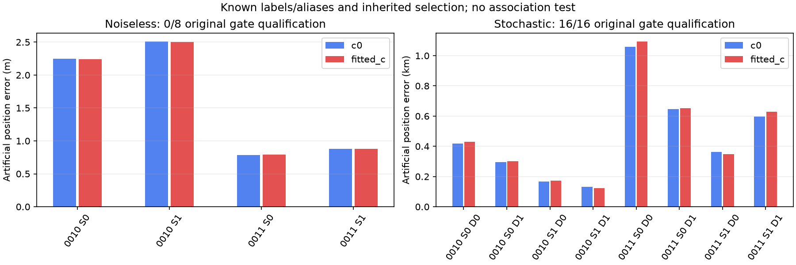
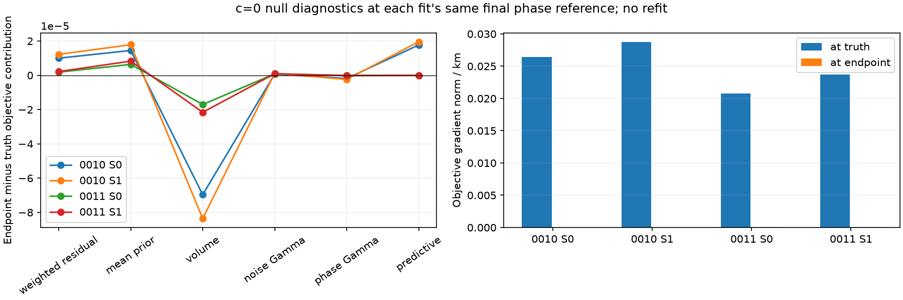

# Fast geometry closes in the noiseless control; declared nuisance draws still permit kilometre errors

All **24 predeclared position fits completed in 63.56 seconds**, without retries,
timeouts or extra fits. The eight noiseless controls recover their artificial
positions within **0.787–2.510 metres**. All sixteen stochastic controls pass the
unchanged original gates, yet position error ranges from **0.123 to 1.094 km**.
This is a known-label, known-alias conditional test. Association and point
selection were inherited and **were not tested**; real GPS was not used.

The null controls are accurate but **0/8 qualify** under the original residual
structure gates. This is distinct from optimizer failure. Every stochastic
control qualifies, and every null/stochastic phase and Gamma convergence check
passes. No gate was relaxed to obtain either result.

## Frozen experiment and actual generator

The first two eligible fast scans by recording UTC, excluding 0095/0087, are
DS24-0010 and DS24-0011. Selection used the existing cohort metadata, not their
real position errors. Their active curved/predictive likelihood counts are
2571/615 and 2241/0. The preserved catalogue, original selected masks, family
identities, original likelihood powers and prior scales are matched across c=0
and fitted-c. Aliases are known from synthetic generation, rather than recovered
from the observations. The generating c is zero in both inference arms.

The artificial east/north positions are **[-4,+3] and [+4,-3] km** relative to
the original regional center 37.906,-122.545. Seeds **2026102511/2026102512** were
frozen before result outputs. For each case/site there is one deterministic
null and two stochastic draws, each fitted with both c arms: 24 fits total.
Every fit starts at [0,0] in the original 25x25 km region, with five phase
refreshes and at most 48 position iterations per refresh. There are two workers,
one BLAS/OMP/MKL thread each, 180 s per fit and a 1200 s shared batch cap.

The null forward mean uses exact bank-based nonlinear Doppler at each family's
original causal phase location, with zero receiver/smooth/shape/fragment
coefficients and zero observation noise. The fitter retains the original
positive noise uncertainties and integrated nuisance priors. Maximum known
forward-mean reconstruction error across all controls is **1.344e-10 Hz**.

Each stochastic draw uses:

- Original causal Student nu=3 phase locations and original marginal scales,
  with the unit-variance Student scale factor sqrt((nu-2)/nu), explicitly
  conditioned on [-15,+15] seconds by inverse CDF. All original locations lie
  inside that domain: [-4.7928,+0.1922] s in 0010 and [-2.4131,+0.0281] s in
  0011. The largest removed family prior masses are 8.4299% and 4.0889%.
- Independent Gaussian receiver hardware, receiver smooth and supported
  three-mode physical-shape coefficients at the original declared scales.
  Curved and predictive source constants have 300 Hz SD. Shape is a linear
  engineering-mode contribution evaluated at the true phase and artificial
  position, not propagation of a fully perturbed nonlinear orbit.
- One independent Gamma(shape=2, rate=2) precision per generated track, shared
  across that track's points, and independent per-ID Gaussian noise conditional
  on that precision. Original per-ID sigma is retained, with noise sigma/sqrt(tau).
  Four separate PCG64 streams bind coefficient/phase, Gaussian observation noise,
  predictive fragment constants and Gamma precision. Both c arms receive exactly
  the same synthetic observations, labels, masks and aliases.

The generator is deliberately explicit. It is **not the full inference model's
exact generative distribution**: original powers include 0.2/0.6/1, yielding
generalized evidence; inference retains parent variational/Gaussian and local
phase approximations, unrenormalized parent phase priors with clipped refreshes,
and the predictive unseen-Gamma Gaussian moment approximation. The generator
instead conditions phase on the operational interval and draws actual Gamma
precisions. No posterior rank or coverage calibration was performed, so this
is not simulation-based calibration or a measured irreducible accuracy bound.

## All results, without excluding gate failures

| Control | c arm | Fits / original-qualified | Mean error | Median error | Maximum error |
| --- | --- | ---: | ---: | ---: | ---: |
| Noiseless | c=0 | 4 / 0 | 1.605 m | 1.563 m | 2.510 m |
| Noiseless | fitted c | 4 / 0 | 1.603 m | 1.560 m | 2.502 m |
| Stochastic | c=0 | 8 / 8 | 0.4600 km | 0.3913 km | 1.0587 km |
| Stochastic | fitted c | 8 / 8 | 0.4689 km | 0.3892 km | 1.0939 km |

The complete per-instance c-arm errors, qualification flags, phase/Gamma changes,
forward closure, truth/endpoint objective differences and gradients are in
[per_fit.csv](per_fit.csv). All round checkpoints and generation truths remain
in [fits](fits/). The worst stochastic draw is 0011/site0/seed0, with c=0/fitted-c
errors 1.0587/1.0939 km despite known identities and passing original gates.
Its objective prefers the estimated position over truth by 8.0204/8.5120 units
under the same final phase reference. None of these finite conditional examples
establishes the cause or distribution of real-data errors.

## Why the null endpoints move slightly and fail gates

At each saved endpoint, we evaluated truth, endpoint and regional origin using
the same final phase reference and nuisance construction. Truth was also
evaluated with its actual generating phase reference. These are fixed evaluations,
not new fits or a multistart search.

For all eight nulls the final objective is lower than truth by only
8.123e-6–3.532e-5. The leading negative component is marginal log-volume; tiny
residual/mean-prior/predictive costs offset part of that decrease. At truth the
finite-difference objective gradient norm is 0.0206–0.0287/km, versus at most
1.23e-4/km at the returned endpoints (h=.01 km). Thus the observed metre-scale
displacement agrees with this marginalized approximate objective; these checks
provide no evidence that the optimizer missed the truth's lower objective.
They do not prove global optimality or remove phase-linearization effects.

Exact replay of all 24 endpoints reproduces every saved gate decision. Across
the eight null arms, **367 curved-track records fail both profile and conditional
lag-one ACF**, using the original limit abs(ACF)<=4/sqrt(n); **54 further curved
records fail only the original owner-support cascade** after those failures.
Another **21 predictive-track records fail ACF**. No null RMS, bias, alias,
visibility, mean, slope, quadratic or step predicate fails. The fitted null
conditional RMS is only 0.00146–0.00865 Hz. Tiny smooth deterministic residuals
can have high normalized ACF; these noise-structure gates were not designed to
declare zero-noise numerical residuals white. This is a gate-domain observation,
not permission to change the production gates. Stochastic draws have no failing
primitive or owner-support predicates. [Full predicate replay](gate_replay.json)
preserves the failures and never treats an unqualified null as an adopted result.

## Interpretation and next boundary

The first two available fast geometries do not show a kilometre-scale noiseless
known-label closure failure under this construction. Conversely, the declared
stochastic nuisance/noise draws already yield substantial errors with correct
labels and passing residual gates. Missing identities or a local optimizer
failure are therefore unnecessary to create such errors in these examples;
neither hypothesis is excluded for actual recordings. Eight stochastic c pairs
are insufficient to separate individual nuisance causes, calibrate uncertainty,
or establish real-data performance. A lower in-sample frequency objective is
reported separately from synthetic position error.

The earlier 120-fit DS23 study used adaptive geometries, Gaussian observation
noise, fixed masks/labels and truth-conditioned nuisance variants. This panel
adds first-available fast geometries, a noiseless closure contrast, explicit
per-track Gamma observation draws, fixed-truth objective/gradient diagnostics,
and exact rejection accounting. It still inherits observed-data selection and
does not test association. The reviewed `fresh_discovery`, `fit_case` and
`select_entries` hooks require consistent full synthetic discovery groups and
raw/clutter sources; unused real tracks were not mixed into a claimed synthetic
selection run. No extra campaign or production change follows from this panel.

Seven owned construction tests pass, including forward identity, fixed-seed
replay, independent stream bindings, c-arm ID/label/alias equality, out-of-domain
phase rejection and absolute posterior-phase bounds. Fits took 2.366–10.208 s
each. The fixed endpoint/gate replay took 6.67 s, without any refit. Inputs,
sources, protocol and all raw results are sealed in [protocol.json](protocol.json),
[scientific_seal.json](scientific_seal.json), and
[report_data_seal.json](report_data_seal.json). The operational baseline and
prior publications remain unchanged.
