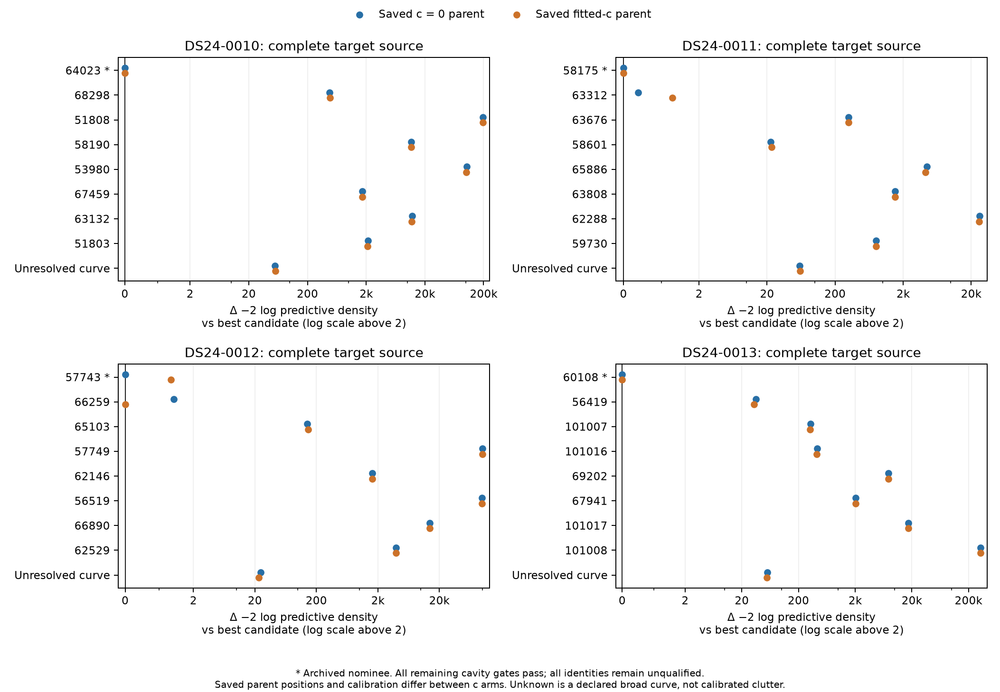
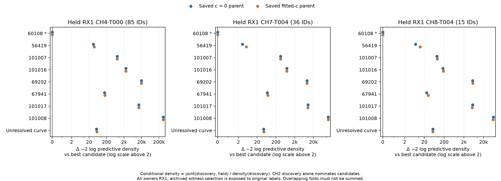

# Causal identity challenge: ambiguity is case dependent

The broader screen finds a new close alternative for **0011**, preserves the
weak state-dependent **0012** competition, and favors the archived **0010**
and **0013** nominees within the frozen eight-candidate pools. For 0013 the
same nominee also wins three complete-owner conditional challenges. These
are new RF diagnostics, not validated identities or operational associations.
No position fits or GPS/error lookups were performed.

The complete experiment took **78.889865 s**: 8.933407 s for the four catalogue
screens and 69.956457 s for exact scores, two workers with one BLAS thread each.
It used all 112 predeclared candidate contexts, well below the 600 s cap. All
eight case/c-arm jobs completed; every remaining parent RF gate, phase bound,
precision/support guard and declared numerical check passed. No scientific
retry, backfill, rescue, changed prior width or position policy was needed.

## What changed from the preceding identity review

Each target source screened its complete original causal catalogue at the
saved c=0 baseline: 1,405/1,422/1,447/1,487 candidates for0010/11/12/13.
The original nominee plus at most seven alternatives were frozen before exact
comparisons, retaining 0012/66259 explicitly. Candidate aliases were not fixed
to the incumbent: every identity and the unresolved null used exactly the same
whole-source k=−4,...,+4 support and uniform 1/9 weights. Candidate phase and
three-mode physical priors used the same fresh causal construction, with
candidate-specific causal parameters rather than incumbent fitted parameters.
The Gaussian phase screen only nominates; exact scoring uses the unchanged R2
nonlinear phase integration.

Every comparison uses a **common union cavity**: all shortlisted families'
curved and predictive observations are withheld from calibration/conditioning
for every candidate and the null. In each arm this removes 280 curved plus 62
predictive observations on 0010, none on 0011/0012, and 41 curved observations
on 0013. The remaining parent references receive five fixed-position refreshes;
the original saved positions do not move. The shared conditional radio
covariance, old/new cross-covariance, unseen-noise convention and 300 Hz source
constant priors remain matched. The physical three-mode covariance includes
level/phase-like components; it is not a pure projected-curvature experiment.

## Complete target-source comparisons

All numbers below are differences in **−2 log predictive density**. A positive
runner-up gap favors the listed best candidate; a positive null gap favors that
candidate over the declared unresolved-curve comparator.

| Target | Best / runner-up at saved c=0 parent | Runner-up gap | Best / runner-up at saved fitted-c parent | Runner-up gap | Unresolved minus best, c=0 / fitted |
|---|---|---:|---|---:|---:|
| 0010, nominee64023 | 64023 /68298 | 475.554998 | 64023 /68298 | 481.919296 | 55.285961 /57.299112 |
| 0011, nominee58175 | 58175 /63312 | **0.383957** | 58175 /63312 | **1.288927** | 59.776826 /60.860258 |
| 0012, nominee57743 | 57743 /66259 | **1.422431** | **66259 /57743** | **1.343895** | 24.681702 /23.093847 |
| 0013, nominee60108 | 60108 /56419 | 35.279748 | 60108 /56419 | 32.584340 | 56.142406 /55.845512 |

0011's nominee leads its newly found competitor by only about 1.21:1 and 1.90:1
conditional density ratios. 0012 remains about 2:1 either way and reverses
ranking. These ratios are conditional on the finite candidate pool, causal
priors, allowed aliases and saved parent state. The two c arms have different
saved **positions and calibration**, so their differences do not isolate c
alone. A broad unresolved curve loses even when two satellite identities are
nearly tied: the null comparison does not resolve this ambiguity.

## 0013: whole-owner challenges favor 60108, with important limits

Only the original CH2 T005 target's 53 native IDs nominate the eight candidates.
The other complete sources have 85, 36 and 15 IDs; all 189 IDs are distinct and
outside both complete parent accepted-ID ledgers, including postfit extensions.
For each held source we evaluate the normalized conditional density
`p(discovery,held | candidate,parent) / p(discovery | candidate,parent)`,
integrating shared phase, physical modes, radio covariance and both source
aliases. The parent receiver/noise calibration is never trained on either
source. Each pair has 81 equally weighted alias combinations. The null uses
the same shared parent covariance and independent proper curve priors per source.

| Held RX1 owner | IDs | Best / runner-up in both arms | Runner-up conditional gap, c=0 / fitted | Unresolved minus60108, c=0 / fitted |
|---|---:|---|---:|---:|
| CH4 T000 | 85 | 60108 /56419 | 35.410815 /38.900585 | 53.182375 /55.741175 |
| CH7 T004 | 36 | 60108 /56419 | **3.278786 /5.270130** | 44.645088 /45.732038 |
| CH8 T004 | 15 | 60108 /56419 | 7.064527 /12.225482 | 52.789745 /54.013203 |

This provides conditional cross-owner consistency beyond the discovery-source
fit; the CH7 comparison is materially weaker than CH4. It is not independent
cross-receiver identity validation: all owners use **RX1**, and the witnesses
were originally frozen from archived graph rows already assigned60108.
Their values do not enter this wave's new shortlist, but historical witness
selection is exposed to the original assignment. A common RX1/model error or
an omitted catalogue competitor remains possible. The overlapping pairwise
folds must not be summed as independent significance.

## What these scores do and do not establish

Both physical and unresolved models are proper **finite translated-Gaussian
mixtures on the same complete real observation vector**, with identical alias
weights and radio-conditioned mean/covariance. The null replaces only the
orbit curve with the existing broad degree-four Legendre prior
`PERIOD/sqrt(6)`, separately per source. It is not empirical clutter calibration,
an infinite wrapped-domain density or a new acceptance threshold. The finite
shortlist is discovery-source selected; omitted catalogue mass is not zero.
The R2 phase law remains the causal Student ν=3 conditioned on [−15,+15] s,
including its conditioning normalizer. Parent VI/Gaussian and linear physical
mode approximations remain. A likelihood winner therefore stays unqualified.

The maximum 1281-versus-2561 score discrepancy was 7.2973e−5, and the maximum
held-owner conditional discrepancy 5.5054e−5. The 16 best/runner-up single-source
rows plus six held-owner winners received the declared adaptive checks;
maximum discrepancy was 1.8596e−5. All were below 1e−3. No position-gradient
qualification is claimed. QUADPACK emitted roundoff warnings on some adaptive
calls; returned relative error bounds and independent terminal comparisons
passed, and no tolerance/node count was changed. Both phase-domain endpoints
and all integration nodes passed visibility checks.

All 112 physical and 14 unresolved alias diagnostics were stable: expanding
the image-sum support from ±4 to ±5 changed the image sums by zero at saved
precision, and maximum unchanged-support whole-period shift sensitivity was
1.14e−12. Known finite-mixture normalization changes were removed for this
range comparison; the primary nine-alias prior was never enlarged. Synthetic
tests independently check exact data/alias relabeling, permutation, normalized
mixture mass, rank-three versus full dense Gaussian scores, conditional
factorization and timeout propagation. All five owned tests pass; C's terminal
audit verifies hashes, cavities, 112 scores and 22 adaptive rows without new
propagation.

## The discriminating next step

Identity ambiguity is now concrete on 0011 (58175/63312) and 0012 (57743/66259).
Those pairs should be frozen in any next RF-only challenge, with a response-free
whole-owner witness definition and the same candidate/alias/prior treatment.
0013 supplies useful held-owner consistency but still needs a witness whose
selection does not depend on the archived 60108 assignment, ideally already
recorded on another receiver. Availability must be established before promising
that test; do not manufacture a witness or add points until it passes.

For 0010/0013, the tested alternatives do not presently explain the nominee's
evidence as a simple label swap. Their relative support does not establish
localization accuracy or rule out receiver/orbit/join error. The next localization
change should therefore follow a specific RF or synthetic model contradiction,
not promotion of the largest density gain or generic extra flexibility. No
new operational identity rule, position refit or production change follows
from this wave.

## Artifacts and reproducibility

[Protocol](PROTOCOL.md), [frozen bindings](protocol.json),
[scientific source](challenge.py), [owned tests](test_challenge.py),
[independent preflight](independent_preflight.json), [execution](execution.json),
[RF seal](RF_seal.json), [all scores CSV](scores.csv),
[summary/pools/margins](summary.json), [report checks](report_checks.json),
[candidate figure PDF](candidate_identity.pdf),
[held-owner figure PDF](whole_owner_identity.pdf), and
[current report seal](report_seal.json) are local artifacts. Per-case screen,
cavity, candidate checkpoint and result JSON files preserve every scientific
attempt. `preparation01/02/03` retain superseded zero-science preparation
snapshots; the prelaunch fixes propagate deadlines and add finite precision/
support guards, with no scientific result overwritten. The independent final
audit is in the study root's `audit/identity_terminal_audit.json`.
