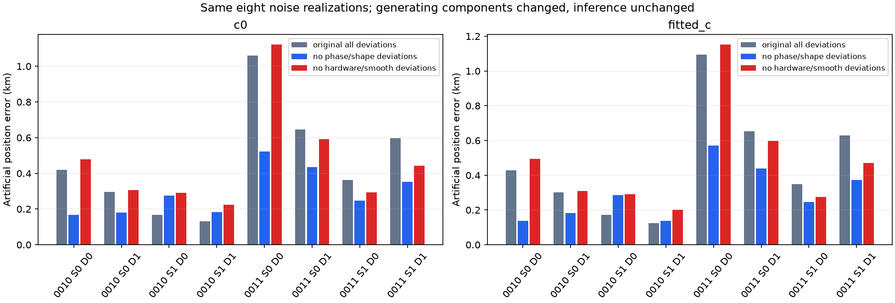
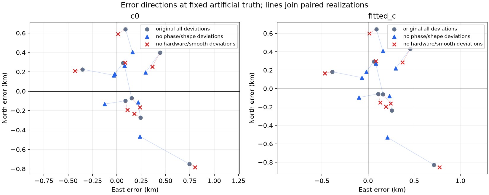

# Removing generating phase/shape deviations helps most paired draws; receiver removal is mixed

All **32 new fits completed and pass the original gates**. On the same eight
noisy fast-scan realizations, removing generating phase and physical-shape
deviations reduces c=0/fitted-c mean artificial-position error from
**0.4600/0.4689 to 0.2954/0.2966 km**. It improves six realizations and worsens
two in each arm. Removing generating hardware/smooth receiver deviations gives
**0.4685/0.4743 km**, improving three and worsening five. No seed, fit or failed
outcome was replaced; no real GPS or new RF was used.

These are generating-component interventions with **unchanged inference
priors**, not known-nuisance inference oracles. They diagnose this conditional
simulator, not a measured satellite-orbit error or RX1 hardware defect.

## Exact common controls and interventions

The eight controls are the previously frozen DS24-0010/0011 geometries x
artificial positions [-4,+3]/[+4,-3] km x seeds 2026102511/2026102512. All eight
original observation hashes and saved coefficient, phase, noise and Gamma
arrays reconstruct exactly in both c arms. The previous sixteen noisy control
fit outputs are reused, **not refitted**. Four independent recorded streams
still bind latent coefficients/phase, per-ID Gaussian noise, predictive source
constants and Gamma precision. Preparation independently reconstructs the
Gaussian and Gamma streams; the new interventions consume their saved draws.

- `no_orbital_deviations` sets true phase to each **original causal prior mean**
  and zeros the three physical-shape coefficients of each originally supported
  family. It does not set phase to zero. Hardware/smooth coefficients, curved
  and predictive source constants, Gaussian noise and per-track Gamma draws
  remain identical. Phase-dependent Doppler and physical-mode geometry are
  recomputed at the changed true phase.
- `no_receiver_deviations` zeros all generating hardware and smooth coefficients
  for both receivers. Original nonlinear phase draws, physical-shape coefficients,
  source constants, Gaussian noise and Gamma precision remain identical.

Both c arms receive the same saved intervention observations. Inference keeps
the original priors, fractional powers, labels, masks, sigma map, 25x25 km box,
regional center, [0,0] cold start, zero initial phase references and five x 48 iteration budget. True c remains
zero. Known common-control integer aliases are preserved as a gauge; synthetic
values need not stay in the centered alias interval. No alias or association
selection is exercised.

The original Student phase draws are unit-marginal-variance nu=3 laws conditioned
on +/-15 s. In the no-orbital intervention the discarded random phase draw is
retained as provenance, while the actual generating phase is deterministic at
its causal mean. Inference is not told which generating coefficients are zero.
Physical shape remains an original linear engineering-mode model, not fully
nonlinear perturbed-orbit propagation. Original parent VI/local-phase and
predictive Gaussian approximations and likelihood powers remain, so this is
not full generative simulation-based calibration.

## Every paired outcome

| Generating condition | c arm | Mean error, km | Median, km | Maximum, km | Improved / worsened control |
| --- | --- | ---: | ---: | ---: | ---: |
| Original all deviations | 0 | 0.460013 | 0.391318 | 1.058704 | Reference |
| Original all deviations | fitted | 0.468903 | 0.389244 | 1.093897 | Reference |
| No phase/shape deviations | 0 | 0.295396 | 0.261449 | 0.522417 | 6 / 2 |
| No phase/shape deviations | fitted | 0.296559 | 0.265643 | 0.570534 | 6 / 2 |
| No hardware/smooth deviations | 0 | 0.468473 | 0.374965 | 1.121502 | 3 / 5 |
| No hardware/smooth deviations | fitted | 0.474285 | 0.389672 | 1.152272 | 3 / 5 |

Both no-orbital regressions are **0010/site1, one for each seed**, in both c
arms. The original components can partly cancel other effects in an individual
realization; removing one group is not guaranteed to improve its position.
Removing phase and shape together cannot distinguish their individual effects.
Even this combined removal leaves errors up to **0.571 km**. Noise, source
constants, receiver draws and the unchanged estimator's prior/approximation
effects remain. The eight realizations do not identify a precision floor.

The paired east/north vectors change direction as well as magnitude. For
example, the c=0 mean error vector changes from [0.184,+0.046] km to
[0.102,+0.062] km without phase/shape deviations, while receiver removal gives
[0.170,-0.003] km. These small-panel averages are descriptive, not a general
directional bias estimate. [paired_results.csv](paired_results.csv) retains
every vector, directional cosine and paired endpoint displacement.

## Frequency fit is a separate outcome

| Generating condition | Mean curved residual RMS c=0 / fitted, Hz |
| --- | ---: |
| Original all deviations | 108.055 / 108.047 |
| No phase/shape deviations | 108.040 / 108.033 |
| No hardware/smooth deviations | 107.972 / 107.964 |

Receiver removal gives the largest small RMS decrease while mean artificial-position
error does not improve. The generating interventions change observations;
their raw endpoint ELBO values are **not same-data model-selection scores**.
[RF summary](rf_summary.json) reports those scores separately. For each new
fit, fixed truth and endpoint evaluations use the **same final phase reference**;
weighted residual, mean-prior, volume, noise-Gamma, phase-Gamma and predictive
changes are saved in the CSV and raw diagnostics. Truth is also evaluated at
its generating phase reference. No global-optimality claim follows from these
fixed checks.

## Gates, numerical checks and artifacts

There are **zero runtime, original track-gate, phase, Gamma or region failures**
among the 32 new fits; exact saved-endpoint replay reproduces every gate
decision. All outcomes enter the error summaries. Maximum known forward-mean
closure error is 1.31e-10 Hz. The maximum final objective-gradient norm is
9.72e-5 per km at h=.01 km. Four owned transformation tests and the independent
preflight review pass. The [independent terminal audit](../audit/synthetic_terminal_audit.json)
also verifies all 262 sealed files, 32 gate decisions, sixteen matched c-arm
observation pairs, error norms and saved objective decompositions.

The new fit batch takes **57.15 s wall time** (1.60–6.66 s per fit, 109.16 summed
worker-seconds). Wall time from first preparation, including independent review
wait, is 160.02 s at execution completion and 221.19 s through the final fixed
replay, within the frozen **600 s** cap. Two workers each use one BLAS/OMP/MKL
thread; each fit has a 180 s cap. There are no retries, rescues, seed rerolls or
extra inference oracles.

Actual observations, times, physical IDs, known aliases, labels and likelihood
membership are saved in sixteen compact NPZ files under [instances](instances/),
alongside all original/intervened truths and unchanged noise/source bindings.
The [preparation receipt](preparation.json) binds the eight old controls, and
the [protocol](protocol.json), [scientific seal](scientific_seal.json),
[gate replay](gate_replay.json), [summary](summary.json) and
[report-data seal](report_data_seal.json) bind the new outputs. Parent input,
production code and prior studies remain unchanged. No publication or further
campaign is part of this branch.
