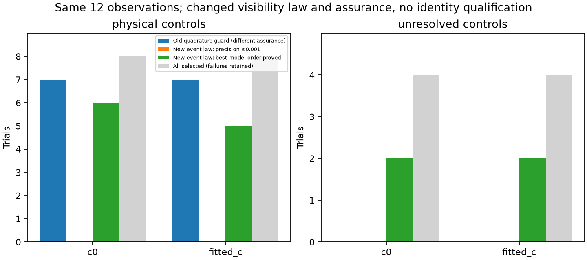
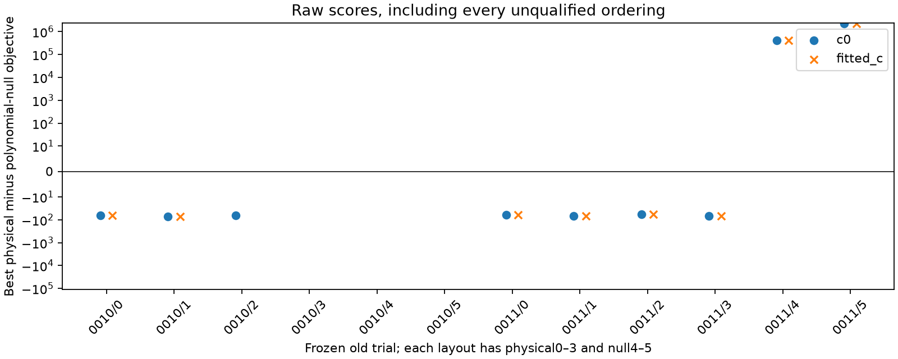

# Visibility support and extreme-density regression: bounded order proofs, incomplete precision

The frozen old 12 replay proves **15 finite-pool best-model orderings** under the
new visibility-event law: 11 physical winners and 4 polynomial-null winners.
All 11 physical proofs select the generating identity; all 4 null proofs select
the declared null. **No new ordering achieves the stronger absolute score
certification.** Seven of 24 arm contexts have no terminal result because the
frozen deadline was reached. There is no wrong completed raw physical winner,
operational identity assignment, position fit or localization improvement.

This is an archived regression on previously examined conditional synthetic
observations, not fresh validation. Both c arms retain the exact same old CFO,
ordinary shortlist, causal priors and aliases; their respective saved raw
residual/covariance and parent arrays are reused directly. No parent calibration
or phase refresh is rerun. The old generator/scorer conditioning difference
remains: generation used the full parent, while the archived exact scorer used
the response-dependent union-shortlist cavity. There is no matching-law
calibration, false-acceptance estimate or new-source simulator here.

## Separate outcomes and full denominators

| Controls / arm | Selected | Terminal arm results | Old quadrature guard passed | New absolute score certification | New bound-proved best-model order |
|---|---:|---:|---:|---:|---:|
| Physical / c0 |8|7|7|0|6|
| Physical / fitted c |8|6|7|0|5|
| Polynomial null / c0 |4|2|0|0|2|
| Polynomial null / fitted c |4|2|0|0|2|

The old guard and new certification are **different assurance criteria**, not
comparable success rates. The old test checked dense/adaptive quadrature and
all-domain visibility. The new precision criterion additionally encloses
unsampled physical modes and support-boundary mass. Zero new certifications
does not imply that14 old passed guards were wrong, nor that new arithmetic is
less accurate. An analytic counterexample establishes why two agreeing
quadratures alone cannot provide the stronger assurance.

The 24 arm slots contain 17 terminal results and 136 terminal candidate contexts.
Four additional candidate-only checkpoints survive in the interrupted
0010/trial2/fitted-c arm. 52 candidate slots were not reached. The
[candidate table](report03/candidate_details.csv) explicitly retains all 192
slots; the [arm table](report03/outcomes.csv) retains all 24. The completed
0010/trial2/c0 result remains complete even though its paired trial did not
finish. No partial checkpoint is promoted to an ordering.

Two completed contexts, 0010/trial0 in both arms, fail the frozen null-eigensolve
agreement guard: 4.78e−7/4.91e−7 versus the declared 1e−7 comparison threshold.
Their null floating allowance is 1e−6, but that does not waive the stricter
guard. The third failure predicted before launch, 0010/trial3/fitted-c, was
never reached. These are conservative arithmetic blockers, not physical/null
winner disagreements. All other completed contexts have a strict order proof.

## What changed in the likelihood and arithmetic

The original causal Student nu3 remains normalized on [-15,+15] seconds with
unchanged location, scale and prior mass. A phase now contributes zero physical
likelihood if any complete native observation is below the nominal horizon.
The visible prior mass is **not renormalized**. This is joint CFO plus the
declared visibility-event evidence, not a detected-conditional phase prior.
It is an explicit physical support-law change, separate from numerical repair.

Support is certified from the actual piecewise-linear position bank plus Earth
rotation. Every shifted interpolation knot is retained; nominal/mode grid
equality is checked. Sign/derivative bounds locate visible intervals and narrow
root brackets; unresolved tangencies would abstain. Root-bracket evidence enters
the full upper bound. The original constant/phase-overlapping3 physical modes,
shared saved covariance, independent300Hz source constant, unseen-noise factor2,
and uniform whole-source aliases−4,…,+4 remain unchanged.

All 136 completed candidate supports certify. 134 have the original fully
visible support, so their numerical score differences are not physical-law
changes. The two changed contexts are the former visibility blocker 100539 in
0011/trial1, one per c arm. Its visible prior mass is0.950928604544, with
3.98e−12 in the root bracket. It now has a finite raw c0 score638.63 and a broad
evidence interval that nevertheless lies below the winner's evidence. The
generating 56530 winner is proved in both arms without claiming a precise
absolute score for 100539. The old results remain archived and unmodified.

The Woodbury quadratic is evaluated as a positive residual-plus-coefficient
energy, retaining the original determinant and density normalizer. Log-domain
tanh-sinh and independent composite Gauss-Legendre32/64 avoid the old absolute
integral scaling problem. They still do not by themselves certify completeness:
the preflight counterexample makes both methods miss99% of a narrow off-grid
Gaussian-plus-background mixture and falsely report convergence. An additional
physical log-density envelope bounds every alias, mean/covariance derivative,
original prior and unsampled phase interval. It uses native min-sigma times
sqrt2 as a valid covariance eigenvalue lower bound, never marginal diagonal SD.

A best-model proof requires one model's LOWER log evidence to exceed EVERY
other UPPER log evidence, including the polynomial null and all eight physical
candidates. Unknown evidence blocks that proof; certified empty support is
exact zero evidence. This establishes an ordering under these finite conditional
models, not calibrated identity probability. It needs no precise million-unit
score for a hopeless physical alternative. Floating allowances remain explicit.

## Remaining numerical and compute limits

No candidate meets the stronger absolute enclosure criterion: 123 envelopes stop
once exclusion is proved, while 13 reach the frozen 8192-panel cap with intervals
still too broad. This is not a relaxed1e−3 precision test. Primary tanh-sinh
reports convergence on133/136 completed candidates; three extreme null-source
comparisons retain nonconverged panel statuses at the fixed maximum level.
Of 46 required reference comparisons, 44 pass their own 32/64 check. The two
failures,68395 on0011/null-trial4 in both arms, differ by about0.640/0.639 in
objective between those orders, even though primary versus64-node differences
are at most1.64e−4 across all references. No tolerance or node count was changed.
Their evidence upper bounds still exclude them by very large margins, so the
null order proof does not depend on pretending those scores are precise.

Scientific work used 477.013 cumulative worker-seconds, including producer
tests, and 299.84 seconds wall time. The common wall deadline conservatively
allocated half of the remaining 600-second worker budget to each case. 0011
finished in 176.75 worker-seconds; 0010 reached that deadline. Idle-worker budget
was not reassigned or used to rescue missing contexts. There were no rerolls,
retries, extensions, new draws, parent/position fits, new RF or GPS reads.

Fourteen owned tests pass, including disconnected/narrow visibility, tangent
abstention, extreme log density, the jointly missed99% mode, physical derivative
bounds and strict ordering/unknown/empty semantics. Independent
[preflight](../audit/preflight.json) verifies the original330 sealed scientific
hashes and mathematical controls. The independent
[terminal02 audit](../audit/terminal02.json) passes after exact restoration of a
report-only source that raced the final seal. Original failed audit/report
attempts remain preserved; no scoring, protocol or numerical artifact changed.
The RF-sealed report01 source remains byte-identical; report02 adds interrupted
artifact handling, and [report03 source](report_support03.py) corrects metric
labels and produces the final figures/table. Their separate
[report seal](report03/seal.json) binds the final reporting bytes.

The useful advance is a limited, independently checked distinction between
absolute precision and mathematical exclusion of losing models. It does not
change the old observation shortlist or provide new difficult physical truths.
It does not resolve real close identities, validate any association, measure a
false-acceptance rate, or improve localization. The inherited layouts were
historically response-selected. Fresh confusable controls require a separately
frozen matching-background law; none runs after this bounded replay.

Core artifacts: [protocol](protocol.json), [execution](execution.json),
[RF seal](RF_seal.json), [final summary](report03/summary.json),
[all arm outcomes](report03/outcomes.csv),
[all candidate slots](report03/candidate_details.csv).
