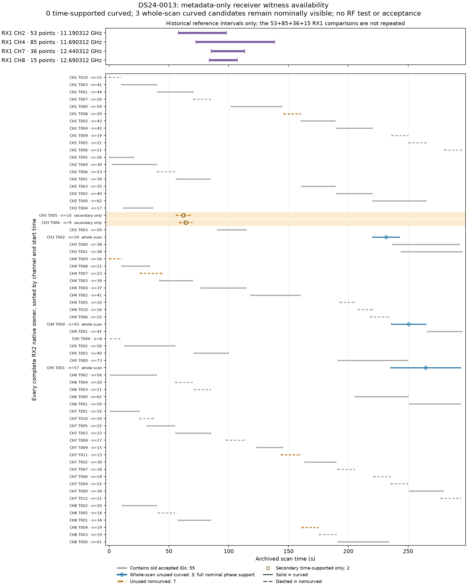

**All three whole-scan RX2 candidates remain nominally visible.**

The geometry check certifies full phase support [-15,+15] s for every original
native timestamp of all three frozen unused curved RX2 owners. There are no
unresolved intervals or horizon-root brackets. None can be excluded by this
nominal visibility rule. This is positive hypothesis feasibility, not evidence
that any observed source is satellite 60108.

| Complete RX2 owner | Native IDs | Nominal phase support, s | Certified interpolation pieces |
| --- | ---: | --- | ---: |
| CH3/T002 | 24 | [-15,+15] | 744 |
| CH5/T001 | 57 | [-15,+15] | 1,767 |
| CH4/T000 | 43 | [-15,+15] | 1,333 |

The 124 native IDs remain distinct and unused by either original accepted-ID
ledger. The original question still has zero unused curved RX2 owners with
overlapping/adjacent support. Dropping that restriction was an explicitly
separate whole-scan question: an orbit hypothesis can predict later
observations across a gap. The earlier sealed
[whole-scan findings](WHOLE_SCAN_FINDINGS.md) record the pre-geometry proposal;
this note completes that proposed check without changing those bytes.

The fixed observer is the saved original c0 RF endpoint, converted using the
unchanged regional-center rule. No evaluation coordinate is used. The exact
causal bank hash, selected elements and 60108 element epoch/collection cutoff
are checked. The original bank is never extrapolated. An exact-byte snapshot
of the shared `support_geometry` port partitions phase at bank interpolation
knots and certifies the topocentric-up sign using derivative/curvature and
rounding bounds. Three endpoint/central diagnostic phase nodes separately check
the public phase-rotation/ENU convention; those samples are not the certificate.

This event uses the **nominal causal bank plus orbital phase**, not visibility
integrated over Gaussian physical-mode uncertainty. It establishes neither true
orbit visibility, actual transmitter identity nor calibrated GLRT detection
probability. No measured CFO value, assignment-closeness score, new propagation,
future element, position fit, IQ processing, GPS or operational association is
used. Geometry takes 0.215 s under its 30 s single-thread cap. Three owned tests
pass for full/empty support and rejection of bank extrapolation. Initial missing-
SciPy-path import failures occurred before loading inputs or running geometry;
they are preserved, and the unchanged source runs with the existing archived
dependency path.

The highest-value next real-data test is separately frozen ordinary full causal
catalogue nomination for **each** of these three metadata-selected sources,
with no forced 60108 entry, no choosing the best source after scores and no
assumption that all three belong to one family. Preserve every shortlist miss,
null/unresolved result and numerical failure. Any predictive comparison with
the discovery source must retain shared discovery/receiver/orbit covariance,
appropriate separate source constants and matched c0/fitted-c inputs and budgets.
Do not sum overlapping-discovery comparisons as independent evidence. Availability
and nominal visibility do not authorize that RF test or an association here.

After that prerequisite, an active-parent phase-dependent physical-mode
reference remains a distinct possible approximation test. Repeating the three
old RX1 held-owner scores or the target/identity B(phi) integrals would repeat
completed work. No new-source position fit follows from this geometry result.

Sources: [geometry protocol](geometry_protocol.json),
[complete result](geometry_result.json), [sliced causal geometry](geometry_input.npz),
[exact support-port snapshot](geometry_support_snapshot.py),
[geometry seal](geometry_seal.json), [original time-supported findings](FINDINGS.md),
[whole-scan metadata pool](whole_scan_inventory.json),
and [versioned illustration seal](availability02_seal.json).
