# DS24: receiver-movement validation and curved-track recovery

**Completed 2026-10-25. Research result: do not promote a new ALGO from this iteration.**

The frozen movement-selection rule retained the shared-RX1 correction on only
3 of 24 usable scans. It improved fitted-c mean position error by **9 m**, with
**no median or P95 improvement**. It also discarded most of the existing RX1
candidate's average benefit. The earlier promising distinction between scans
0017 and 0095 did not reproduce across two new satellite-family partitions.

A separate recovery pilot added one curved family on each of two scans. It
increased GLRT association and conditional geometric information on both, but
position error improved modestly on 0087 and worsened substantially on 0095.
These experiments show why residual compatibility, predictive fit and point
coverage must be evaluated separately from geographic accuracy.

The baseline remains unchanged. No receiver-correction/recovery combination,
production change or new ALGO release is claimed. This is development evidence
from previously examined, same-site scans, not unseen-location validation.

## Scope and controls

The frozen DS24 revision-2 fast population has **34 recordings**. Required saved
tracking contracts exist for **24**; 0001–0009 and 0103 remain explicit unavailable
rows. This describes this frozen comparison's input availability, not whether
raw recordings or newer upstream products exist. See the complete
[cohort ledger](cohort_ledger.json) and [position table](evaluation/positions.csv).

Three SOL xhigh agents implemented movement validation, recovery and independent
audit/evaluation in parallel. The coordinator froze the protocol, allocated
compute and reviewed interpretation and publication. The experiments implement
the approved execution plan, preserved with the publication source material.

The baseline is fresh ALGO02-v1 plus the qualified causal signed phase prior and
equal-assignment-prior family cavity. The receiver candidate adds the previously
defined RF-scaled RX1 smooth correction: 31 Gaussian coefficients, 10 s spacing,
5 s width, 50 Hz coefficient scale and RF/11.5 GHz loading. This study tests a
new rule for choosing that existing candidate; it does not redefine the model.

Every ordinary held-family or recovery fit starts independently at the center
of the original **25 × 25 km box, latitude 37.906, longitude −122.545**.
The inherited recovery constrained rescue continues its ordinary endpoint
and phase reference. Causal TLE inputs,
candidate universes and the declared physical priors are inherited and bound by
hash. There is no cross-scan position pooling or assumption of one stationary
site across recordings. Each scan still fits one position; receiver motion
within a scan is not modeled in this experiment.
Both **c = 0 and fitted c** use matched observations, candidate sets, other priors
and budgets. The evaluation coordinate, **37.849061591561885,
−122.48574968092912**, is used only by the geographic evaluator after the RF
decisions are sealed. All 24 geographic outcomes had been examined in earlier
work; workspace separation is a reproducibility discipline, not a security or
blind-validation boundary.

## 1. Complete movement policies on all 24 scans

All policies retain qualified positions for the same 24 scans by using the exact
saved baseline pair on rejection. “RX1 retained” counts paired c-arm adoption.
The existing RX1 policy includes its original eligibility and paired-gate
fallbacks; it is not an unrestricted choice of the best GPS result.

| Policy | c arm | Mean error (km) | Median (km) | P95 (km) | Worst (km) | RX1 retained |
| --- | --- | ---: | ---: | ---: | ---: | ---: |
| Baseline | 0 | 1.202 | 1.135 | 2.087 | 2.188 | 0 / 24 |
| Existing RX1 candidate | 0 | 1.112 | 1.079 | 1.889 | 2.089 | 18 / 24 |
| New movement rule | 0 | 1.190 | 1.135 | 2.087 | 2.188 | 3 / 24 |
| Baseline | fitted | 1.220 | 1.114 | 2.131 | 2.205 | 0 / 24 |
| Existing RX1 candidate | fitted | 1.120 | 1.090 | 2.064 | 2.141 | 18 / 24 |
| New movement rule | fitted | 1.211 | 1.114 | 2.131 | 2.205 | 3 / 24 |

The new rule improves **one scan, worsens two and leaves 21 unchanged** in each
c arm. Its mean benefit is 12.7 m for c = 0 and 9.0 m for fitted c. The existing
candidate improves 11, worsens seven and leaves six unchanged, with respective
mean benefits of 90.2 and 100.0 m. Its regressions still need explanation; this
study does not convert that candidate into a released algorithm.

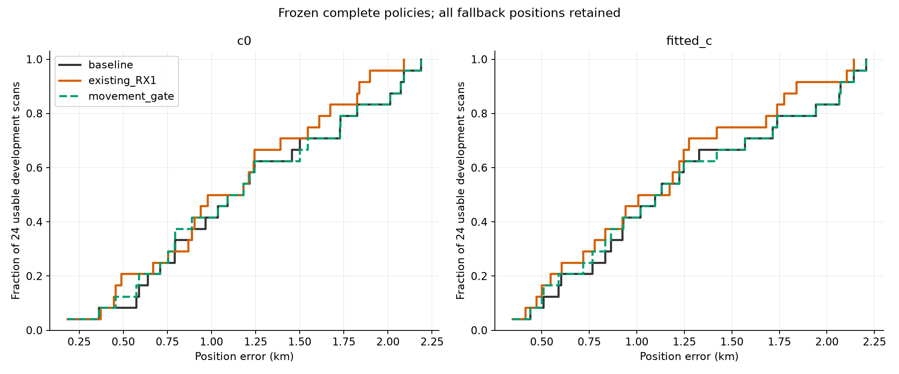

The planned descriptive advancement criterion required better mean **and**
median error with no P95 deterioration in both arms. The new rule fails because
the median does not improve. Removing the previously discussed examples 0017
and 0095 does not change the conclusion: on the remaining 22 development scans,
fitted-c mean changes from 1.2169 to 1.2071 km, while median and P95 stay fixed.
All 12 policy/arm/subset rows are in [summary.csv](evaluation/summary.csv).

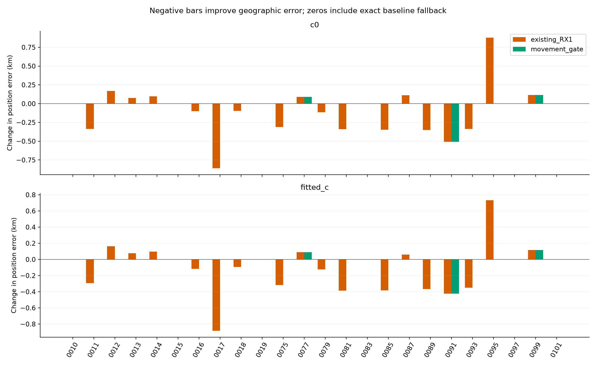

The only retained cases are:

| Scan | Fitted-c baseline → new rule (km) | Change |
| --- | ---: | --- |
| 0077 | 1.328 → 1.419 | 91 m worse |
| 0091 | 0.923 → 0.500 | 423 m better |
| 0099 | 0.602 → 0.717 | 115 m worse |

Membership is identical across all three movement policies: **78,067 / 108,600
original winning GLRT points = 71.8849%** enter the position likelihood. This is
the disjoint union of 66,110 curved-calibration points and 11,957 predictive
points. It excludes post-fit-only compatible points. Movement validation adds
no tracks, points or satellite identities.

Frequency RMS is a separate outcome. Mean per-scan curved RMS for fitted c is
71.380 Hz at baseline, 68.381 Hz for the existing candidate and 70.784 Hz for the
new rule. Lower RMS does not establish a more accurate position. The identical
point masks make these particular frequency comparisons matched; the recovery
comparisons below change masks and have a different interpretation.

## 2. What the family-validation experiment actually tests

For each scan, two fixed seeds, `2026102504` and `2026102505`, independently
partition the active satellite families into three folds. The generator is
`PCG64(SeedSequence([seed, numeric_scan_suffix]))`; sorted family indices,
permutations and native-ID lists are saved. Every receiver/channel owner of a
held family is removed together from training position and calibration factors.
Training predictive points retain their original position-only role.

Each fold fits baseline and RX1 models in both c arms from the regional center,
using five phase-refresh rounds of at most 48 position steps. At both resulting
training-only positions, each predictor refreshes its nuisance state using only
training data. Held phases remain at causal prior means. The held vector is
scored jointly, retaining shared receiver covariance, its quadratic residual
term and covariance log determinant. Native noise multipliers 1, √2 and 2 are
all retained; figures use √2 unless stated otherwise.

For a fixed predictor, the movement gain is its held loss at the
baseline-trained position **minus** its held loss at the RX1-trained position.
Positive gain favors the RX1-trained position under that same predictor. This
differs from comparing two models each at its own endpoint, which can reward
better nuisance flexibility without supporting the position movement.
Both comparisons and their quadratic/log-determinant decomposition are saved in
[fold gains](movement/fold_gains.csv),
[aggregate gains](movement/aggregate_gains.csv) and
[own-model gains](movement/own_model_gains.csv).

The three fold gains are summed within each partition/predictor/c/noise
combination. The complete rule requires all **24 aggregate gains** to exceed
`1e-8`, original RX1 eligibility and full-data paired gates, complete finite
results, final train/fixed-position phase changes ≤0.01 s and Gamma
log-precision changes ≤1e−5. A final position termination of `iteration_budget`
rejects the candidate. The existing `small_step_and_improvement` and
`no_accepted_damped_step` labels are permitted; neither is proof of stationarity.
Any failure selects the exact saved baseline pair. There is no seed reroll,
fold omission, extra iteration, GPS-based choice or post-evaluation threshold
change. The final policy selects saved full-data endpoints without refitting.

### The earlier two-example distinction does not reproduce

The previous witness partition suggested that held-family prediction could
support the useful movement on 0017 while rejecting the harmful one on 0095.
The new partitions do not preserve that distinction:

| Scan | Fitted-c predictor | Seed 2026102504 gain | Seed 2026102505 gain |
| --- | --- | ---: | ---: |
| 0017 | baseline | +9.400 | −27.515 |
| 0017 | RX1 | +19.009 | −15.977 |
| 0095 | baseline | +15.213 | +29.881 |
| 0095 | RX1 | +20.840 | +39.368 |

These are √2-noise joint fold-summed objective differences, not probabilities,
independent replicates or significance levels. Scan 0017's full-data RX1
candidate improves error from 2.071 to 1.188 km, but the new rule discards it.
Scan 0095's receiver-only candidate worsens error from 0.439 to 1.173 km, yet
held prediction favors that method in both new partitions. **0095 falls back
because training-phase convergence fails, not because held prediction rejects
the movement.** It must not be counted as a predictive-selection success.

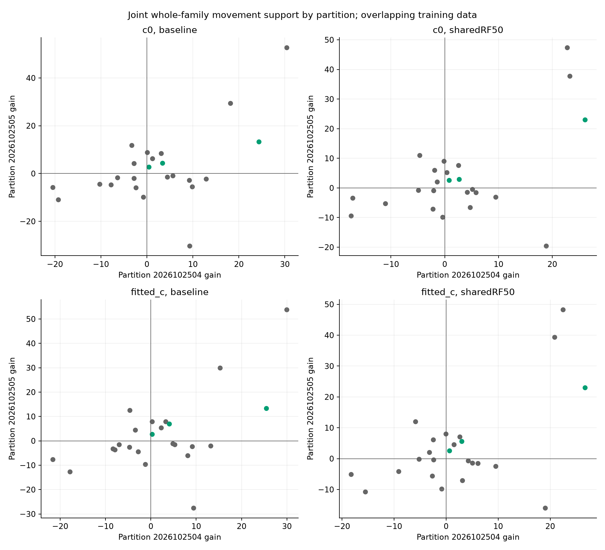

Green points are the three retained cases; gray points fall back for at least
one criterion. Six scans pass all 24 positive-gain conditions: 0010, 0019, 0077,
0091, 0095 and 0099. Original paired gates reject 0010 and 0019; convergence
rejects 0095. The saved [decisions](movement/decisions.json) retain every reason.

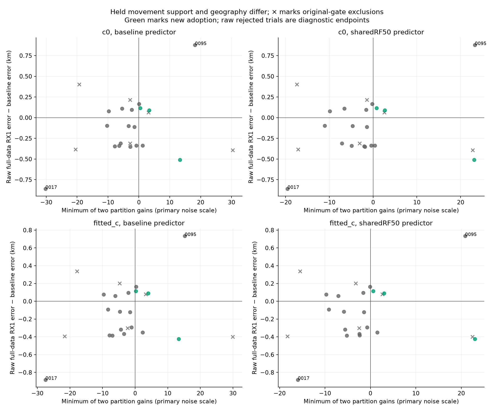

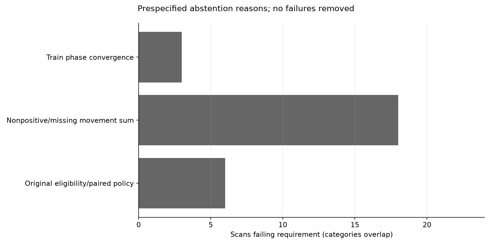

Folds fit different training positions. Consequently this is cross-validation
of a method-selection rule, not an independent test of the exact displacement
of a full-data endpoint. Graphs, labels, native noise estimates and support
definitions are inherited from the prior RF analysis. They are not rebuilt
without the held families, so this is conditional cross-validation rather than
an untouched end-to-end holdout. The predictive reference uses Gaussian moment
covariances and the original Gamma inverse-precision moment approximation;
held Student-phase variance is reset to its unit marginal prior variance. These limitations
remain explicit rather than being repaired after looking at geographic errors.

## 3. Recovery adds real likelihood evidence, with mixed accuracy

The two scans were selected by the largest saved c = 0 curved weak-axis scale,
not position error: 0095 (0.972 km) and 0087 (0.928 km). The scale is conditional
on the selected RF model, not a calibrated uncertainty interval. The existing
whole-curve recovery method screens the three longest wholly unassociated
actively curved sources against the original causal catalogue, refining at
most eight identities including the original. The target curve cannot calibrate
its own nomination. Each of seven nonempty source combinations is tested per
scan. Whole-source IDs, aliases, priors and budgets are matched across c arms.

**Ordinary graph reentry rejects all 14 combinations**, so its complete policy
retains baseline. A separately named, predeclared support-aware control tests
at most two failed proposals per scan. It retains all incumbent active family
definitions and points, while allowing a newly active one-owner family to use
phase without the three unsupported orbital-shape coordinates. After the
technical corrections described below, it admits one source per scan:

| Scan | Newly active modeled family | Added curved observations | Position-likelihood GLRT before → after | Likelihood % before → after | c = 0 error before → after (km) | Fitted-c error before → after (km) |
| --- | --- | ---: | --- | --- | --- | --- |
| 0095 | 65500, RX1 CH5 | 49 | 2262 → 2311 / 4050 | 55.852 → 57.062% | 0.360 → 1.450 | 0.439 → 1.631 |
| 0087 | 57752, RX2 CH7 | 43 | 3601 → 3644 / 4401 | 81.822 → 82.799% | 1.500 → 1.427 | 1.713 → 1.626 |

These are model assignments, not independently established emitter identities.
Each addition creates a new active curved family, taking family counts from
15 to 16 and 22 to 23. Each currently has one receiver/channel owner. Neither
creates an independent receiver station or cross-owner confirmation.

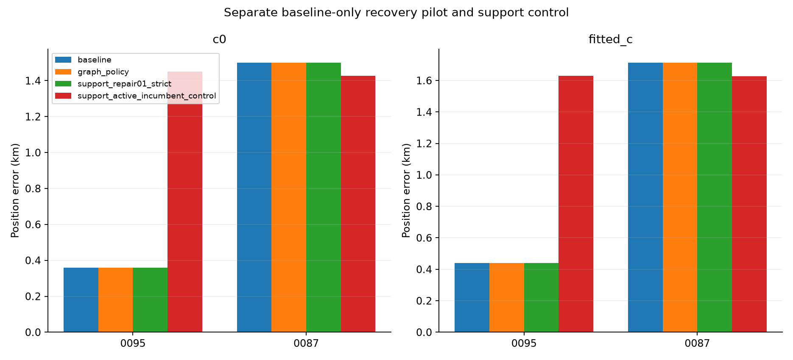

Compatibility counts are larger because they also include accepted points that
do **not** enter position likelihood. For 0095 this is 2671 → 2735 / 4050,
**65.951 → 67.531%**; for 0087, 3601 → 3665 / 4401,
**81.822 → 83.277%**. Both add 64 compatible points, but only 49 and 43 enter
curved calibration; the other 15 and 21 are post-fit-only. Predictive IDs remain
unchanged (zero for 0095, 644 for 0087). Every parent compatible and likelihood
ID survives. The primary percentage comparable to the movement policy's
71.8849% is the position-likelihood percentage, not the post-fit-inclusive one.

### Native CFO views before and after

**Gray means all original native GLRT points, red means unassociated, blue
shows incumbent curved-source observations and orange shows the recovered
source.** Gray alone is not an unassociated label. Lines connect measured
source observations; they are not orbit predictions or new polynomial fits.
Connections break at alias jumps and gaps. The header distinguishes compatible
points from points entering the position likelihood.

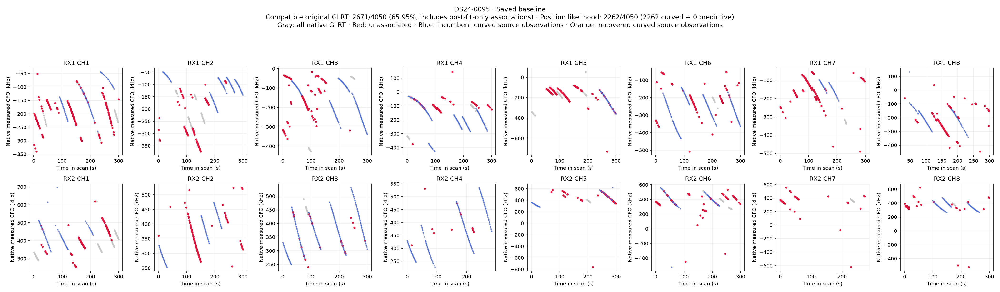
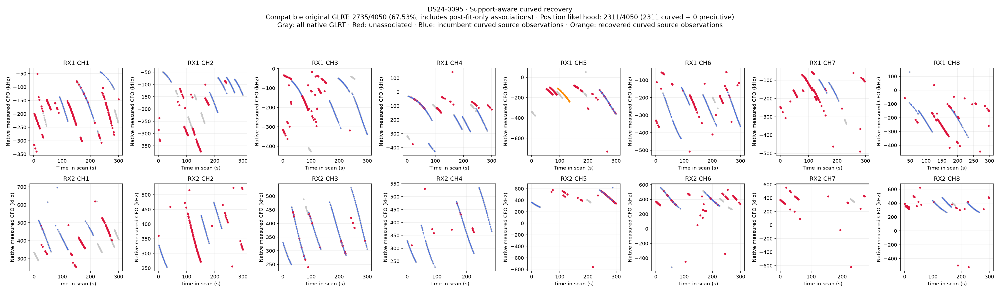

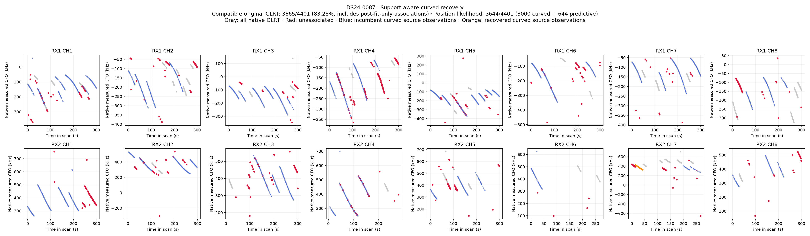

The remaining sources were not forced into the model. For example, the
62-point 0095 RX2 CH2 nominee 66886 has fitted-c RMS 112.954 Hz in the simplified
support control, but a slope z-score of 6.597, quadratic BIC gain of 39.575,
maximum step z-score of 6.762 and lag-one correlation of 0.851. It is structured
despite modest RMS. On 0087 a different RX1 CH8 source nominated to 57752 has
RMS 1824.585 Hz and remains rejected. Those failures are distinct from the
accepted RX2 CH7 source. Full mechanisms, ordinary/rescued endpoints and
rejected proposals are preserved in [recovery findings](recovery/FINDINGS.md)
and [all trial geographic results](evaluation/recovery_trial_positions.csv).

### Residuals and information are not substitutes for position error

| Scan | c arm | Full curved RMS before → after (Hz) | Conditional weak-axis scale before → after (km) |
| --- | --- | --- | --- |
| 0095 | 0 | 50.336 → 50.772 | 0.972 → 0.897 |
| 0095 | fitted | 50.169 → 50.644 | 0.964 → 0.892 |
| 0087 | 0 | 65.429 → 65.010 | 0.928 → 0.878 |
| 0087 | fitted | 65.367 → 64.945 | 0.923 → 0.876 |

These RMS summaries use different point masks before and after. Raw likelihood
totals across those masks must not be interpreted as a matched model advantage.
The information calculation uses curved observations, fixed selected labels and
fitted Gamma precisions, and eliminates nuisance parameters using their priors.
Position derivatives agree at 10 m and 20 m steps. Baseline and candidate
endpoints/noise states also differ, so the scale change is not a fixed-state
causal decomposition of just the new points.

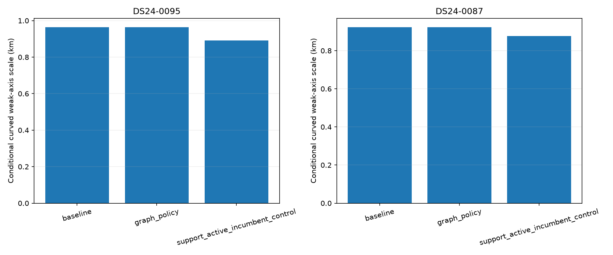
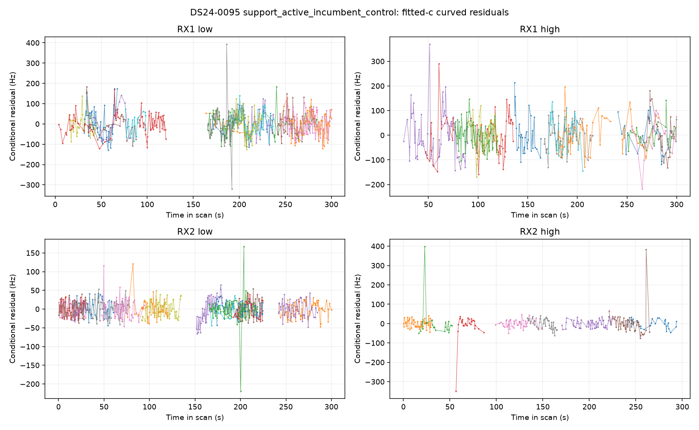
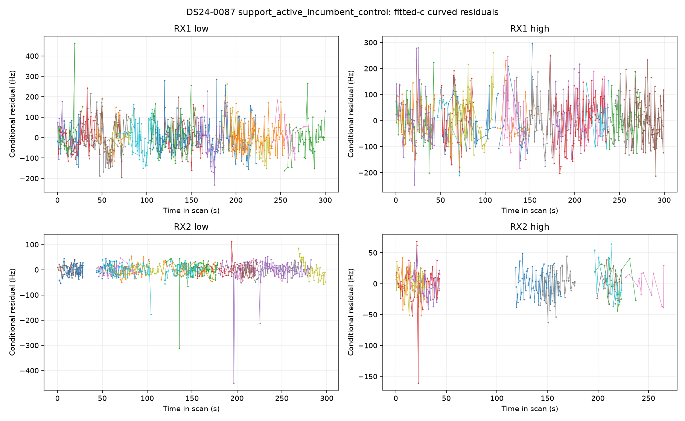

At the support endpoint, deleting the new family and reprojecting nuisances
reduces weak-direction information by 0.164739 km⁻² on 0095 and 0.129480 km⁻²
on 0087 in fitted c. This is a fixed-position/noise/prior influence diagnostic,
not a family-deletion position search; contributions are not additive.

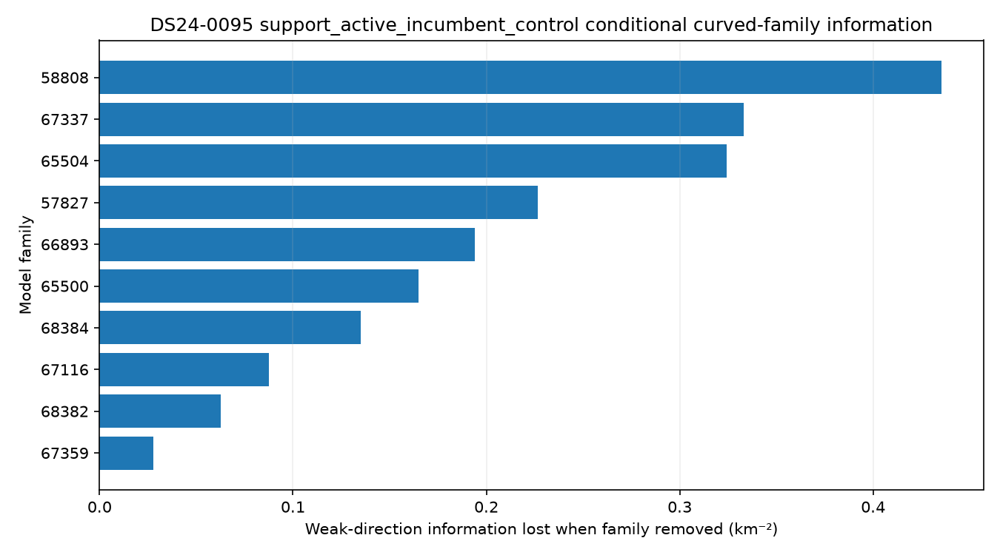
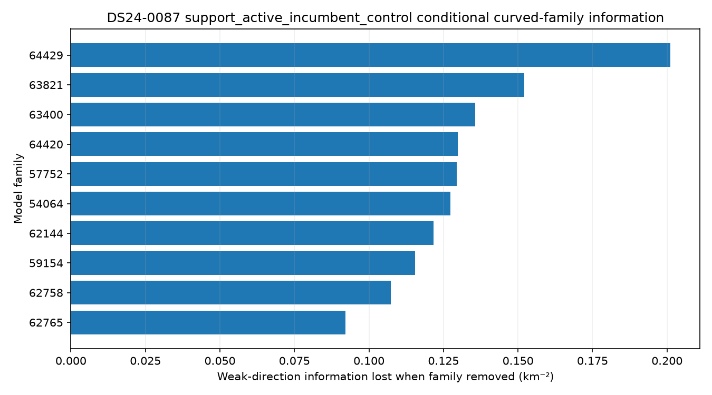

0095 is a clear counterexample to treating a smaller local model ellipse or
more associated GLRT points as proof of better localization. The experiment
does not yet distinguish a wrong emitter assignment from an inadequate
orbit/phase/receiver model or miscalibrated uncertainty for family 65500. It
does show that the present compatibility gates and conditional information
diagnostics do not prevent this particular harmful addition.

## 4. Execution, repairs and independent checks

The movement run completed **144 / 144 jobs, 576 training fits, 1,152 crossover
vectors and 3,456 noise-scale scores** in 791.42 s. Two initial workers expanded
to six using only the frozen CPU/RAM rule; every numerical worker used one
BLAS/OMP/MKL thread. Maximum job duration was 165.57 s and peak job RSS was
1,500,676 KiB. There were no runtime failures, timeouts or retries. Statistical
convergence requirements still failed for five training fits across scans
0015, 0075 and 0095; these failures were preserved and triggered policy fallback
where applicable. Maximum fixed-position phase change was 0.002648 s and maximum
Gamma log-precision change was 9.995e−6. No convergence budget was extended.

Recovery retained the 600 s graph and 240 s support caps per scan and the
1,800 s overall pilot cap. Its original near-feasible constrained rescue was
allowed only by its inherited rule and recorded separately. Active scientific
runtime, including the repeated support attempts below, was **158.407 s**;
wall time through repaired support completion was 412.277 s. No graph fit was
repeated and no new RF or IQ processing was performed.

Three versioned technical/reporting corrections are part of the record:

1. **Support replay (`repair01`).** The fitter protected the original incumbent
   modes correctly, but the initial reader recomputed that set from augmented
   membership and replayed a different model. The first support pair on each
   scan was not checkpointed before that error. Those original failures and
   timings remain; the missing initial endpoints are a provenance limitation.
   Before repeating only the frozen support proposals, the independent auditor
   verified exact objective/design agreement in all eight case/proposal/arm
   contexts. Repeated fits checkpoint before replay and count previous runtime
   against the original caps. No graph fits or scientific thresholds changed.
2. **Eligibility semantics (`eligibility02`).** The strict checker incorrectly
   required dormant nominee coordinates to survive the control intended to
   disable them. A symmetric no-refit correction checks
   `parent.supported ∩ original_protected`, preserves all active incumbent
   definitions and IDs, and permits disabling shape modes only for newly active
   one-owner families. All four support trials were rechecked before geographic
   evaluation. The strict-control baseline outcomes and corrected results both
   remain in the tables; the change is not hidden as an ordinary successful run.
3. **CFO presentation (`report_native03`).** The first DBG01 rendering mixed
   native scatter with alias-wrapped source lines. Corrected plots map source
   IDs directly to native CFO/time. All 15,749 plotted observations independently
   match with zero coordinate discrepancy. The six superseded plots remain
   marked as provenance and are not the primary figures in this report.

Independent audit receipts establish:

| Check | Result | Receipt |
| --- | --- | --- |
| Frozen population and inputs | 34 ledger rows, 24 eligible, 10 unavailable; original dirty workspace preserved | [Wave 0](audit/wave0.json) |
| Partitions and source closure | All 48 case/seed partitions independently reconstructed; 369 movement source bindings | [Launch approval](audit/movement_launch_approval.json) |
| Held Gaussian scores and decisions | All 3,456 scores replayed by an independent SVD calculation; maximum difference 2.47e−10; all decisions/fallbacks agree | [Movement audit](audit/movement_artifacts.json) |
| Recovery fits and gates | Ordinary/rescued graph fits and repaired support trials replay; maximum objective difference zero; parent ID and active-mode protection verified | [Recovery audit](audit/recovery_artifacts.json) |
| Native figures | 15,749 source observations; zero CFO/time discrepancy | [Plot audit](audit/native_plot_audit.json) |
| Geographic tables | 1,484 numeric cells verified; independent spherical distance differs by at most 9.86e−13 km | [Reporting audit](audit/reporting_audit.json) |

Movement's 13 owned tests plus the independent dense-score oracle pass. Recovery's
26 inference/adapter and two native-report tests pass; targeted geographic
reporting tests also pass. These are overlapping component receipts, not a
claim of one newly authored aggregate test suite. No golden fixtures or
production components were changed.

## 5. Decision and next useful investigation

Keep the current baseline and retain these candidates as research results.
Do not loosen the movement gate or choose seeds to recover the favorable 0017
example. The new partitions are evidence against treating the earlier
two-example witness as a reliable selector. No automatic cohort-wide recovery
expansion or receiver/recovery combination follows from this pilot.

The most informative next bounded investigation is the 0095 family-65500
addition: separate identity uncertainty, causal orbital/phase mismatch and
receiver-model sensitivity while preserving all incumbent observations and
matched c arms. Compare the new family's nuisance-projected position pull
against the incumbent families, and test whether any available independent
owner evidence supports its identity and correction. Prespecify such tests
from RF evidence; use GPS only for the final evaluation. An RF-valid explanation
that survives those controls is more valuable than a higher association count.
This is a recommended followup, not a completed diagnosis or a launched batch.

For receiver selection, any future alternative should explicitly address the
conditional nature and partition sensitivity of the present score. The saved
design/prior/posterior arrays permit a separately frozen training-only-noise or
shared heavy-tail predictive study. This result does not justify tuning that
study to these known geographic outcomes. IQ/sample-rate or receiver-geometry
causality was not tested here, so neither is ruled in or out as a bottleneck.

## Reproduction and publication contents

The source experiment root is
`/srv/bulk/leo/research/ds24-movement-policy-r01`. Scientific artifacts remain
immutable there. The published package contains this report, figures, tables,
complete policy and recovery results, audit receipts, exact research sources
and a hash-addressed snapshot of the actual runtime source closure. Three
already-dirty imported repository files are included only as research source
snapshots; production paths and unrelated working-tree changes are untouched.

Large raw arrays are preserved as separately checksummed release assets, not
silently omitted. The [publication index](publication_index.json) records the
exact file mapping, archive membership and hashes;
[RESTORE.md](RESTORE.md) provides restore instructions. These include the shared
covariance designs and prior/posterior quantities needed to audit the held
predictive score. The broad source inventory remains for provenance, while
the copied source capsule follows actual imports rather than every unused
file encountered during discovery. Original absolute input paths describe the
research environment; a checkout alone does not provide the radio corpus.

Useful starting points are [protocol.json](protocol.json),
[movement protocol](movement/protocol.json),
[movement scientific seal](movement/scientific_seal.json),
[recovery findings and artifact guide](recovery/FINDINGS.md),
[geographic seal](evaluation/seal.json),
[full summaries](evaluation/summary.json) and
[per-scan positions](evaluation/positions.csv).
